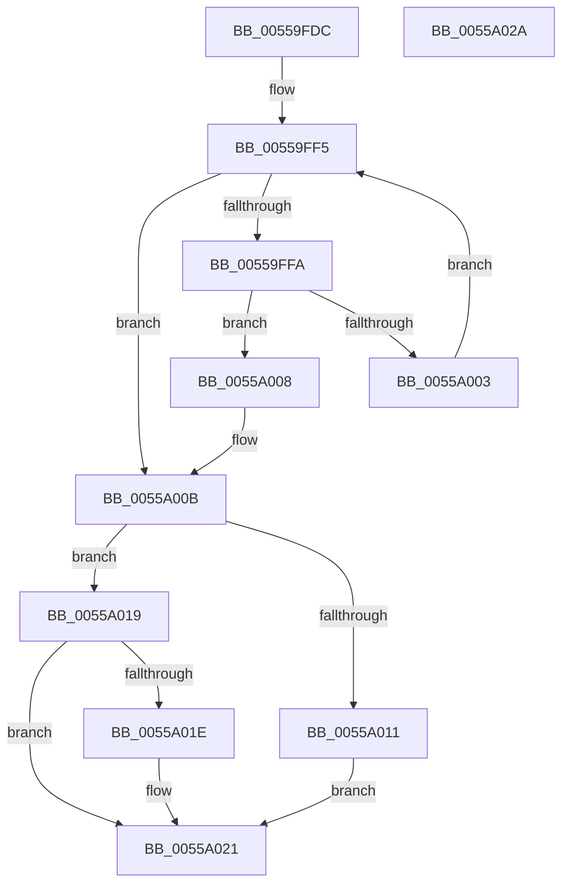

# HalpNumaSystemLocalityInfoFindTargetIndex

- RVA: `0x00559FDC`–`0x0055A02B` (길이 `79` bytes)
- VA: `0x0000000140559FDC`
- 실행 섹션: `.text`
- PDB 이름 있음: `예`; PDB Function 태그: `아니요`
- unwind 정보 RVA: `0x00071750`
- 디코드: `26`개 명령, `79/79` bytes 표시
- 미해석 바이트: `0` (있으면 어셈블리에 `.byte`로 보존)

> 이 문서는 커널 이미지의 기계어와 PDB 기호를 분석해 생성했습니다. 4번과 5번은 함수 원형과 자료형을 바이너리 사용 방식에서 추정한 C 해석이며 원본 소스 복구 결과는 아닙니다.

## 1. Dependencies

- 직접 호출 지점: **0**; 고유 호출 대상: **0**
- 직접 호출자로 확인된 함수: **1**
- RIP 상대 이미지 참조: **0**

### Outgoing calls
- 직접 디코드된 call 명령이 없습니다.

### Direct callers
- [HalpNumaQuerySystemLocalityLatencyAndBandwidthInfo](HalpNumaQuerySystemLocalityLatencyAndBandwidthInfo_function_005597E0.md) at `0x00559942`
- [HalpNumaQuerySystemLocalityLatencyAndBandwidthInfo](HalpNumaQuerySystemLocalityLatencyAndBandwidthInfo_function_005597E0.md) at `0x00559982`
- [HalpNumaQuerySystemLocalityLatencyAndBandwidthInfo](HalpNumaQuerySystemLocalityLatencyAndBandwidthInfo_function_005597E0.md) at `0x00559B5B`
- [HalpNumaQuerySystemLocalityLatencyAndBandwidthInfo](HalpNumaQuerySystemLocalityLatencyAndBandwidthInfo_function_005597E0.md) at `0x00559B8A`
- [HalpNumaQuerySystemLocalityLatencyAndBandwidthInfo](HalpNumaQuerySystemLocalityLatencyAndBandwidthInfo_function_005597E0.md) at `0x00559BB7`

### Static image references
- 디코드된 RIP-relative 메모리 참조가 없습니다.

## 2. Other-region calls and transfers

- 다른 실행 섹션으로 향하는 call: **0**
- 별도 외부 분기/꼬리 이동을 확인하지 못했습니다.

## 3. Assembly (complete function range)

```asm
00559FDC  48 89 5C 24 08                  mov qword ptr [rsp + 8], rbx
00559FE1  8B 41 0C                        mov eax, dword ptr [rcx + 0xc]
00559FE4  41 83 CB FF                     or r11d, 0xffffffff
00559FE8  45 33 D2                        xor r10d, r10d
00559FEB  45 8B CA                        mov r9d, r10d
00559FEE  48 8D 1C 81                     lea rbx, [rcx + rax*4]
00559FF2  8B 49 10                        mov ecx, dword ptr [rcx + 0x10]
00559FF5  44 3B C9                        cmp r9d, ecx
00559FF8  73 11                           jae 0x14055a00b
00559FFA  41 8B C1                        mov eax, r9d
00559FFD  39 54 83 20                     cmp dword ptr [rbx + rax*4 + 0x20], edx
0055A001  74 05                           je 0x14055a008
0055A003  41 FF C1                        inc r9d
0055A006  EB ED                           jmp 0x140559ff5
0055A008  45 8B D9                        mov r11d, r9d
0055A00B  41 83 FB FF                     cmp r11d, -1
0055A00F  75 08                           jne 0x14055a019
0055A011  41 BA 25 02 00 C0               mov r10d, 0xc0000225
0055A017  EB 08                           jmp 0x14055a021
0055A019  4D 85 C0                        test r8, r8
0055A01C  74 03                           je 0x14055a021
0055A01E  45 89 18                        mov dword ptr [r8], r11d
0055A021  48 8B 5C 24 08                  mov rbx, qword ptr [rsp + 8]
0055A026  41 8B C2                        mov eax, r10d
0055A029  C3                              ret
0055A02A  CC                              int3
```

## 4. C-style interpretation (structured pseudocode)

```c
__int64 __fastcall HalpNumaSystemLocalityInfoFindTargetIndex(__int64 a1, int a2, __int64 a3)
{
    __int64 v_r10;
    __int64 v_r11;
    unsigned __int64 v_stack_p8;

    v_stack_p8 = v_rbx;
    v_r11 = (unsigned int)((v_r11) | (0xFFFFFFFFULL));
    v_r10 = 0;
loc_00559FF5:
    if (0 >= ((unsigned int)((unsigned int)(*(unsigned int *)(a1 + 16))))) goto loc_0055A00B;
    if ((*(unsigned int *)(a1 + (unsigned int)(*(unsigned int *)(a1 + 12)) * 4 + 0 * 4 + 32)) == a2) goto loc_0055A008;
    a4 = (unsigned int)((0) + 1);
    goto loc_00559FF5;
loc_0055A008:
loc_0055A00B:
    if (((unsigned int)((unsigned int)((unsigned int)(a4)))) != -1) goto loc_0055A019;
    goto loc_0055A021;
loc_0055A019:
    if (a3 != 0) {
        *(unsigned int *)(a3) = (unsigned int)((unsigned int)((unsigned int)(a4)));
    }
    return (unsigned int)((unsigned int)((unsigned int)(0xC0000225ULL)));
}
```

## 5. (Beta) C Style

```c
int64_t HalpNumaSystemLocalityInfoFindTargetIndex(void *Arg1, int32_t Arg2, int64_t Arg3)
{
    uint8_t *arg1 = (uint8_t *)Arg1;

    int64_t local_r10;
    int64_t local_r11;
    uint64_t v_stack_p8;

    v_stack_p8 = local_rbx;
    local_r11 = (uint32_t)((local_r11) | (0xFFFFFFFFULL));
    local_r10 = 0;
loc_00559FF5:
    if (0 >= ((uint32_t)((uint32_t)(*(uint32_t *)(arg1 + 0x10))))) goto loc_0055A00B;
    if ((*(uint32_t *)(arg1 + (uint32_t)(*(uint32_t *)(arg1 + 0xC)) * 4 + 0x0 * 4 + 0x20)) == Arg2) goto loc_0055A008;
    a4 = (uint32_t)((0) + 1);
    goto loc_00559FF5;
loc_0055A008:
loc_0055A00B:
    if (((uint32_t)((uint32_t)((uint32_t)(a4)))) != -1) goto loc_0055A019;
    goto loc_0055A021;
loc_0055A019:
    if (Arg3 != 0) {
        *(uint32_t *)(Arg3) = (uint32_t)((uint32_t)((uint32_t)(a4)));
    }
    return (uint32_t)((uint32_t)((uint32_t)(0xC0000225ULL)));
}
```

### 관측된 메모리 오프셋

구조체 형식이 확인되지 않은 접근은 인자 기준의 오프셋으로만 기록했습니다.

| 기준 인자 | 오프셋 표현 | 폭 (bit) | 접근 |
|---|---:|---:|---|
| `Arg1` | `+ 0x0 + rax*4` | `64` | `R` |
| `Arg1` | `+ 0xC` | `32` | `R` |
| `Arg1` | `+ 0x10` | `32` | `R` |
| `Arg1` | `+ 0x20 + rax*4` | `32` | `R` |

## 6. Execution-region graph

[열기: 2D/3D 그래프와 함수 탐색 컨트롤 패널](../../../control-panel.html?section=text&rva=0x00559FDC&view=graph)

- 2D 그래프는 위에서 아래로 흐르고, 3D 그래프는 빈 공간을 드래그해 회전합니다. Shift+드래그는 이동, 휠은 확대·축소, 함수 노드 선택은 대상 보고서 이동입니다.

### Static fallback


