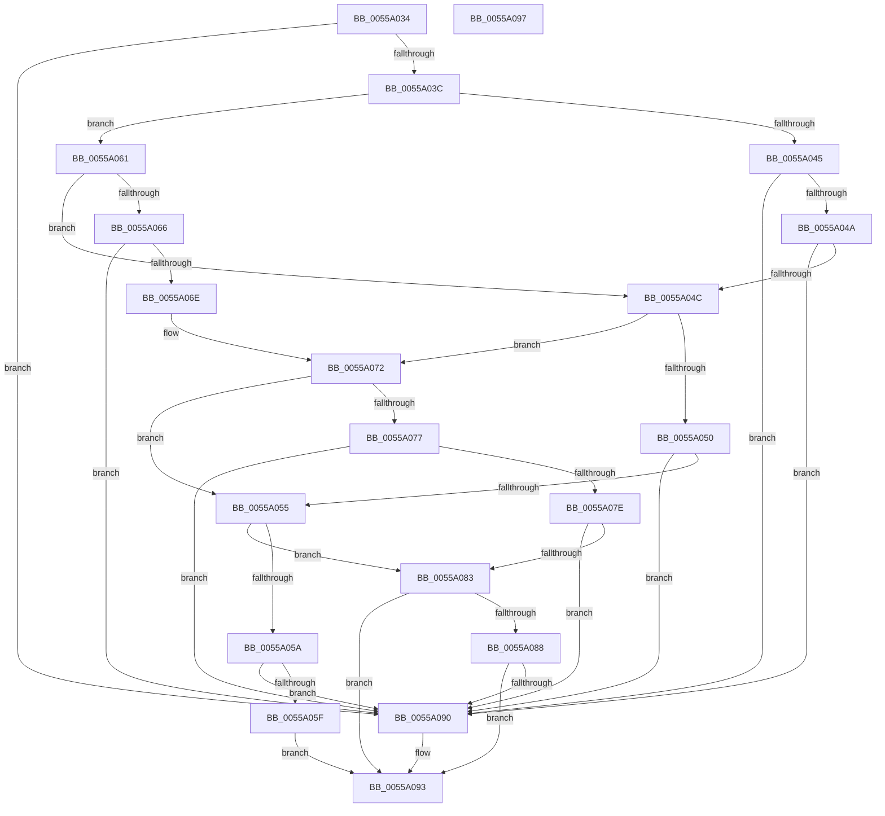

# HalpNumaSystemLocalityInfoIncludeQueryDataType

- RVA: `0x0055A034`–`0x0055A098` (길이 `100` bytes)
- VA: `0x000000014055A034`
- 실행 섹션: `.text`
- PDB 이름 있음: `예`; PDB Function 태그: `아니요`
- unwind 정보 RVA: `0x000DB714`
- 디코드: `42`개 명령, `100/100` bytes 표시
- 미해석 바이트: `0` (있으면 어셈블리에 `.byte`로 보존)

> 이 문서는 커널 이미지의 기계어와 PDB 기호를 분석해 생성했습니다. 4번과 5번은 함수 원형과 자료형을 바이너리 사용 방식에서 추정한 C 해석이며 원본 소스 복구 결과는 아닙니다.

## 1. Dependencies

- 직접 호출 지점: **0**; 고유 호출 대상: **0**
- 직접 호출자로 확인된 함수: **1**
- RIP 상대 이미지 참조: **0**

### Outgoing calls
- 직접 디코드된 call 명령이 없습니다.

### Direct callers
- [HalpNumaQuerySystemLocalityLatencyAndBandwidthInfo](HalpNumaQuerySystemLocalityLatencyAndBandwidthInfo_function_005597E0.md) at `0x00559918`
- [HalpNumaQuerySystemLocalityLatencyAndBandwidthInfo](HalpNumaQuerySystemLocalityLatencyAndBandwidthInfo_function_005597E0.md) at `0x00559A61`

### Static image references
- 디코드된 RIP-relative 메모리 참조가 없습니다.

## 2. Other-region calls and transfers

- 다른 실행 섹션으로 향하는 call: **0**
- 별도 외부 분기/꼬리 이동을 확인하지 못했습니다.

## 3. Assembly (complete function range)

```asm
0055A034  45 33 C0                        xor r8d, r8d
0055A037  83 FA 06                        cmp edx, 6
0055A03A  74 54                           je 0x14055a090
0055A03C  48 8D 41 09                     lea rax, [rcx + 9]
0055A040  83 FA 04                        cmp edx, 4
0055A043  75 1C                           jne 0x14055a061
0055A045  80 38 02                        cmp byte ptr [rax], 2
0055A048  72 46                           jb 0x14055a090
0055A04A  74 44                           je 0x14055a090
0055A04C  85 D2                           test edx, edx
0055A04E  75 22                           jne 0x14055a072
0055A050  80 38 02                        cmp byte ptr [rax], 2
0055A053  72 3B                           jb 0x14055a090
0055A055  83 FA 02                        cmp edx, 2
0055A058  75 29                           jne 0x14055a083
0055A05A  F6 00 FD                        test byte ptr [rax], 0xfd
0055A05D  74 31                           je 0x14055a090
0055A05F  EB 32                           jmp 0x14055a093
0055A061  83 FA 05                        cmp edx, 5
0055A064  75 E6                           jne 0x14055a04c
0055A066  8A 00                           mov al, byte ptr [rax]
0055A068  2C 03                           sub al, 3
0055A06A  3C 02                           cmp al, 2
0055A06C  76 22                           jbe 0x14055a090
0055A06E  48 8D 41 09                     lea rax, [rcx + 9]
0055A072  83 FA 01                        cmp edx, 1
0055A075  75 DE                           jne 0x14055a055
0055A077  8A 08                           mov cl, byte ptr [rax]
0055A079  80 F9 03                        cmp cl, 3
0055A07C  74 12                           je 0x14055a090
0055A07E  80 F9 04                        cmp cl, 4
0055A081  74 0D                           je 0x14055a090
0055A083  83 FA 03                        cmp edx, 3
0055A086  75 0B                           jne 0x14055a093
0055A088  8A 00                           mov al, byte ptr [rax]
0055A08A  FE C8                           dec al
0055A08C  A8 FD                           test al, 0xfd
0055A08E  75 03                           jne 0x14055a093
0055A090  41 B0 01                        mov r8b, 1
0055A093  41 8A C0                        mov al, r8b
0055A096  C3                              ret
0055A097  CC                              int3
```

## 4. C-style interpretation (structured pseudocode)

```c
__int64 __fastcall HalpNumaSystemLocalityInfoIncludeQueryDataType(__int64 a1, int a2, int a3)
{
    __int64 result;

    a3 = 0;
    if (a2 == 6) goto loc_0055A090;
    if (a2 != 4) goto loc_0055A061;
    if ((*(unsigned __int8 *)(a1 + 9)) < 2) goto loc_0055A090;
    if ((*(unsigned __int8 *)(a1 + 9)) == 2) goto loc_0055A090;
loc_0055A04C:
    if (a2 != 0) goto loc_0055A072;
    if ((*(unsigned __int8 *)(a1 + 9)) < 2) goto loc_0055A090;
loc_0055A055:
    if (a2 != 2) goto loc_0055A083;
    if (((*(unsigned __int8 *)(a1 + 9)) & (253)) == 0) goto loc_0055A090;
    goto loc_0055A093;
loc_0055A061:
    if (a2 != 5) goto loc_0055A04C;
    result = (unsigned __int8)((*(unsigned __int8 *)(a1 + 9)) - (3));
    if (((unsigned __int8)(result)) <= 2) goto loc_0055A090;
loc_0055A072:
    if (a2 != 1) goto loc_0055A055;
    if (((unsigned __int8)(*(unsigned __int8 *)(a1 + 9))) == 3) goto loc_0055A090;
    if (((unsigned __int8)(*(unsigned __int8 *)(a1 + 9))) == 4) goto loc_0055A090;
loc_0055A083:
    if (a2 != 3) goto loc_0055A093;
    result = (unsigned __int8)((*(unsigned __int8 *)(a1 + 9)) - 1);
    if ((((unsigned __int8)(result)) & (253)) == 0) {
        a3 = 1;
    }
    return (unsigned __int8)(a3);
}
```

## 5. (Beta) C Style

```c
int64_t HalpNumaSystemLocalityInfoIncludeQueryDataType(void *Arg1, int32_t Arg2, int32_t Arg3)
{
    uint8_t *arg1 = (uint8_t *)Arg1;

    int64_t result;

    Arg3 = 0;
    if (Arg2 == 6) goto loc_0055A090;
    if (Arg2 != 4) goto loc_0055A061;
    if ((*(uint8_t *)(arg1 + 0x9)) < 2) goto loc_0055A090;
    if ((*(uint8_t *)(arg1 + 0x9)) == 2) goto loc_0055A090;
loc_0055A04C:
    if (Arg2 != 0) goto loc_0055A072;
    if ((*(uint8_t *)(arg1 + 0x9)) < 2) goto loc_0055A090;
loc_0055A055:
    if (Arg2 != 2) goto loc_0055A083;
    if (((*(uint8_t *)(arg1 + 0x9)) & (253)) == 0) goto loc_0055A090;
    goto loc_0055A093;
loc_0055A061:
    if (Arg2 != 5) goto loc_0055A04C;
    result = (uint8_t)((*(uint8_t *)(arg1 + 0x9)) - (3));
    if (((uint8_t)(result)) <= 2) goto loc_0055A090;
loc_0055A072:
    if (Arg2 != 1) goto loc_0055A055;
    if (((uint8_t)(*(uint8_t *)(arg1 + 0x9))) == 3) goto loc_0055A090;
    if (((uint8_t)(*(uint8_t *)(arg1 + 0x9))) == 4) goto loc_0055A090;
loc_0055A083:
    if (Arg2 != 3) goto loc_0055A093;
    result = (uint8_t)((*(uint8_t *)(arg1 + 0x9)) - 1);
    if ((((uint8_t)(result)) & (253)) == 0) {
        Arg3 = 1;
    }
    return (uint8_t)(Arg3);
}
```

### 관측된 메모리 오프셋

구조체 형식이 확인되지 않은 접근은 인자 기준의 오프셋으로만 기록했습니다.

| 기준 인자 | 오프셋 표현 | 폭 (bit) | 접근 |
|---|---:|---:|---|
| `Arg1` | `+ 0x0` | `8` | `R` |
| `Arg1` | `+ 0x9` | `64` | `R` |

## 6. Execution-region graph

[열기: 2D/3D 그래프와 함수 탐색 컨트롤 패널](../../../control-panel.html?section=text&rva=0x0055A034&view=graph)

- 2D 그래프는 위에서 아래로 흐르고, 3D 그래프는 빈 공간을 드래그해 회전합니다. Shift+드래그는 이동, 휠은 확대·축소, 함수 노드 선택은 대상 보고서 이동입니다.

### Static fallback


