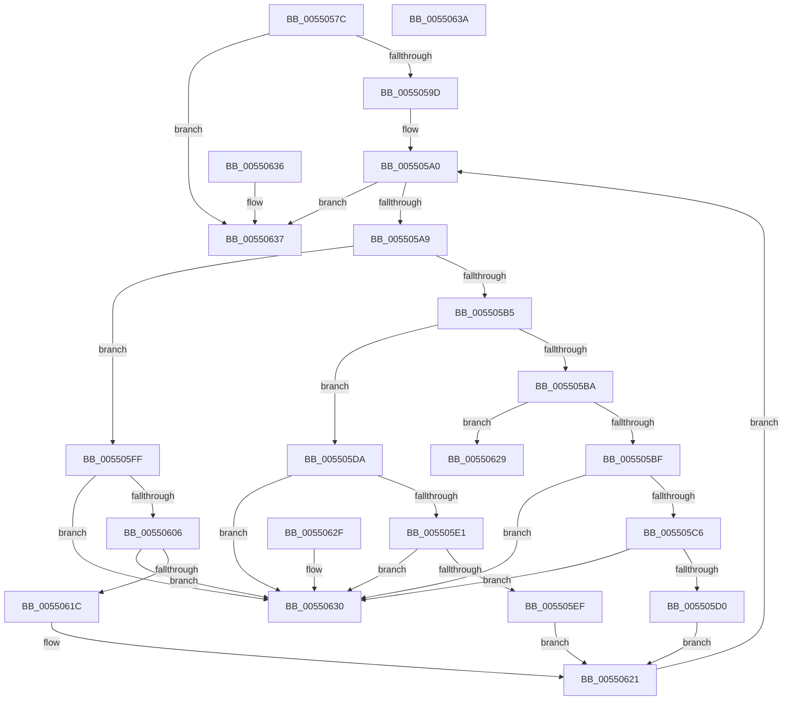

# HalpParseCommonBufferExtendedConfigurations

- RVA: `0x0055057C`–`0x0055063B` (길이 `191` bytes)
- VA: `0x000000014055057C`
- 실행 섹션: `.text`
- PDB 이름 있음: `예`; PDB Function 태그: `아니요`
- unwind 정보 RVA: `0x000DB714`
- 디코드: `58`개 명령, `191/191` bytes 표시
- 미해석 바이트: `0` (있으면 어셈블리에 `.byte`로 보존)

> 이 문서는 커널 이미지의 기계어와 PDB 기호를 분석해 생성했습니다. 4번과 5번은 함수 원형과 자료형을 바이너리 사용 방식에서 추정한 C 해석이며 원본 소스 복구 결과는 아닙니다.

## 1. Dependencies

- 직접 호출 지점: **0**; 고유 호출 대상: **0**
- 직접 호출자로 확인된 함수: **1**
- RIP 상대 이미지 참조: **0**

### Outgoing calls
- 직접 디코드된 call 명령이 없습니다.

### Direct callers
- [HalpCreateCommonBufferFromMdlVerifyParams](HalpCreateCommonBufferFromMdlVerifyParams_function_00550478.md) at `0x005504AA`

### Static image references
- 디코드된 RIP-relative 메모리 참조가 없습니다.

## 2. Other-region calls and transfers

- 다른 실행 섹션으로 향하는 call: **0**
- 별도 외부 분기/꼬리 이동을 확인하지 못했습니다.

## 3. Assembly (complete function range)

```asm
0055057C  0F 57 C0                        xorps xmm0, xmm0
0055057F  33 C0                           xor eax, eax
00550581  44 8B DA                        mov r11d, edx
00550584  4C 8B C9                        mov r9, rcx
00550587  41 0F 11 00                     movups xmmword ptr [r8], xmm0
0055058B  41 0F 11 40 10                  movups xmmword ptr [r8 + 0x10], xmm0
00550590  49 89 40 20                     mov qword ptr [r8 + 0x20], rax
00550594  48 85 C9                        test rcx, rcx
00550597  0F 84 9A 00 00 00               je 0x140550637
0055059D  45 33 D2                        xor r10d, r10d
005505A0  45 3B D3                        cmp r10d, r11d
005505A3  0F 83 8E 00 00 00               jae 0x140550637
005505A9  4B 8D 14 92                     lea rdx, [r10 + r10*4]
005505AD  41 8B 0C D1                     mov ecx, dword ptr [r9 + rdx*8]
005505B1  85 C9                           test ecx, ecx
005505B3  74 4A                           je 0x1405505ff
005505B5  83 E9 01                        sub ecx, 1
005505B8  74 20                           je 0x1405505da
005505BA  83 F9 01                        cmp ecx, 1
005505BD  75 6A                           jne 0x140550629
005505BF  41 80 78 26 00                  cmp byte ptr [r8 + 0x26], 0
005505C4  75 6A                           jne 0x140550630
005505C6  41 8B 44 D1 08                  mov eax, dword ptr [r9 + rdx*8 + 8]
005505CB  83 F8 03                        cmp eax, 3
005505CE  7D 60                           jge 0x140550630
005505D0  41 89 40 20                     mov dword ptr [r8 + 0x20], eax
005505D4  41 88 48 26                     mov byte ptr [r8 + 0x26], cl
005505D8  EB 47                           jmp 0x140550621
005505DA  41 80 78 25 00                  cmp byte ptr [r8 + 0x25], 0
005505DF  75 4F                           jne 0x140550630
005505E1  41 8B 44 D1 10                  mov eax, dword ptr [r9 + rdx*8 + 0x10]
005505E6  49 89 40 10                     mov qword ptr [r8 + 0x10], rax
005505EA  48 85 C0                        test rax, rax
005505ED  74 41                           je 0x140550630
005505EF  49 8B 44 D1 08                  mov rax, qword ptr [r9 + rdx*8 + 8]
005505F4  49 89 40 18                     mov qword ptr [r8 + 0x18], rax
005505F8  41 C6 40 25 01                  mov byte ptr [r8 + 0x25], 1
005505FD  EB 22                           jmp 0x140550621
005505FF  41 80 78 24 00                  cmp byte ptr [r8 + 0x24], 0
00550604  75 2A                           jne 0x140550630
00550606  49 8B 4C D1 08                  mov rcx, qword ptr [r9 + rdx*8 + 8]
0055060B  49 89 08                        mov qword ptr [r8], rcx
0055060E  49 8B 44 D1 10                  mov rax, qword ptr [r9 + rdx*8 + 0x10]
00550613  49 89 40 08                     mov qword ptr [r8 + 8], rax
00550617  48 3B C8                        cmp rcx, rax
0055061A  73 14                           jae 0x140550630
0055061C  41 C6 40 24 01                  mov byte ptr [r8 + 0x24], 1
00550621  41 FF C2                        inc r10d
00550624  E9 77 FF FF FF                  jmp 0x1405505a0
00550629  B8 BB 00 00 C0                  mov eax, 0xc00000bb
0055062E  C3                              ret
0055062F  CC                              int3
00550630  B8 0D 00 00 C0                  mov eax, 0xc000000d
00550635  C3                              ret
00550636  CC                              int3
00550637  33 C0                           xor eax, eax
00550639  C3                              ret
0055063A  CC                              int3
```

## 4. C-style interpretation (structured pseudocode)

```c
__int64 __fastcall HalpParseCommonBufferExtendedConfigurations(__int64 a1, int a2, __int64 a3)
{
    __int64 result;
    __int64 v_r10;

    result = 0;
    *(unsigned __int64 *)(a3) = v_xmm0;
    *(unsigned __int64 *)(a3 + 16) = v_xmm0;
    *(unsigned __int64 *)(a3 + 32) = 0;
    if (a1 == 0) goto loc_00550637;
    v_r10 = 0;
loc_005505A0:
    if (0 >= ((unsigned int)((unsigned int)(a2)))) goto loc_00550637;
    if ((unsigned int)((unsigned int)(*(unsigned int *)(a1 + v_r10 + v_r10 * 4 * 8))) == 0) goto loc_005505FF;
    a1 = (unsigned int)(((unsigned int)(*(unsigned int *)(a1 + v_r10 + v_r10 * 4 * 8))) - (1));
    if (condition_is_equal) goto loc_005505DA;
    if (((unsigned int)(a1)) != 1) goto loc_00550629;
    if ((*(unsigned __int8 *)(a3 + 38)) != 0) goto loc_00550630;
    if (((unsigned int)((unsigned int)(*(unsigned int *)(a1 + v_r10 + v_r10 * 4 * 8 + 8)))) >= 3) goto loc_00550630;
    *(unsigned int *)(a3 + 32) = (unsigned int)((unsigned int)(*(unsigned int *)(a1 + v_r10 + v_r10 * 4 * 8 + 8)));
    *(unsigned __int8 *)(a3 + 38) = (unsigned __int8)(a1);
    goto loc_00550621;
loc_005505DA:
    if ((*(unsigned __int8 *)(a3 + 37)) != 0) goto loc_00550630;
    *(unsigned __int64 *)(a3 + 16) = (unsigned int)(*(unsigned int *)(a1 + v_r10 + v_r10 * 4 * 8 + 16));
    if ((unsigned int)(*(unsigned int *)(a1 + v_r10 + v_r10 * 4 * 8 + 16)) == 0) goto loc_00550630;
    *(unsigned __int64 *)(a3 + 24) = *(unsigned __int64 *)(a1 + v_r10 + v_r10 * 4 * 8 + 8);
    *(unsigned __int8 *)(a3 + 37) = 1;
    goto loc_00550621;
loc_005505FF:
    if ((*(unsigned __int8 *)(a3 + 36)) != 0) goto loc_00550630;
    *(unsigned __int64 *)(a3) = *(unsigned __int64 *)(a1 + v_r10 + v_r10 * 4 * 8 + 8);
    *(unsigned __int64 *)(a3 + 8) = *(unsigned __int64 *)(a1 + v_r10 + v_r10 * 4 * 8 + 16);
    if ((*(unsigned __int64 *)(a1 + v_r10 + v_r10 * 4 * 8 + 8)) >= (*(unsigned __int64 *)(a1 + v_r10 + v_r10 * 4 * 8 + 16))) goto loc_00550630;
    *(unsigned __int8 *)(a3 + 36) = 1;
loc_00550621:
    v_r10 = (unsigned int)((v_r10) + 1);
    goto loc_005505A0;
loc_00550629:
    return (unsigned int)(0xC00000BBULL);
loc_00550630:
    return (unsigned int)(0xC000000DULL);
loc_00550637:
    result = 0;
    return result;
}
```

## 5. (Beta) C Style

```c
int64_t HalpParseCommonBufferExtendedConfigurations(void *Arg1, int32_t Arg2, void *Arg3)
{
    uint8_t *arg1 = (uint8_t *)Arg1;
    uint8_t *arg3 = (uint8_t *)Arg3;

    int64_t result;
    int64_t local_r10;

    result = 0;
    *(uint64_t *)(arg3) = v_xmm0;
    *(uint64_t *)(arg3 + 0x10) = v_xmm0;
    *(uint64_t *)(arg3 + 0x20) = 0;
    if (Arg1 == NULL) goto loc_00550637;
    local_r10 = 0;
loc_005505A0:
    if (0 >= ((uint32_t)((uint32_t)(Arg2)))) goto loc_00550637;
    if ((uint32_t)((uint32_t)(*(uint32_t *)(arg1 + local_r10 + local_r10 * 4 * 8))) == 0) goto loc_005505FF;
    Arg1 = (uint32_t)(((uint32_t)(*(uint32_t *)(arg1 + local_r10 + local_r10 * 4 * 8))) - (1));
    if (condition_is_equal) goto loc_005505DA;
    if (((uint32_t)(Arg1)) != 1) goto loc_00550629;
    if ((*(uint8_t *)(arg3 + 0x26)) != 0) goto loc_00550630;
    if (((uint32_t)((uint32_t)(*(uint32_t *)(arg1 + local_r10 + local_r10 * 4 * 8 + 0x8)))) >= 3) goto loc_00550630;
    *(uint32_t *)(arg3 + 0x20) = (uint32_t)((uint32_t)(*(uint32_t *)(arg1 + local_r10 + local_r10 * 4 * 8 + 0x8)));
    *(uint8_t *)(arg3 + 0x26) = (uint8_t)(Arg1);
    goto loc_00550621;
loc_005505DA:
    if ((*(uint8_t *)(arg3 + 0x25)) != 0) goto loc_00550630;
    *(uint64_t *)(arg3 + 0x10) = (uint32_t)(*(uint32_t *)(arg1 + local_r10 + local_r10 * 4 * 8 + 0x10));
    if ((uint32_t)(*(uint32_t *)(arg1 + local_r10 + local_r10 * 4 * 8 + 0x10)) == 0) goto loc_00550630;
    *(uint64_t *)(arg3 + 0x18) = *(uint64_t *)(arg1 + local_r10 + local_r10 * 4 * 8 + 0x8);
    *(uint8_t *)(arg3 + 0x25) = 1;
    goto loc_00550621;
loc_005505FF:
    if ((*(uint8_t *)(arg3 + 0x24)) != 0) goto loc_00550630;
    *(uint64_t *)(arg3) = *(uint64_t *)(arg1 + local_r10 + local_r10 * 4 * 8 + 0x8);
    *(uint64_t *)(arg3 + 0x8) = *(uint64_t *)(arg1 + local_r10 + local_r10 * 4 * 8 + 0x10);
    if ((*(uint64_t *)(arg1 + local_r10 + local_r10 * 4 * 8 + 0x8)) >= (*(uint64_t *)(arg1 + local_r10 + local_r10 * 4 * 8 + 0x10))) goto loc_00550630;
    *(uint8_t *)(arg3 + 0x24) = 1;
loc_00550621:
    local_r10 = (uint32_t)((local_r10) + 1);
    goto loc_005505A0;
loc_00550629:
    return (uint32_t)(0xC00000BBULL);
loc_00550630:
    return (uint32_t)(0xC000000DULL);
loc_00550637:
    result = 0;
    return result;
}
```

### 관측된 메모리 오프셋

구조체 형식이 확인되지 않은 접근은 인자 기준의 오프셋으로만 기록했습니다.

| 기준 인자 | 오프셋 표현 | 폭 (bit) | 접근 |
|---|---:|---:|---|
| `Arg1` | `+ 0x0 + rdx*8` | `32` | `R` |
| `Arg1` | `+ 0x8 + rdx*8` | `32` | `R` |
| `Arg1` | `+ 0x8 + rdx*8` | `64` | `R` |
| `Arg1` | `+ 0x10 + rdx*8` | `32` | `R` |
| `Arg1` | `+ 0x10 + rdx*8` | `64` | `R` |
| `Arg3` | `+ 0x0` | `64` | `W` |
| `Arg3` | `+ 0x0` | `128` | `R` |
| `Arg3` | `+ 0x8` | `64` | `W` |
| `Arg3` | `+ 0x10` | `64` | `W` |
| `Arg3` | `+ 0x10` | `128` | `R` |
| `Arg3` | `+ 0x18` | `64` | `W` |
| `Arg3` | `+ 0x20` | `32` | `W` |
| `Arg3` | `+ 0x20` | `64` | `W` |
| `Arg3` | `+ 0x24` | `8` | `R` |
| `Arg3` | `+ 0x24` | `8` | `W` |
| `Arg3` | `+ 0x25` | `8` | `R` |
| `Arg3` | `+ 0x25` | `8` | `W` |
| `Arg3` | `+ 0x26` | `8` | `R` |
| `Arg3` | `+ 0x26` | `8` | `W` |

## 6. Execution-region graph

[열기: 2D/3D 그래프와 함수 탐색 컨트롤 패널](../../../control-panel.html?section=text&rva=0x0055057C&view=graph)

- 2D 그래프는 위에서 아래로 흐르고, 3D 그래프는 빈 공간을 드래그해 회전합니다. Shift+드래그는 이동, 휠은 확대·축소, 함수 노드 선택은 대상 보고서 이동입니다.

### Static fallback


