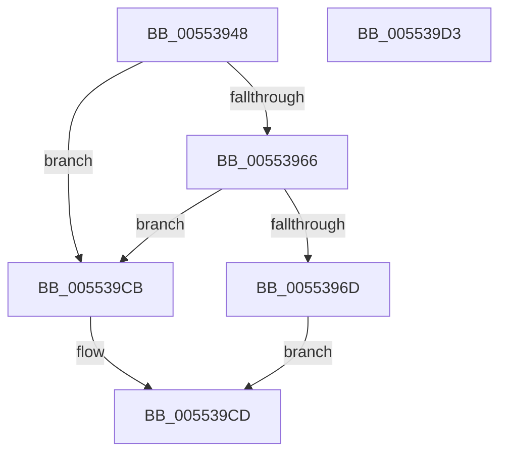

# HalpPciAccessIoConfigSpace

- RVA: `0x00553948`–`0x005539D4` (길이 `140` bytes)
- VA: `0x0000000140553948`
- 실행 섹션: `.text`
- PDB 이름 있음: `예`; PDB Function 태그: `아니요`
- unwind 정보 RVA: `0x00064C80`
- 디코드: `42`개 명령, `140/140` bytes 표시
- 미해석 바이트: `0` (있으면 어셈블리에 `.byte`로 보존)

> 이 문서는 커널 이미지의 기계어와 PDB 기호를 분석해 생성했습니다. 4번과 5번은 함수 원형과 자료형을 바이너리 사용 방식에서 추정한 C 해석이며 원본 소스 복구 결과는 아닙니다.

## 1. Dependencies

- 직접 호출 지점: **1**; 고유 호출 대상: **1**
- 직접 호출자로 확인된 함수: **2**
- RIP 상대 이미지 참조: **2**

### Outgoing calls
- `0x005539B8` → [HalpPCIPerformConfigAccess](../44/HalpPCIPerformConfigAccess_function_0044F6E4.md) (function, `0x0044F6E4`)

### Direct callers
- [sub_00235D85](../23/Unknown_function_00235D85.md) at `0x00235E1C`
- [HaliPciInterfaceReadConfig](../43/HaliPciInterfaceReadConfig_function_004391A0.md) at `0x004393A5`

### Static image references
- `0x00553992` → RVA `0x00007658` (`.rdata`; read)
- `0x005539AD` → RVA `0x00007640` (`.rdata`; read)

## 2. Other-region calls and transfers

- 다른 실행 섹션으로 향하는 call: **0**
- 별도 외부 분기/꼬리 이동을 확인하지 못했습니다.

## 3. Assembly (complete function range)

```asm
00553948  40 53                           push rbx
0055394A  48 83 EC 30                     sub rsp, 0x30
0055394E  44 8B 54 24 68                  mov r10d, dword ptr [rsp + 0x68]
00553953  4D 8B D9                        mov r11, r9
00553956  44 8B 4C 24 60                  mov r9d, dword ptr [rsp + 0x60]
0055395B  43 8D 04 11                     lea eax, [r9 + r10]
0055395F  3D 00 01 00 00                  cmp eax, 0x100
00553964  77 65                           ja 0x1405539cb
00553966  33 DB                           xor ebx, ebx
00553968  66 85 C9                        test cx, cx
0055396B  75 5E                           jne 0x1405539cb
0055396D  41 8B C0                        mov eax, r8d
00553970  0F B6 CA                        movzx ecx, dl
00553973  81 C9 00 80 FF FF               or ecx, 0xffff8000
00553979  44 89 54 24 20                  mov dword ptr [rsp + 0x20], r10d
0055397E  C1 E1 05                        shl ecx, 5
00553981  48 8D 54 24 60                  lea rdx, [rsp + 0x60]
00553986  83 E0 1F                        and eax, 0x1f
00553989  41 81 E0 E0 00 00 00            and r8d, 0xe0
00553990  0B C8                           or ecx, eax
00553992  48 8D 05 BF 3C AB FF            lea rax, [rip - 0x54c341]
00553999  C1 E1 08                        shl ecx, 8
0055399C  41 0B C8                        or ecx, r8d
0055399F  4D 8B C3                        mov r8, r11
005539A2  C1 E1 03                        shl ecx, 3
005539A5  39 5C 24 70                     cmp dword ptr [rsp + 0x70], ebx
005539A9  89 4C 24 60                     mov dword ptr [rsp + 0x60], ecx
005539AD  48 8D 0D 8C 3C AB FF            lea rcx, [rip - 0x54c374]
005539B4  48 0F 45 C8                     cmovne rcx, rax
005539B8  E8 27 BD EF FF                  call 0x14044f6e4
005539BD  33 C0                           xor eax, eax
005539BF  90                              nop
005539C0  BA F8 0C 00 00                  mov edx, 0xcf8
005539C5  EF                              out dx, eax
005539C6  90                              nop
005539C7  B0 01                           mov al, 1
005539C9  EB 02                           jmp 0x1405539cd
005539CB  32 C0                           xor al, al
005539CD  48 83 C4 30                     add rsp, 0x30
005539D1  5B                              pop rbx
005539D2  C3                              ret
005539D3  CC                              int3
```

## 4. C-style interpretation (structured pseudocode)

```c
__int64 __fastcall HalpPciAccessIoConfigSpace(unsigned __int16 a1, unsigned __int8 a2, int a3, __int64 a4, unsigned int a5, unsigned int a6, unsigned int a7)
{
    __int64 result;
    __int64 v_rbx;
    __int64 v_rsp;
    unsigned int v_stack_m18;
    unsigned int v_stack_p28;

    v_rsp = (v_rsp) - (48);
    if (((unsigned int)((unsigned int)(a5) + (unsigned int)(a6) * 1)) > 256) goto loc_005539CB;
    v_rbx = 0;
    if (a1 != 0) goto loc_005539CB;
    a1 = (unsigned int)((a2) | (0xFFFF8000ULL));
    v_stack_m18 = (unsigned int)((unsigned int)(a6));
    a1 = (unsigned int)((a1) << (5));
    result = (unsigned int)(((unsigned int)(a3)) & (31));
    a3 = (unsigned int)((a3) & (224));
    a1 = (unsigned int)((a1) | ((unsigned int)(result)));
    a1 = (unsigned int)((a1) << (8));
    a1 = (unsigned int)((a1) | (a3));
    a1 = (unsigned int)((a1) << (3));
    v_stack_p28 = a1;
    a1 = v_rip - 5555060;
    if (a7 != 0) { a1 = v_rip - 5555009; }
    result = HalpPCIPerformConfigAccess(a1, a5, a4, (unsigned int)(a5));
    result = 0;
    goto loc_005539CD;
loc_005539CB:
    result = 0;
loc_005539CD:
    v_rsp = (v_rsp) + (48);
    return result;
}
```

## 5. (Beta) C Style

```c
int64_t HalpPciAccessIoConfigSpace(uint16_t Arg1, uint8_t Arg2, int32_t Arg3, int64_t Arg4, void *Arg5, uint32_t Arg6, uint32_t Arg7)
{
    uint8_t *arg5 = (uint8_t *)Arg5;

    int64_t result;
    int64_t local_rbx;
    int64_t local_rsp;
    uint32_t v_stack_m18;
    uint32_t v_stack_p28;

    local_rsp = (local_rsp) - (48);
    if (((uint32_t)((uint32_t)(Arg5) + (uint32_t)(Arg6) * 1)) > 256) goto loc_005539CB;
    local_rbx = 0;
    if (Arg1 != 0) goto loc_005539CB;
    Arg1 = (uint32_t)((Arg2) | (0xFFFF8000ULL));
    v_stack_m18 = (uint32_t)((uint32_t)(Arg6));
    Arg1 = (uint32_t)((Arg1) << (5));
    result = (uint32_t)(((uint32_t)(Arg3)) & (31));
    Arg3 = (uint32_t)((Arg3) & (224));
    Arg1 = (uint32_t)((Arg1) | ((uint32_t)(result)));
    Arg1 = (uint32_t)((Arg1) << (8));
    Arg1 = (uint32_t)((Arg1) | (Arg3));
    Arg1 = (uint32_t)((Arg1) << (3));
    v_stack_p28 = Arg1;
    Arg1 = v_rip - 5555060;
    if (Arg7 != 0) { Arg1 = v_rip - 5555009; }
    result = HalpPCIPerformConfigAccess(Arg1, Arg5, Arg4, (uint32_t)(Arg5));
    result = 0;
    goto loc_005539CD;
loc_005539CB:
    result = 0;
loc_005539CD:
    local_rsp = (local_rsp) + (48);
    return result;
}
```

### 관측된 메모리 오프셋

구조체 형식이 확인되지 않은 접근은 인자 기준의 오프셋으로만 기록했습니다.

| 기준 인자 | 오프셋 표현 | 폭 (bit) | 접근 |
|---|---:|---:|---|
| `Arg5` | `+ 0x0 + r10*1` | `32` | `R` |

## 6. Execution-region graph

[열기: 2D/3D 그래프와 함수 탐색 컨트롤 패널](../../../control-panel.html?section=text&rva=0x00553948&view=graph)

- 2D 그래프는 위에서 아래로 흐르고, 3D 그래프는 빈 공간을 드래그해 회전합니다. Shift+드래그는 이동, 휠은 확대·축소, 함수 노드 선택은 대상 보고서 이동입니다.

### Static fallback


