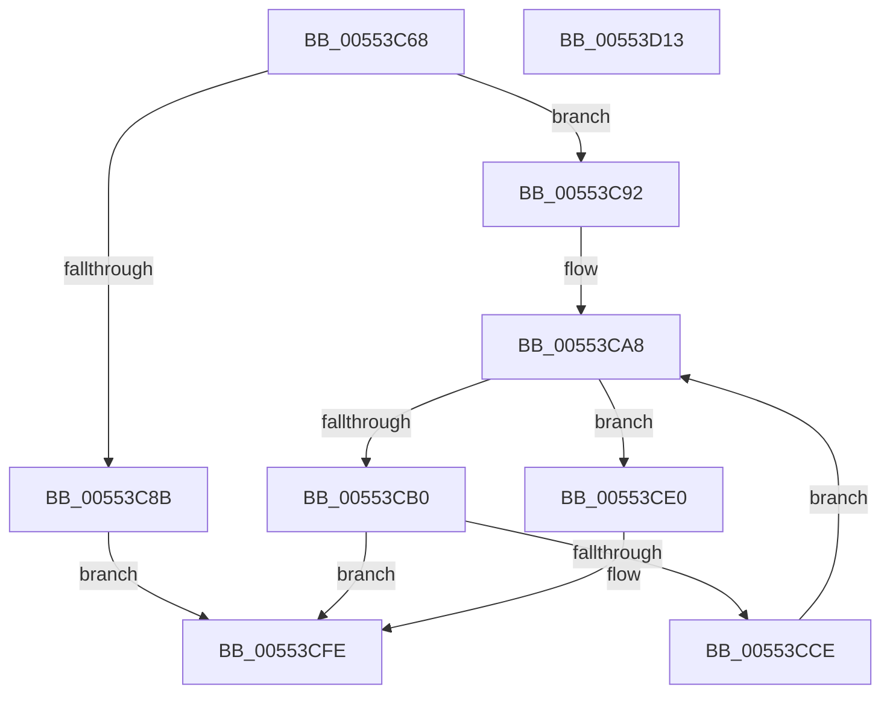

# HalpPciConvertDevicePathToRid

- RVA: `0x00553C68`–`0x00553D14` (길이 `172` bytes)
- VA: `0x0000000140553C68`
- 실행 섹션: `.text`
- PDB 이름 있음: `예`; PDB Function 태그: `아니요`
- unwind 정보 RVA: `0x000A118C`
- 디코드: `52`개 명령, `172/172` bytes 표시
- 미해석 바이트: `0` (있으면 어셈블리에 `.byte`로 보존)

> 이 문서는 커널 이미지의 기계어와 PDB 기호를 분석해 생성했습니다. 4번과 5번은 함수 원형과 자료형을 바이너리 사용 방식에서 추정한 C 해석이며 원본 소스 복구 결과는 아닙니다.

## 1. Dependencies

- 직접 호출 지점: **1**; 고유 호출 대상: **1**
- 직접 호출자로 확인된 함수: **1**
- RIP 상대 이미지 참조: **0**

### Outgoing calls
- `0x00553CC5` → [HalpPciReadSecondaryBusNumber](HalpPciReadSecondaryBusNumber_function_00553D1C.md) (function, `0x00553D1C`)

### Direct callers
- [HalpIommuDetermineReservedPciRid](HalpIommuDetermineReservedPciRid_function_00554F4C.md) at `0x00554F92`

### Static image references
- 디코드된 RIP-relative 메모리 참조가 없습니다.

## 2. Other-region calls and transfers

- 다른 실행 섹션으로 향하는 call: **0**
- 별도 외부 분기/꼬리 이동을 확인하지 못했습니다.

## 3. Assembly (complete function range)

```asm
00553C68  48 89 5C 24 10                  mov qword ptr [rsp + 0x10], rbx
00553C6D  48 89 6C 24 18                  mov qword ptr [rsp + 0x18], rbp
00553C72  48 89 74 24 20                  mov qword ptr [rsp + 0x20], rsi
00553C77  57                              push rdi
00553C78  48 83 EC 30                     sub rsp, 0x30
00553C7C  33 ED                           xor ebp, ebp
00553C7E  48 8B D9                        mov rbx, rcx
00553C81  66 89 69 04                     mov word ptr [rcx + 4], bp
00553C85  66 39 69 06                     cmp word ptr [rcx + 6], bp
00553C89  75 07                           jne 0x140553c92
00553C8B  B8 0D 00 00 C0                  mov eax, 0xc000000d
00553C90  EB 6C                           jmp 0x140553cfe
00553C92  48 8B 79 08                     mov rdi, qword ptr [rcx + 8]
00553C96  BE 01 00 00 00                  mov esi, 1
00553C9B  8A 49 03                        mov cl, byte ptr [rcx + 3]
00553C9E  88 4C 24 40                     mov byte ptr [rsp + 0x40], cl
00553CA2  8A 17                           mov dl, byte ptr [rdi]
00553CA4  44 8A 47 01                     mov r8b, byte ptr [rdi + 1]
00553CA8  0F B7 43 06                     movzx eax, word ptr [rbx + 6]
00553CAC  3B F0                           cmp esi, eax
00553CAE  73 30                           jae 0x140553ce0
00553CB0  45 8A C8                        mov r9b, r8b
00553CB3  48 8D 44 24 40                  lea rax, [rsp + 0x40]
00553CB8  44 8A C2                        mov r8b, dl
00553CBB  48 89 44 24 20                  mov qword ptr [rsp + 0x20], rax
00553CC0  8A D1                           mov dl, cl
00553CC2  0F B7 0B                        movzx ecx, word ptr [rbx]
00553CC5  E8 52 00 00 00                  call 0x140553d1c
00553CCA  85 C0                           test eax, eax
00553CCC  78 30                           js 0x140553cfe
00553CCE  8A 4C 24 40                     mov cl, byte ptr [rsp + 0x40]
00553CD2  8B C6                           mov eax, esi
00553CD4  FF C6                           inc esi
00553CD6  8A 14 47                        mov dl, byte ptr [rdi + rax*2]
00553CD9  44 8A 44 47 01                  mov r8b, byte ptr [rdi + rax*2 + 1]
00553CDE  EB C8                           jmp 0x140553ca8
00553CE0  0F B6 C9                        movzx ecx, cl
00553CE3  66 C1 E1 05                     shl cx, 5
00553CE7  0F B6 C2                        movzx eax, dl
00553CEA  66 0B C8                        or cx, ax
00553CED  41 0F B6 C0                     movzx eax, r8b
00553CF1  66 C1 E1 03                     shl cx, 3
00553CF5  66 0B C8                        or cx, ax
00553CF8  8B C5                           mov eax, ebp
00553CFA  66 89 4B 04                     mov word ptr [rbx + 4], cx
00553CFE  48 8B 5C 24 48                  mov rbx, qword ptr [rsp + 0x48]
00553D03  48 8B 6C 24 50                  mov rbp, qword ptr [rsp + 0x50]
00553D08  48 8B 74 24 58                  mov rsi, qword ptr [rsp + 0x58]
00553D0D  48 83 C4 30                     add rsp, 0x30
00553D11  5F                              pop rdi
00553D12  C3                              ret
00553D13  CC                              int3
```

## 4. C-style interpretation (structured pseudocode)

```c
__int64 __fastcall HalpPciConvertDevicePathToRid(__int64 a1)
{
    __int64 result;
    __int64 v_rbp;
    __int64 v_rsi;
    __int64 v_rsp;
    unsigned __int64 v_stack_m18;
    unsigned __int64 v_stack_p10;
    unsigned __int64 v_stack_p18;
    unsigned __int64 v_stack_p20;
    unsigned __int8 v_stack_p8;

    v_stack_p10 = v_rbx;
    v_stack_p18 = v_rbp;
    v_stack_p20 = v_rsi;
    v_rsp = (v_rsp) - (48);
    v_rbp = 0;
    *(unsigned __int16 *)(a1 + 4) = 0;
    if ((*(unsigned __int16 *)(a1 + 6)) != 0) goto loc_00553C92;
    goto loc_00553CFE;
loc_00553C92:
    v_stack_p8 = (unsigned __int8)(*(unsigned __int8 *)(a1 + 3));
loc_00553CA8:
    if (1 >= ((unsigned int)(*(unsigned __int16 *)(a1 + 6)))) goto loc_00553CE0;
    v_stack_m18 = v_stack_p8;
    result = HalpPciReadSecondaryBusNumber(*(unsigned __int16 *)(a1), (unsigned __int8)(*(unsigned __int8 *)(a1 + 3)), (unsigned __int8)(*(unsigned __int8 *)(*(unsigned __int64 *)(a1 + 8))), (unsigned __int8)(*(unsigned __int8 *)(*(unsigned __int64 *)(a1 + 8) + 1)));
    if (sign_flag) goto loc_00553CFE;
    v_rsi = (unsigned int)((1) + 1);
    goto loc_00553CA8;
loc_00553CE0:
    a1 = (unsigned __int16)(((unsigned __int8)(v_stack_p8)) << (5));
    a1 = (unsigned __int16)((a1) | ((unsigned __int16)((unsigned __int8)(*(unsigned __int8 *)(*(unsigned __int64 *)(a1 + 8) + 1 * 2)))));
    a1 = (unsigned __int16)((a1) << (3));
    a1 = (unsigned __int16)((a1) | ((unsigned __int16)((unsigned __int8)(*(unsigned __int8 *)(*(unsigned __int64 *)(a1 + 8) + 1 * 2 + 1)))));
    *(unsigned __int16 *)(a1 + 4) = (unsigned __int16)(a1);
loc_00553CFE:
    v_rsp = (v_rsp) + (48);
    return 0;
}
```

## 5. (Beta) C Style

```c
int64_t HalpPciConvertDevicePathToRid(void *Arg1)
{
    uint8_t *arg1 = (uint8_t *)Arg1;

    int64_t result;
    int64_t local_rbp;
    int64_t local_rsi;
    int64_t local_rsp;
    uint64_t v_stack_m18;
    uint64_t v_stack_p10;
    uint64_t v_stack_p18;
    uint64_t v_stack_p20;
    uint8_t v_stack_p8;

    v_stack_p10 = local_rbx;
    v_stack_p18 = local_rbp;
    v_stack_p20 = local_rsi;
    local_rsp = (local_rsp) - (48);
    local_rbp = 0;
    *(uint16_t *)(arg1 + 0x4) = 0;
    if ((*(uint16_t *)(arg1 + 0x6)) != 0) goto loc_00553C92;
    goto loc_00553CFE;
loc_00553C92:
    v_stack_p8 = (uint8_t)(*(uint8_t *)(arg1 + 0x3));
loc_00553CA8:
    if (1 >= ((uint32_t)(*(uint16_t *)(arg1 + 0x6)))) goto loc_00553CE0;
    v_stack_m18 = v_stack_p8;
    result = HalpPciReadSecondaryBusNumber(*(uint16_t *)(arg1), (uint8_t)(*(uint8_t *)(arg1 + 0x3)), (uint8_t)(*(uint8_t *)(*(uint64_t *)(arg1 + 0x8))), (uint8_t)(*(uint8_t *)(*(uint64_t *)(arg1 + 0x8) + 0x1)));
    if (sign_flag) goto loc_00553CFE;
    local_rsi = (uint32_t)((1) + 1);
    goto loc_00553CA8;
loc_00553CE0:
    Arg1 = (uint16_t)(((uint8_t)(v_stack_p8)) << (5));
    Arg1 = (uint16_t)((Arg1) | ((uint16_t)((uint8_t)(*(uint8_t *)(*(uint64_t *)(arg1 + 0x8) + 0x1 * 2)))));
    Arg1 = (uint16_t)((Arg1) << (3));
    Arg1 = (uint16_t)((Arg1) | ((uint16_t)((uint8_t)(*(uint8_t *)(*(uint64_t *)(arg1 + 0x8) + 0x1 * 2 + 0x1)))));
    *(uint16_t *)(arg1 + 0x4) = (uint16_t)(Arg1);
loc_00553CFE:
    local_rsp = (local_rsp) + (48);
    return 0;
}
```

### 관측된 메모리 오프셋

구조체 형식이 확인되지 않은 접근은 인자 기준의 오프셋으로만 기록했습니다.

| 기준 인자 | 오프셋 표현 | 폭 (bit) | 접근 |
|---|---:|---:|---|
| `Arg1` | `+ 0x0` | `16` | `R` |
| `Arg1` | `+ 0x3` | `8` | `R` |
| `Arg1` | `+ 0x4` | `16` | `W` |
| `Arg1` | `+ 0x6` | `16` | `R` |
| `Arg1` | `+ 0x8` | `64` | `R` |

## 6. Execution-region graph

[열기: 2D/3D 그래프와 함수 탐색 컨트롤 패널](../../../control-panel.html?section=text&rva=0x00553C68&view=graph)

- 2D 그래프는 위에서 아래로 흐르고, 3D 그래프는 빈 공간을 드래그해 회전합니다. Shift+드래그는 이동, 휠은 확대·축소, 함수 노드 선택은 대상 보고서 이동입니다.

### Static fallback


