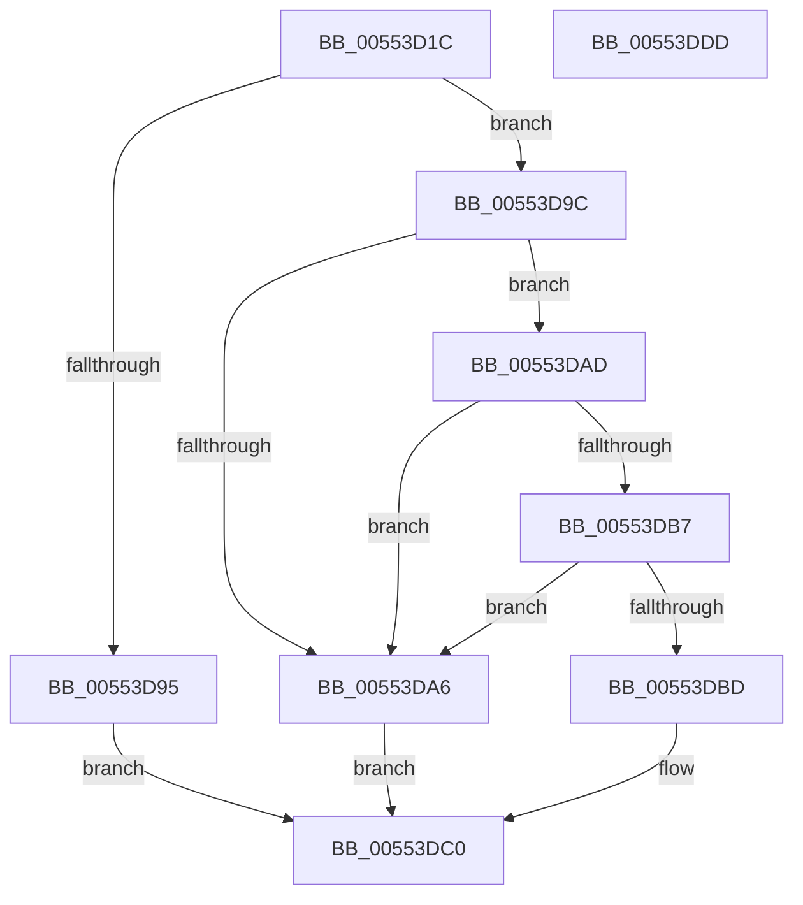

# HalpPciReadSecondaryBusNumber

- RVA: `0x00553D1C`–`0x00553DDE` (길이 `194` bytes)
- VA: `0x0000000140553D1C`
- 실행 섹션: `.text`
- PDB 이름 있음: `예`; PDB Function 태그: `아니요`
- unwind 정보 RVA: `0x000C449C`
- 디코드: `59`개 명령, `194/194` bytes 표시
- 미해석 바이트: `0` (있으면 어셈블리에 `.byte`로 보존)

> 이 문서는 커널 이미지의 기계어와 PDB 기호를 분석해 생성했습니다. 4번과 5번은 함수 원형과 자료형을 바이너리 사용 방식에서 추정한 C 해석이며 원본 소스 복구 결과는 아닙니다.

## 1. Dependencies

- 직접 호출 지점: **3**; 고유 호출 대상: **3**
- 직접 호출자로 확인된 함수: **1**
- RIP 상대 이미지 참조: **1**

### Outgoing calls
- `0x00553D5A` → [memset](../6C/memset_function_006C6C40.md) (function, `0x006C6C40`)
- `0x00553D8B` → [HalpGetPCIData](../46/HalpGetPCIData_function_00461858.md) (function, `0x00461858`)
- `0x00553DCA` → [_security_check_cookie](../6A/_security_check_cookie_function_006AC640.md) (function, `0x006AC640`)

### Direct callers
- [HalpPciConvertDevicePathToRid](HalpPciConvertDevicePathToRid_function_00553C68.md) at `0x00553CC5`

### Static image references
- `0x00553D2A` → RVA `0x00E0A740` (`.data`; read)

## 2. Other-region calls and transfers

- 다른 실행 섹션으로 향하는 call: **0**
- 별도 외부 분기/꼬리 이동을 확인하지 못했습니다.

## 3. Assembly (complete function range)

```asm
00553D1C  40 53                           push rbx
00553D1E  55                              push rbp
00553D1F  56                              push rsi
00553D20  57                              push rdi
00553D21  41 56                           push r14
00553D23  48 81 EC 80 00 00 00            sub rsp, 0x80
00553D2A  48 8B 05 0F 6A 8B 00            mov rax, qword ptr [rip + 0x8b6a0f]
00553D31  48 33 C4                        xor rax, rsp
00553D34  48 89 44 24 70                  mov qword ptr [rsp + 0x70], rax
00553D39  4C 8B B4 24 D0 00 00 00         mov r14, qword ptr [rsp + 0xd0]
00553D41  40 8A EA                        mov bpl, dl
00553D44  33 D2                           xor edx, edx
00553D46  41 0F B6 F8                     movzx edi, r8b
00553D4A  0F B7 F1                        movzx esi, cx
00553D4D  41 0F B6 D9                     movzx ebx, r9b
00553D51  48 8D 4C 24 30                  lea rcx, [rsp + 0x30]
00553D56  44 8D 42 40                     lea r8d, [rdx + 0x40]
00553D5A  E8 E1 2E 17 00                  call 0x1406c6c40
00553D5F  44 8B C3                        mov r8d, ebx
00553D62  C7 44 24 28 40 00 00 00         mov dword ptr [rsp + 0x28], 0x40
00553D6A  41 83 E0 07                     and r8d, 7
00553D6E  4C 8D 4C 24 30                  lea r9, [rsp + 0x30]
00553D73  8B C7                           mov eax, edi
00553D75  41 C1 E0 05                     shl r8d, 5
00553D79  83 E0 1F                        and eax, 0x1f
00553D7C  33 DB                           xor ebx, ebx
00553D7E  44 0B C0                        or r8d, eax
00553D81  89 5C 24 20                     mov dword ptr [rsp + 0x20], ebx
00553D85  40 8A D5                        mov dl, bpl
00553D88  0F B7 CE                        movzx ecx, si
00553D8B  E8 C8 DA F0 FF                  call 0x140461858
00553D90  83 F8 40                        cmp eax, 0x40
00553D93  74 07                           je 0x140553d9c
00553D95  BB 83 04 00 C0                  mov ebx, 0xc0000483
00553D9A  EB 24                           jmp 0x140553dc0
00553D9C  8A 44 24 3E                     mov al, byte ptr [rsp + 0x3e]
00553DA0  24 7F                           and al, 0x7f
00553DA2  3C 01                           cmp al, 1
00553DA4  74 07                           je 0x140553dad
00553DA6  BB 0E 00 00 C0                  mov ebx, 0xc000000e
00553DAB  EB 13                           jmp 0x140553dc0
00553DAD  8A 44 24 49                     mov al, byte ptr [rsp + 0x49]
00553DB1  3A 44 24 48                     cmp al, byte ptr [rsp + 0x48]
00553DB5  76 EF                           jbe 0x140553da6
00553DB7  38 44 24 4A                     cmp byte ptr [rsp + 0x4a], al
00553DBB  72 E9                           jb 0x140553da6
00553DBD  41 88 06                        mov byte ptr [r14], al
00553DC0  8B C3                           mov eax, ebx
00553DC2  48 8B 4C 24 70                  mov rcx, qword ptr [rsp + 0x70]
00553DC7  48 33 CC                        xor rcx, rsp
00553DCA  E8 71 88 15 00                  call 0x1406ac640
00553DCF  48 81 C4 80 00 00 00            add rsp, 0x80
00553DD6  41 5E                           pop r14
00553DD8  5F                              pop rdi
00553DD9  5E                              pop rsi
00553DDA  5D                              pop rbp
00553DDB  5B                              pop rbx
00553DDC  C3                              ret
00553DDD  CC                              int3
```

## 4. C-style interpretation (structured pseudocode)

```c
__int64 __fastcall HalpPciReadSecondaryBusNumber(unsigned __int16 a1, int a2, unsigned __int8 a3, unsigned __int8 a4, __int64 a5)
{
    __int64 result;
    __int64 v_rbx;
    __int64 v_rsp;
    unsigned __int64 v_stack_m38;
    unsigned __int8 v_stack_m5E;
    unsigned __int8 v_stack_m5F;
    unsigned __int8 v_stack_m60;
    unsigned __int8 v_stack_m6A;
    unsigned __int64 v_stack_m78;
    unsigned int v_stack_m80;
    unsigned int v_stack_m88;

    v_rsp = (v_rsp) - (128);
    result = (*(unsigned __int64 *)(v_rip + 9136655)) ^ (v_rsp);
    v_stack_m38 = result;
    a2 = 0;
    result = memset(v_stack_m78, a2, a2 + 64, a4);
    v_stack_m80 = 64;
    a3 = (unsigned int)(((unsigned int)(a4)) & (7));
    a3 = (unsigned int)((a3) << (5));
    result = (unsigned int)(((unsigned int)(a3)) & (31));
    v_rbx = 0;
    a3 = (unsigned int)((a3) | ((unsigned int)(result)));
    v_stack_m88 = 0;
    result = HalpGetPCIData(a1, (unsigned __int8)((unsigned __int8)(a2)), a3, v_stack_m78);
    if (((unsigned int)(result)) == 64) goto loc_00553D9C;
    goto loc_00553DC0;
loc_00553D9C:
    result = (unsigned __int8)((v_stack_m6A) & (127));
    if (((unsigned __int8)(result)) == 1) goto loc_00553DAD;
loc_00553DA6:
    goto loc_00553DC0;
loc_00553DAD:
    if (((unsigned __int8)(v_stack_m5F)) <= v_stack_m60) goto loc_00553DA6;
    if (v_stack_m5E < ((unsigned __int8)(v_stack_m5F))) goto loc_00553DA6;
    *(unsigned __int8 *)(a5) = (unsigned __int8)(v_stack_m5F);
loc_00553DC0:
    a1 = (v_stack_m38) ^ (v_rsp);
    result = _security_check_cookie(a1, (unsigned __int8)((unsigned __int8)(a2)), a3, v_stack_m78);
    v_rsp = (v_rsp) + (128);
    return result;
}
```

## 5. (Beta) C Style

```c
int64_t HalpPciReadSecondaryBusNumber(uint16_t Arg1, int32_t Arg2, uint8_t Arg3, uint8_t Arg4, void *Arg5)
{
    uint8_t *arg5 = (uint8_t *)Arg5;

    int64_t result;
    int64_t local_rbx;
    int64_t local_rsp;
    uint64_t v_stack_m38;
    uint8_t v_stack_m5E;
    uint8_t v_stack_m5F;
    uint8_t v_stack_m60;
    uint8_t v_stack_m6A;
    uint64_t v_stack_m78;
    uint32_t v_stack_m80;
    uint32_t v_stack_m88;

    local_rsp = (local_rsp) - (128);
    result = (*(uint64_t *)(v_rip + 0x8B6A0F)) ^ (local_rsp);
    v_stack_m38 = result;
    Arg2 = 0;
    result = memset(v_stack_m78, Arg2, Arg2 + 64, Arg4);
    v_stack_m80 = 64;
    Arg3 = (uint32_t)(((uint32_t)(Arg4)) & (7));
    Arg3 = (uint32_t)((Arg3) << (5));
    result = (uint32_t)(((uint32_t)(Arg3)) & (31));
    local_rbx = 0;
    Arg3 = (uint32_t)((Arg3) | ((uint32_t)(result)));
    v_stack_m88 = 0;
    result = HalpGetPCIData(Arg1, (uint8_t)((uint8_t)(Arg2)), Arg3, v_stack_m78);
    if (((uint32_t)(result)) == 64) goto loc_00553D9C;
    goto loc_00553DC0;
loc_00553D9C:
    result = (uint8_t)((v_stack_m6A) & (127));
    if (((uint8_t)(result)) == 1) goto loc_00553DAD;
loc_00553DA6:
    goto loc_00553DC0;
loc_00553DAD:
    if (((uint8_t)(v_stack_m5F)) <= v_stack_m60) goto loc_00553DA6;
    if (v_stack_m5E < ((uint8_t)(v_stack_m5F))) goto loc_00553DA6;
    *(uint8_t *)(arg5) = (uint8_t)(v_stack_m5F);
loc_00553DC0:
    Arg1 = (v_stack_m38) ^ (local_rsp);
    result = _security_check_cookie(Arg1, (uint8_t)((uint8_t)(Arg2)), Arg3, v_stack_m78);
    local_rsp = (local_rsp) + (128);
    return result;
}
```

### 관측된 메모리 오프셋

구조체 형식이 확인되지 않은 접근은 인자 기준의 오프셋으로만 기록했습니다.

| 기준 인자 | 오프셋 표현 | 폭 (bit) | 접근 |
|---|---:|---:|---|
| `Arg5` | `+ 0x0` | `8` | `W` |

## 6. Execution-region graph

[열기: 2D/3D 그래프와 함수 탐색 컨트롤 패널](../../../control-panel.html?section=text&rva=0x00553D1C&view=graph)

- 2D 그래프는 위에서 아래로 흐르고, 3D 그래프는 빈 공간을 드래그해 회전합니다. Shift+드래그는 이동, 휠은 확대·축소, 함수 노드 선택은 대상 보고서 이동입니다.

### Static fallback


