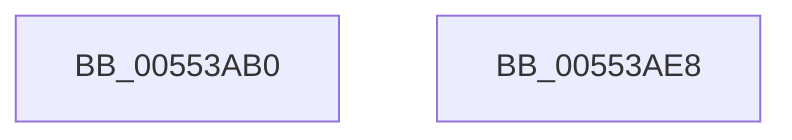

# HalpPciWriteIoConfigUchar

- RVA: `0x00553AB0`–`0x00553AE9` (길이 `57` bytes)
- VA: `0x0000000140553AB0`
- 실행 섹션: `.text`
- PDB 이름 있음: `예`; PDB Function 태그: `아니요`
- unwind 정보 RVA: `0x000DB714`
- 디코드: `21`개 명령, `57/57` bytes 표시
- 미해석 바이트: `0` (있으면 어셈블리에 `.byte`로 보존)

> 이 문서는 커널 이미지의 기계어와 PDB 기호를 분석해 생성했습니다. 4번과 5번은 함수 원형과 자료형을 바이너리 사용 방식에서 추정한 C 해석이며 원본 소스 복구 결과는 아닙니다.

## 1. Dependencies

- 직접 호출 지점: **0**; 고유 호출 대상: **0**
- 직접 호출자로 확인된 함수: **0**
- RIP 상대 이미지 참조: **0**

### Outgoing calls
- 직접 디코드된 call 명령이 없습니다.

### Direct callers
- 이 함수 시작 RVA로 연결되는 직접 call은 확인되지 않았습니다. 간접 호출은 완전히 역산할 수 없습니다.

### Static image references
- 디코드된 RIP-relative 메모리 참조가 없습니다.

## 2. Other-region calls and transfers

- 다른 실행 섹션으로 향하는 call: **0**
- 별도 외부 분기/꼬리 이동을 확인하지 못했습니다.

## 3. Assembly (complete function range)

```asm
00553AB0  44 8B 09                        mov r9d, dword ptr [rcx]
00553AB3  4C 8B D2                        mov r10, rdx
00553AB6  BA F8 0C 00 00                  mov edx, 0xcf8
00553ABB  41 8B C1                        mov eax, r9d
00553ABE  41 33 C0                        xor eax, r8d
00553AC1  66 41 83 E0 03                  and r8w, 3
00553AC6  25 FC 00 00 00                  and eax, 0xfc
00553ACB  41 33 C1                        xor eax, r9d
00553ACE  89 01                           mov dword ptr [rcx], eax
00553AD0  90                              nop
00553AD1  EF                              out dx, eax
00553AD2  90                              nop
00553AD3  BA FC 0C 00 00                  mov edx, 0xcfc
00553AD8  41 8A 02                        mov al, byte ptr [r10]
00553ADB  66 41 03 D0                     add dx, r8w
00553ADF  90                              nop
00553AE0  EE                              out dx, al
00553AE1  90                              nop
00553AE2  B8 01 00 00 00                  mov eax, 1
00553AE7  C3                              ret
00553AE8  CC                              int3
```

## 4. C-style interpretation (structured pseudocode)

```c
__int64 __fastcall HalpPciWriteIoConfigUchar(__int64 a1, __int64 a2, int a3)
{
    __int64 result;

    result = (unsigned int)(((unsigned int)((unsigned int)((unsigned int)(*(unsigned int *)(a1))))) ^ (a3));
    a3 = (unsigned __int16)((a3) & (3));
    result = (unsigned int)((result) & (252));
    result = (unsigned int)((result) ^ ((unsigned int)((unsigned int)(*(unsigned int *)(a1)))));
    *(unsigned int *)(a1) = (unsigned int)(result);
    a2 = (unsigned __int16)(((unsigned int)(0xCFCULL)) + ((unsigned __int16)(a3)));
    return 1;
}
```

## 5. (Beta) C Style

```c
int64_t HalpPciWriteIoConfigUchar(void *Arg1, void *Arg2, int32_t Arg3)
{
    uint8_t *arg1 = (uint8_t *)Arg1;
    uint8_t *arg2 = (uint8_t *)Arg2;

    int64_t result;

    result = (uint32_t)(((uint32_t)((uint32_t)((uint32_t)(*(uint32_t *)(arg1))))) ^ (Arg3));
    Arg3 = (uint16_t)((Arg3) & (3));
    result = (uint32_t)((result) & (252));
    result = (uint32_t)((result) ^ ((uint32_t)((uint32_t)(*(uint32_t *)(arg1)))));
    *(uint32_t *)(arg1) = (uint32_t)(result);
    Arg2 = (uint16_t)(((uint32_t)(0xCFCULL)) + ((uint16_t)(Arg3)));
    return 1;
}
```

### 관측된 메모리 오프셋

구조체 형식이 확인되지 않은 접근은 인자 기준의 오프셋으로만 기록했습니다.

| 기준 인자 | 오프셋 표현 | 폭 (bit) | 접근 |
|---|---:|---:|---|
| `Arg1` | `+ 0x0` | `32` | `R` |
| `Arg1` | `+ 0x0` | `32` | `W` |
| `Arg2` | `+ 0x0` | `8` | `R` |

## 6. Execution-region graph

[열기: 2D/3D 그래프와 함수 탐색 컨트롤 패널](../../../control-panel.html?section=text&rva=0x00553AB0&view=graph)

- 2D 그래프는 위에서 아래로 흐르고, 3D 그래프는 빈 공간을 드래그해 회전합니다. Shift+드래그는 이동, 휠은 확대·축소, 함수 노드 선택은 대상 보고서 이동입니다.

### Static fallback


