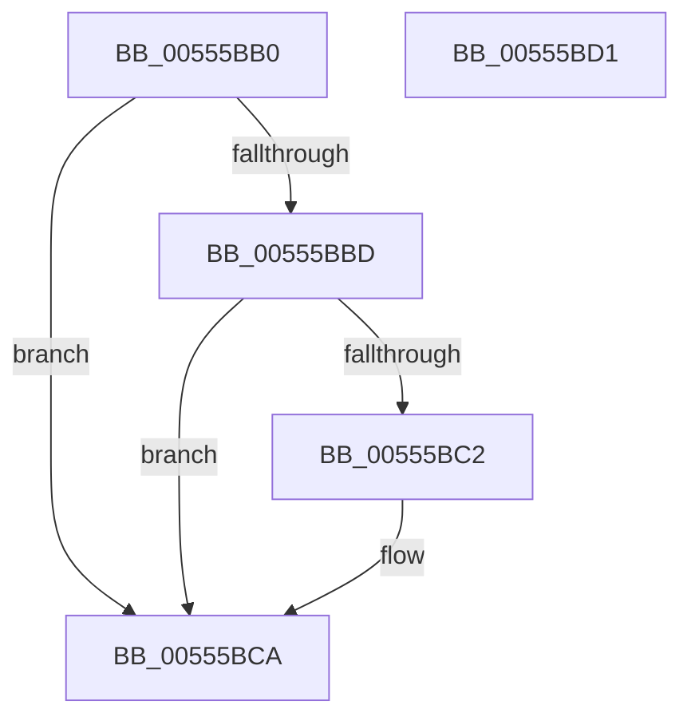

# HalpPeiInterruptHandler

- RVA: `0x00555BB0`–`0x00555BD2` (길이 `34` bytes)
- VA: `0x0000000140555BB0`
- 실행 섹션: `.text`
- PDB 이름 있음: `예`; PDB Function 태그: `아니요`
- unwind 정보 RVA: `0x0005C788`
- 디코드: `11`개 명령, `34/34` bytes 표시
- 미해석 바이트: `0` (있으면 어셈블리에 `.byte`로 보존)

> 이 문서는 커널 이미지의 기계어와 PDB 기호를 분석해 생성했습니다. 4번과 5번은 함수 원형과 자료형을 바이너리 사용 방식에서 추정한 C 해석이며 원본 소스 복구 결과는 아닙니다.

## 1. Dependencies

- 직접 호출 지점: **1**; 고유 호출 대상: **1**
- 직접 호출자로 확인된 함수: **0**
- RIP 상대 이미지 참조: **1**

### Outgoing calls
- `0x00555BC5` → [HalpCheckAndReportGhes](../4A/HalpCheckAndReportGhes_function_004A9CDC.md) (function, `0x004A9CDC`)

### Direct callers
- 이 함수 시작 RVA로 연결되는 직접 call은 확인되지 않았습니다. 간접 호출은 완전히 역산할 수 없습니다.

### Static image references
- `0x00555BB4` → RVA `0x00E10410` (`.data`; read)

## 2. Other-region calls and transfers

- 다른 실행 섹션으로 향하는 call: **0**
- 별도 외부 분기/꼬리 이동을 확인하지 못했습니다.

## 3. Assembly (complete function range)

```asm
00555BB0  48 83 EC 28                     sub rsp, 0x28
00555BB4  83 3D 55 A8 8B 00 00            cmp dword ptr [rip + 0x8ba855], 0
00555BBB  74 0D                           je 0x140555bca
00555BBD  48 85 D2                        test rdx, rdx
00555BC0  74 08                           je 0x140555bca
00555BC2  48 8B CA                        mov rcx, rdx
00555BC5  E8 12 41 F5 FF                  call 0x1404a9cdc
00555BCA  B0 01                           mov al, 1
00555BCC  48 83 C4 28                     add rsp, 0x28
00555BD0  C3                              ret
00555BD1  CC                              int3
```

## 4. C-style interpretation (structured pseudocode)

```c
__int64 __fastcall HalpPeiInterruptHandler(__int64 a1, __int64 a2)
{
    __int64 result;
    __int64 v_rsp;

    v_rsp = (v_rsp) - (40);
    if ((*(unsigned int *)(v_rip + 9152597)) == 0) goto loc_00555BCA;
    if (a2 != 0) {
        a1 = a2;
        result = HalpCheckAndReportGhes(a1, a2, a3, a4);
    }
    v_rsp = (v_rsp) + (40);
    return 1;
}
```

## 5. (Beta) C Style

```c
int64_t HalpPeiInterruptHandler(int64_t Arg1, int64_t Arg2)
{
    int64_t result;
    int64_t local_rsp;

    local_rsp = (local_rsp) - (40);
    if ((*(uint32_t *)(v_rip + 0x8BA855)) == 0) goto loc_00555BCA;
    if (Arg2 != 0) {
        Arg1 = Arg2;
        result = HalpCheckAndReportGhes(Arg1, Arg2, a3, a4);
    }
    local_rsp = (local_rsp) + (40);
    return 1;
}
```

## 6. Execution-region graph

[열기: 2D/3D 그래프와 함수 탐색 컨트롤 패널](../../../control-panel.html?section=text&rva=0x00555BB0&view=graph)

- 2D 그래프는 위에서 아래로 흐르고, 3D 그래프는 빈 공간을 드래그해 회전합니다. Shift+드래그는 이동, 휠은 확대·축소, 함수 노드 선택은 대상 보고서 이동입니다.

### Static fallback


