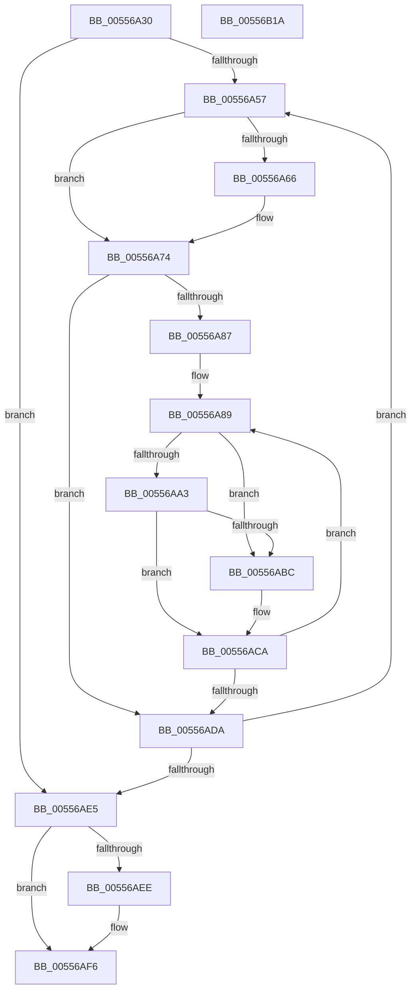

# HalpPmemErrorDeferredHandler

- RVA: `0x00556A30`–`0x00556B1B` (길이 `235` bytes)
- VA: `0x0000000140556A30`
- 실행 섹션: `.text`
- PDB 이름 있음: `예`; PDB Function 태그: `아니요`
- unwind 정보 RVA: `0x000B8D34`
- 디코드: `68`개 명령, `235/235` bytes 표시
- 미해석 바이트: `0` (있으면 어셈블리에 `.byte`로 보존)

> 이 문서는 커널 이미지의 기계어와 PDB 기호를 분석해 생성했습니다. 4번과 5번은 함수 원형과 자료형을 바이너리 사용 방식에서 추정한 C 해석이며 원본 소스 복구 결과는 아닙니다.

## 1. Dependencies

- 직접 호출 지점: **4**; 고유 호출 대상: **4**
- 직접 호출자로 확인된 함수: **1**
- RIP 상대 이미지 참조: **1**

### Outgoing calls
- `0x00556A9A` → [MmGetPageBadStatus](../67/MmGetPageBadStatus_function_0067A9B0.md) (function, `0x0067A9B0`)
- `0x00556AB3` → [WheaAttemptPhysicalPageOffline](../../page/7D/WheaAttemptPhysicalPageOffline_function_007D7380.md) (function, `0x007D7380`)
- `0x00556AF1` → [HalpHvInvokeWheaErrorNotificationCallback](../54/HalpHvInvokeWheaErrorNotificationCallback_function_0054CE74.md) (function, `0x0054CE74`)
- `0x00556AFE` → [ExFreePoolWithTag](../../poolcode/B8/ExFreePoolWithTag_function_00B82870.md) (function, `0x00B82870`)

### Direct callers
- [HalpErrorDeferredHandler](HalpErrorDeferredHandler_function_005565D0.md) at `0x00556640`

### Static image references
- `0x00556AE5` → RVA `0x00FC1C48` (`.data`; read)

## 2. Other-region calls and transfers

- 다른 실행 섹션으로 향하는 call: **2**
  - `0x00556AB3` → [WheaAttemptPhysicalPageOffline](../../page/7D/WheaAttemptPhysicalPageOffline_function_007D7380.md) (`.text` → `PAGE`)
  - `0x00556AFE` → [ExFreePoolWithTag](../../poolcode/B8/ExFreePoolWithTag_function_00B82870.md) (`.text` → `POOLCODE`)
- 별도 외부 분기/꼬리 이동을 확인하지 못했습니다.

## 3. Assembly (complete function range)

```asm
00556A30  48 89 5C 24 10                  mov qword ptr [rsp + 0x10], rbx
00556A35  48 89 6C 24 18                  mov qword ptr [rsp + 0x18], rbp
00556A3A  56                              push rsi
00556A3B  57                              push rdi
00556A3C  41 54                           push r12
00556A3E  41 56                           push r14
00556A40  41 57                           push r15
00556A42  48 83 EC 30                     sub rsp, 0x30
00556A46  48 8B 19                        mov rbx, qword ptr [rcx]
00556A49  33 F6                           xor esi, esi
00556A4B  4C 8B F1                        mov r14, rcx
00556A4E  39 73 54                        cmp dword ptr [rbx + 0x54], esi
00556A51  0F 86 8E 00 00 00               jbe 0x140556ae5
00556A57  48 8D 3C 76                     lea rdi, [rsi + rsi*2]
00556A5B  48 8B 44 FB 60                  mov rax, qword ptr [rbx + rdi*8 + 0x60]
00556A60  48 83 F8 32                     cmp rax, 0x32
00556A64  76 0E                           jbe 0x140556a74
00556A66  48 C7 44 FB 60 32 00 00 00      mov qword ptr [rbx + rdi*8 + 0x60], 0x32
00556A6F  B8 32 00 00 00                  mov eax, 0x32
00556A74  48 83 64 FB 68 00               and qword ptr [rbx + rdi*8 + 0x68], 0
00556A7A  45 33 E4                        xor r12d, r12d
00556A7D  4C 8B 7C FB 58                  mov r15, qword ptr [rbx + rdi*8 + 0x58]
00556A82  48 85 C0                        test rax, rax
00556A85  74 53                           je 0x140556ada
00556A87  33 ED                           xor ebp, ebp
00556A89  49 8B C7                        mov rax, r15
00556A8C  48 8D 4C 24 60                  lea rcx, [rsp + 0x60]
00556A91  48 C1 E0 0C                     shl rax, 0xc
00556A95  48 89 44 24 60                  mov qword ptr [rsp + 0x60], rax
00556A9A  E8 11 3F 12 00                  call 0x14067a9b0
00556A9F  85 C0                           test eax, eax
00556AA1  75 19                           jne 0x140556abc
00556AA3  45 33 C9                        xor r9d, r9d
00556AA6  4C 89 74 24 20                  mov qword ptr [rsp + 0x20], r14
00556AAB  41 B0 01                        mov r8b, 1
00556AAE  33 D2                           xor edx, edx
00556AB0  49 8B CF                        mov rcx, r15
00556AB3  E8 C8 08 28 00                  call 0x1407d7380
00556AB8  85 C0                           test eax, eax
00556ABA  75 0E                           jne 0x140556aca
00556ABC  48 8B 44 FB 68                  mov rax, qword ptr [rbx + rdi*8 + 0x68]
00556AC1  48 0F AB E8                     bts rax, rbp
00556AC5  48 89 44 FB 68                  mov qword ptr [rbx + rdi*8 + 0x68], rax
00556ACA  41 FF C4                        inc r12d
00556ACD  49 FF C7                        inc r15
00556AD0  41 8B EC                        mov ebp, r12d
00556AD3  48 3B 6C FB 60                  cmp rbp, qword ptr [rbx + rdi*8 + 0x60]
00556AD8  72 AF                           jb 0x140556a89
00556ADA  FF C6                           inc esi
00556ADC  3B 73 54                        cmp esi, dword ptr [rbx + 0x54]
00556ADF  0F 82 72 FF FF FF               jb 0x140556a57
00556AE5  80 3D 5C B1 A6 00 00            cmp byte ptr [rip + 0xa6b15c], 0
00556AEC  74 08                           je 0x140556af6
00556AEE  49 8B CE                        mov rcx, r14
00556AF1  E8 7E 63 FF FF                  call 0x14054ce74
00556AF6  BA 48 61 6C 57                  mov edx, 0x576c6148
00556AFB  48 8B CB                        mov rcx, rbx
00556AFE  E8 6D BD 62 00                  call 0x140b82870
00556B03  48 8B 5C 24 68                  mov rbx, qword ptr [rsp + 0x68]
00556B08  48 8B 6C 24 70                  mov rbp, qword ptr [rsp + 0x70]
00556B0D  48 83 C4 30                     add rsp, 0x30
00556B11  41 5F                           pop r15
00556B13  41 5E                           pop r14
00556B15  41 5C                           pop r12
00556B17  5F                              pop rdi
00556B18  5E                              pop rsi
00556B19  C3                              ret
00556B1A  CC                              int3
```

## 4. C-style interpretation (structured pseudocode)

```c
__int64 __fastcall HalpPmemErrorDeferredHandler(__int64 a1, int a2, __int64 a3, int a4)
{
    __int64 result;
    __int64 v_r12;
    __int64 v_r15;
    __int64 v_rbp;
    __int64 v_rsi;
    __int64 v_rsp;
    unsigned __int64 v_stack_m38;
    unsigned __int64 v_stack_p10;
    unsigned __int64 v_stack_p18;
    unsigned __int64 v_stack_p8;

    v_stack_p10 = v_rbx;
    v_stack_p18 = v_rbp;
    v_rsp = (v_rsp) - (48);
    v_rsi = 0;
    if ((*(unsigned int *)(*(unsigned __int64 *)(a1) + 84)) <= 0) goto loc_00556AE5;
loc_00556A57:
    result = *(unsigned __int64 *)(*(unsigned __int64 *)(a1) + v_rsi + v_rsi * 2 * 8 + 96);
    if ((*(unsigned __int64 *)(*(unsigned __int64 *)(a1) + v_rsi + v_rsi * 2 * 8 + 96)) >= = 50) {
        *(unsigned __int64 *)(*(unsigned __int64 *)(a1) + v_rsi + v_rsi * 2 * 8 + 96) = 50;
        result = 50;
    }
    v_r12 = 0;
    if (result == 0) goto loc_00556ADA;
    v_rbp = 0;
loc_00556A89:
    result = (*(unsigned __int64 *)(*(unsigned __int64 *)(a1) + v_rsi + v_rsi * 2 * 8 + 88)) << (12);
    v_stack_p8 = result;
    result = MmGetPageBadStatus(v_stack_p8, a2, a3, a4);
    if ((unsigned int)(result) != 0) goto loc_00556ABC;
    a4 = 0;
    v_stack_m38 = a1;
    a2 = 0;
    result = WheaAttemptPhysicalPageOffline(*(unsigned __int64 *)(*(unsigned __int64 *)(a1) + v_rsi + v_rsi * 2 * 8 + 88), a2, 1, a4);
    if ((unsigned int)(result) == 0) {
        result = *(unsigned __int64 *)(*(unsigned __int64 *)(a1) + v_rsi + v_rsi * 2 * 8 + 104);
        *(unsigned __int64 *)(*(unsigned __int64 *)(a1) + v_rsi + v_rsi * 2 * 8 + 104) = result;
    }
    v_r12 = (unsigned int)((v_r12) + 1);
    v_r15 = (*(unsigned __int64 *)(*(unsigned __int64 *)(a1) + v_rsi + v_rsi * 2 * 8 + 88)) + 1;
    if (((unsigned int)((unsigned int)(v_r12))) < (*(unsigned __int64 *)(*(unsigned __int64 *)(a1) + v_rsi + v_rsi * 2 * 8 + 96))) goto loc_00556A89;
loc_00556ADA:
    v_rsi = (unsigned int)((v_rsi) + 1);
    if (((unsigned int)(v_rsi)) < (*(unsigned int *)(*(unsigned __int64 *)(a1) + 84))) goto loc_00556A57;
loc_00556AE5:
    if ((*(unsigned __int8 *)(v_rip + 10924380)) != 0) {
        a1 = a1;
        result = HalpHvInvokeWheaErrorNotificationCallback(a1, a2, 1, a4);
    }
    result = ExFreePoolWithTag(*(unsigned __int64 *)(a1), (unsigned int)(0x576C6148ULL), 1, a4);
    v_rsp = (v_rsp) + (48);
    return result;
}
```

## 5. (Beta) C Style

```c
int64_t HalpPmemErrorDeferredHandler(void *Arg1, int32_t Arg2, int64_t Arg3, int32_t Arg4)
{
    uint8_t *arg1 = (uint8_t *)Arg1;

    int64_t result;
    int64_t local_r12;
    int64_t local_r15;
    int64_t local_rbp;
    int64_t local_rsi;
    int64_t local_rsp;
    uint64_t v_stack_m38;
    uint64_t v_stack_p10;
    uint64_t v_stack_p18;
    uint64_t v_stack_p8;

    v_stack_p10 = local_rbx;
    v_stack_p18 = local_rbp;
    local_rsp = (local_rsp) - (48);
    local_rsi = 0;
    if ((*(uint32_t *)(*(uint64_t *)(arg1) + 0x54)) <= 0) goto loc_00556AE5;
loc_00556A57:
    result = *(uint64_t *)(*(uint64_t *)(arg1) + local_rsi + local_rsi * 2 * 8 + 0x60);
    if ((*(uint64_t *)(*(uint64_t *)(arg1) + local_rsi + local_rsi * 2 * 8 + 0x60)) >= = 50) {
        *(uint64_t *)(*(uint64_t *)(arg1) + local_rsi + local_rsi * 2 * 8 + 0x60) = 50;
        result = 50;
    }
    local_r12 = 0;
    if (result == 0) goto loc_00556ADA;
    local_rbp = 0;
loc_00556A89:
    result = (*(uint64_t *)(*(uint64_t *)(arg1) + local_rsi + local_rsi * 2 * 8 + 0x58)) << (12);
    v_stack_p8 = result;
    result = MmGetPageBadStatus(v_stack_p8, Arg2, Arg3, Arg4);
    if ((uint32_t)(result) != 0) goto loc_00556ABC;
    Arg4 = 0;
    v_stack_m38 = Arg1;
    Arg2 = 0;
    result = WheaAttemptPhysicalPageOffline(*(uint64_t *)(*(uint64_t *)(arg1) + local_rsi + local_rsi * 2 * 8 + 0x58), Arg2, 1, Arg4);
    if ((uint32_t)(result) == 0) {
        result = *(uint64_t *)(*(uint64_t *)(arg1) + local_rsi + local_rsi * 2 * 8 + 0x68);
        *(uint64_t *)(*(uint64_t *)(arg1) + local_rsi + local_rsi * 2 * 8 + 0x68) = result;
    }
    local_r12 = (uint32_t)((local_r12) + 1);
    local_r15 = (*(uint64_t *)(*(uint64_t *)(arg1) + local_rsi + local_rsi * 2 * 8 + 0x58)) + 1;
    if (((uint32_t)((uint32_t)(local_r12))) < (*(uint64_t *)(*(uint64_t *)(arg1) + local_rsi + local_rsi * 2 * 8 + 0x60))) goto loc_00556A89;
loc_00556ADA:
    local_rsi = (uint32_t)((local_rsi) + 1);
    if (((uint32_t)(local_rsi)) < (*(uint32_t *)(*(uint64_t *)(arg1) + 0x54))) goto loc_00556A57;
loc_00556AE5:
    if ((*(uint8_t *)(v_rip + 0xA6B15C)) != 0) {
        Arg1 = Arg1;
        result = HalpHvInvokeWheaErrorNotificationCallback(Arg1, Arg2, 1, Arg4);
    }
    result = ExFreePoolWithTag(*(uint64_t *)(arg1), (uint32_t)(0x576C6148ULL), 1, Arg4);
    local_rsp = (local_rsp) + (48);
    return result;
}
```

### 관측된 메모리 오프셋

구조체 형식이 확인되지 않은 접근은 인자 기준의 오프셋으로만 기록했습니다.

| 기준 인자 | 오프셋 표현 | 폭 (bit) | 접근 |
|---|---:|---:|---|
| `Arg1` | `+ 0x0` | `64` | `R` |

## 6. Execution-region graph

[열기: 2D/3D 그래프와 함수 탐색 컨트롤 패널](../../../control-panel.html?section=text&rva=0x00556A30&view=graph)

- 2D 그래프는 위에서 아래로 흐르고, 3D 그래프는 빈 공간을 드래그해 회전합니다. Shift+드래그는 이동, 휠은 확대·축소, 함수 노드 선택은 대상 보고서 이동입니다.

### Static fallback


