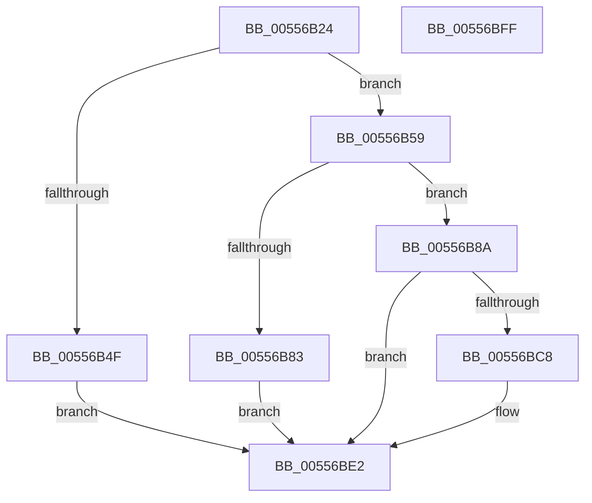

# HalpPmemErrorDeferredRecovery

- RVA: `0x00556B24`–`0x00556C00` (길이 `220` bytes)
- VA: `0x0000000140556B24`
- 실행 섹션: `.text`
- PDB 이름 있음: `예`; PDB Function 태그: `아니요`
- unwind 정보 RVA: `0x0005E6B4`
- 디코드: `59`개 명령, `220/220` bytes 표시
- 미해석 바이트: `0` (있으면 어셈블리에 `.byte`로 보존)

> 이 문서는 커널 이미지의 기계어와 PDB 기호를 분석해 생성했습니다. 4번과 5번은 함수 원형과 자료형을 바이너리 사용 방식에서 추정한 C 해석이며 원본 소스 복구 결과는 아닙니다.

## 1. Dependencies

- 직접 호출 지점: **6**; 고유 호출 대상: **6**
- 직접 호출자로 확인된 함수: **1**
- RIP 상대 이미지 참조: **0**

### Outgoing calls
- `0x00556B40` → [HalpAcquireDrsPool](HalpAcquireDrsPool_function_00556538.md) (function, `0x00556538`)
- `0x00556B76` → [ExAllocatePool2](../../poolcode/B8/ExAllocatePool2_function_00B820F0.md) (function, `0x00B820F0`)
- `0x00556B93` → [memcpy](../6C/memcpy_function_006C6840.md) (function, `0x006C6840`)
- `0x00556BBF` → [WheaRequestDeferredRecovery](../66/WheaRequestDeferredRecovery_function_00660140.md) (function, `0x00660140`)
- `0x00556BCB` → [HalpFreeDrsPool](HalpFreeDrsPool_function_0055666C.md) (function, `0x0055666C`)
- `0x00556BDD` → [ExFreePoolWithTag](../../poolcode/B8/ExFreePoolWithTag_function_00B82870.md) (function, `0x00B82870`)

### Direct callers
- [HalpGenericErrorSourceRecovery](HalpGenericErrorSourceRecovery_function_0055669C.md) at `0x005567C0`

### Static image references
- 디코드된 RIP-relative 메모리 참조가 없습니다.

## 2. Other-region calls and transfers

- 다른 실행 섹션으로 향하는 call: **2**
  - `0x00556B76` → [ExAllocatePool2](../../poolcode/B8/ExAllocatePool2_function_00B820F0.md) (`.text` → `POOLCODE`)
  - `0x00556BDD` → [ExFreePoolWithTag](../../poolcode/B8/ExFreePoolWithTag_function_00B82870.md) (`.text` → `POOLCODE`)
- 별도 외부 분기/꼬리 이동을 확인하지 못했습니다.

## 3. Assembly (complete function range)

```asm
00556B24  48 8B C4                        mov rax, rsp
00556B27  48 89 58 08                     mov qword ptr [rax + 8], rbx
00556B2B  48 89 68 10                     mov qword ptr [rax + 0x10], rbp
00556B2F  48 89 70 18                     mov qword ptr [rax + 0x18], rsi
00556B33  48 89 78 20                     mov qword ptr [rax + 0x20], rdi
00556B37  41 56                           push r14
00556B39  48 83 EC 20                     sub rsp, 0x20
00556B3D  48 8B E9                        mov rbp, rcx
00556B40  E8 F3 F9 FF FF                  call 0x140556538
00556B45  33 DB                           xor ebx, ebx
00556B47  48 8B F8                        mov rdi, rax
00556B4A  48 85 C0                        test rax, rax
00556B4D  75 0A                           jne 0x140556b59
00556B4F  BB 43 00 00 C0                  mov ebx, 0xc0000043
00556B54  E9 89 00 00 00                  jmp 0x140556be2
00556B59  8B 45 54                        mov eax, dword ptr [rbp + 0x54]
00556B5C  41 B8 48 61 6C 57               mov r8d, 0x576c6148
00556B62  8D 0C 40                        lea ecx, [rax + rax*2]
00556B65  8D 0C CD 58 00 00 00            lea ecx, [rcx*8 + 0x58]
00556B6C  44 8B F1                        mov r14d, ecx
00556B6F  8B D1                           mov edx, ecx
00556B71  B9 40 00 00 00                  mov ecx, 0x40
00556B76  E8 75 B5 62 00                  call 0x140b820f0
00556B7B  48 8B F0                        mov rsi, rax
00556B7E  48 85 C0                        test rax, rax
00556B81  75 07                           jne 0x140556b8a
00556B83  BB 9A 00 00 C0                  mov ebx, 0xc000009a
00556B88  EB 58                           jmp 0x140556be2
00556B8A  4D 8B C6                        mov r8, r14
00556B8D  48 8B D5                        mov rdx, rbp
00556B90  48 8B CE                        mov rcx, rsi
00556B93  E8 A8 FC 16 00                  call 0x1406c6840
00556B98  48 8D 57 30                     lea rdx, [rdi + 0x30]
00556B9C  48 8D 4F 08                     lea rcx, [rdi + 8]
00556BA0  48 89 32                        mov qword ptr [rdx], rsi
00556BA3  48 89 5A 10                     mov qword ptr [rdx + 0x10], rbx
00556BA7  89 5A 18                        mov dword ptr [rdx + 0x18], ebx
00556BAA  C7 42 1C 02 00 00 00            mov dword ptr [rdx + 0x1c], 2
00556BB1  C7 42 20 01 00 00 00            mov dword ptr [rdx + 0x20], 1
00556BB8  89 5A 2C                        mov dword ptr [rdx + 0x2c], ebx
00556BBB  48 89 5A 34                     mov qword ptr [rdx + 0x34], rbx
00556BBF  E8 7C 95 10 00                  call 0x140660140
00556BC4  84 C0                           test al, al
00556BC6  75 1A                           jne 0x140556be2
00556BC8  48 8B CF                        mov rcx, rdi
00556BCB  E8 9C FA FF FF                  call 0x14055666c
00556BD0  BA 48 61 6C 57                  mov edx, 0x576c6148
00556BD5  48 8B CE                        mov rcx, rsi
00556BD8  BB 43 00 00 C0                  mov ebx, 0xc0000043
00556BDD  E8 8E BC 62 00                  call 0x140b82870
00556BE2  48 8B 6C 24 38                  mov rbp, qword ptr [rsp + 0x38]
00556BE7  8B C3                           mov eax, ebx
00556BE9  48 8B 5C 24 30                  mov rbx, qword ptr [rsp + 0x30]
00556BEE  48 8B 74 24 40                  mov rsi, qword ptr [rsp + 0x40]
00556BF3  48 8B 7C 24 48                  mov rdi, qword ptr [rsp + 0x48]
00556BF8  48 83 C4 20                     add rsp, 0x20
00556BFC  41 5E                           pop r14
00556BFE  C3                              ret
00556BFF  CC                              int3
```

## 4. C-style interpretation (structured pseudocode)

```c
__int64 __fastcall HalpPmemErrorDeferredRecovery(__int64 a1)
{
    __int64 result;
    __int64 v_rbx;
    __int64 v_rsp;
    unsigned __int64 v_stack_p10;
    unsigned __int64 v_stack_p18;
    unsigned __int64 v_stack_p20;
    unsigned __int64 v_stack_p8;

    *(unsigned __int64 *)(v_rsp + 8) = v_rbx;
    *(unsigned __int64 *)(v_rsp + 16) = v_rbp;
    *(unsigned __int64 *)(v_rsp + 24) = v_rsi;
    *(unsigned __int64 *)(v_rsp + 32) = v_rdi;
    v_rsp = (v_rsp) - (32);
    result = HalpAcquireDrsPool(a1, a2, a3, a4);
    v_rbx = 0;
    if (result != 0) goto loc_00556B59;
    goto loc_00556BE2;
loc_00556B59:
    result = ExAllocatePool2(64, (unsigned int)((unsigned int)((unsigned int)(*(unsigned int *)(a1 + 84)) + (unsigned int)(*(unsigned int *)(a1 + 84)) * 2 * 8 + 88)), (unsigned int)(0x576C6148ULL), a4);
    if (result != 0) goto loc_00556B8A;
    goto loc_00556BE2;
loc_00556B8A:
    result = memcpy(result, a1, (unsigned int)((unsigned int)((unsigned int)(*(unsigned int *)(a1 + 84)) + (unsigned int)(*(unsigned int *)(a1 + 84)) * 2 * 8 + 88)), a4);
    *(unsigned __int64 *)(result + 48) = result;
    *(unsigned __int64 *)(result + 48 + 16) = (unsigned int)(0xC000009AULL);
    *(unsigned int *)(result + 48 + 24) = (unsigned int)((unsigned int)(0xC000009AULL));
    *(unsigned int *)(result + 48 + 28) = 2;
    *(unsigned int *)(result + 48 + 32) = 1;
    *(unsigned int *)(result + 48 + 44) = (unsigned int)((unsigned int)(0xC000009AULL));
    *(unsigned __int64 *)(result + 48 + 52) = (unsigned int)(0xC000009AULL);
    result = WheaRequestDeferredRecovery(result + 8, result + 48, (unsigned int)((unsigned int)((unsigned int)(*(unsigned int *)(a1 + 84)) + (unsigned int)(*(unsigned int *)(a1 + 84)) * 2 * 8 + 88)), a4);
    v_rbx = (unsigned int)(0xC000009AULL);
    if ((unsigned __int8)(result) == 0) {
        a1 = result;
        result = HalpFreeDrsPool(a1, result + 48, (unsigned int)((unsigned int)((unsigned int)(*(unsigned int *)(a1 + 84)) + (unsigned int)(*(unsigned int *)(a1 + 84)) * 2 * 8 + 88)), a4);
        a2 = 0x576C6148ULL;
        a1 = result;
        v_rbx = 0xC0000043ULL;
        result = ExFreePoolWithTag(a1, a2, (unsigned int)((unsigned int)((unsigned int)(*(unsigned int *)(a1 + 84)) + (unsigned int)(*(unsigned int *)(a1 + 84)) * 2 * 8 + 88)), a4);
    }
    v_rsp = (v_rsp) + (32);
    return (unsigned int)((unsigned int)(v_rbx));
}
```

## 5. (Beta) C Style

```c
int64_t HalpPmemErrorDeferredRecovery(void *Arg1)
{
    uint8_t *arg1 = (uint8_t *)Arg1;

    int64_t result;
    int64_t local_rbx;
    int64_t local_rsp;
    uint64_t v_stack_p10;
    uint64_t v_stack_p18;
    uint64_t v_stack_p20;
    uint64_t v_stack_p8;

    *(uint64_t *)(local_rsp + 0x8) = local_rbx;
    *(uint64_t *)(local_rsp + 0x10) = local_rbp;
    *(uint64_t *)(local_rsp + 0x18) = local_rsi;
    *(uint64_t *)(local_rsp + 0x20) = local_rdi;
    local_rsp = (local_rsp) - (32);
    result = HalpAcquireDrsPool(Arg1, a2, a3, a4);
    local_rbx = 0;
    if (result != 0) goto loc_00556B59;
    goto loc_00556BE2;
loc_00556B59:
    result = ExAllocatePool2(64, (uint32_t)((uint32_t)((uint32_t)(*(uint32_t *)(arg1 + 0x54)) + (uint32_t)(*(uint32_t *)(arg1 + 0x54)) * 2 * 8 + 88)), (uint32_t)(0x576C6148ULL), a4);
    if (result != 0) goto loc_00556B8A;
    goto loc_00556BE2;
loc_00556B8A:
    result = memcpy(result, Arg1, (uint32_t)((uint32_t)((uint32_t)(*(uint32_t *)(arg1 + 0x54)) + (uint32_t)(*(uint32_t *)(arg1 + 0x54)) * 2 * 8 + 88)), a4);
    *(uint64_t *)(result + 0x30) = result;
    *(uint64_t *)(result + 0x30 + 0x10) = (uint32_t)(0xC000009AULL);
    *(uint32_t *)(result + 0x30 + 0x18) = (uint32_t)((uint32_t)(0xC000009AULL));
    *(uint32_t *)(result + 0x30 + 0x1C) = 2;
    *(uint32_t *)(result + 0x30 + 0x20) = 1;
    *(uint32_t *)(result + 0x30 + 0x2C) = (uint32_t)((uint32_t)(0xC000009AULL));
    *(uint64_t *)(result + 0x30 + 0x34) = (uint32_t)(0xC000009AULL);
    result = WheaRequestDeferredRecovery(result + 8, result + 48, (uint32_t)((uint32_t)((uint32_t)(*(uint32_t *)(arg1 + 0x54)) + (uint32_t)(*(uint32_t *)(arg1 + 0x54)) * 2 * 8 + 88)), a4);
    local_rbx = (uint32_t)(0xC000009AULL);
    if ((uint8_t)(result) == 0) {
        Arg1 = result;
        result = HalpFreeDrsPool(Arg1, result + 48, (uint32_t)((uint32_t)((uint32_t)(*(uint32_t *)(arg1 + 0x54)) + (uint32_t)(*(uint32_t *)(arg1 + 0x54)) * 2 * 8 + 88)), a4);
        a2 = 0x576C6148ULL;
        Arg1 = result;
        local_rbx = 0xC0000043ULL;
        result = ExFreePoolWithTag(Arg1, a2, (uint32_t)((uint32_t)((uint32_t)(*(uint32_t *)(arg1 + 0x54)) + (uint32_t)(*(uint32_t *)(arg1 + 0x54)) * 2 * 8 + 88)), a4);
    }
    local_rsp = (local_rsp) + (32);
    return (uint32_t)((uint32_t)(local_rbx));
}
```

### 관측된 메모리 오프셋

구조체 형식이 확인되지 않은 접근은 인자 기준의 오프셋으로만 기록했습니다.

| 기준 인자 | 오프셋 표현 | 폭 (bit) | 접근 |
|---|---:|---:|---|
| `Arg1` | `+ 0x54` | `32` | `R` |

## 6. Execution-region graph

[열기: 2D/3D 그래프와 함수 탐색 컨트롤 패널](../../../control-panel.html?section=text&rva=0x00556B24&view=graph)

- 2D 그래프는 위에서 아래로 흐르고, 3D 그래프는 빈 공간을 드래그해 회전합니다. Shift+드래그는 이동, 휠은 확대·축소, 함수 노드 선택은 대상 보고서 이동입니다.

### Static fallback


