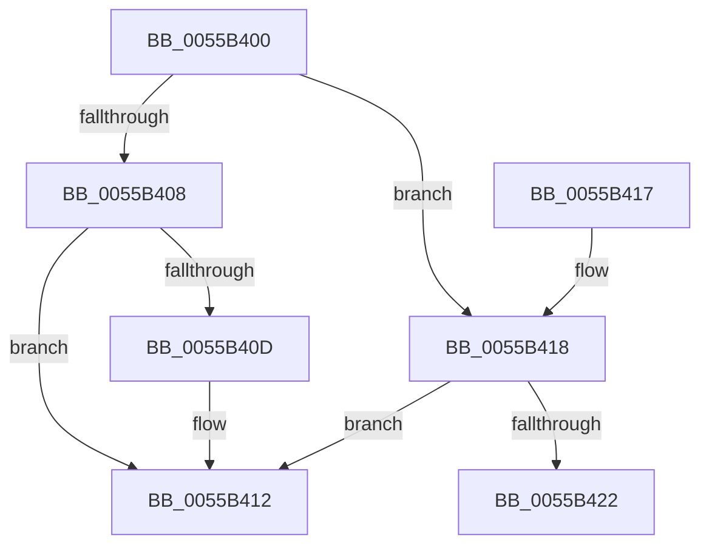

# HalpPreprocessNmi

- RVA: `0x0055B400`–`0x0055B42C` (길이 `44` bytes)
- VA: `0x000000014055B400`
- 실행 섹션: `.text`
- PDB 이름 있음: `예`; PDB Function 태그: `아니요`
- unwind 정보 RVA: `0x0008A618`
- 디코드: `16`개 명령, `44/44` bytes 표시
- 미해석 바이트: `0` (있으면 어셈블리에 `.byte`로 보존)

> 이 문서는 커널 이미지의 기계어와 PDB 기호를 분석해 생성했습니다. 4번과 5번은 함수 원형과 자료형을 바이너리 사용 방식에서 추정한 C 해석이며 원본 소스 복구 결과는 아닙니다.

## 1. Dependencies

- 직접 호출 지점: **2**; 고유 호출 대상: **2**
- 직접 호출자로 확인된 함수: **0**
- RIP 상대 이미지 참조: **1**

### Outgoing calls
- `0x0055B40D` → [HalpWatchdogCheckPreResetNMI](../54/HalpWatchdogCheckPreResetNMI_function_0054C7F4.md) (function, `0x0054C7F4`)
- `0x0055B426` → [HalpInterruptRebootService](HalpInterruptRebootService_function_0055B850.md) (function, `0x0055B850`)

### Direct callers
- 이 함수 시작 RVA로 연결되는 직접 call은 확인되지 않았습니다. 간접 호출은 완전히 역산할 수 없습니다.

### Static image references
- `0x0055B418` → RVA `0x00F90530` (`.data`; read)

## 2. Other-region calls and transfers

- 다른 실행 섹션으로 향하는 call: **0**
- 별도 외부 분기/꼬리 이동을 확인하지 못했습니다.

## 3. Assembly (complete function range)

```asm
0055B400  48 83 EC 28                     sub rsp, 0x28
0055B404  85 C9                           test ecx, ecx
0055B406  74 10                           je 0x14055b418
0055B408  83 F9 01                        cmp ecx, 1
0055B40B  75 05                           jne 0x14055b412
0055B40D  E8 E2 13 FF FF                  call 0x14054c7f4
0055B412  48 83 C4 28                     add rsp, 0x28
0055B416  C3                              ret
0055B417  CC                              int3
0055B418  8A 05 12 51 A3 00               mov al, byte ptr [rip + 0xa35112]
0055B41E  84 C0                           test al, al
0055B420  74 F0                           je 0x14055b412
0055B422  33 D2                           xor edx, edx
0055B424  33 C9                           xor ecx, ecx
0055B426  E8 25 04 00 00                  call 0x14055b850
0055B42B  CC                              int3
```

## 4. C-style interpretation (structured pseudocode)

```c
__int64 __fastcall HalpPreprocessNmi(int a1, int a2)
{
    __int64 result;
    __int64 v_rsp;

    v_rsp = (v_rsp) - (40);
    if (a1 == 0) goto loc_0055B418;
    if (a1 == 1) {
        result = HalpWatchdogCheckPreResetNMI(a1, a2, a3, a4);
    }
    v_rsp = (v_rsp) + (40);
    return result;
loc_0055B418:
    if ((unsigned __int8)(*(unsigned __int8 *)(v_rip + 10703122)) == 0) goto loc_0055B412;
    a2 = 0;
    a1 = 0;
    result = HalpInterruptRebootService(a1, a2, a3, a4);
    return result;
}
```

## 5. (Beta) C Style

```c
int64_t HalpPreprocessNmi(int32_t Arg1, int32_t Arg2)
{
    int64_t result;
    int64_t local_rsp;

    local_rsp = (local_rsp) - (40);
    if (Arg1 == 0) goto loc_0055B418;
    if (Arg1 == 1) {
        result = HalpWatchdogCheckPreResetNMI(Arg1, Arg2, a3, a4);
    }
    local_rsp = (local_rsp) + (40);
    return result;
loc_0055B418:
    if ((uint8_t)(*(uint8_t *)(v_rip + 0xA35112)) == 0) goto loc_0055B412;
    Arg2 = 0;
    Arg1 = 0;
    result = HalpInterruptRebootService(Arg1, Arg2, a3, a4);
    return result;
}
```

## 6. Execution-region graph

[열기: 2D/3D 그래프와 함수 탐색 컨트롤 패널](../../../control-panel.html?section=text&rva=0x0055B400&view=graph)

- 2D 그래프는 위에서 아래로 흐르고, 3D 그래프는 빈 공간을 드래그해 회전합니다. Shift+드래그는 이동, 휠은 확대·축소, 함수 노드 선택은 대상 보고서 이동입니다.

### Static fallback


