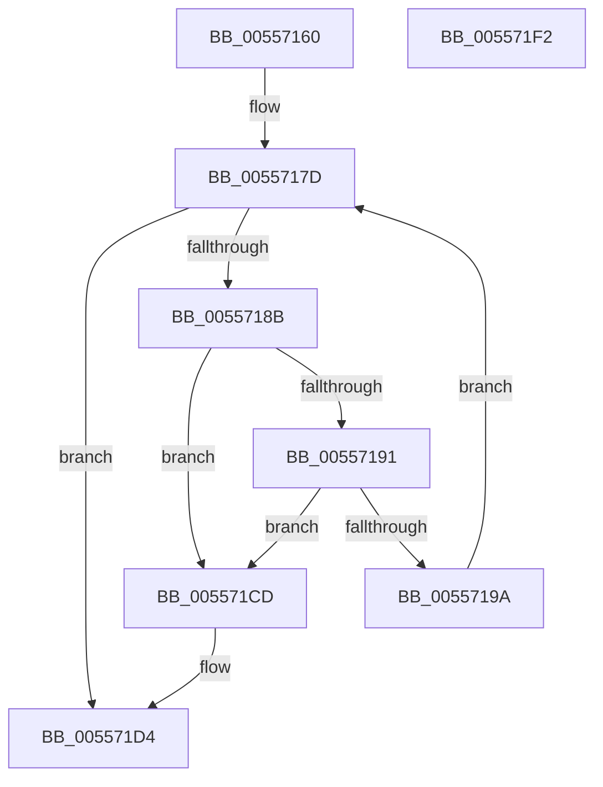

# HalpProcessSecondarySignalList

- RVA: `0x00557160`–`0x005571F3` (길이 `147` bytes)
- VA: `0x0000000140557160`
- 실행 섹션: `.text`
- PDB 이름 있음: `예`; PDB Function 태그: `아니요`
- unwind 정보 RVA: `0x00085760`
- 디코드: `36`개 명령, `147/147` bytes 표시
- 미해석 바이트: `0` (있으면 어셈블리에 `.byte`로 보존)

> 이 문서는 커널 이미지의 기계어와 PDB 기호를 분석해 생성했습니다. 4번과 5번은 함수 원형과 자료형을 바이너리 사용 방식에서 추정한 C 해석이며 원본 소스 복구 결과는 아닙니다.

## 1. Dependencies

- 직접 호출 지점: **5**; 고유 호출 대상: **3**
- 직접 호출자로 확인된 함수: **0**
- RIP 상대 이미지 참조: **4**

### Outgoing calls
- `0x00557171` → [HalpAcquireHighLevelLock](../2D/HalpAcquireHighLevelLock_function_002D2390.md) (function, `0x002D2390`)
- `0x005571AC` → [HalpReleaseHighLevelLock](../2D/HalpReleaseHighLevelLock_function_002D1C58.md) (function, `0x002D1C58`)
- `0x005571BA` → [KeSetEvent](../33/KeSetEvent_function_0033F310.md) (function, `0x0033F310`)
- `0x005571C6` → [HalpAcquireHighLevelLock](../2D/HalpAcquireHighLevelLock_function_002D2390.md) (function, `0x002D2390`)
- `0x005571E2` → [HalpReleaseHighLevelLock](../2D/HalpReleaseHighLevelLock_function_002D1C58.md) (function, `0x002D1C58`)

### Direct callers
- 이 함수 시작 RVA로 연결되는 직접 call은 확인되지 않았습니다. 간접 호출은 완전히 역산할 수 없습니다.

### Static image references
- `0x0055716A` → RVA `0x00F90A38` (`.data`; read)
- `0x00557176` → RVA `0x00F90A20` (`.data`; read)
- `0x0055719A` → RVA `0x00F90A20` (`.data`; write)
- `0x005571DB` → RVA `0x00F909D8` (`.data`; write)

## 2. Other-region calls and transfers

- 다른 실행 섹션으로 향하는 call: **0**
- 별도 외부 분기/꼬리 이동을 확인하지 못했습니다.

## 3. Assembly (complete function range)

```asm
00557160  48 89 5C 24 08                  mov qword ptr [rsp + 8], rbx
00557165  56                              push rsi
00557166  48 83 EC 20                     sub rsp, 0x20
0055716A  48 8D 0D C7 98 A3 00            lea rcx, [rip + 0xa398c7]
00557171  E8 1A B2 D7 FF                  call 0x1402d2390
00557176  48 8D 35 A3 98 A3 00            lea rsi, [rip + 0xa398a3]
0055717D  48 8B 1D 9C 98 A3 00            mov rbx, qword ptr [rip + 0xa3989c]
00557184  8A D0                           mov dl, al
00557186  48 3B DE                        cmp rbx, rsi
00557189  74 49                           je 0x1405571d4
0055718B  48 39 73 08                     cmp qword ptr [rbx + 8], rsi
0055718F  75 3C                           jne 0x1405571cd
00557191  48 8B 03                        mov rax, qword ptr [rbx]
00557194  48 39 58 08                     cmp qword ptr [rax + 8], rbx
00557198  75 33                           jne 0x1405571cd
0055719A  48 89 05 7F 98 A3 00            mov qword ptr [rip + 0xa3987f], rax
005571A1  48 8D 0D 90 98 A3 00            lea rcx, [rip + 0xa39890]
005571A8  48 89 70 08                     mov qword ptr [rax + 8], rsi
005571AC  E8 A7 AA D7 FF                  call 0x1402d1c58
005571B1  48 8D 4B E8                     lea rcx, [rbx - 0x18]
005571B5  45 33 C0                        xor r8d, r8d
005571B8  33 D2                           xor edx, edx
005571BA  E8 51 81 DE FF                  call 0x14033f310
005571BF  48 8D 0D 72 98 A3 00            lea rcx, [rip + 0xa39872]
005571C6  E8 C5 B1 D7 FF                  call 0x1402d2390
005571CB  EB B0                           jmp 0x14055717d
005571CD  B9 03 00 00 00                  mov ecx, 3
005571D2  CD 29                           int 0x29
005571D4  48 8D 0D 5D 98 A3 00            lea rcx, [rip + 0xa3985d]
005571DB  C6 05 F6 97 A3 00 00            mov byte ptr [rip + 0xa397f6], 0
005571E2  E8 71 AA D7 FF                  call 0x1402d1c58
005571E7  48 8B 5C 24 30                  mov rbx, qword ptr [rsp + 0x30]
005571EC  48 83 C4 20                     add rsp, 0x20
005571F0  5E                              pop rsi
005571F1  C3                              ret
005571F2  CC                              int3
```

## 4. C-style interpretation (structured pseudocode)

```c
__int64 __fastcall HalpProcessSecondarySignalList(__int64 a1, __int64 a2, int a3)
{
    __int64 result;
    __int64 v_rsp;
    unsigned __int64 v_stack_p8;

    v_stack_p8 = v_rbx;
    v_rsp = (v_rsp) - (32);
    result = HalpAcquireHighLevelLock(v_rip + 10721479, a2, a3, a4);
loc_0055717D:
    if ((*(unsigned __int64 *)(v_rip + 10721436)) == (v_rip + 10721443)) goto loc_005571D4;
    if ((*(unsigned __int64 *)(*(unsigned __int64 *)(v_rip + 10721436) + 8)) != (v_rip + 10721443)) goto loc_005571CD;
    if ((*(unsigned __int64 *)(*(unsigned __int64 *)(*(unsigned __int64 *)(v_rip + 10721436)) + 8)) != (*(unsigned __int64 *)(v_rip + 10721436))) goto loc_005571CD;
    *(unsigned __int64 *)(v_rip + 10721407) = *(unsigned __int64 *)(*(unsigned __int64 *)(v_rip + 10721436));
    *(unsigned __int64 *)(*(unsigned __int64 *)(*(unsigned __int64 *)(v_rip + 10721436)) + 8) = v_rip + 10721443;
    result = HalpReleaseHighLevelLock(v_rip + 10721424, (unsigned __int8)(result), a3, a4);
    a3 = 0;
    a2 = 0;
    result = KeSetEvent(*(unsigned __int64 *)(v_rip + 10721436) - 24, a2, a3, a4);
    result = HalpAcquireHighLevelLock(v_rip + 10721394, a2, a3, a4);
    goto loc_0055717D;
loc_005571CD:
loc_005571D4:
    *(unsigned __int8 *)(v_rip + 10721270) = 0;
    result = HalpReleaseHighLevelLock(v_rip + 10721373, a2, a3, a4);
    v_rsp = (v_rsp) + (32);
    return result;
}
```

## 5. (Beta) C Style

```c
int64_t HalpProcessSecondarySignalList(int64_t Arg1, int64_t Arg2, int32_t Arg3)
{
    int64_t result;
    int64_t local_rsp;
    uint64_t v_stack_p8;

    v_stack_p8 = local_rbx;
    local_rsp = (local_rsp) - (32);
    result = HalpAcquireHighLevelLock(v_rip + 10721479, Arg2, Arg3, a4);
loc_0055717D:
    if ((*(uint64_t *)(v_rip + 0xA3989C)) == (v_rip + 10721443)) goto loc_005571D4;
    if ((*(uint64_t *)(*(uint64_t *)(v_rip + 0xA3989C) + 0x8)) != (v_rip + 10721443)) goto loc_005571CD;
    if ((*(uint64_t *)(*(uint64_t *)(*(uint64_t *)(v_rip + 0xA3989C)) + 0x8)) != (*(uint64_t *)(v_rip + 0xA3989C))) goto loc_005571CD;
    *(uint64_t *)(v_rip + 0xA3987F) = *(uint64_t *)(*(uint64_t *)(v_rip + 0xA3989C));
    *(uint64_t *)(*(uint64_t *)(*(uint64_t *)(v_rip + 0xA3989C)) + 0x8) = v_rip + 10721443;
    result = HalpReleaseHighLevelLock(v_rip + 10721424, (uint8_t)(result), Arg3, a4);
    Arg3 = 0;
    Arg2 = 0;
    result = KeSetEvent(*(uint64_t *)(v_rip + 0xA3989C) - 24, Arg2, Arg3, a4);
    result = HalpAcquireHighLevelLock(v_rip + 10721394, Arg2, Arg3, a4);
    goto loc_0055717D;
loc_005571CD:
loc_005571D4:
    *(uint8_t *)(v_rip + 0xA397F6) = 0;
    result = HalpReleaseHighLevelLock(v_rip + 10721373, Arg2, Arg3, a4);
    local_rsp = (local_rsp) + (32);
    return result;
}
```

## 6. Execution-region graph

[열기: 2D/3D 그래프와 함수 탐색 컨트롤 패널](../../../control-panel.html?section=text&rva=0x00557160&view=graph)

- 2D 그래프는 위에서 아래로 흐르고, 3D 그래프는 빈 공간을 드래그해 회전합니다. Shift+드래그는 이동, 휠은 확대·축소, 함수 노드 선택은 대상 보고서 이동입니다.

### Static fallback


