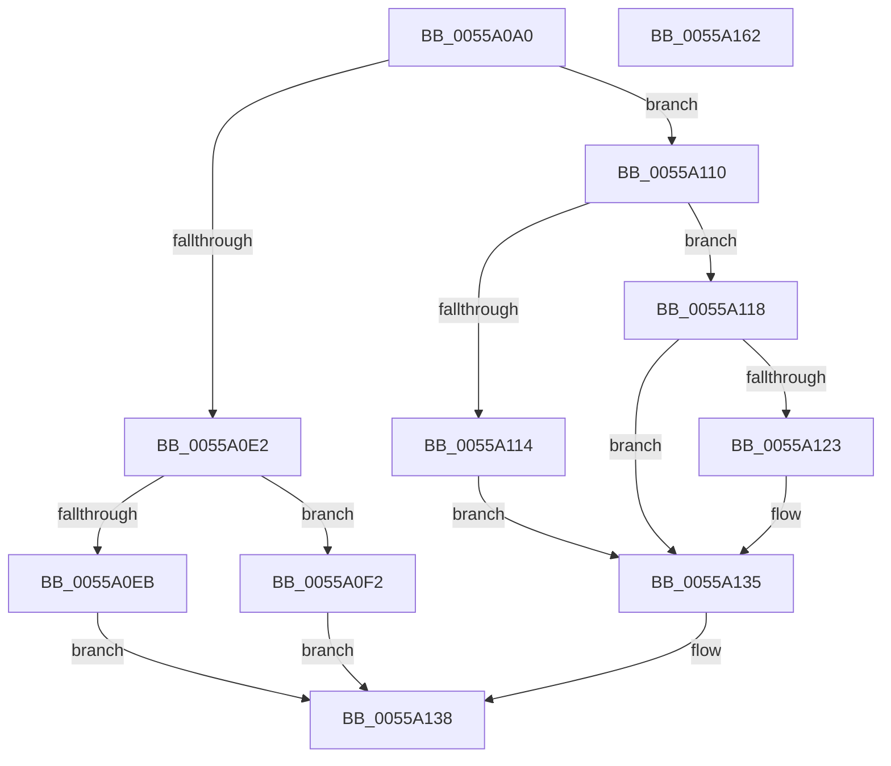

# HalpQueryNumaRangeTableInformation

- RVA: `0x0055A0A0`–`0x0055A163` (길이 `195` bytes)
- VA: `0x000000014055A0A0`
- 실행 섹션: `.text`
- PDB 이름 있음: `예`; PDB Function 태그: `아니요`
- unwind 정보 RVA: `0x00060300`
- 디코드: `58`개 명령, `195/195` bytes 표시
- 미해석 바이트: `0` (있으면 어셈블리에 `.byte`로 보존)

> 이 문서는 커널 이미지의 기계어와 PDB 기호를 분석해 생성했습니다. 4번과 5번은 함수 원형과 자료형을 바이너리 사용 방식에서 추정한 C 해석이며 원본 소스 복구 결과는 아닙니다.

## 1. Dependencies

- 직접 호출 지점: **4**; 고유 호출 대상: **3**
- 직접 호출자로 확인된 함수: **1**
- RIP 상대 이미지 참조: **3**

### Outgoing calls
- `0x0055A0C9` → [ExAcquireSpinLockShared](../24/ExAcquireSpinLockShared_function_0024DCE0.md) (function, `0x0024DCE0`)
- `0x0055A109` → [memcpy](../6C/memcpy_function_006C6840.md) (function, `0x006C6840`)
- `0x0055A130` → [memcpy](../6C/memcpy_function_006C6840.md) (function, `0x006C6840`)
- `0x0055A142` → [ExReleaseSpinLockShared](../2F/ExReleaseSpinLockShared_function_002F0EF0.md) (function, `0x002F0EF0`)

### Direct callers
- [sub_00B80AC2](../../pagelk/B8/Unknown_function_00B80AC2.md) at `0x00B80B4E`

### Static image references
- `0x0055A0BE` → RVA `0x00F90610` (`.data`; read)
- `0x0055A0D1` → RVA `0x00F90630` (`.data`; read)
- `0x0055A0E2` → RVA `0x00F90608` (`.data`; read)

## 2. Other-region calls and transfers

- 다른 실행 섹션으로 향하는 call: **0**
- 별도 외부 분기/꼬리 이동을 확인하지 못했습니다.

## 3. Assembly (complete function range)

```asm
0055A0A0  48 89 5C 24 08                  mov qword ptr [rsp + 8], rbx
0055A0A5  48 89 6C 24 10                  mov qword ptr [rsp + 0x10], rbp
0055A0AA  48 89 74 24 18                  mov qword ptr [rsp + 0x18], rsi
0055A0AF  57                              push rdi
0055A0B0  41 56                           push r14
0055A0B2  41 57                           push r15
0055A0B4  48 83 EC 20                     sub rsp, 0x20
0055A0B8  48 8B E9                        mov rbp, rcx
0055A0BB  4D 8B F0                        mov r14, r8
0055A0BE  48 8D 0D 4B 65 A3 00            lea rcx, [rip + 0xa3654b]
0055A0C5  8B FA                           mov edi, edx
0055A0C7  33 DB                           xor ebx, ebx
0055A0C9  E8 12 3C CF FF                  call 0x14024dce0
0055A0CE  44 8A F8                        mov r15b, al
0055A0D1  8B 05 59 65 A3 00               mov eax, dword ptr [rip + 0xa36559]
0055A0D7  8D 70 01                        lea esi, [rax + 1]
0055A0DA  C1 E6 04                        shl esi, 4
0055A0DD  4D 85 F6                        test r14, r14
0055A0E0  75 2E                           jne 0x14055a110
0055A0E2  48 39 1D 1F 65 A3 00            cmp qword ptr [rip + 0xa3651f], rbx
0055A0E9  75 07                           jne 0x14055a0f2
0055A0EB  BB 25 02 00 C0                  mov ebx, 0xc0000225
0055A0F0  EB 46                           jmp 0x14055a138
0055A0F2  B8 08 00 00 00                  mov eax, 8
0055A0F7  48 8D 15 0A 65 A3 00            lea rdx, [rip + 0xa3650a]
0055A0FE  3B F8                           cmp edi, eax
0055A100  48 8B CD                        mov rcx, rbp
0055A103  0F 43 F8                        cmovae edi, eax
0055A106  44 8B C7                        mov r8d, edi
0055A109  E8 32 C7 16 00                  call 0x1406c6840
0055A10E  EB 28                           jmp 0x14055a138
0055A110  85 C0                           test eax, eax
0055A112  75 04                           jne 0x14055a118
0055A114  8B F3                           mov esi, ebx
0055A116  EB 1D                           jmp 0x14055a135
0055A118  3B F7                           cmp esi, edi
0055A11A  8B C6                           mov eax, esi
0055A11C  0F 47 C7                        cmova eax, edi
0055A11F  85 FF                           test edi, edi
0055A121  74 12                           je 0x14055a135
0055A123  48 8B 15 DE 64 A3 00            mov rdx, qword ptr [rip + 0xa364de]
0055A12A  48 8B CD                        mov rcx, rbp
0055A12D  44 8B C0                        mov r8d, eax
0055A130  E8 0B C7 16 00                  call 0x1406c6840
0055A135  41 89 36                        mov dword ptr [r14], esi
0055A138  41 8A D7                        mov dl, r15b
0055A13B  48 8D 0D CE 64 A3 00            lea rcx, [rip + 0xa364ce]
0055A142  E8 A9 6D D9 FF                  call 0x1402f0ef0
0055A147  48 8B 6C 24 48                  mov rbp, qword ptr [rsp + 0x48]
0055A14C  8B C3                           mov eax, ebx
0055A14E  48 8B 5C 24 40                  mov rbx, qword ptr [rsp + 0x40]
0055A153  48 8B 74 24 50                  mov rsi, qword ptr [rsp + 0x50]
0055A158  48 83 C4 20                     add rsp, 0x20
0055A15C  41 5F                           pop r15
0055A15E  41 5E                           pop r14
0055A160  5F                              pop rdi
0055A161  C3                              ret
0055A162  CC                              int3
```

## 4. C-style interpretation (structured pseudocode)

```c
__int64 __fastcall HalpQueryNumaRangeTableInformation(__int64 a1, int a2, __int64 a3)
{
    __int64 result;
    __int64 v_rbx;
    __int64 v_rdi;
    __int64 v_rsi;
    __int64 v_rsp;
    unsigned __int64 v_stack_p10;
    unsigned __int64 v_stack_p18;
    unsigned __int64 v_stack_p8;

    v_stack_p8 = v_rbx;
    v_stack_p10 = v_rbp;
    v_stack_p18 = v_rsi;
    v_rsp = (v_rsp) - (32);
    v_rbx = 0;
    result = ExAcquireSpinLockShared(v_rip + 10708299, a2, a3, a4);
    v_rsi = (unsigned int)(((unsigned int)(*(unsigned int *)(v_rip + 10708313)) + 1) << (4));
    if (a3 != 0) goto loc_0055A110;
    if ((*(unsigned __int64 *)(v_rip + 10708255)) != 0) goto loc_0055A0F2;
    goto loc_0055A138;
loc_0055A0F2:
    v_rdi = (unsigned int)(a2);
    if (((unsigned int)((unsigned int)(a2))) >= 8) { v_rdi = 8; }
    result = memcpy(a1, v_rip + 10708234, (unsigned int)((unsigned int)(v_rdi)), a4);
    goto loc_0055A138;
loc_0055A110:
    if ((unsigned int)(result) != 0) goto loc_0055A118;
    goto loc_0055A135;
loc_0055A118:
    result = (unsigned int)((unsigned int)((unsigned int)((unsigned int)((unsigned int)(0xC0000225ULL)))));
    if (((unsigned int)((unsigned int)((unsigned int)((unsigned int)(0xC0000225ULL))))) > ((unsigned int)(v_rdi))) { result = (unsigned int)(v_rdi); }
    if ((unsigned int)(v_rdi) != 0) {
        a2 = *(unsigned __int64 *)(v_rip + 10708190);
        a1 = a1;
        a3 = (unsigned int)(result);
        result = memcpy(a1, a2, a3, a4);
    }
    *(unsigned int *)(a3) = (unsigned int)((unsigned int)((unsigned int)((unsigned int)(0xC0000225ULL))));
loc_0055A138:
    result = ExReleaseSpinLockShared(v_rip + 10708174, (unsigned __int8)((unsigned __int8)(result)), a3, a4);
    v_rsp = (v_rsp) + (32);
    return (unsigned int)((unsigned int)((unsigned int)(0xC0000225ULL)));
}
```

## 5. (Beta) C Style

```c
int64_t HalpQueryNumaRangeTableInformation(int64_t Arg1, int32_t Arg2, int64_t Arg3)
{
    int64_t result;
    int64_t local_rbx;
    int64_t local_rdi;
    int64_t local_rsi;
    int64_t local_rsp;
    uint64_t v_stack_p10;
    uint64_t v_stack_p18;
    uint64_t v_stack_p8;

    v_stack_p8 = local_rbx;
    v_stack_p10 = local_rbp;
    v_stack_p18 = local_rsi;
    local_rsp = (local_rsp) - (32);
    local_rbx = 0;
    result = ExAcquireSpinLockShared(v_rip + 10708299, Arg2, Arg3, a4);
    local_rsi = (uint32_t)(((uint32_t)(*(uint32_t *)(v_rip + 0xA36559)) + 1) << (4));
    if (Arg3 != 0) goto loc_0055A110;
    if ((*(uint64_t *)(v_rip + 0xA3651F)) != 0) goto loc_0055A0F2;
    goto loc_0055A138;
loc_0055A0F2:
    local_rdi = (uint32_t)(Arg2);
    if (((uint32_t)((uint32_t)(Arg2))) >= 8) { local_rdi = 8; }
    result = memcpy(Arg1, v_rip + 10708234, (uint32_t)((uint32_t)(local_rdi)), a4);
    goto loc_0055A138;
loc_0055A110:
    if ((uint32_t)(result) != 0) goto loc_0055A118;
    goto loc_0055A135;
loc_0055A118:
    result = (uint32_t)((uint32_t)((uint32_t)((uint32_t)((uint32_t)(0xC0000225ULL)))));
    if (((uint32_t)((uint32_t)((uint32_t)((uint32_t)(0xC0000225ULL))))) > ((uint32_t)(local_rdi))) { result = (uint32_t)(local_rdi); }
    if ((uint32_t)(local_rdi) != 0) {
        Arg2 = *(uint64_t *)(v_rip + 0xA364DE);
        Arg1 = Arg1;
        Arg3 = (uint32_t)(result);
        result = memcpy(Arg1, Arg2, Arg3, a4);
    }
    *(uint32_t *)(Arg3) = (uint32_t)((uint32_t)((uint32_t)((uint32_t)(0xC0000225ULL))));
loc_0055A138:
    result = ExReleaseSpinLockShared(v_rip + 10708174, (uint8_t)((uint8_t)(result)), Arg3, a4);
    local_rsp = (local_rsp) + (32);
    return (uint32_t)((uint32_t)((uint32_t)(0xC0000225ULL)));
}
```

## 6. Execution-region graph

[열기: 2D/3D 그래프와 함수 탐색 컨트롤 패널](../../../control-panel.html?section=text&rva=0x0055A0A0&view=graph)

- 2D 그래프는 위에서 아래로 흐르고, 3D 그래프는 빈 공간을 드래그해 회전합니다. Shift+드래그는 이동, 휠은 확대·축소, 함수 노드 선택은 대상 보고서 이동입니다.

### Static fallback


