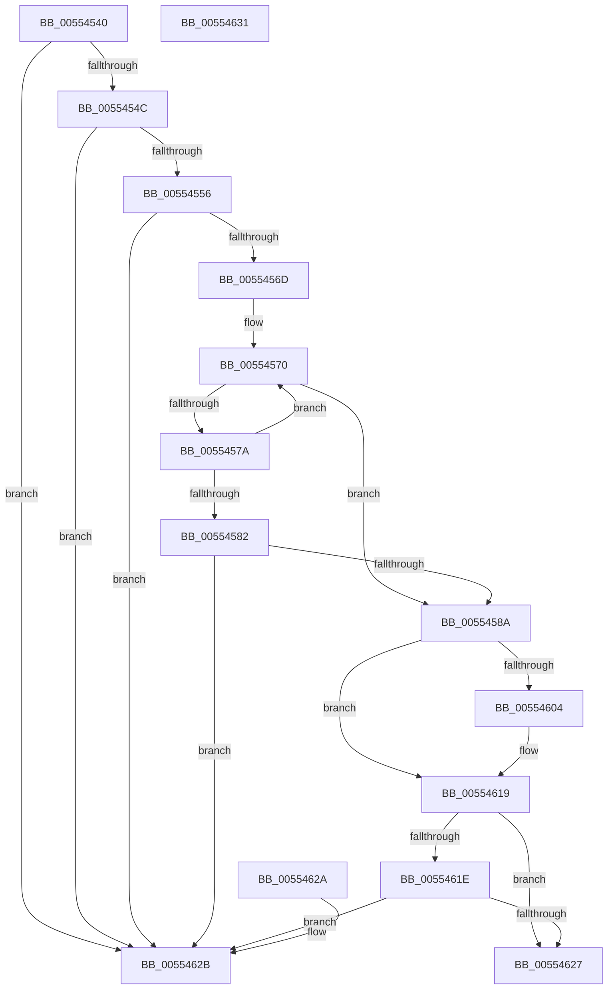

# HalpRegisterDmaChannel

- RVA: `0x00554540`–`0x00554632` (길이 `242` bytes)
- VA: `0x0000000140554540`
- 실행 섹션: `.text`
- PDB 이름 있음: `예`; PDB Function 태그: `아니요`
- unwind 정보 RVA: `0x000DB714`
- 디코드: `64`개 명령, `242/242` bytes 표시
- 미해석 바이트: `0` (있으면 어셈블리에 `.byte`로 보존)

> 이 문서는 커널 이미지의 기계어와 PDB 기호를 분석해 생성했습니다. 4번과 5번은 함수 원형과 자료형을 바이너리 사용 방식에서 추정한 C 해석이며 원본 소스 복구 결과는 아닙니다.

## 1. Dependencies

- 직접 호출 지점: **0**; 고유 호출 대상: **0**
- 직접 호출자로 확인된 함수: **1**
- RIP 상대 이미지 참조: **2**

### Outgoing calls
- 직접 디코드된 call 명령이 없습니다.

### Direct callers
- [HalpExtRegisterResourceDescriptor](../54/HalpExtRegisterResourceDescriptor_function_0054E640.md) at `0x0054E834`

### Static image references
- `0x00554556` → RVA `0x00FC16F0` (`.data`; read)
- `0x005545AE` → RVA `0x004B8EE0` (`HalpDmaControllerDpcRoutine`; read)

## 2. Other-region calls and transfers

- 다른 실행 섹션으로 향하는 call: **0**
- 별도 외부 분기/꼬리 이동을 확인하지 못했습니다.

## 3. Assembly (complete function range)

```asm
00554540  83 39 01                        cmp dword ptr [rcx], 1
00554543  4C 8B C1                        mov r8, rcx
00554546  0F 85 DF 00 00 00               jne 0x14055462b
0055454C  83 79 04 24                     cmp dword ptr [rcx + 4], 0x24
00554550  0F 85 D5 00 00 00               jne 0x14055462b
00554556  48 8B 05 93 D1 A6 00            mov rax, qword ptr [rip + 0xa6d193]
0055455D  4C 8D 15 8C D1 A6 00            lea r10, [rip + 0xa6d18c]
00554564  49 3B C2                        cmp rax, r10
00554567  0F 84 BE 00 00 00               je 0x14055462b
0055456D  8B 49 08                        mov ecx, dword ptr [rcx + 8]
00554570  8B 50 20                        mov edx, dword ptr [rax + 0x20]
00554573  4C 8D 08                        lea r9, [rax]
00554576  3B D1                           cmp edx, ecx
00554578  74 10                           je 0x14055458a
0055457A  48 8B 00                        mov rax, qword ptr [rax]
0055457D  49 3B C2                        cmp rax, r10
00554580  75 EE                           jne 0x140554570
00554582  3B D1                           cmp edx, ecx
00554584  0F 85 A1 00 00 00               jne 0x14055462b
0055458A  41 8B 48 20                     mov ecx, dword ptr [r8 + 0x20]
0055458E  48 8D 14 89                     lea rdx, [rcx + rcx*4]
00554592  48 C1 E2 05                     shl rdx, 5
00554596  49 03 51 38                     add rdx, qword ptr [r9 + 0x38]
0055459A  89 0A                           mov dword ptr [rdx], ecx
0055459C  33 C9                           xor ecx, ecx
0055459E  88 4A 06                        mov byte ptr [rdx + 6], cl
005545A1  66 C7 42 04 01 00               mov word ptr [rdx + 4], 1
005545A7  41 8B 40 1C                     mov eax, dword ptr [r8 + 0x1c]
005545AB  89 42 78                        mov dword ptr [rdx + 0x78], eax
005545AE  48 8D 05 2B 49 F6 FF            lea rax, [rip - 0x9b6d5]
005545B5  48 89 8A 80 00 00 00            mov qword ptr [rdx + 0x80], rcx
005545BC  48 89 8A 88 00 00 00            mov qword ptr [rdx + 0x88], rcx
005545C3  48 89 4A 08                     mov qword ptr [rdx + 8], rcx
005545C7  48 89 4A 10                     mov qword ptr [rdx + 0x10], rcx
005545CB  48 89 4A 18                     mov qword ptr [rdx + 0x18], rcx
005545CF  89 4A 20                        mov dword ptr [rdx + 0x20], ecx
005545D2  48 89 42 40                     mov qword ptr [rdx + 0x40], rax
005545D6  48 8D 82 90 00 00 00            lea rax, [rdx + 0x90]
005545DD  C7 42 28 13 01 00 00            mov dword ptr [rdx + 0x28], 0x113
005545E4  48 89 52 48                     mov qword ptr [rdx + 0x48], rdx
005545E8  48 89 4A 60                     mov qword ptr [rdx + 0x60], rcx
005545EC  48 89 4A 38                     mov qword ptr [rdx + 0x38], rcx
005545F0  48 89 40 08                     mov qword ptr [rax + 8], rax
005545F4  48 89 00                        mov qword ptr [rax], rax
005545F7  41 8A 40 0C                     mov al, byte ptr [r8 + 0xc]
005545FB  88 42 68                        mov byte ptr [rdx + 0x68], al
005545FE  41 38 48 0C                     cmp byte ptr [r8 + 0xc], cl
00554602  74 15                           je 0x140554619
00554604  41 8B 40 10                     mov eax, dword ptr [r8 + 0x10]
00554608  89 42 6C                        mov dword ptr [rdx + 0x6c], eax
0055460B  41 8B 40 14                     mov eax, dword ptr [r8 + 0x14]
0055460F  89 42 70                        mov dword ptr [rdx + 0x70], eax
00554612  41 8B 40 18                     mov eax, dword ptr [r8 + 0x18]
00554616  89 42 74                        mov dword ptr [rdx + 0x74], eax
00554619  39 4A 78                        cmp dword ptr [rdx + 0x78], ecx
0055461C  74 09                           je 0x140554627
0055461E  49 39 89 90 00 00 00            cmp qword ptr [r9 + 0x90], rcx
00554625  74 04                           je 0x14055462b
00554627  33 C0                           xor eax, eax
00554629  C3                              ret
0055462A  CC                              int3
0055462B  B8 0D 00 00 C0                  mov eax, 0xc000000d
00554630  C3                              ret
00554631  CC                              int3
```

## 4. C-style interpretation (structured pseudocode)

```c
__int64 __fastcall HalpRegisterDmaChannel(__int64 a1)
{
    __int64 result;

    if ((*(unsigned int *)(a1)) != 1) goto loc_0055462B;
    if ((*(unsigned int *)(a1 + 4)) != 36) goto loc_0055462B;
    if ((*(unsigned __int64 *)(v_rip + 10932627)) == (v_rip + 10932620)) goto loc_0055462B;
loc_00554570:
    if (((unsigned int)((unsigned int)(*(unsigned int *)(*(unsigned __int64 *)(v_rip + 10932627) + 32)))) == ((unsigned int)((unsigned int)(*(unsigned int *)(a1 + 8))))) goto loc_0055458A;
    if ((*(unsigned __int64 *)(*(unsigned __int64 *)(v_rip + 10932627))) != (v_rip + 10932620)) goto loc_00554570;
    if (((unsigned int)((unsigned int)(*(unsigned int *)(*(unsigned __int64 *)(v_rip + 10932627) + 32)))) != ((unsigned int)((unsigned int)(*(unsigned int *)(a1 + 8))))) goto loc_0055462B;
loc_0055458A:
    a2 = ((unsigned int)(*(unsigned int *)(a1 + 32)) + (unsigned int)(*(unsigned int *)(a1 + 32)) * 4) << (5);
    a2 = (a2) + (*(unsigned __int64 *)(*(unsigned __int64 *)(v_rip + 10932627) + 56));
    *(unsigned int *)(a2) = (unsigned int)((unsigned int)(*(unsigned int *)(a1 + 32)));
    a1 = 0;
    *(unsigned __int8 *)(a2 + 6) = 0;
    *(unsigned __int16 *)(a2 + 4) = 1;
    *(unsigned int *)(a2 + 120) = (unsigned int)((unsigned int)(*(unsigned int *)(a1 + 28)));
    *(unsigned __int64 *)(a2 + 128) = 0;
    *(unsigned __int64 *)(a2 + 136) = 0;
    *(unsigned __int64 *)(a2 + 8) = 0;
    *(unsigned __int64 *)(a2 + 16) = 0;
    *(unsigned __int64 *)(a2 + 24) = 0;
    *(unsigned int *)(a2 + 32) = 0;
    *(unsigned __int64 *)(a2 + 64) = v_rip - 636629;
    *(unsigned int *)(a2 + 40) = 275;
    *(unsigned __int64 *)(a2 + 72) = a2;
    *(unsigned __int64 *)(a2 + 96) = 0;
    *(unsigned __int64 *)(a2 + 56) = 0;
    *(unsigned __int64 *)(a2 + 144 + 8) = a2 + 144;
    *(unsigned __int64 *)(a2 + 144) = a2 + 144;
    *(unsigned __int8 *)(a2 + 104) = (unsigned __int8)(*(unsigned __int8 *)(a1 + 12));
    result = *(unsigned __int8 *)(a1 + 12);
    if ((*(unsigned __int8 *)(a1 + 12)) != 0) {
        result = *(unsigned int *)(a1 + 16);
        *(unsigned int *)(a2 + 108) = (unsigned int)(result);
        result = *(unsigned int *)(a1 + 20);
        *(unsigned int *)(a2 + 112) = (unsigned int)(result);
        result = *(unsigned int *)(a1 + 24);
        *(unsigned int *)(a2 + 116) = (unsigned int)(result);
    }
    if ((*(unsigned int *)(a2 + 120)) == 0) goto loc_00554627;
    if ((*(unsigned __int64 *)(*(unsigned __int64 *)(v_rip + 10932627) + 144)) == 0) goto loc_0055462B;
loc_00554627:
    result = 0;
    return result;
loc_0055462B:
    return (unsigned int)(0xC000000DULL);
}
```

## 5. (Beta) C Style

```c
int64_t HalpRegisterDmaChannel(void *Arg1)
{
    uint8_t *arg1 = (uint8_t *)Arg1;

    int64_t result;

    if ((*(uint32_t *)(arg1)) != 1) goto loc_0055462B;
    if ((*(uint32_t *)(arg1 + 0x4)) != 36) goto loc_0055462B;
    if ((*(uint64_t *)(v_rip + 0xA6D193)) == (v_rip + 10932620)) goto loc_0055462B;
loc_00554570:
    if (((uint32_t)((uint32_t)(*(uint32_t *)(*(uint64_t *)(v_rip + 0xA6D193) + 0x20)))) == ((uint32_t)((uint32_t)(*(uint32_t *)(arg1 + 0x8))))) goto loc_0055458A;
    if ((*(uint64_t *)(*(uint64_t *)(v_rip + 0xA6D193))) != (v_rip + 10932620)) goto loc_00554570;
    if (((uint32_t)((uint32_t)(*(uint32_t *)(*(uint64_t *)(v_rip + 0xA6D193) + 0x20)))) != ((uint32_t)((uint32_t)(*(uint32_t *)(arg1 + 0x8))))) goto loc_0055462B;
loc_0055458A:
    a2 = ((uint32_t)(*(uint32_t *)(arg1 + 0x20)) + (uint32_t)(*(uint32_t *)(arg1 + 0x20)) * 4) << (5);
    a2 = (a2) + (*(uint64_t *)(*(uint64_t *)(v_rip + 0xA6D193) + 0x38));
    *(uint32_t *)(a2) = (uint32_t)((uint32_t)(*(uint32_t *)(arg1 + 0x20)));
    Arg1 = 0;
    *(uint8_t *)(a2 + 0x6) = 0;
    *(uint16_t *)(a2 + 0x4) = 1;
    *(uint32_t *)(a2 + 0x78) = (uint32_t)((uint32_t)(*(uint32_t *)(arg1 + 0x1C)));
    *(uint64_t *)(a2 + 0x80) = 0;
    *(uint64_t *)(a2 + 0x88) = 0;
    *(uint64_t *)(a2 + 0x8) = 0;
    *(uint64_t *)(a2 + 0x10) = 0;
    *(uint64_t *)(a2 + 0x18) = 0;
    *(uint32_t *)(a2 + 0x20) = 0;
    *(uint64_t *)(a2 + 0x40) = v_rip - 636629;
    *(uint32_t *)(a2 + 0x28) = 275;
    *(uint64_t *)(a2 + 0x48) = a2;
    *(uint64_t *)(a2 + 0x60) = 0;
    *(uint64_t *)(a2 + 0x38) = 0;
    *(uint64_t *)(a2 + 0x90 + 0x8) = a2 + 144;
    *(uint64_t *)(a2 + 0x90) = a2 + 144;
    *(uint8_t *)(a2 + 0x68) = (uint8_t)(*(uint8_t *)(arg1 + 0xC));
    result = *(uint8_t *)(arg1 + 0xC);
    if ((*(uint8_t *)(arg1 + 0xC)) != 0) {
        result = *(uint32_t *)(arg1 + 0x10);
        *(uint32_t *)(a2 + 0x6C) = (uint32_t)(result);
        result = *(uint32_t *)(arg1 + 0x14);
        *(uint32_t *)(a2 + 0x70) = (uint32_t)(result);
        result = *(uint32_t *)(arg1 + 0x18);
        *(uint32_t *)(a2 + 0x74) = (uint32_t)(result);
    }
    if ((*(uint32_t *)(a2 + 0x78)) == 0) goto loc_00554627;
    if ((*(uint64_t *)(*(uint64_t *)(v_rip + 0xA6D193) + 0x90)) == 0) goto loc_0055462B;
loc_00554627:
    result = 0;
    return result;
loc_0055462B:
    return (uint32_t)(0xC000000DULL);
}
```

### 관측된 메모리 오프셋

구조체 형식이 확인되지 않은 접근은 인자 기준의 오프셋으로만 기록했습니다.

| 기준 인자 | 오프셋 표현 | 폭 (bit) | 접근 |
|---|---:|---:|---|
| `Arg1` | `+ 0x0` | `32` | `R` |
| `Arg1` | `+ 0x4` | `32` | `R` |
| `Arg1` | `+ 0x8` | `32` | `R` |
| `Arg1` | `+ 0xC` | `8` | `R` |
| `Arg1` | `+ 0x10` | `32` | `R` |
| `Arg1` | `+ 0x14` | `32` | `R` |
| `Arg1` | `+ 0x18` | `32` | `R` |
| `Arg1` | `+ 0x1C` | `32` | `R` |
| `Arg1` | `+ 0x20` | `32` | `R` |

## 6. Execution-region graph

[열기: 2D/3D 그래프와 함수 탐색 컨트롤 패널](../../../control-panel.html?section=text&rva=0x00554540&view=graph)

- 2D 그래프는 위에서 아래로 흐르고, 3D 그래프는 빈 공간을 드래그해 회전합니다. Shift+드래그는 이동, 휠은 확대·축소, 함수 노드 선택은 대상 보고서 이동입니다.

### Static fallback


