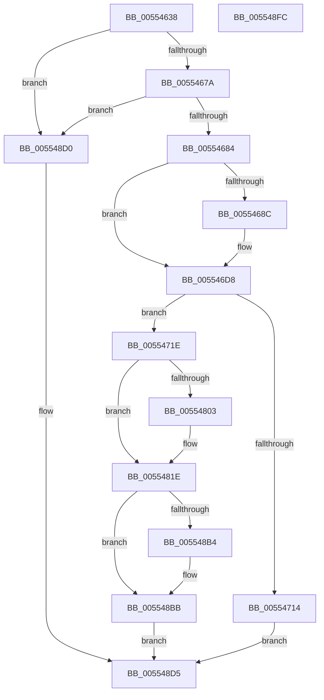

# HalpRegisterDmaController

- RVA: `0x00554638`–`0x005548FD` (길이 `709` bytes)
- VA: `0x0000000140554638`
- 실행 섹션: `.text`
- PDB 이름 있음: `예`; PDB Function 태그: `아니요`
- unwind 정보 RVA: `0x000C44DC`
- 디코드: `177`개 명령, `709/709` bytes 표시
- 미해석 바이트: `0` (있으면 어셈블리에 `.byte`로 보존)

> 이 문서는 커널 이미지의 기계어와 PDB 기호를 분석해 생성했습니다. 4번과 5번은 함수 원형과 자료형을 바이너리 사용 방식에서 추정한 C 해석이며 원본 소스 복구 결과는 아닙니다.

## 1. Dependencies

- 직접 호출 지점: **7**; 고유 호출 대상: **7**
- 직접 호출자로 확인된 함수: **1**
- RIP 상대 이미지 참조: **5**

### Outgoing calls
- `0x005546BF` → [HalpExtBuildResourceIdString](../54/HalpExtBuildResourceIdString_function_0054E494.md) (function, `0x0054E494`)
- `0x005546D3` → [RtlInitUnicodeString](../42/RtlInitUnicodeString_function_0042A780.md) (function, `0x0042A780`)
- `0x00554707` → [HalpMmAllocateMemoryInternal](../54/HalpMmAllocateMemoryInternal_function_00544990.md) (function, `0x00544990`)
- `0x00554726` → [memset](../6C/memset_function_006C6C40.md) (function, `0x006C6C40`)
- `0x0055477F` → [memcpy](../6C/memcpy_function_006C6840.md) (function, `0x006C6840`)
- `0x005547A0` → [RtlCopyUnicodeString](../3F/RtlCopyUnicodeString_function_003FEF30.md) (function, `0x003FEF30`)
- `0x005548E0` → [_security_check_cookie](../6A/_security_check_cookie_function_006AC640.md) (function, `0x006AC640`)

### Direct callers
- [HalpExtRegisterResourceDescriptor](../54/HalpExtRegisterResourceDescriptor_function_0054E640.md) at `0x0054E82A`

### Static image references
- `0x0055464B` → RVA `0x00E0A740` (`.data`; read)
- `0x005547B5` → RVA `0x00E10404` (`.data`; read/write)
- `0x005548A1` → RVA `0x00FC16F0` (`.data`; read)
- `0x005548A8` → RVA `0x00FC16F8` (`.data`; read)
- `0x005548C7` → RVA `0x00FC16F8` (`.data`; write)

## 2. Other-region calls and transfers

- 다른 실행 섹션으로 향하는 call: **0**
- 별도 외부 분기/꼬리 이동을 확인하지 못했습니다.

## 3. Assembly (complete function range)

```asm
00554638  48 89 5C 24 18                  mov qword ptr [rsp + 0x18], rbx
0055463D  55                              push rbp
0055463E  56                              push rsi
0055463F  57                              push rdi
00554640  41 56                           push r14
00554642  41 57                           push r15
00554644  48 81 EC 10 01 00 00            sub rsp, 0x110
0055464B  48 8B 05 EE 60 8B 00            mov rax, qword ptr [rip + 0x8b60ee]
00554652  48 33 C4                        xor rax, rsp
00554655  48 89 84 24 00 01 00 00         mov qword ptr [rsp + 0x100], rax
0055465D  41 BF 01 00 00 00               mov r15d, 1
00554663  0F 57 C0                        xorps xmm0, xmm0
00554666  48 8B F2                        mov rsi, rdx
00554669  48 8B F9                        mov rdi, rcx
0055466C  0F 11 44 24 50                  movups xmmword ptr [rsp + 0x50], xmm0
00554671  44 39 39                        cmp dword ptr [rcx], r15d
00554674  0F 85 56 02 00 00               jne 0x1405548d0
0055467A  83 79 04 50                     cmp dword ptr [rcx + 4], 0x50
0055467E  0F 85 4C 02 00 00               jne 0x1405548d0
00554684  45 33 F6                        xor r14d, r14d
00554687  48 85 D2                        test rdx, rdx
0055468A  75 4C                           jne 0x1405546d8
0055468C  48 8D 44 24 60                  lea rax, [rsp + 0x60]
00554691  45 33 C9                        xor r9d, r9d
00554694  48 89 44 24 40                  mov qword ptr [rsp + 0x40], rax
00554699  41 B8 00 42 00 00               mov r8d, 0x4200
0055469F  8B 41 08                        mov eax, dword ptr [rcx + 8]
005546A2  B9 4D 53 46 54                  mov ecx, 0x5446534d
005546A7  C7 44 24 38 4B 00 00 00         mov dword ptr [rsp + 0x38], 0x4b
005546AF  89 44 24 30                     mov dword ptr [rsp + 0x30], eax
005546B3  66 44 89 74 24 28               mov word ptr [rsp + 0x28], r14w
005546B9  66 44 89 7C 24 20               mov word ptr [rsp + 0x20], r15w
005546BF  E8 D0 9D FF FF                  call 0x14054e494
005546C4  48 8D 54 24 60                  lea rdx, [rsp + 0x60]
005546C9  48 8D 4C 24 50                  lea rcx, [rsp + 0x50]
005546CE  48 8D 74 24 50                  lea rsi, [rsp + 0x50]
005546D3  E8 A8 60 ED FF                  call 0x14042a780
005546D8  8B 47 0C                        mov eax, dword ptr [rdi + 0xc]
005546DB  BA F8 FF FF FF                  mov edx, 0xfffffff8
005546E0  0F B7 2E                        movzx ebp, word ptr [rsi]
005546E3  8D 0C 80                        lea ecx, [rax + rax*4]
005546E6  8B 47 40                        mov eax, dword ptr [rdi + 0x40]
005546E9  C1 E1 05                        shl ecx, 5
005546EC  83 C0 07                        add eax, 7
005546EF  81 C1 E7 00 00 00               add ecx, 0xe7
005546F5  23 CA                           and ecx, edx
005546F7  03 C8                           add ecx, eax
005546F9  23 CA                           and ecx, edx
005546FB  83 C1 09                        add ecx, 9
005546FE  03 E9                           add ebp, ecx
00554700  23 EA                           and ebp, edx
00554702  41 8B D7                        mov edx, r15d
00554705  8B CD                           mov ecx, ebp
00554707  E8 84 02 FF FF                  call 0x140544990
0055470C  48 8B D8                        mov rbx, rax
0055470F  48 85 C0                        test rax, rax
00554712  75 0A                           jne 0x14055471e
00554714  B8 9A 00 00 C0                  mov eax, 0xc000009a
00554719  E9 B7 01 00 00                  jmp 0x1405548d5
0055471E  44 8B C5                        mov r8d, ebp
00554721  33 D2                           xor edx, edx
00554723  48 8B CB                        mov rcx, rbx
00554726  E8 15 25 17 00                  call 0x1406c6c40
0055472B  48 8D 93 E7 00 00 00            lea rdx, [rbx + 0xe7]
00554732  48 83 E2 F8                     and rdx, 0xfffffffffffffff8
00554736  48 89 53 38                     mov qword ptr [rbx + 0x38], rdx
0055473A  8B 47 0C                        mov eax, dword ptr [rdi + 0xc]
0055473D  48 8D 0C 80                     lea rcx, [rax + rax*4]
00554741  48 C1 E1 05                     shl rcx, 5
00554745  48 8D 43 10                     lea rax, [rbx + 0x10]
00554749  48 03 D1                        add rdx, rcx
0055474C  48 89 53 40                     mov qword ptr [rbx + 0x40], rdx
00554750  8B 4F 40                        mov ecx, dword ptr [rdi + 0x40]
00554753  48 83 C1 07                     add rcx, 7
00554757  48 03 CA                        add rcx, rdx
0055475A  48 83 E1 F8                     and rcx, 0xfffffffffffffff8
0055475E  48 89 8B C8 00 00 00            mov qword ptr [rbx + 0xc8], rcx
00554765  48 89 40 08                     mov qword ptr [rax + 8], rax
00554769  48 89 00                        mov qword ptr [rax], rax
0055476C  48 8B 4B 40                     mov rcx, qword ptr [rbx + 0x40]
00554770  4C 89 B3 A8 00 00 00            mov qword ptr [rbx + 0xa8], r14
00554777  44 8B 47 40                     mov r8d, dword ptr [rdi + 0x40]
0055477B  48 8B 57 38                     mov rdx, qword ptr [rdi + 0x38]
0055477F  E8 BC 20 17 00                  call 0x1406c6840
00554784  48 8D 8B C0 00 00 00            lea rcx, [rbx + 0xc0]
0055478B  48 8B D6                        mov rdx, rsi
0055478E  66 44 89 31                     mov word ptr [rcx], r14w
00554792  0F B7 06                        movzx eax, word ptr [rsi]
00554795  66 83 C0 02                     add ax, 2
00554799  66 89 83 C2 00 00 00            mov word ptr [rbx + 0xc2], ax
005547A0  E8 8B A7 EA FF                  call 0x1403fef30
005547A5  C6 83 B0 00 00 00 0C            mov byte ptr [rbx + 0xb0], 0xc
005547AC  8A 47 10                        mov al, byte ptr [rdi + 0x10]
005547AF  88 43 48                        mov byte ptr [rbx + 0x48], al
005547B2  41 8B C7                        mov eax, r15d
005547B5  F0 0F C1 05 47 BC 8B 00         lock xadd dword ptr [rip + 0x8bbc47], eax
005547BD  41 03 C7                        add eax, r15d
005547C0  89 43 20                        mov dword ptr [rbx + 0x20], eax
005547C3  89 47 08                        mov dword ptr [rdi + 8], eax
005547C6  8B 47 0C                        mov eax, dword ptr [rdi + 0xc]
005547C9  89 43 2C                        mov dword ptr [rbx + 0x2c], eax
005547CC  8B 47 14                        mov eax, dword ptr [rdi + 0x14]
005547CF  89 43 4C                        mov dword ptr [rbx + 0x4c], eax
005547D2  44 89 7B 30                     mov dword ptr [rbx + 0x30], r15d
005547D6  8B 47 20                        mov eax, dword ptr [rdi + 0x20]
005547D9  89 43 24                        mov dword ptr [rbx + 0x24], eax
005547DC  8B 47 24                        mov eax, dword ptr [rdi + 0x24]
005547DF  89 43 28                        mov dword ptr [rbx + 0x28], eax
005547E2  8B 47 18                        mov eax, dword ptr [rdi + 0x18]
005547E5  89 83 A0 00 00 00               mov dword ptr [rbx + 0xa0], eax
005547EB  8B 47 1C                        mov eax, dword ptr [rdi + 0x1c]
005547EE  89 83 A4 00 00 00               mov dword ptr [rbx + 0xa4], eax
005547F4  8A 47 28                        mov al, byte ptr [rdi + 0x28]
005547F7  88 83 B1 00 00 00               mov byte ptr [rbx + 0xb1], al
005547FD  44 38 77 28                     cmp byte ptr [rdi + 0x28], r14b
00554801  74 1B                           je 0x14055481e
00554803  8B 47 2C                        mov eax, dword ptr [rdi + 0x2c]
00554806  89 83 B4 00 00 00               mov dword ptr [rbx + 0xb4], eax
0055480C  8B 47 30                        mov eax, dword ptr [rdi + 0x30]
0055480F  89 83 B8 00 00 00               mov dword ptr [rbx + 0xb8], eax
00554815  8B 47 34                        mov eax, dword ptr [rdi + 0x34]
00554818  89 83 BC 00 00 00               mov dword ptr [rbx + 0xbc], eax
0055481E  48 8B 47 48                     mov rax, qword ptr [rdi + 0x48]
00554822  48 8B 08                        mov rcx, qword ptr [rax]
00554825  48 89 4B 50                     mov qword ptr [rbx + 0x50], rcx
00554829  48 8B 47 48                     mov rax, qword ptr [rdi + 0x48]
0055482D  48 8B 48 08                     mov rcx, qword ptr [rax + 8]
00554831  48 89 4B 58                     mov qword ptr [rbx + 0x58], rcx
00554835  48 8B 47 48                     mov rax, qword ptr [rdi + 0x48]
00554839  48 8B 48 10                     mov rcx, qword ptr [rax + 0x10]
0055483D  48 89 4B 60                     mov qword ptr [rbx + 0x60], rcx
00554841  48 8B 47 48                     mov rax, qword ptr [rdi + 0x48]
00554845  48 8B 48 18                     mov rcx, qword ptr [rax + 0x18]
00554849  48 89 4B 68                     mov qword ptr [rbx + 0x68], rcx
0055484D  48 8B 47 48                     mov rax, qword ptr [rdi + 0x48]
00554851  48 8B 48 20                     mov rcx, qword ptr [rax + 0x20]
00554855  48 89 4B 70                     mov qword ptr [rbx + 0x70], rcx
00554859  48 8B 47 48                     mov rax, qword ptr [rdi + 0x48]
0055485D  48 8B 48 28                     mov rcx, qword ptr [rax + 0x28]
00554861  48 89 4B 78                     mov qword ptr [rbx + 0x78], rcx
00554865  48 8B 47 48                     mov rax, qword ptr [rdi + 0x48]
00554869  48 8B 48 30                     mov rcx, qword ptr [rax + 0x30]
0055486D  48 89 8B 80 00 00 00            mov qword ptr [rbx + 0x80], rcx
00554874  48 8B 47 48                     mov rax, qword ptr [rdi + 0x48]
00554878  48 8B 48 38                     mov rcx, qword ptr [rax + 0x38]
0055487C  48 89 8B 88 00 00 00            mov qword ptr [rbx + 0x88], rcx
00554883  48 8B 47 48                     mov rax, qword ptr [rdi + 0x48]
00554887  48 8B 48 40                     mov rcx, qword ptr [rax + 0x40]
0055488B  48 89 8B 90 00 00 00            mov qword ptr [rbx + 0x90], rcx
00554892  48 8B 47 48                     mov rax, qword ptr [rdi + 0x48]
00554896  48 8B 48 48                     mov rcx, qword ptr [rax + 0x48]
0055489A  48 89 8B 98 00 00 00            mov qword ptr [rbx + 0x98], rcx
005548A1  48 8D 0D 48 CE A6 00            lea rcx, [rip + 0xa6ce48]
005548A8  48 8B 05 49 CE A6 00            mov rax, qword ptr [rip + 0xa6ce49]
005548AF  48 39 08                        cmp qword ptr [rax], rcx
005548B2  74 07                           je 0x1405548bb
005548B4  B9 03 00 00 00                  mov ecx, 3
005548B9  CD 29                           int 0x29
005548BB  48 89 43 08                     mov qword ptr [rbx + 8], rax
005548BF  48 89 0B                        mov qword ptr [rbx], rcx
005548C2  48 89 18                        mov qword ptr [rax], rbx
005548C5  33 C0                           xor eax, eax
005548C7  48 89 1D 2A CE A6 00            mov qword ptr [rip + 0xa6ce2a], rbx
005548CE  EB 05                           jmp 0x1405548d5
005548D0  B8 0D 00 00 C0                  mov eax, 0xc000000d
005548D5  48 8B 8C 24 00 01 00 00         mov rcx, qword ptr [rsp + 0x100]
005548DD  48 33 CC                        xor rcx, rsp
005548E0  E8 5B 7D 15 00                  call 0x1406ac640
005548E5  48 8B 9C 24 50 01 00 00         mov rbx, qword ptr [rsp + 0x150]
005548ED  48 81 C4 10 01 00 00            add rsp, 0x110
005548F4  41 5F                           pop r15
005548F6  41 5E                           pop r14
005548F8  5F                              pop rdi
005548F9  5E                              pop rsi
005548FA  5D                              pop rbp
005548FB  C3                              ret
005548FC  CC                              int3
```

## 4. C-style interpretation (structured pseudocode)

```c
__int64 __fastcall HalpRegisterDmaController(__int64 a1, __int64 a2, __int64 a3, int a4)
{
    __int64 result;
    __int64 v_r14;
    __int64 v_rbp;
    __int64 v_rsi;
    __int64 v_rsp;
    unsigned int v_stack_m100;
    unsigned int v_stack_m108;
    unsigned __int16 v_stack_m110;
    unsigned __int16 v_stack_m118;
    unsigned __int64 v_stack_m38;
    unsigned __int64 v_stack_mD8;
    unsigned __int64 v_stack_mE8;
    unsigned __int64 v_stack_mF8;
    unsigned __int64 v_stack_p18;

    v_stack_p18 = v_rbx;
    v_rsp = (v_rsp) - (272);
    result = (*(unsigned __int64 *)(v_rip + 9134318)) ^ (v_rsp);
    v_stack_m38 = result;
    v_stack_mE8 = v_xmm0;
    if ((*(unsigned int *)(a1)) != 1) goto loc_005548D0;
    if ((*(unsigned int *)(a1 + 4)) != 80) goto loc_005548D0;
    v_r14 = 0;
    v_rsi = a2;
    if (a2 == 0) {
        result = v_stack_mD8;
        a4 = 0;
        v_stack_mF8 = result;
        a3 = 0x4200ULL;
        result = *(unsigned int *)(a1 + 8);
        a1 = 0x5446534DULL;
        v_stack_m100 = 75;
        v_stack_m108 = (unsigned int)(result);
        v_stack_m110 = 0;
        v_stack_m118 = 1;
        result = HalpExtBuildResourceIdString(a1, a2, a3, a4);
        a2 = v_stack_mD8;
        a1 = v_stack_mE8;
        v_rsi = v_stack_mE8;
        result = RtlInitUnicodeString(a1, a2, a3, a4);
    }
    a1 = (unsigned int)(((unsigned int)(*(unsigned int *)(a1 + 12)) + (unsigned int)(*(unsigned int *)(a1 + 12)) * 4) << (5));
    result = (unsigned int)(((unsigned int)(*(unsigned int *)(a1 + 64))) + (7));
    a1 = (unsigned int)((a1) + (231));
    a1 = (unsigned int)((a1) & ((unsigned int)((unsigned int)(0xFFFFFFF8ULL))));
    a1 = (unsigned int)((a1) + ((unsigned int)(result)));
    a1 = (unsigned int)((a1) & ((unsigned int)((unsigned int)(0xFFFFFFF8ULL))));
    a1 = (unsigned int)((a1) + (9));
    v_rbp = (unsigned int)((*(unsigned __int16 *)(v_rsi)) + ((unsigned int)(a1)));
    v_rbp = (unsigned int)((v_rbp) & ((unsigned int)((unsigned int)(0xFFFFFFF8ULL))));
    result = HalpMmAllocateMemoryInternal((unsigned int)((unsigned int)(v_rbp)), 1, a3, a4);
    if (result != 0) goto loc_0055471E;
    goto loc_005548D5;
loc_0055471E:
    a2 = 0;
    result = memset(result, a2, (unsigned int)((unsigned int)(v_rbp)), a4);
    a2 = (result + 231) & (-8);
    *(unsigned __int64 *)(result + 56) = a2;
    a1 = ((unsigned int)(*(unsigned int *)(a1 + 12)) + (unsigned int)(*(unsigned int *)(a1 + 12)) * 4) << (5);
    a2 = (a2) + (a1);
    *(unsigned __int64 *)(result + 64) = a2;
    a1 = ((unsigned int)(*(unsigned int *)(a1 + 64))) + (7);
    a1 = (a1) + (a2);
    a1 = (a1) & (-8);
    *(unsigned __int64 *)(result + 200) = a1;
    *(unsigned __int64 *)(result + 16 + 8) = result + 16;
    *(unsigned __int64 *)(result + 16) = result + 16;
    *(unsigned __int64 *)(result + 168) = 0;
    result = memcpy(*(unsigned __int64 *)(result + 64), *(unsigned __int64 *)(a1 + 56), (unsigned int)(*(unsigned int *)(a1 + 64)), a4);
    *(unsigned __int16 *)(result + 192) = 0;
    result = (unsigned __int16)((*(unsigned __int16 *)(v_rsi)) + (2));
    *(unsigned __int16 *)(result + 194) = (unsigned __int16)(result);
    result = RtlCopyUnicodeString(result + 192, v_rsi, (unsigned int)(*(unsigned int *)(a1 + 64)), a4);
    *(unsigned __int8 *)(result + 176) = 12;
    *(unsigned __int8 *)(result + 72) = (unsigned __int8)(*(unsigned __int8 *)(a1 + 16));
    result = (unsigned int)((1) + (1));
    *(unsigned int *)(result + 32) = (unsigned int)(result);
    *(unsigned int *)(a1 + 8) = (unsigned int)(result);
    *(unsigned int *)(result + 44) = (unsigned int)((unsigned int)(*(unsigned int *)(a1 + 12)));
    *(unsigned int *)(result + 76) = (unsigned int)((unsigned int)(*(unsigned int *)(a1 + 20)));
    *(unsigned int *)(result + 48) = 1;
    *(unsigned int *)(result + 36) = (unsigned int)((unsigned int)(*(unsigned int *)(a1 + 32)));
    *(unsigned int *)(result + 40) = (unsigned int)((unsigned int)(*(unsigned int *)(a1 + 36)));
    *(unsigned int *)(result + 160) = (unsigned int)((unsigned int)(*(unsigned int *)(a1 + 24)));
    *(unsigned int *)(result + 164) = (unsigned int)((unsigned int)(*(unsigned int *)(a1 + 28)));
    *(unsigned __int8 *)(result + 177) = (unsigned __int8)(*(unsigned __int8 *)(a1 + 40));
    result = *(unsigned __int8 *)(a1 + 40);
    if ((*(unsigned __int8 *)(a1 + 40)) != 0) {
        result = *(unsigned int *)(a1 + 44);
        *(unsigned int *)(result + 180) = (unsigned int)(result);
        result = *(unsigned int *)(a1 + 48);
        *(unsigned int *)(result + 184) = (unsigned int)(result);
        result = *(unsigned int *)(a1 + 52);
        *(unsigned int *)(result + 188) = (unsigned int)(result);
    }
    *(unsigned __int64 *)(result + 80) = *(unsigned __int64 *)(*(unsigned __int64 *)(a1 + 72));
    *(unsigned __int64 *)(result + 88) = *(unsigned __int64 *)(*(unsigned __int64 *)(a1 + 72) + 8);
    *(unsigned __int64 *)(result + 96) = *(unsigned __int64 *)(*(unsigned __int64 *)(a1 + 72) + 16);
    *(unsigned __int64 *)(result + 104) = *(unsigned __int64 *)(*(unsigned __int64 *)(a1 + 72) + 24);
    *(unsigned __int64 *)(result + 112) = *(unsigned __int64 *)(*(unsigned __int64 *)(a1 + 72) + 32);
    *(unsigned __int64 *)(result + 120) = *(unsigned __int64 *)(*(unsigned __int64 *)(a1 + 72) + 40);
    *(unsigned __int64 *)(result + 128) = *(unsigned __int64 *)(*(unsigned __int64 *)(a1 + 72) + 48);
    *(unsigned __int64 *)(result + 136) = *(unsigned __int64 *)(*(unsigned __int64 *)(a1 + 72) + 56);
    *(unsigned __int64 *)(result + 144) = *(unsigned __int64 *)(*(unsigned __int64 *)(a1 + 72) + 64);
    *(unsigned __int64 *)(result + 152) = *(unsigned __int64 *)(*(unsigned __int64 *)(a1 + 72) + 72);
    if ((*(unsigned __int64 *)(*(unsigned __int64 *)(v_rip + 10931785))) != (v_rip + 10931784)) {
        a1 = 3;
    }
    *(unsigned __int64 *)(result + 8) = *(unsigned __int64 *)(v_rip + 10931785);
    *(unsigned __int64 *)(result) = a1;
    *(unsigned __int64 *)(*(unsigned __int64 *)(v_rip + 10931785)) = result;
    result = 0;
    *(unsigned __int64 *)(v_rip + 10931754) = 0;
    goto loc_005548D5;
loc_005548D0:
loc_005548D5:
    a1 = (v_stack_m38) ^ (v_rsp);
    result = _security_check_cookie(a1, v_rsi, (unsigned int)(*(unsigned int *)(a1 + 64)), a4);
    v_rsp = (v_rsp) + (272);
    return result;
}
```

## 5. (Beta) C Style

```c
int64_t HalpRegisterDmaController(void *Arg1, int64_t Arg2, int64_t Arg3, int32_t Arg4)
{
    uint8_t *arg1 = (uint8_t *)Arg1;

    int64_t result;
    int64_t local_r14;
    int64_t local_rbp;
    int64_t local_rsi;
    int64_t local_rsp;
    uint32_t v_stack_m100;
    uint32_t v_stack_m108;
    uint16_t v_stack_m110;
    uint16_t v_stack_m118;
    uint64_t v_stack_m38;
    uint64_t v_stack_mD8;
    uint64_t v_stack_mE8;
    uint64_t v_stack_mF8;
    uint64_t v_stack_p18;

    v_stack_p18 = local_rbx;
    local_rsp = (local_rsp) - (272);
    result = (*(uint64_t *)(v_rip + 0x8B60EE)) ^ (local_rsp);
    v_stack_m38 = result;
    v_stack_mE8 = v_xmm0;
    if ((*(uint32_t *)(arg1)) != 1) goto loc_005548D0;
    if ((*(uint32_t *)(arg1 + 0x4)) != 80) goto loc_005548D0;
    local_r14 = 0;
    local_rsi = Arg2;
    if (Arg2 == 0) {
        result = v_stack_mD8;
        Arg4 = 0;
        v_stack_mF8 = result;
        Arg3 = 0x4200ULL;
        result = *(uint32_t *)(arg1 + 0x8);
        Arg1 = 0x5446534DULL;
        v_stack_m100 = 75;
        v_stack_m108 = (uint32_t)(result);
        v_stack_m110 = 0;
        v_stack_m118 = 1;
        result = HalpExtBuildResourceIdString(Arg1, Arg2, Arg3, Arg4);
        Arg2 = v_stack_mD8;
        Arg1 = v_stack_mE8;
        local_rsi = v_stack_mE8;
        result = RtlInitUnicodeString(Arg1, Arg2, Arg3, Arg4);
    }
    Arg1 = (uint32_t)(((uint32_t)(*(uint32_t *)(arg1 + 0xC)) + (uint32_t)(*(uint32_t *)(arg1 + 0xC)) * 4) << (5));
    result = (uint32_t)(((uint32_t)(*(uint32_t *)(arg1 + 0x40))) + (7));
    Arg1 = (uint32_t)((Arg1) + (231));
    Arg1 = (uint32_t)((Arg1) & ((uint32_t)((uint32_t)(0xFFFFFFF8ULL))));
    Arg1 = (uint32_t)((Arg1) + ((uint32_t)(result)));
    Arg1 = (uint32_t)((Arg1) & ((uint32_t)((uint32_t)(0xFFFFFFF8ULL))));
    Arg1 = (uint32_t)((Arg1) + (9));
    local_rbp = (uint32_t)((*(uint16_t *)(local_rsi)) + ((uint32_t)(Arg1)));
    local_rbp = (uint32_t)((local_rbp) & ((uint32_t)((uint32_t)(0xFFFFFFF8ULL))));
    result = HalpMmAllocateMemoryInternal((uint32_t)((uint32_t)(local_rbp)), 1, Arg3, Arg4);
    if (result != 0) goto loc_0055471E;
    goto loc_005548D5;
loc_0055471E:
    Arg2 = 0;
    result = memset(result, Arg2, (uint32_t)((uint32_t)(local_rbp)), Arg4);
    Arg2 = (result + 231) & (-8);
    *(uint64_t *)(result + 0x38) = Arg2;
    Arg1 = ((uint32_t)(*(uint32_t *)(arg1 + 0xC)) + (uint32_t)(*(uint32_t *)(arg1 + 0xC)) * 4) << (5);
    Arg2 = (Arg2) + (Arg1);
    *(uint64_t *)(result + 0x40) = Arg2;
    Arg1 = ((uint32_t)(*(uint32_t *)(arg1 + 0x40))) + (7);
    Arg1 = (Arg1) + (Arg2);
    Arg1 = (Arg1) & (-8);
    *(void **)(result + 0xC8) = Arg1;
    *(uint64_t *)(result + 0x10 + 0x8) = result + 16;
    *(uint64_t *)(result + 0x10) = result + 16;
    *(uint64_t *)(result + 0xA8) = 0;
    result = memcpy(*(uint64_t *)(result + 0x40), *(uint64_t *)(arg1 + 0x38), (uint32_t)(*(uint32_t *)(arg1 + 0x40)), Arg4);
    *(uint16_t *)(result + 0xC0) = 0;
    result = (uint16_t)((*(uint16_t *)(local_rsi)) + (2));
    *(uint16_t *)(result + 0xC2) = (uint16_t)(result);
    result = RtlCopyUnicodeString(result + 192, local_rsi, (uint32_t)(*(uint32_t *)(arg1 + 0x40)), Arg4);
    *(uint8_t *)(result + 0xB0) = 12;
    *(uint8_t *)(result + 0x48) = (uint8_t)(*(uint8_t *)(arg1 + 0x10));
    result = (uint32_t)((1) + (1));
    *(uint32_t *)(result + 0x20) = (uint32_t)(result);
    *(uint32_t *)(arg1 + 0x8) = (uint32_t)(result);
    *(uint32_t *)(result + 0x2C) = (uint32_t)((uint32_t)(*(uint32_t *)(arg1 + 0xC)));
    *(uint32_t *)(result + 0x4C) = (uint32_t)((uint32_t)(*(uint32_t *)(arg1 + 0x14)));
    *(uint32_t *)(result + 0x30) = 1;
    *(uint32_t *)(result + 0x24) = (uint32_t)((uint32_t)(*(uint32_t *)(arg1 + 0x20)));
    *(uint32_t *)(result + 0x28) = (uint32_t)((uint32_t)(*(uint32_t *)(arg1 + 0x24)));
    *(uint32_t *)(result + 0xA0) = (uint32_t)((uint32_t)(*(uint32_t *)(arg1 + 0x18)));
    *(uint32_t *)(result + 0xA4) = (uint32_t)((uint32_t)(*(uint32_t *)(arg1 + 0x1C)));
    *(uint8_t *)(result + 0xB1) = (uint8_t)(*(uint8_t *)(arg1 + 0x28));
    result = *(uint8_t *)(arg1 + 0x28);
    if ((*(uint8_t *)(arg1 + 0x28)) != 0) {
        result = *(uint32_t *)(arg1 + 0x2C);
        *(uint32_t *)(result + 0xB4) = (uint32_t)(result);
        result = *(uint32_t *)(arg1 + 0x30);
        *(uint32_t *)(result + 0xB8) = (uint32_t)(result);
        result = *(uint32_t *)(arg1 + 0x34);
        *(uint32_t *)(result + 0xBC) = (uint32_t)(result);
    }
    *(uint64_t *)(result + 0x50) = *(uint64_t *)(*(uint64_t *)(arg1 + 0x48));
    *(uint64_t *)(result + 0x58) = *(uint64_t *)(*(uint64_t *)(arg1 + 0x48) + 0x8);
    *(uint64_t *)(result + 0x60) = *(uint64_t *)(*(uint64_t *)(arg1 + 0x48) + 0x10);
    *(uint64_t *)(result + 0x68) = *(uint64_t *)(*(uint64_t *)(arg1 + 0x48) + 0x18);
    *(uint64_t *)(result + 0x70) = *(uint64_t *)(*(uint64_t *)(arg1 + 0x48) + 0x20);
    *(uint64_t *)(result + 0x78) = *(uint64_t *)(*(uint64_t *)(arg1 + 0x48) + 0x28);
    *(uint64_t *)(result + 0x80) = *(uint64_t *)(*(uint64_t *)(arg1 + 0x48) + 0x30);
    *(uint64_t *)(result + 0x88) = *(uint64_t *)(*(uint64_t *)(arg1 + 0x48) + 0x38);
    *(uint64_t *)(result + 0x90) = *(uint64_t *)(*(uint64_t *)(arg1 + 0x48) + 0x40);
    *(uint64_t *)(result + 0x98) = *(uint64_t *)(*(uint64_t *)(arg1 + 0x48) + 0x48);
    if ((*(uint64_t *)(*(uint64_t *)(v_rip + 0xA6CE49))) != (v_rip + 10931784)) {
        Arg1 = 3;
    }
    *(uint64_t *)(result + 0x8) = *(uint64_t *)(v_rip + 0xA6CE49);
    *(void **)(result) = Arg1;
    *(uint64_t *)(*(uint64_t *)(v_rip + 0xA6CE49)) = result;
    result = 0;
    *(uint64_t *)(v_rip + 0xA6CE2A) = 0;
    goto loc_005548D5;
loc_005548D0:
loc_005548D5:
    Arg1 = (v_stack_m38) ^ (local_rsp);
    result = _security_check_cookie(Arg1, local_rsi, (uint32_t)(*(uint32_t *)(arg1 + 0x40)), Arg4);
    local_rsp = (local_rsp) + (272);
    return result;
}
```

### 관측된 메모리 오프셋

구조체 형식이 확인되지 않은 접근은 인자 기준의 오프셋으로만 기록했습니다.

| 기준 인자 | 오프셋 표현 | 폭 (bit) | 접근 |
|---|---:|---:|---|
| `Arg1` | `+ 0x0` | `32` | `R` |
| `Arg1` | `+ 0x4` | `32` | `R` |
| `Arg1` | `+ 0x8` | `32` | `R` |
| `Arg1` | `+ 0x8` | `32` | `W` |
| `Arg1` | `+ 0xC` | `32` | `R` |
| `Arg1` | `+ 0x10` | `8` | `R` |
| `Arg1` | `+ 0x14` | `32` | `R` |
| `Arg1` | `+ 0x18` | `32` | `R` |
| `Arg1` | `+ 0x1C` | `32` | `R` |
| `Arg1` | `+ 0x20` | `32` | `R` |
| `Arg1` | `+ 0x24` | `32` | `R` |
| `Arg1` | `+ 0x28` | `8` | `R` |
| `Arg1` | `+ 0x2C` | `32` | `R` |
| `Arg1` | `+ 0x30` | `32` | `R` |
| `Arg1` | `+ 0x34` | `32` | `R` |
| `Arg1` | `+ 0x38` | `64` | `R` |
| `Arg1` | `+ 0x40` | `32` | `R` |
| `Arg1` | `+ 0x48` | `64` | `R` |

## 6. Execution-region graph

[열기: 2D/3D 그래프와 함수 탐색 컨트롤 패널](../../../control-panel.html?section=text&rva=0x00554638&view=graph)

- 2D 그래프는 위에서 아래로 흐르고, 3D 그래프는 빈 공간을 드래그해 회전합니다. Shift+드래그는 이동, 휠은 확대·축소, 함수 노드 선택은 대상 보고서 이동입니다.

### Static fallback


