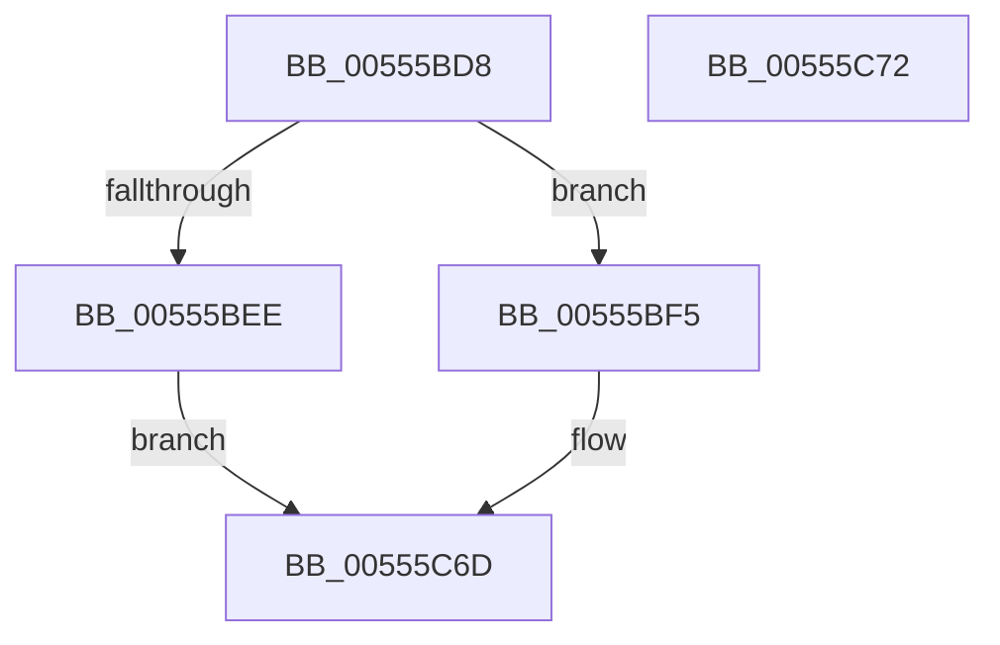

# HalpRegisterPeiErrorSource

- RVA: `0x00555BD8`–`0x00555C73` (길이 `155` bytes)
- VA: `0x0000000140555BD8`
- 실행 섹션: `.text`
- PDB 이름 있음: `예`; PDB Function 태그: `아니요`
- unwind 정보 RVA: `0x0006C9B8`
- 디코드: `34`개 명령, `155/155` bytes 표시
- 미해석 바이트: `0` (있으면 어셈블리에 `.byte`로 보존)

> 이 문서는 커널 이미지의 기계어와 PDB 기호를 분석해 생성했습니다. 4번과 5번은 함수 원형과 자료형을 바이너리 사용 방식에서 추정한 C 해석이며 원본 소스 복구 결과는 아닙니다.

## 1. Dependencies

- 직접 호출 지점: **1**; 고유 호출 대상: **1**
- 직접 호출자로 확인된 함수: **1**
- RIP 상대 이미지 참조: **3**

### Outgoing calls
- `0x00555C68` → [HalpInterruptConnect](../54/HalpInterruptConnect_function_005426F8.md) (function, `0x005426F8`)

### Direct callers
- [HalpInitializeGenericErrorSource](../../pagelk/B5/HalpInitializeGenericErrorSource_function_00B5E564.md) at `0x00B5E6B1`

### Static image references
- `0x00555BFF` → RVA `0x00FC7120` (`ALMOSTRO`; read)
- `0x00555C13` → RVA `0x00FC7128` (`ALMOSTRO`; read)
- `0x00555C20` → RVA `0x00555BB0` (`HalpPeiInterruptHandler`; read)

## 2. Other-region calls and transfers

- 다른 실행 섹션으로 향하는 call: **0**
- 별도 외부 분기/꼬리 이동을 확인하지 못했습니다.

## 3. Assembly (complete function range)

```asm
00555BD8  48 8B C4                        mov rax, rsp
00555BDB  48 83 EC 78                     sub rsp, 0x78
00555BDF  45 33 C9                        xor r9d, r9d
00555BE2  4C 8B C1                        mov r8, rcx
00555BE5  4C 89 48 08                     mov qword ptr [rax + 8], r9
00555BE9  48 85 C9                        test rcx, rcx
00555BEC  75 07                           jne 0x140555bf5
00555BEE  B8 0D 00 00 C0                  mov eax, 0xc000000d
00555BF3  EB 78                           jmp 0x140555c6d
00555BF5  33 D2                           xor edx, edx
00555BF7  48 8D 84 24 80 00 00 00         lea rax, [rsp + 0x80]
00555BFF  66 3B 15 1A 15 A7 00            cmp dx, word ptr [rip + 0xa7151a]
00555C06  49 8B C9                        mov rcx, r9
00555C09  41 8B 90 A0 00 00 00            mov edx, dword ptr [r8 + 0xa0]
00555C10  0F 57 C0                        xorps xmm0, xmm0
00555C13  48 0F 42 0D 0D 15 A7 00         cmovb rcx, qword ptr [rip + 0xa7150d]
00555C1B  48 89 44 24 58                  mov qword ptr [rsp + 0x58], rax
00555C20  48 8D 05 89 FF FF FF            lea rax, [rip - 0x77]
00555C27  C7 44 24 50 07 00 00 00         mov dword ptr [rsp + 0x50], 7
00555C2F  C6 44 24 48 0F                  mov byte ptr [rsp + 0x48], 0xf
00555C34  4C 89 4C 24 40                  mov qword ptr [rsp + 0x40], r9
00555C39  4C 89 44 24 38                  mov qword ptr [rsp + 0x38], r8
00555C3E  41 B8 E4 00 00 00               mov r8d, 0xe4
00555C44  48 89 44 24 30                  mov qword ptr [rsp + 0x30], rax
00555C49  44 89 4C 24 28                  mov dword ptr [rsp + 0x28], r9d
00555C4E  41 B1 0F                        mov r9b, 0xf
00555C51  0F 11 44 24 60                  movups xmmword ptr [rsp + 0x60], xmm0
00555C56  48 89 4C 24 60                  mov qword ptr [rsp + 0x60], rcx
00555C5B  48 8D 4C 24 60                  lea rcx, [rsp + 0x60]
00555C60  C7 44 24 20 01 00 00 00         mov dword ptr [rsp + 0x20], 1
00555C68  E8 8B CA FE FF                  call 0x1405426f8
00555C6D  48 83 C4 78                     add rsp, 0x78
00555C71  C3                              ret
00555C72  CC                              int3
```

## 4. C-style interpretation (structured pseudocode)

```c
__int64 __fastcall HalpRegisterPeiErrorSource(__int64 a1, int a2, __int64 a3, int a4)
{
    __int64 result;
    __int64 v_rsp;
    unsigned __int64 v_stack_m18;
    unsigned __int64 v_stack_m20;
    unsigned int v_stack_m28;
    unsigned __int8 v_stack_m30;
    unsigned __int64 v_stack_m38;
    unsigned __int64 v_stack_m40;
    unsigned __int64 v_stack_m48;
    unsigned int v_stack_m50;
    unsigned int v_stack_m58;
    unsigned __int64 v_stack_p8;

    v_rsp = (v_rsp) - (120);
    a4 = 0;
    *(unsigned __int64 *)(v_rsp + 8) = 0;
    if (a1 != 0) goto loc_00555BF5;
    goto loc_00555C6D;
loc_00555BF5:
    a2 = 0;
    a1 = 0;
    if (0 < (*(unsigned __int16 *)(v_rip + 10949914))) { a1 = *(unsigned __int64 *)(v_rip + 10949901); }
    v_stack_m20 = v_stack_p8;
    v_stack_m28 = 7;
    v_stack_m30 = 15;
    v_stack_m38 = 0;
    v_stack_m40 = a1;
    v_stack_m48 = v_rip - 119;
    v_stack_m50 = 0;
    v_stack_m18 = v_xmm0;
    v_stack_m18 = a1;
    v_stack_m58 = 1;
    result = HalpInterruptConnect(v_stack_m18, (unsigned int)(*(unsigned int *)(a1 + 160)), 228, 15);
loc_00555C6D:
    v_rsp = (v_rsp) + (120);
    return result;
}
```

## 5. (Beta) C Style

```c
int64_t HalpRegisterPeiErrorSource(void *Arg1, int32_t Arg2, int64_t Arg3, int32_t Arg4)
{
    uint8_t *arg1 = (uint8_t *)Arg1;

    int64_t result;
    int64_t local_rsp;
    uint64_t v_stack_m18;
    uint64_t v_stack_m20;
    uint32_t v_stack_m28;
    uint8_t v_stack_m30;
    uint64_t v_stack_m38;
    uint64_t v_stack_m40;
    uint64_t v_stack_m48;
    uint32_t v_stack_m50;
    uint32_t v_stack_m58;
    uint64_t v_stack_p8;

    local_rsp = (local_rsp) - (120);
    Arg4 = 0;
    *(uint64_t *)(local_rsp + 0x8) = 0;
    if (Arg1 != NULL) goto loc_00555BF5;
    goto loc_00555C6D;
loc_00555BF5:
    Arg2 = 0;
    Arg1 = 0;
    if (0 < (*(uint16_t *)(v_rip + 0xA7151A))) { Arg1 = *(uint64_t *)(v_rip + 0xA7150D); }
    v_stack_m20 = v_stack_p8;
    v_stack_m28 = 7;
    v_stack_m30 = 15;
    v_stack_m38 = 0;
    v_stack_m40 = Arg1;
    v_stack_m48 = v_rip - 119;
    v_stack_m50 = 0;
    v_stack_m18 = v_xmm0;
    v_stack_m18 = Arg1;
    v_stack_m58 = 1;
    result = HalpInterruptConnect(v_stack_m18, (uint32_t)(*(uint32_t *)(arg1 + 0xA0)), 228, 15);
loc_00555C6D:
    local_rsp = (local_rsp) + (120);
    return result;
}
```

### 관측된 메모리 오프셋

구조체 형식이 확인되지 않은 접근은 인자 기준의 오프셋으로만 기록했습니다.

| 기준 인자 | 오프셋 표현 | 폭 (bit) | 접근 |
|---|---:|---:|---|
| `Arg1` | `+ 0xA0` | `32` | `R` |

## 6. Execution-region graph

[열기: 2D/3D 그래프와 함수 탐색 컨트롤 패널](../../../control-panel.html?section=text&rva=0x00555BD8&view=graph)

- 2D 그래프는 위에서 아래로 흐르고, 3D 그래프는 빈 공간을 드래그해 회전합니다. Shift+드래그는 이동, 휠은 확대·축소, 함수 노드 선택은 대상 보고서 이동입니다.

### Static fallback


