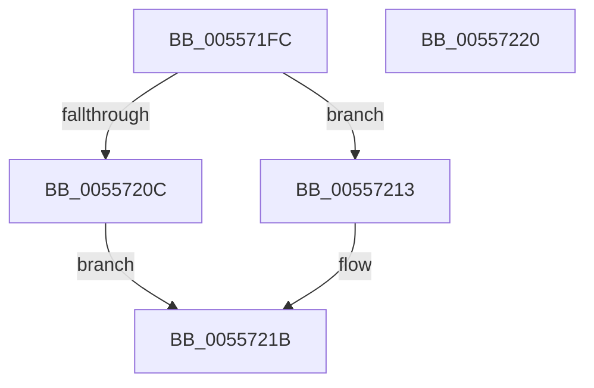

# HalpRegisterSecondaryIcInterface

- RVA: `0x005571FC`–`0x00557221` (길이 `37` bytes)
- VA: `0x00000001405571FC`
- 실행 섹션: `.text`
- PDB 이름 있음: `예`; PDB Function 태그: `아니요`
- unwind 정보 RVA: `0x0005C788`
- 디코드: `12`개 명령, `37/37` bytes 표시
- 미해석 바이트: `0` (있으면 어셈블리에 `.byte`로 보존)

> 이 문서는 커널 이미지의 기계어와 PDB 기호를 분석해 생성했습니다. 4번과 5번은 함수 원형과 자료형을 바이너리 사용 방식에서 추정한 C 해석이며 원본 소스 복구 결과는 아닙니다.

## 1. Dependencies

- 직접 호출 지점: **2**; 고유 호출 대상: **2**
- 직접 호출자로 확인된 함수: **1**
- RIP 상대 이미지 참조: **0**

### Outgoing calls
- `0x00557203` → [HalpValidateInterface](../../page/70/HalpValidateInterface_function_0070A6A4.md) (function, `0x0070A6A4`)
- `0x00557216` → [HalpCreateSecondaryIcEntry](HalpCreateSecondaryIcEntry_function_00556D4C.md) (function, `0x00556D4C`)

### Direct callers
- [HaliSetSystemInformation](../../page/70/HaliSetSystemInformation_function_0070BF54.md) at `0x0070C023`

### Static image references
- 디코드된 RIP-relative 메모리 참조가 없습니다.

## 2. Other-region calls and transfers

- 다른 실행 섹션으로 향하는 call: **1**
  - `0x00557203` → [HalpValidateInterface](../../page/70/HalpValidateInterface_function_0070A6A4.md) (`.text` → `PAGE`)
- 별도 외부 분기/꼬리 이동을 확인하지 못했습니다.

## 3. Assembly (complete function range)

```asm
005571FC  48 83 EC 28                     sub rsp, 0x28
00557200  4C 8B D1                        mov r10, rcx
00557203  E8 9C 34 1B 00                  call 0x14070a6a4
00557208  84 C0                           test al, al
0055720A  75 07                           jne 0x140557213
0055720C  B8 0D 00 00 C0                  mov eax, 0xc000000d
00557211  EB 08                           jmp 0x14055721b
00557213  49 8B CA                        mov rcx, r10
00557216  E8 31 FB FF FF                  call 0x140556d4c
0055721B  48 83 C4 28                     add rsp, 0x28
0055721F  C3                              ret
00557220  CC                              int3
```

## 4. C-style interpretation (structured pseudocode)

```c
__int64 __fastcall HalpRegisterSecondaryIcInterface(__int64 a1)
{
    __int64 result;
    __int64 v_rsp;

    v_rsp = (v_rsp) - (40);
    result = HalpValidateInterface(a1, a2, a3, a4);
    if ((unsigned __int8)(result) != 0) goto loc_00557213;
    goto loc_0055721B;
loc_00557213:
    result = HalpCreateSecondaryIcEntry(a1, a2, a3, a4);
loc_0055721B:
    v_rsp = (v_rsp) + (40);
    return result;
}
```

## 5. (Beta) C Style

```c
int64_t HalpRegisterSecondaryIcInterface(int64_t Arg1)
{
    int64_t result;
    int64_t local_rsp;

    local_rsp = (local_rsp) - (40);
    result = HalpValidateInterface(Arg1, a2, a3, a4);
    if ((uint8_t)(result) != 0) goto loc_00557213;
    goto loc_0055721B;
loc_00557213:
    result = HalpCreateSecondaryIcEntry(Arg1, a2, a3, a4);
loc_0055721B:
    local_rsp = (local_rsp) + (40);
    return result;
}
```

## 6. Execution-region graph

[열기: 2D/3D 그래프와 함수 탐색 컨트롤 패널](../../../control-panel.html?section=text&rva=0x005571FC&view=graph)

- 2D 그래프는 위에서 아래로 흐르고, 3D 그래프는 빈 공간을 드래그해 회전합니다. Shift+드래그는 이동, 휠은 확대·축소, 함수 노드 선택은 대상 보고서 이동입니다.

### Static fallback


