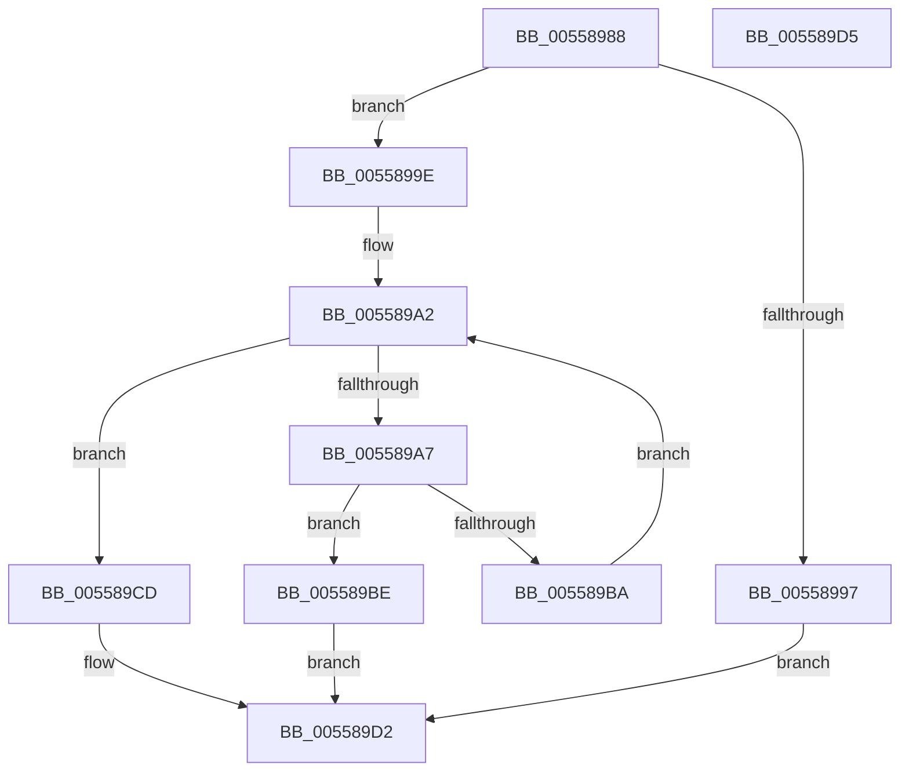

# HalpSetProcessorStateByNtIndex

- RVA: `0x00558988`–`0x005589D6` (길이 `78` bytes)
- VA: `0x0000000140558988`
- 실행 섹션: `.text`
- PDB 이름 있음: `예`; PDB Function 태그: `아니요`
- unwind 정보 RVA: `0x000DB714`
- 디코드: `25`개 명령, `78/78` bytes 표시
- 미해석 바이트: `0` (있으면 어셈블리에 `.byte`로 보존)

> 이 문서는 커널 이미지의 기계어와 PDB 기호를 분석해 생성했습니다. 4번과 5번은 함수 원형과 자료형을 바이너리 사용 방식에서 추정한 C 해석이며 원본 소스 복구 결과는 아닙니다.

## 1. Dependencies

- 직접 호출 지점: **0**; 고유 호출 대상: **0**
- 직접 호출자로 확인된 함수: **1**
- RIP 상대 이미지 참조: **3**

### Outgoing calls
- 직접 디코드된 call 명령이 없습니다.

### Direct callers
- [HalpInterruptStartProcessor](../../pagelk/B5/HalpInterruptStartProcessor_function_00B5BEF0.md) at `0x00B5BFC2`

### Static image references
- `0x00558988` → RVA `0x00E10200` (`.data`; read)
- `0x005589AE` → RVA `0x00FC3E30` (`.data`; read)
- `0x005589BE` → RVA `0x00FC3E20` (`.data`; read)

## 2. Other-region calls and transfers

- 다른 실행 섹션으로 향하는 call: **0**
- 별도 외부 분기/꼬리 이동을 확인하지 못했습니다.

## 3. Assembly (complete function range)

```asm
00558988  44 8B 0D 71 78 8B 00            mov r9d, dword ptr [rip + 0x8b7871]
0055898F  44 8B D2                        mov r10d, edx
00558992  41 3B C9                        cmp ecx, r9d
00558995  72 07                           jb 0x14055899e
00558997  BA 0D 00 00 C0                  mov edx, 0xc000000d
0055899C  EB 34                           jmp 0x1405589d2
0055899E  33 D2                           xor edx, edx
005589A0  8B C2                           mov eax, edx
005589A2  41 3B C1                        cmp eax, r9d
005589A5  73 26                           jae 0x1405589cd
005589A7  44 8B C0                        mov r8d, eax
005589AA  49 C1 E0 06                     shl r8, 6
005589AE  4C 03 05 7B B4 A6 00            add r8, qword ptr [rip + 0xa6b47b]
005589B5  45 39 10                        cmp dword ptr [r8], r10d
005589B8  74 04                           je 0x1405589be
005589BA  FF C0                           inc eax
005589BC  EB E4                           jmp 0x1405589a2
005589BE  48 8B 05 5B B4 A6 00            mov rax, qword ptr [rip + 0xa6b45b]
005589C5  8B C9                           mov ecx, ecx
005589C7  4C 89 04 C8                     mov qword ptr [rax + rcx*8], r8
005589CB  EB 05                           jmp 0x1405589d2
005589CD  BA 25 02 00 C0                  mov edx, 0xc0000225
005589D2  8B C2                           mov eax, edx
005589D4  C3                              ret
005589D5  CC                              int3
```

## 4. C-style interpretation (structured pseudocode)

```c
__int64 __fastcall HalpSetProcessorStateByNtIndex(int a1, int a2)
{
    __int64 result;

    if (a1 < ((unsigned int)((unsigned int)(*(unsigned int *)(v_rip + 9140337))))) goto loc_0055899E;
    goto loc_005589D2;
loc_0055899E:
    a2 = 0;
loc_005589A2:
    if (0 >= ((unsigned int)((unsigned int)(*(unsigned int *)(v_rip + 9140337))))) goto loc_005589CD;
    a3 = (0) << (6);
    a3 = (a3) + (*(unsigned __int64 *)(v_rip + 10925179));
    if ((*(unsigned int *)(a3)) == ((unsigned int)((unsigned int)(a2)))) goto loc_005589BE;
    result = (unsigned int)((0) + 1);
    goto loc_005589A2;
loc_005589BE:
    *(unsigned __int64 *)(*(unsigned __int64 *)(v_rip + 10925147) + (unsigned int)(a1) * 8) = a3;
    goto loc_005589D2;
loc_005589CD:
loc_005589D2:
    return (unsigned int)((unsigned int)((unsigned int)(0xC0000225ULL)));
}
```

## 5. (Beta) C Style

```c
int64_t HalpSetProcessorStateByNtIndex(int32_t Arg1, int32_t Arg2)
{
    int64_t result;

    if (Arg1 < ((uint32_t)((uint32_t)(*(uint32_t *)(v_rip + 0x8B7871))))) goto loc_0055899E;
    goto loc_005589D2;
loc_0055899E:
    Arg2 = 0;
loc_005589A2:
    if (0 >= ((uint32_t)((uint32_t)(*(uint32_t *)(v_rip + 0x8B7871))))) goto loc_005589CD;
    a3 = (0) << (6);
    a3 = (a3) + (*(uint64_t *)(v_rip + 0xA6B47B));
    if ((*(uint32_t *)(a3)) == ((uint32_t)((uint32_t)(Arg2)))) goto loc_005589BE;
    result = (uint32_t)((0) + 1);
    goto loc_005589A2;
loc_005589BE:
    *(uint64_t *)(*(uint64_t *)(v_rip + 0xA6B45B) + (uint32_t)(Arg1) * 8) = a3;
    goto loc_005589D2;
loc_005589CD:
loc_005589D2:
    return (uint32_t)((uint32_t)((uint32_t)(0xC0000225ULL)));
}
```

## 6. Execution-region graph

[열기: 2D/3D 그래프와 함수 탐색 컨트롤 패널](../../../control-panel.html?section=text&rva=0x00558988&view=graph)

- 2D 그래프는 위에서 아래로 흐르고, 3D 그래프는 빈 공간을 드래그해 회전합니다. Shift+드래그는 이동, 휠은 확대·축소, 함수 노드 선택은 대상 보고서 이동입니다.

### Static fallback


