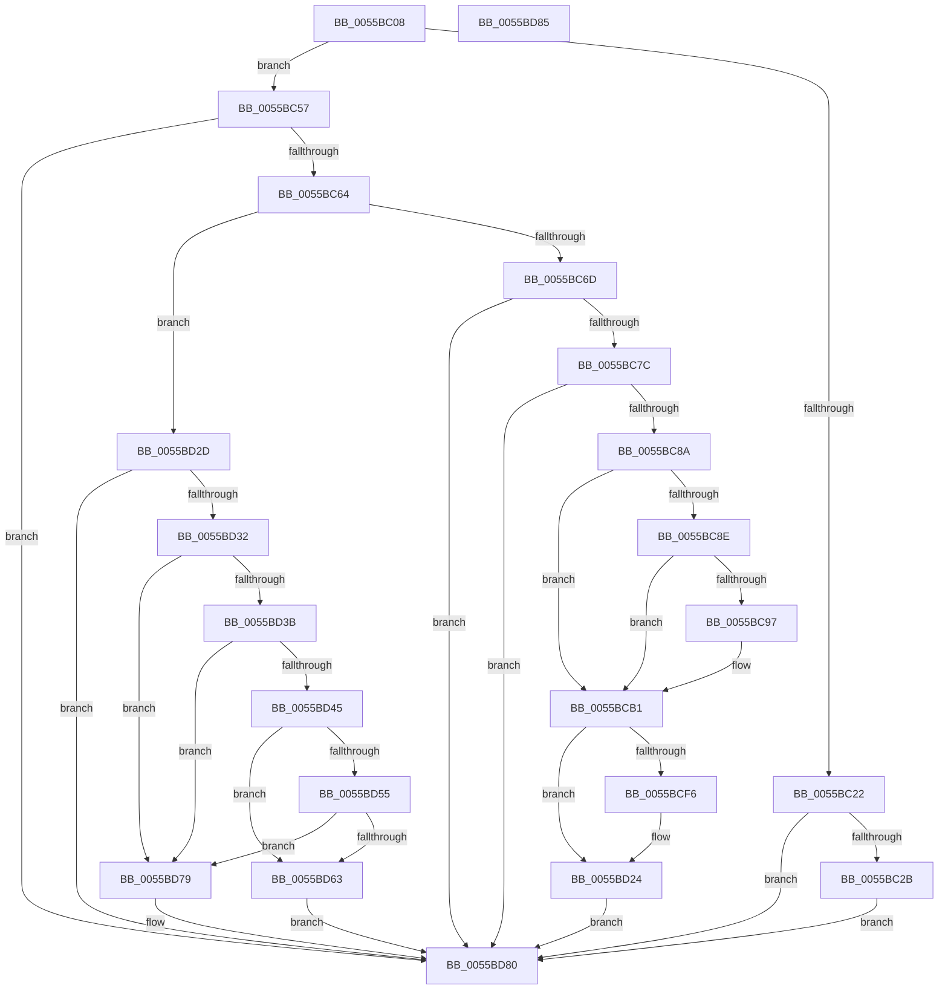

# HalpSetResumeTime

- RVA: `0x0055BC08`–`0x0055BD86` (길이 `382` bytes)
- VA: `0x000000014055BC08`
- 실행 섹션: `.text`
- PDB 이름 있음: `예`; PDB Function 태그: `아니요`
- unwind 정보 RVA: `0x0005D2F4`
- 디코드: `86`개 명령, `382/382` bytes 표시
- 미해석 바이트: `0` (있으면 어셈블리에 `.byte`로 보존)

> 이 문서는 커널 이미지의 기계어와 PDB 기호를 분석해 생성했습니다. 4번과 5번은 함수 원형과 자료형을 바이너리 사용 방식에서 추정한 C 해석이며 원본 소스 복구 결과는 아닙니다.

## 1. Dependencies

- 직접 호출 지점: **5**; 고유 호출 대상: **5**
- 직접 호출자로 확인된 함수: **2**
- RIP 상대 이미지 참조: **11**

### Outgoing calls
- `0x0055BC97` → [PsGetCurrentServerSiloGlobals](../2F/PsGetCurrentServerSiloGlobals_function_002FE1F0.md) (function, `0x002FE1F0`)
- `0x0055BCBD` → [guard_dispatch_icall](../6B/guard_dispatch_icall_function_006BAAD0.md) (function, `0x006BAAD0`)
- `0x0055BCD9` → [RtlULongLongMult](../43/RtlULongLongMult_function_0043E530.md) (function, `0x0043E530`)
- `0x0055BD4C` → [HalpQueryVirtualRtc](../54/HalpQueryVirtualRtc_function_0054C4D0.md) (function, `0x0054C4D0`)
- `0x0055BD6A` → [HalpSetVirtualRtc](../42/HalpSetVirtualRtc_function_0042DF30.md) (function, `0x0042DF30`)

### Direct callers
- [HalpEfiInitializeOnResume](../54/HalpEfiInitializeOnResume_function_0054E324.md) at `0x0054E351`
- [HalpPostSleepMP](../../pagelk/B5/HalpPostSleepMP_function_00B5ECC4.md) at `0x00B5EDBF`
- [HalpPostSleepMP](../../pagelk/B5/HalpPostSleepMP_function_00B5ECC4.md) at `0x00B5EDE5`

### Static image references
- `0x0055BC2F` → RVA `0x00F90020` (`.data`; write)
- `0x0055BC3D` → RVA `0x00F90010` (`.data`; write)
- `0x0055BC4B` → RVA `0x00F90160` (`.data`; write)
- `0x0055BC57` → RVA `0x00FC1AB2` (`.data`; read)
- `0x0055BC6D` → RVA `0x00F90160` (`.data`; read)
- `0x0055BC7C` → RVA `0x00F90020` (`.data`; read)
- `0x0055BC8E` → RVA `0x00E68570` (`.data`; read)
- `0x0055BCAA` → RVA `0x00F90020` (`.data`; read/write)
- `0x0055BCB1` → RVA `0x00E00A50` (`.data`; read)
- `0x0055BCCA` → RVA `0x00F90010` (`.data`; read)
- `0x0055BD79` → RVA `0x00FC21C4` (`.data`; write)

## 2. Other-region calls and transfers

- 다른 실행 섹션으로 향하는 call: **0**
- 별도 외부 분기/꼬리 이동을 확인하지 못했습니다.

## 3. Assembly (complete function range)

```asm
0055BC08  48 83 EC 38                     sub rsp, 0x38
0055BC0C  48 83 64 24 20 00               and qword ptr [rsp + 0x20], 0
0055BC12  48 83 64 24 58 00               and qword ptr [rsp + 0x58], 0
0055BC18  48 83 64 24 50 00               and qword ptr [rsp + 0x50], 0
0055BC1E  85 D2                           test edx, edx
0055BC20  75 35                           jne 0x14055bc57
0055BC22  48 85 C9                        test rcx, rcx
0055BC25  0F 84 55 01 00 00               je 0x14055bd80
0055BC2B  48 8B 41 78                     mov rax, qword ptr [rcx + 0x78]
0055BC2F  48 89 05 EA 43 A3 00            mov qword ptr [rip + 0xa343ea], rax
0055BC36  48 8B 81 80 00 00 00            mov rax, qword ptr [rcx + 0x80]
0055BC3D  48 89 05 CC 43 A3 00            mov qword ptr [rip + 0xa343cc], rax
0055BC44  48 8B 81 88 00 00 00            mov rax, qword ptr [rcx + 0x88]
0055BC4B  48 89 05 0E 45 A3 00            mov qword ptr [rip + 0xa3450e], rax
0055BC52  E9 29 01 00 00                  jmp 0x14055bd80
0055BC57  80 3D 54 5E A6 00 00            cmp byte ptr [rip + 0xa65e54], 0
0055BC5E  0F 84 1C 01 00 00               je 0x14055bd80
0055BC64  83 FA 01                        cmp edx, 1
0055BC67  0F 85 C0 00 00 00               jne 0x14055bd2d
0055BC6D  48 8B 05 EC 44 A3 00            mov rax, qword ptr [rip + 0xa344ec]
0055BC74  84 C2                           test dl, al
0055BC76  0F 85 04 01 00 00               jne 0x14055bd80
0055BC7C  48 83 3D 9C 43 A3 00 00         cmp qword ptr [rip + 0xa3439c], 0
0055BC84  0F 84 F6 00 00 00               je 0x14055bd80
0055BC8A  A8 02                           test al, 2
0055BC8C  75 23                           jne 0x14055bcb1
0055BC8E  83 3D DB C8 90 00 00            cmp dword ptr [rip + 0x90c8db], 0
0055BC95  75 1A                           jne 0x14055bcb1
0055BC97  E8 54 25 DA FF                  call 0x1402fe1f0
0055BC9C  48 8B 88 C8 04 00 00            mov rcx, qword ptr [rax + 0x4c8]
0055BCA3  48 8B 81 B8 01 00 00            mov rax, qword ptr [rcx + 0x1b8]
0055BCAA  48 01 05 6F 43 A3 00            add qword ptr [rip + 0xa3436f], rax
0055BCB1  48 8B 05 98 4D 8A 00            mov rax, qword ptr [rip + 0x8a4d98]
0055BCB8  48 8D 4C 24 58                  lea rcx, [rsp + 0x58]
0055BCBD  E8 0E EE 15 00                  call 0x1406baad0
0055BCC2  4C 8B D0                        mov r10, rax
0055BCC5  4C 8D 44 24 50                  lea r8, [rsp + 0x50]
0055BCCA  4C 2B 15 3F 43 A3 00            sub r10, qword ptr [rip + 0xa3433f]
0055BCD1  BA 80 96 98 00                  mov edx, 0x989680
0055BCD6  49 8B CA                        mov rcx, r10
0055BCD9  E8 52 28 EE FF                  call 0x14043e530
0055BCDE  4C 8B 5C 24 58                  mov r11, qword ptr [rsp + 0x58]
0055BCE3  8B C8                           mov ecx, eax
0055BCE5  48 8B 44 24 50                  mov rax, qword ptr [rsp + 0x50]
0055BCEA  33 D2                           xor edx, edx
0055BCEC  49 F7 F3                        div r11
0055BCEF  4C 8B C8                        mov r9, rax
0055BCF2  85 C9                           test ecx, ecx
0055BCF4  79 2E                           jns 0x14055bd24
0055BCF6  33 D2                           xor edx, edx
0055BCF8  49 8B C2                        mov rax, r10
0055BCFB  49 F7 F3                        div r11
0055BCFE  33 D2                           xor edx, edx
0055BD00  48 8B C8                        mov rcx, rax
0055BD03  4C 8B C0                        mov r8, rax
0055BD06  49 0F AF CB                     imul rcx, r11
0055BD0A  4C 2B D1                        sub r10, rcx
0055BD0D  49 69 C2 80 96 98 00            imul rax, r10, 0x989680
0055BD14  49 F7 F3                        div r11
0055BD17  4C 8B C8                        mov r9, rax
0055BD1A  49 69 C0 80 96 98 00            imul rax, r8, 0x989680
0055BD21  4C 03 C8                        add r9, rax
0055BD24  4C 01 0D F5 42 A3 00            add qword ptr [rip + 0xa342f5], r9
0055BD2B  EB 53                           jmp 0x14055bd80
0055BD2D  83 FA 02                        cmp edx, 2
0055BD30  75 4E                           jne 0x14055bd80
0055BD32  F6 05 27 44 A3 00 01            test byte ptr [rip + 0xa34427], 1
0055BD39  75 3E                           jne 0x14055bd79
0055BD3B  48 83 3D DD 42 A3 00 00         cmp qword ptr [rip + 0xa342dd], 0
0055BD43  74 34                           je 0x14055bd79
0055BD45  33 D2                           xor edx, edx
0055BD47  48 8D 4C 24 20                  lea rcx, [rsp + 0x20]
0055BD4C  E8 7F 07 FF FF                  call 0x14054c4d0
0055BD51  84 C0                           test al, al
0055BD53  74 0E                           je 0x14055bd63
0055BD55  48 8B 44 24 20                  mov rax, qword ptr [rsp + 0x20]
0055BD5A  48 39 05 BF 42 A3 00            cmp qword ptr [rip + 0xa342bf], rax
0055BD61  7C 16                           jl 0x14055bd79
0055BD63  48 8D 0D B6 42 A3 00            lea rcx, [rip + 0xa342b6]
0055BD6A  E8 C1 21 ED FF                  call 0x14042df30
0055BD6F  48 83 25 A9 42 A3 00 00         and qword ptr [rip + 0xa342a9], 0
0055BD77  EB 07                           jmp 0x14055bd80
0055BD79  C6 05 44 64 A6 00 01            mov byte ptr [rip + 0xa66444], 1
0055BD80  48 83 C4 38                     add rsp, 0x38
0055BD84  C3                              ret
0055BD85  CC                              int3
```

## 4. C-style interpretation (structured pseudocode)

```c
__int64 __fastcall HalpSetResumeTime(__int64 a1, int a2)
{
    __int64 result;
    __int64 v_r10;
    __int64 v_rsp;
    unsigned __int64 v_stack_m18;
    unsigned __int64 v_stack_p18;
    unsigned __int64 v_stack_p20;

    v_rsp = (v_rsp) - (56);
    if (a2 != 0) goto loc_0055BC57;
    if (a1 == 0) goto loc_0055BD80;
    *(unsigned __int64 *)(v_rip + 10699754) = *(unsigned __int64 *)(a1 + 120);
    *(unsigned __int64 *)(v_rip + 10699724) = *(unsigned __int64 *)(a1 + 128);
    *(unsigned __int64 *)(v_rip + 10700046) = *(unsigned __int64 *)(a1 + 136);
    goto loc_0055BD80;
loc_0055BC57:
    if ((*(unsigned __int8 *)(v_rip + 10903124)) == 0) goto loc_0055BD80;
    if (a2 != 1) goto loc_0055BD2D;
    if ((((unsigned __int8)(a2)) & ((unsigned __int8)(*(unsigned __int64 *)(v_rip + 10700012)))) != 0) goto loc_0055BD80;
    if ((*(unsigned __int64 *)(v_rip + 10699676)) == 0) goto loc_0055BD80;
    if ((((unsigned __int8)(*(unsigned __int64 *)(v_rip + 10700012))) & (2)) != 0) goto loc_0055BCB1;
    result = *(unsigned __int64 *)(v_rip + 10700012);
    if ((*(unsigned int *)(v_rip + 9488603)) == 0) {
        result = PsGetCurrentServerSiloGlobals(a1, a2, a3, a4);
        a1 = *(unsigned __int64 *)(result + 1224);
        result = *(unsigned __int64 *)(a1 + 440);
    }
    result = guard_dispatch_icall(v_stack_p20, a2, a3, a4);
    v_r10 = (result) - (*(unsigned __int64 *)(v_rip + 10699583));
    result = RtlULongLongMult(v_r10, (unsigned int)(0x989680ULL), v_stack_p18, a4);
    a2 = 0;
    result = v_stack_p18;
    if (sign_flag) {
        a2 = 0;
        result = v_r10;
        a2 = 0;
        a1 = result;
        a3 = result;
        a1 = (a1) * (v_stack_p20);
        v_r10 = (v_r10) - (a1);
        result = (result) * (v_r10);
        a4 = result;
        result = (result) * (a3);
        a4 = (a4) + (result);
    }
    goto loc_0055BD80;
loc_0055BD2D:
    if (0 != 2) goto loc_0055BD80;
    if (((*(unsigned __int8 *)(v_rip + 10699815)) & (1)) != 0) goto loc_0055BD79;
    if ((*(unsigned __int64 *)(v_rip + 10699485)) == 0) goto loc_0055BD79;
    a2 = 0;
    result = HalpQueryVirtualRtc(v_stack_m18, a2, a3, a4);
    if ((unsigned __int8)(result) == 0) goto loc_0055BD63;
    if ((*(unsigned __int64 *)(v_rip + 10699455)) < v_stack_m18) goto loc_0055BD79;
loc_0055BD63:
    result = HalpSetVirtualRtc(v_rip + 10699446, a2, a3, a4);
    goto loc_0055BD80;
loc_0055BD79:
    *(unsigned __int8 *)(v_rip + 10904644) = 1;
loc_0055BD80:
    v_rsp = (v_rsp) + (56);
    return result;
}
```

## 5. (Beta) C Style

```c
int64_t HalpSetResumeTime(int64_t Arg1, int32_t Arg2)
{
    int64_t result;
    int64_t local_r10;
    int64_t local_rsp;
    uint64_t v_stack_m18;
    uint64_t v_stack_p18;
    uint64_t v_stack_p20;

    local_rsp = (local_rsp) - (56);
    if (Arg2 != 0) goto loc_0055BC57;
    if (Arg1 == 0) goto loc_0055BD80;
    *(uint64_t *)(v_rip + 0xA343EA) = *(uint64_t *)(Arg1 + 0x78);
    *(uint64_t *)(v_rip + 0xA343CC) = *(uint64_t *)(Arg1 + 0x80);
    *(uint64_t *)(v_rip + 0xA3450E) = *(uint64_t *)(Arg1 + 0x88);
    goto loc_0055BD80;
loc_0055BC57:
    if ((*(uint8_t *)(v_rip + 0xA65E54)) == 0) goto loc_0055BD80;
    if (Arg2 != 1) goto loc_0055BD2D;
    if ((((uint8_t)(Arg2)) & ((uint8_t)(*(uint64_t *)(v_rip + 0xA344EC)))) != 0) goto loc_0055BD80;
    if ((*(uint64_t *)(v_rip + 0xA3439C)) == 0) goto loc_0055BD80;
    if ((((uint8_t)(*(uint64_t *)(v_rip + 0xA344EC))) & (2)) != 0) goto loc_0055BCB1;
    result = *(uint64_t *)(v_rip + 0xA344EC);
    if ((*(uint32_t *)(v_rip + 0x90C8DB)) == 0) {
        result = PsGetCurrentServerSiloGlobals(Arg1, Arg2, a3, a4);
        Arg1 = *(uint64_t *)(result + 0x4C8);
        result = *(uint64_t *)(Arg1 + 0x1B8);
    }
    result = guard_dispatch_icall(v_stack_p20, Arg2, a3, a4);
    local_r10 = (result) - (*(uint64_t *)(v_rip + 0xA3433F));
    result = RtlULongLongMult(local_r10, (uint32_t)(0x989680ULL), v_stack_p18, a4);
    Arg2 = 0;
    result = v_stack_p18;
    if (sign_flag) {
        Arg2 = 0;
        result = local_r10;
        Arg2 = 0;
        Arg1 = result;
        a3 = result;
        Arg1 = (Arg1) * (v_stack_p20);
        local_r10 = (local_r10) - (Arg1);
        result = (result) * (local_r10);
        a4 = result;
        result = (result) * (a3);
        a4 = (a4) + (result);
    }
    goto loc_0055BD80;
loc_0055BD2D:
    if (0 != 2) goto loc_0055BD80;
    if (((*(uint8_t *)(v_rip + 0xA34427)) & (1)) != 0) goto loc_0055BD79;
    if ((*(uint64_t *)(v_rip + 0xA342DD)) == 0) goto loc_0055BD79;
    Arg2 = 0;
    result = HalpQueryVirtualRtc(v_stack_m18, Arg2, a3, a4);
    if ((uint8_t)(result) == 0) goto loc_0055BD63;
    if ((*(uint64_t *)(v_rip + 0xA342BF)) < v_stack_m18) goto loc_0055BD79;
loc_0055BD63:
    result = HalpSetVirtualRtc(v_rip + 10699446, Arg2, a3, a4);
    goto loc_0055BD80;
loc_0055BD79:
    *(uint8_t *)(v_rip + 0xA66444) = 1;
loc_0055BD80:
    local_rsp = (local_rsp) + (56);
    return result;
}
```

## 6. Execution-region graph

[열기: 2D/3D 그래프와 함수 탐색 컨트롤 패널](../../../control-panel.html?section=text&rva=0x0055BC08&view=graph)

- 2D 그래프는 위에서 아래로 흐르고, 3D 그래프는 빈 공간을 드래그해 회전합니다. Shift+드래그는 이동, 휠은 확대·축소, 함수 노드 선택은 대상 보고서 이동입니다.

### Static fallback


