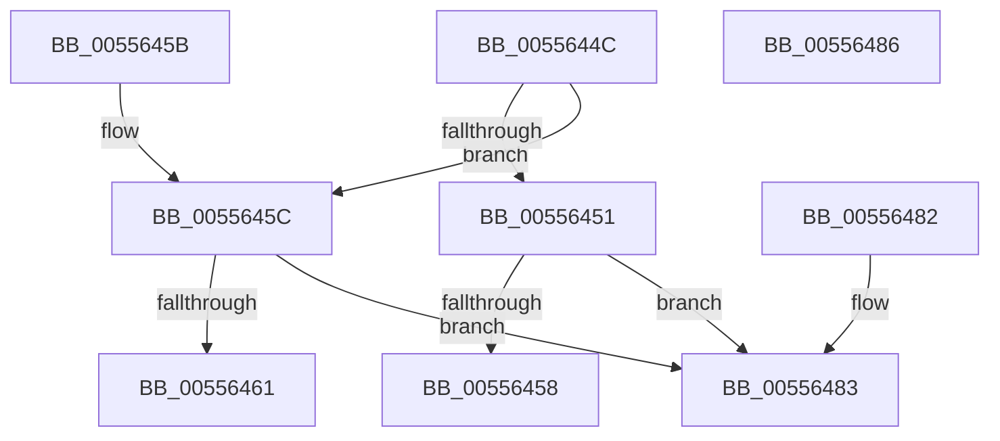

# HalpShouldRecoveryBeAttempted

- RVA: `0x0055644C`–`0x00556487` (길이 `59` bytes)
- VA: `0x000000014055644C`
- 실행 섹션: `.text`
- PDB 이름 있음: `예`; PDB Function 태그: `아니요`
- unwind 정보 RVA: `0x000DB714`
- 디코드: `20`개 명령, `59/59` bytes 표시
- 미해석 바이트: `0` (있으면 어셈블리에 `.byte`로 보존)

> 이 문서는 커널 이미지의 기계어와 PDB 기호를 분석해 생성했습니다. 4번과 5번은 함수 원형과 자료형을 바이너리 사용 방식에서 추정한 C 해석이며 원본 소스 복구 결과는 아닙니다.

## 1. Dependencies

- 직접 호출 지점: **0**; 고유 호출 대상: **0**
- 직접 호출자로 확인된 함수: **2**
- RIP 상대 이미지 참조: **0**

### Outgoing calls
- 직접 디코드된 call 명령이 없습니다.

### Direct callers
- [HalpMcaReportError](../54/HalpMcaReportError_function_00541D04.md) at `0x00541D8A`
- [HalpMceRecovery](HalpMceRecovery_function_00555DD0.md) at `0x00555E48`

### Static image references
- 디코드된 RIP-relative 메모리 참조가 없습니다.

## 2. Other-region calls and transfers

- 다른 실행 섹션으로 향하는 call: **0**
- 별도 외부 분기/꼬리 이동을 확인하지 못했습니다.

## 3. Assembly (complete function range)

```asm
0055644C  83 F9 01                        cmp ecx, 1
0055644F  75 0B                           jne 0x14055645c
00556451  48 0F BA 22 37                  bt qword ptr [rdx], 0x37
00556456  73 2B                           jae 0x140556483
00556458  8A C1                           mov al, cl
0055645A  C3                              ret
0055645B  CC                              int3
0055645C  83 F9 02                        cmp ecx, 2
0055645F  75 22                           jne 0x140556483
00556461  48 8B 02                        mov rax, qword ptr [rdx]
00556464  48 B9 00 00 00 00 00 10 00 20   movabs rcx, 0x2000100000000000
0055646E  48 23 C1                        and rax, rcx
00556471  48 B9 00 00 00 00 00 00 00 20   movabs rcx, 0x2000000000000000
0055647B  48 3B C1                        cmp rax, rcx
0055647E  0F 94 C0                        sete al
00556481  C3                              ret
00556482  CC                              int3
00556483  32 C0                           xor al, al
00556485  C3                              ret
00556486  CC                              int3
```

## 4. C-style interpretation (structured pseudocode)

```c
__int64 __fastcall HalpShouldRecoveryBeAttempted(int a1, __int64 a2)
{
    __int64 result;

    if (a1 != 1) goto loc_0055645C;
    if (a1 >= 1) goto loc_00556483;
    return (unsigned __int8)(a1);
loc_0055645C:
    if (a1 != 2) goto loc_00556483;
    result = (*(unsigned __int64 *)(a2)) & (a1);
    result = (result == a1) ? 1 : 0;
    return result;
loc_00556483:
    result = 0;
    return result;
}
```

## 5. (Beta) C Style

```c
int64_t HalpShouldRecoveryBeAttempted(int32_t Arg1, void *Arg2)
{
    uint8_t *arg2 = (uint8_t *)Arg2;

    int64_t result;

    if (Arg1 != 1) goto loc_0055645C;
    if (Arg1 >= 1) goto loc_00556483;
    return (uint8_t)(Arg1);
loc_0055645C:
    if (Arg1 != 2) goto loc_00556483;
    result = (*(uint64_t *)(arg2)) & (Arg1);
    result = (result == Arg1) ? 1 : 0;
    return result;
loc_00556483:
    result = 0;
    return result;
}
```

### 관측된 메모리 오프셋

구조체 형식이 확인되지 않은 접근은 인자 기준의 오프셋으로만 기록했습니다.

| 기준 인자 | 오프셋 표현 | 폭 (bit) | 접근 |
|---|---:|---:|---|
| `Arg2` | `+ 0x0` | `64` | `R` |

## 6. Execution-region graph

[열기: 2D/3D 그래프와 함수 탐색 컨트롤 패널](../../../control-panel.html?section=text&rva=0x0055644C&view=graph)

- 2D 그래프는 위에서 아래로 흐르고, 3D 그래프는 빈 공간을 드래그해 회전합니다. Shift+드래그는 이동, 휠은 확대·축소, 함수 노드 선택은 대상 보고서 이동입니다.

### Static fallback


