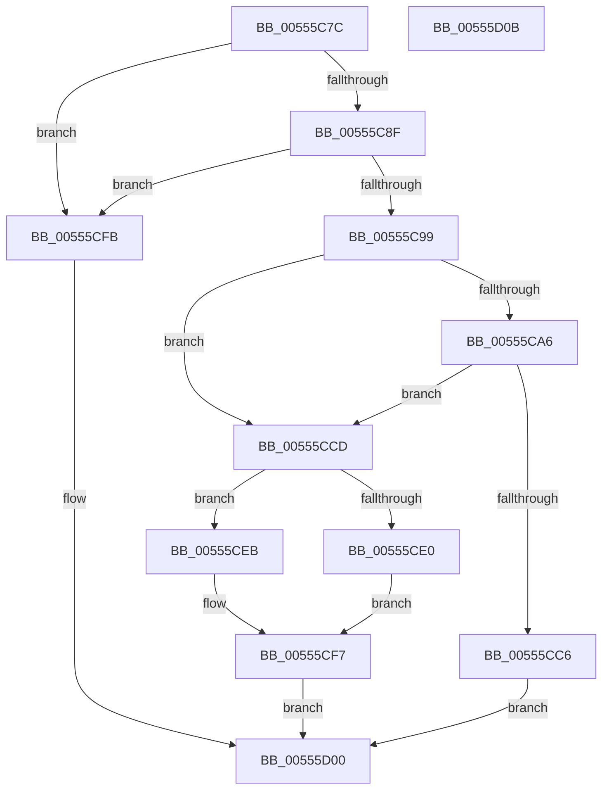

# HalpSignalRAS

- RVA: `0x00555C7C`–`0x00555D0C` (길이 `144` bytes)
- VA: `0x0000000140555C7C`
- 실행 섹션: `.text`
- PDB 이름 있음: `예`; PDB Function 태그: `아니요`
- unwind 정보 RVA: `0x0005CAAC`
- 디코드: `44`개 명령, `144/144` bytes 표시
- 미해석 바이트: `0` (있으면 어셈블리에 `.byte`로 보존)

> 이 문서는 커널 이미지의 기계어와 PDB 기호를 분석해 생성했습니다. 4번과 5번은 함수 원형과 자료형을 바이너리 사용 방식에서 추정한 C 해석이며 원본 소스 복구 결과는 아닙니다.

## 1. Dependencies

- 직접 호출 지점: **1**; 고유 호출 대상: **1**
- 직접 호출자로 확인된 함수: **1**
- RIP 상대 이미지 참조: **0**

### Outgoing calls
- `0x00555CB5` → [MmMapIoSpaceEx](../32/MmMapIoSpaceEx_function_00327830.md) (function, `0x00327830`)

### Direct callers
- [HalpCheckAndReportGhes](../4A/HalpCheckAndReportGhes_function_004A9CDC.md) at `0x004A9D24`

### Static image references
- 디코드된 RIP-relative 메모리 참조가 없습니다.

## 2. Other-region calls and transfers

- 다른 실행 섹션으로 향하는 call: **0**
- 별도 외부 분기/꼬리 이동을 확인하지 못했습니다.

## 3. Assembly (complete function range)

```asm
00555C7C  48 89 5C 24 08                  mov qword ptr [rsp + 8], rbx
00555C81  57                              push rdi
00555C82  48 83 EC 20                     sub rsp, 0x20
00555C86  83 79 60 0C                     cmp dword ptr [rcx + 0x60], 0xc
00555C8A  48 8B D9                        mov rbx, rcx
00555C8D  75 6C                           jne 0x140555cfb
00555C8F  48 8B 41 40                     mov rax, qword ptr [rcx + 0x40]
00555C93  48 83 38 FF                     cmp qword ptr [rax], -1
00555C97  74 62                           je 0x140555cfb
00555C99  48 8B 49 50                     mov rcx, qword ptr [rcx + 0x50]
00555C9D  48 8D 7B 48                     lea rdi, [rbx + 0x48]
00555CA1  48 85 C9                        test rcx, rcx
00555CA4  75 27                           jne 0x140555ccd
00555CA6  8B 17                           mov edx, dword ptr [rdi]
00555CA8  41 B8 04 02 00 00               mov r8d, 0x204
00555CAE  48 8B 8B B8 00 00 00            mov rcx, qword ptr [rbx + 0xb8]
00555CB5  E8 76 1B DD FF                  call 0x140327830
00555CBA  48 89 43 50                     mov qword ptr [rbx + 0x50], rax
00555CBE  48 8B C8                        mov rcx, rax
00555CC1  48 85 C0                        test rax, rax
00555CC4  75 07                           jne 0x140555ccd
00555CC6  B8 E5 00 00 C0                  mov eax, 0xc00000e5
00555CCB  EB 33                           jmp 0x140555d00
00555CCD  83 3F 04                        cmp dword ptr [rdi], 4
00555CD0  48 8B 93 C0 00 00 00            mov rdx, qword ptr [rbx + 0xc0]
00555CD7  4C 8B 83 C8 00 00 00            mov r8, qword ptr [rbx + 0xc8]
00555CDE  75 0B                           jne 0x140555ceb
00555CE0  8B 01                           mov eax, dword ptr [rcx]
00555CE2  23 C2                           and eax, edx
00555CE4  41 0B C0                        or eax, r8d
00555CE7  89 01                           mov dword ptr [rcx], eax
00555CE9  EB 0C                           jmp 0x140555cf7
00555CEB  48 8B 01                        mov rax, qword ptr [rcx]
00555CEE  48 23 C2                        and rax, rdx
00555CF1  49 0B C0                        or rax, r8
00555CF4  48 89 01                        mov qword ptr [rcx], rax
00555CF7  33 C0                           xor eax, eax
00555CF9  EB 05                           jmp 0x140555d00
00555CFB  B8 25 02 00 C0                  mov eax, 0xc0000225
00555D00  48 8B 5C 24 30                  mov rbx, qword ptr [rsp + 0x30]
00555D05  48 83 C4 20                     add rsp, 0x20
00555D09  5F                              pop rdi
00555D0A  C3                              ret
00555D0B  CC                              int3
```

## 4. C-style interpretation (structured pseudocode)

```c
__int64 __fastcall HalpSignalRAS(__int64 a1)
{
    __int64 result;
    __int64 v_rsp;
    unsigned __int64 v_stack_p8;

    v_stack_p8 = v_rbx;
    v_rsp = (v_rsp) - (32);
    if ((*(unsigned int *)(a1 + 96)) != 12) goto loc_00555CFB;
    if ((*(unsigned __int64 *)(*(unsigned __int64 *)(a1 + 64))) == -1) goto loc_00555CFB;
    if (*(unsigned __int64 *)(a1 + 80) != 0) goto loc_00555CCD;
    result = MmMapIoSpaceEx(*(unsigned __int64 *)(a1 + 184), (unsigned int)(*(unsigned int *)(a1 + 72)), 516, a4);
    *(unsigned __int64 *)(a1 + 80) = result;
    if (result != 0) goto loc_00555CCD;
    goto loc_00555D00;
loc_00555CCD:
    if ((*(unsigned int *)(a1 + 72)) != 4) goto loc_00555CEB;
    result = (unsigned int)(((unsigned int)(*(unsigned int *)(result))) & ((unsigned int)(*(unsigned __int64 *)(a1 + 192))));
    result = (unsigned int)((result) | ((unsigned int)(*(unsigned __int64 *)(a1 + 200))));
    *(unsigned int *)(result) = (unsigned int)(result);
    goto loc_00555CF7;
loc_00555CEB:
    result = (*(unsigned __int64 *)(result)) & (*(unsigned __int64 *)(a1 + 192));
    result = (result) | (*(unsigned __int64 *)(a1 + 200));
    *(unsigned __int64 *)(result) = result;
loc_00555CF7:
    result = 0;
    goto loc_00555D00;
loc_00555CFB:
loc_00555D00:
    v_rsp = (v_rsp) + (32);
    return (unsigned int)(0xC0000225ULL);
}
```

## 5. (Beta) C Style

```c
int64_t HalpSignalRAS(void *Arg1)
{
    uint8_t *arg1 = (uint8_t *)Arg1;

    int64_t result;
    int64_t local_rsp;
    uint64_t v_stack_p8;

    v_stack_p8 = local_rbx;
    local_rsp = (local_rsp) - (32);
    if ((*(uint32_t *)(arg1 + 0x60)) != 12) goto loc_00555CFB;
    if ((*(uint64_t *)(*(uint64_t *)(arg1 + 0x40))) == -1) goto loc_00555CFB;
    if (*(uint64_t *)(arg1 + 0x50) != 0) goto loc_00555CCD;
    result = MmMapIoSpaceEx(*(uint64_t *)(arg1 + 0xB8), (uint32_t)(*(uint32_t *)(arg1 + 0x48)), 516, a4);
    *(uint64_t *)(arg1 + 0x50) = result;
    if (result != 0) goto loc_00555CCD;
    goto loc_00555D00;
loc_00555CCD:
    if ((*(uint32_t *)(arg1 + 0x48)) != 4) goto loc_00555CEB;
    result = (uint32_t)(((uint32_t)(*(uint32_t *)(result))) & ((uint32_t)(*(uint64_t *)(arg1 + 0xC0))));
    result = (uint32_t)((result) | ((uint32_t)(*(uint64_t *)(arg1 + 0xC8))));
    *(uint32_t *)(result) = (uint32_t)(result);
    goto loc_00555CF7;
loc_00555CEB:
    result = (*(uint64_t *)(result)) & (*(uint64_t *)(arg1 + 0xC0));
    result = (result) | (*(uint64_t *)(arg1 + 0xC8));
    *(uint64_t *)(result) = result;
loc_00555CF7:
    result = 0;
    goto loc_00555D00;
loc_00555CFB:
loc_00555D00:
    local_rsp = (local_rsp) + (32);
    return (uint32_t)(0xC0000225ULL);
}
```

### 관측된 메모리 오프셋

구조체 형식이 확인되지 않은 접근은 인자 기준의 오프셋으로만 기록했습니다.

| 기준 인자 | 오프셋 표현 | 폭 (bit) | 접근 |
|---|---:|---:|---|
| `Arg1` | `+ 0x0` | `32` | `R` |
| `Arg1` | `+ 0x40` | `64` | `R` |
| `Arg1` | `+ 0x48` | `64` | `R` |
| `Arg1` | `+ 0x50` | `64` | `R` |
| `Arg1` | `+ 0x50` | `64` | `W` |
| `Arg1` | `+ 0x60` | `32` | `R` |
| `Arg1` | `+ 0xB8` | `64` | `R` |
| `Arg1` | `+ 0xC0` | `64` | `R` |
| `Arg1` | `+ 0xC8` | `64` | `R` |

## 6. Execution-region graph

[열기: 2D/3D 그래프와 함수 탐색 컨트롤 패널](../../../control-panel.html?section=text&rva=0x00555C7C&view=graph)

- 2D 그래프는 위에서 아래로 흐르고, 3D 그래프는 빈 공간을 드래그해 회전합니다. Shift+드래그는 이동, 휠은 확대·축소, 함수 노드 선택은 대상 보고서 이동입니다.

### Static fallback


