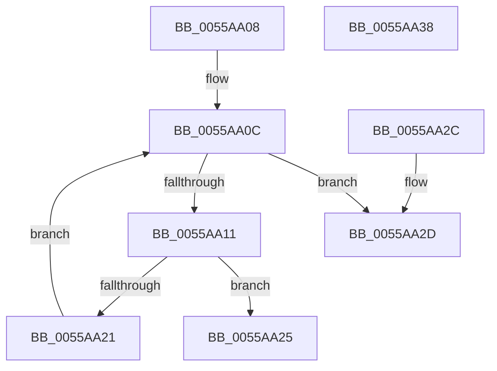

# HalpStoreFreeCr3

- RVA: `0x0055AA08`–`0x0055AA39` (길이 `49` bytes)
- VA: `0x000000014055AA08`
- 실행 섹션: `.text`
- PDB 이름 있음: `예`; PDB Function 태그: `아니요`
- unwind 정보 RVA: `0x000DB714`
- 디코드: `19`개 명령, `49/49` bytes 표시
- 미해석 바이트: `0` (있으면 어셈블리에 `.byte`로 보존)

> 이 문서는 커널 이미지의 기계어와 PDB 기호를 분석해 생성했습니다. 4번과 5번은 함수 원형과 자료형을 바이너리 사용 방식에서 추정한 C 해석이며 원본 소스 복구 결과는 아닙니다.

## 1. Dependencies

- 직접 호출 지점: **0**; 고유 호출 대상: **0**
- 직접 호출자로 확인된 함수: **1**
- RIP 상대 이미지 참조: **1**

### Outgoing calls
- 직접 디코드된 call 명령이 없습니다.

### Direct callers
- [HalpMapCR3Ex](../../pagelk/B5/HalpMapCR3Ex_function_00B5E95C.md) at `0x00B5E9D2`

### Static image references
- `0x0055AA14` → RVA `0x00F90560` (`.data`; read)

## 2. Other-region calls and transfers

- 다른 실행 섹션으로 향하는 call: **0**
- 별도 외부 분기/꼬리 이동을 확인하지 못했습니다.

## 3. Assembly (complete function range)

```asm
0055AA08  33 D2                           xor edx, edx
0055AA0A  8B C2                           mov eax, edx
0055AA0C  83 F8 10                        cmp eax, 0x10
0055AA0F  73 1C                           jae 0x14055aa2d
0055AA11  44 8B C0                        mov r8d, eax
0055AA14  4C 8D 0D 45 5B A3 00            lea r9, [rip + 0xa35b45]
0055AA1B  4B 39 14 C1                     cmp qword ptr [r9 + r8*8], rdx
0055AA1F  74 04                           je 0x14055aa25
0055AA21  FF C0                           inc eax
0055AA23  EB E7                           jmp 0x14055aa0c
0055AA25  4B 89 0C C1                     mov qword ptr [r9 + r8*8], rcx
0055AA29  33 C0                           xor eax, eax
0055AA2B  C3                              ret
0055AA2C  CC                              int3
0055AA2D  B9 9A 00 00 C0                  mov ecx, 0xc000009a
0055AA32  0F 44 D1                        cmove edx, ecx
0055AA35  8B C2                           mov eax, edx
0055AA37  C3                              ret
0055AA38  CC                              int3
```

## 4. C-style interpretation (structured pseudocode)

```c
__int64 __fastcall HalpStoreFreeCr3(__int64 a1, int a2)
{
    __int64 result;

    a2 = 0;
loc_0055AA0C:
    if (0 >= 16) goto loc_0055AA2D;
    if ((*(unsigned __int64 *)(v_rip + 10705733 + 0 * 8)) == 0) goto loc_0055AA25;
    result = (unsigned int)((0) + 1);
    goto loc_0055AA0C;
loc_0055AA25:
    *(unsigned __int64 *)(v_rip + 10705733 + 0 * 8) = a1;
    result = 0;
    return result;
loc_0055AA2D:
    if (condition_is_equal) { a2 = (unsigned int)((unsigned int)(0xC000009AULL)); }
    return (unsigned int)(a2);
}
```

## 5. (Beta) C Style

```c
int64_t HalpStoreFreeCr3(int64_t Arg1, int32_t Arg2)
{
    int64_t result;

    Arg2 = 0;
loc_0055AA0C:
    if (0 >= 16) goto loc_0055AA2D;
    if ((*(uint64_t *)(v_rip + 0xA35B45 + 0x0 * 8)) == 0) goto loc_0055AA25;
    result = (uint32_t)((0) + 1);
    goto loc_0055AA0C;
loc_0055AA25:
    *(uint64_t *)(v_rip + 0xA35B45 + 0x0 * 8) = Arg1;
    result = 0;
    return result;
loc_0055AA2D:
    if (condition_is_equal) { Arg2 = (uint32_t)((uint32_t)(0xC000009AULL)); }
    return (uint32_t)(Arg2);
}
```

## 6. Execution-region graph

[열기: 2D/3D 그래프와 함수 탐색 컨트롤 패널](../../../control-panel.html?section=text&rva=0x0055AA08&view=graph)

- 2D 그래프는 위에서 아래로 흐르고, 3D 그래프는 빈 공간을 드래그해 회전합니다. Shift+드래그는 이동, 휠은 확대·축소, 함수 노드 선택은 대상 보고서 이동입니다.

### Static fallback


