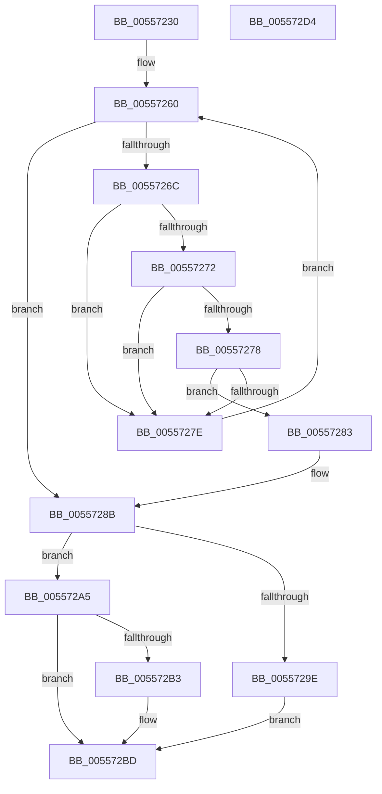

# HalpUnregisterSecondaryIcInterface

- RVA: `0x00557230`–`0x005572D5` (길이 `165` bytes)
- VA: `0x0000000140557230`
- 실행 섹션: `.text`
- PDB 이름 있음: `예`; PDB Function 태그: `아니요`
- unwind 정보 RVA: `0x0005C954`
- 디코드: `48`개 명령, `165/165` bytes 표시
- 미해석 바이트: `0` (있으면 어셈블리에 `.byte`로 보존)

> 이 문서는 커널 이미지의 기계어와 PDB 기호를 분석해 생성했습니다. 4번과 5번은 함수 원형과 자료형을 바이너리 사용 방식에서 추정한 C 해석이며 원본 소스 복구 결과는 아닙니다.

## 1. Dependencies

- 직접 호출 지점: **4**; 고유 호출 대상: **4**
- 직접 호출자로 확인된 함수: **0**
- RIP 상대 이미지 참조: **2**

### Outgoing calls
- `0x00557252` → [HalpAcquireHighLevelLock](../2D/HalpAcquireHighLevelLock_function_002D2390.md) (function, `0x002D2390`)
- `0x00557294` → [HalpReleaseHighLevelLock](../2D/HalpReleaseHighLevelLock_function_002D1C58.md) (function, `0x002D1C58`)
- `0x005572A8` → [HalpDeleteSecondaryIcEntry](HalpDeleteSecondaryIcEntry_function_00556E58.md) (function, `0x00556E58`)
- `0x005572B8` → [HalpReleaseSecondaryIcEntryShared](../48/HalpReleaseSecondaryIcEntryShared_function_00488FD0.md) (function, `0x00488FD0`)

### Direct callers
- 이 함수 시작 RVA로 연결되는 직접 call은 확인되지 않았습니다. 간접 호출은 완전히 역산할 수 없습니다.

### Static image references
- `0x00557249` → RVA `0x00F909D0` (`.data`; read)
- `0x00557257` → RVA `0x00F909C0` (`.data`; read)

## 2. Other-region calls and transfers

- 다른 실행 섹션으로 향하는 call: **0**
- 별도 외부 분기/꼬리 이동을 확인하지 못했습니다.

## 3. Assembly (complete function range)

```asm
00557230  48 89 5C 24 08                  mov qword ptr [rsp + 8], rbx
00557235  48 89 6C 24 10                  mov qword ptr [rsp + 0x10], rbp
0055723A  48 89 74 24 18                  mov qword ptr [rsp + 0x18], rsi
0055723F  57                              push rdi
00557240  48 83 EC 20                     sub rsp, 0x20
00557244  8B E9                           mov ebp, ecx
00557246  49 8B D8                        mov rbx, r8
00557249  48 8D 0D 80 97 A3 00            lea rcx, [rip + 0xa39780]
00557250  8B F2                           mov esi, edx
00557252  E8 39 B1 D7 FF                  call 0x1402d2390
00557257  4C 8B 0D 62 97 A3 00            mov r9, qword ptr [rip + 0xa39762]
0055725E  33 FF                           xor edi, edi
00557260  48 8D 0D 59 97 A3 00            lea rcx, [rip + 0xa39759]
00557267  4C 3B C9                        cmp r9, rcx
0055726A  74 1F                           je 0x14055728b
0055726C  41 39 69 10                     cmp dword ptr [r9 + 0x10], ebp
00557270  75 0C                           jne 0x14055727e
00557272  41 39 71 14                     cmp dword ptr [r9 + 0x14], esi
00557276  75 06                           jne 0x14055727e
00557278  49 39 59 30                     cmp qword ptr [r9 + 0x30], rbx
0055727C  74 05                           je 0x140557283
0055727E  4D 8B 09                        mov r9, qword ptr [r9]
00557281  EB DD                           jmp 0x140557260
00557283  49 8B F9                        mov rdi, r9
00557286  F0 41 FF 41 70                  lock inc dword ptr [r9 + 0x70]
0055728B  8A D0                           mov dl, al
0055728D  48 8D 0D 3C 97 A3 00            lea rcx, [rip + 0xa3973c]
00557294  E8 BF A9 D7 FF                  call 0x1402d1c58
00557299  48 85 FF                        test rdi, rdi
0055729C  75 07                           jne 0x1405572a5
0055729E  BB 21 A1 00 C0                  mov ebx, 0xc000a121
005572A3  EB 18                           jmp 0x1405572bd
005572A5  48 8B CF                        mov rcx, rdi
005572A8  E8 AB FB FF FF                  call 0x140556e58
005572AD  8B D8                           mov ebx, eax
005572AF  85 C0                           test eax, eax
005572B1  79 0A                           jns 0x1405572bd
005572B3  B2 01                           mov dl, 1
005572B5  48 8B CF                        mov rcx, rdi
005572B8  E8 13 1D F3 FF                  call 0x140488fd0
005572BD  48 8B 6C 24 38                  mov rbp, qword ptr [rsp + 0x38]
005572C2  8B C3                           mov eax, ebx
005572C4  48 8B 5C 24 30                  mov rbx, qword ptr [rsp + 0x30]
005572C9  48 8B 74 24 40                  mov rsi, qword ptr [rsp + 0x40]
005572CE  48 83 C4 20                     add rsp, 0x20
005572D2  5F                              pop rdi
005572D3  C3                              ret
005572D4  CC                              int3
```

## 4. C-style interpretation (structured pseudocode)

```c
__int64 __fastcall HalpUnregisterSecondaryIcInterface(int a1, int a2, __int64 a3)
{
    __int64 result;
    __int64 v_rdi;
    __int64 v_rsp;
    unsigned __int64 v_stack_p10;
    unsigned __int64 v_stack_p18;
    unsigned __int64 v_stack_p8;

    v_stack_p8 = v_rbx;
    v_stack_p10 = v_rbp;
    v_stack_p18 = v_rsi;
    v_rsp = (v_rsp) - (32);
    result = HalpAcquireHighLevelLock(v_rip + 10721152, a2, a3, a4);
    v_rdi = 0;
loc_00557260:
    if ((*(unsigned __int64 *)(v_rip + 10721122)) == (v_rip + 10721113)) goto loc_0055728B;
    if ((*(unsigned int *)(*(unsigned __int64 *)(v_rip + 10721122) + 16)) != ((unsigned int)((unsigned int)(a1)))) goto loc_0055727E;
    if ((*(unsigned int *)(*(unsigned __int64 *)(v_rip + 10721122) + 20)) != ((unsigned int)((unsigned int)(a2)))) goto loc_0055727E;
    if ((*(unsigned __int64 *)(*(unsigned __int64 *)(v_rip + 10721122) + 48)) == a3) goto loc_00557283;
loc_0055727E:
    goto loc_00557260;
loc_00557283:
loc_0055728B:
    result = HalpReleaseHighLevelLock(v_rip + 10721084, (unsigned __int8)(result), a3, *(unsigned __int64 *)(*(unsigned __int64 *)(v_rip + 10721122)));
    if (*(unsigned __int64 *)(*(unsigned __int64 *)(v_rip + 10721122)) != 0) goto loc_005572A5;
    goto loc_005572BD;
loc_005572A5:
    result = HalpDeleteSecondaryIcEntry(*(unsigned __int64 *)(*(unsigned __int64 *)(v_rip + 10721122)), (unsigned __int8)(result), a3, *(unsigned __int64 *)(*(unsigned __int64 *)(v_rip + 10721122)));
    if (sign_flag) {
        a2 = 1;
        a1 = *(unsigned __int64 *)(*(unsigned __int64 *)(v_rip + 10721122));
        result = HalpReleaseSecondaryIcEntryShared(a1, a2, a3, *(unsigned __int64 *)(*(unsigned __int64 *)(v_rip + 10721122)));
    }
    v_rsp = (v_rsp) + (32);
    return (unsigned int)((unsigned int)((unsigned int)((unsigned int)(result))));
}
```

## 5. (Beta) C Style

```c
int64_t HalpUnregisterSecondaryIcInterface(int32_t Arg1, int32_t Arg2, int64_t Arg3)
{
    int64_t result;
    int64_t local_rdi;
    int64_t local_rsp;
    uint64_t v_stack_p10;
    uint64_t v_stack_p18;
    uint64_t v_stack_p8;

    v_stack_p8 = local_rbx;
    v_stack_p10 = local_rbp;
    v_stack_p18 = local_rsi;
    local_rsp = (local_rsp) - (32);
    result = HalpAcquireHighLevelLock(v_rip + 10721152, Arg2, Arg3, a4);
    local_rdi = 0;
loc_00557260:
    if ((*(uint64_t *)(v_rip + 0xA39762)) == (v_rip + 10721113)) goto loc_0055728B;
    if ((*(uint32_t *)(*(uint64_t *)(v_rip + 0xA39762) + 0x10)) != ((uint32_t)((uint32_t)(Arg1)))) goto loc_0055727E;
    if ((*(uint32_t *)(*(uint64_t *)(v_rip + 0xA39762) + 0x14)) != ((uint32_t)((uint32_t)(Arg2)))) goto loc_0055727E;
    if ((*(uint64_t *)(*(uint64_t *)(v_rip + 0xA39762) + 0x30)) == Arg3) goto loc_00557283;
loc_0055727E:
    goto loc_00557260;
loc_00557283:
loc_0055728B:
    result = HalpReleaseHighLevelLock(v_rip + 10721084, (uint8_t)(result), Arg3, *(uint64_t *)(*(uint64_t *)(v_rip + 0xA39762)));
    if (*(uint64_t *)(*(uint64_t *)(v_rip + 0xA39762)) != 0) goto loc_005572A5;
    goto loc_005572BD;
loc_005572A5:
    result = HalpDeleteSecondaryIcEntry(*(uint64_t *)(*(uint64_t *)(v_rip + 0xA39762)), (uint8_t)(result), Arg3, *(uint64_t *)(*(uint64_t *)(v_rip + 0xA39762)));
    if (sign_flag) {
        Arg2 = 1;
        Arg1 = *(uint64_t *)(*(uint64_t *)(v_rip + 0xA39762));
        result = HalpReleaseSecondaryIcEntryShared(Arg1, Arg2, Arg3, *(uint64_t *)(*(uint64_t *)(v_rip + 0xA39762)));
    }
    local_rsp = (local_rsp) + (32);
    return (uint32_t)((uint32_t)((uint32_t)((uint32_t)(result))));
}
```

## 6. Execution-region graph

[열기: 2D/3D 그래프와 함수 탐색 컨트롤 패널](../../../control-panel.html?section=text&rva=0x00557230&view=graph)

- 2D 그래프는 위에서 아래로 흐르고, 3D 그래프는 빈 공간을 드래그해 회전합니다. Shift+드래그는 이동, 휠은 확대·축소, 함수 노드 선택은 대상 보고서 이동입니다.

### Static fallback


