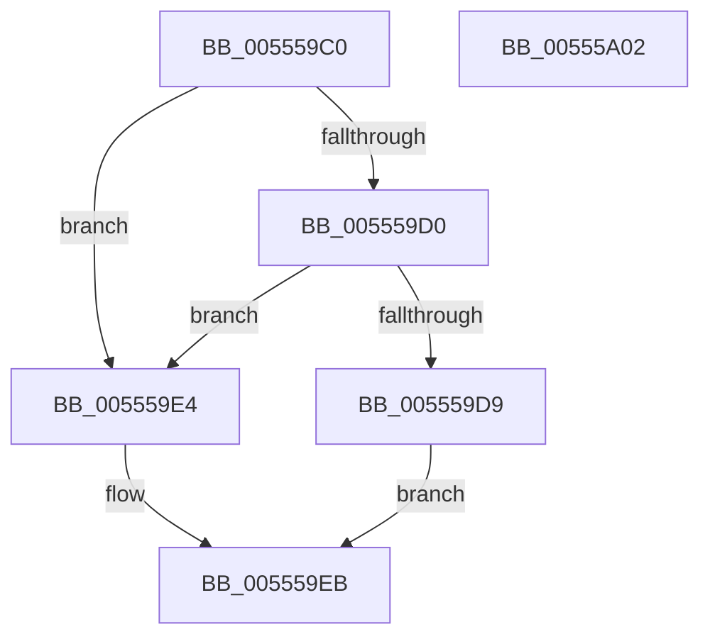

# HalpWheaReadMsrAddress

- RVA: `0x005559C0`–`0x00555A03` (길이 `67` bytes)
- VA: `0x00000001405559C0`
- 실행 섹션: `.text`
- PDB 이름 있음: `예`; PDB Function 태그: `아니요`
- unwind 정보 RVA: `0x0005C788`
- 디코드: `18`개 명령, `67/67` bytes 표시
- 미해석 바이트: `0` (있으면 어셈블리에 `.byte`로 보존)

> 이 문서는 커널 이미지의 기계어와 PDB 기호를 분석해 생성했습니다. 4번과 5번은 함수 원형과 자료형을 바이너리 사용 방식에서 추정한 C 해석이며 원본 소스 복구 결과는 아닙니다.

## 1. Dependencies

- 직접 호출 지점: **2**; 고유 호출 대상: **2**
- 직접 호출자로 확인된 함수: **2**
- RIP 상대 이미지 참조: **2**

### Outgoing calls
- `0x005559C7` → [HalpGetCpuVendor](../48/HalpGetCpuVendor_function_004879E4.md) (function, `0x004879E4`)
- `0x005559F8` → [guard_dispatch_icall](../6B/guard_dispatch_icall_function_006BAAD0.md) (function, `0x006BAAD0`)

### Direct callers
- [HalpMcaPopulateErrorData](../54/HalpMcaPopulateErrorData_function_005417AC.md) at `0x00541883`
- [HalpMcaPopulateErrorDataEx](../54/HalpMcaPopulateErrorDataEx_function_0054198C.md) at `0x005419DA`

### Static image references
- `0x005559D0` → RVA `0x00E10258` (`.data`; read)
- `0x005559EB` → RVA `0x00FC1990` (`.data`; read)

## 2. Other-region calls and transfers

- 다른 실행 섹션으로 향하는 call: **0**
- 별도 외부 분기/꼬리 이동을 확인하지 못했습니다.

## 3. Assembly (complete function range)

```asm
005559C0  48 83 EC 28                     sub rsp, 0x28
005559C4  4C 8B C9                        mov r9, rcx
005559C7  E8 18 20 F3 FF                  call 0x1404879e4
005559CC  3C 01                           cmp al, 1
005559CE  75 14                           jne 0x1405559e4
005559D0  80 3D 81 A8 8B 00 00            cmp byte ptr [rip + 0x8ba881], 0
005559D7  74 0B                           je 0x1405559e4
005559D9  C1 E2 04                        shl edx, 4
005559DC  81 EA FE DF FF 3F               sub edx, 0x3fffdffe
005559E2  EB 07                           jmp 0x1405559eb
005559E4  8D 14 95 02 04 00 00            lea edx, [rdx*4 + 0x402]
005559EB  48 8B 05 9E BF A6 00            mov rax, qword ptr [rip + 0xa6bf9e]
005559F2  45 33 C0                        xor r8d, r8d
005559F5  49 8B C9                        mov rcx, r9
005559F8  E8 D3 50 16 00                  call 0x1406baad0
005559FD  48 83 C4 28                     add rsp, 0x28
00555A01  C3                              ret
00555A02  CC                              int3
```

## 4. C-style interpretation (structured pseudocode)

```c
__int64 __fastcall HalpWheaReadMsrAddress(__int64 a1, int a2, int a3)
{
    __int64 result;
    __int64 v_rsp;

    v_rsp = (v_rsp) - (40);
    result = HalpGetCpuVendor(a1, a2, a3, a1);
    if (((unsigned __int8)(result)) != 1) goto loc_005559E4;
    if ((*(unsigned __int8 *)(v_rip + 9152641)) == 0) goto loc_005559E4;
    a2 = (unsigned int)((a2) << (4));
    a2 = (unsigned int)((a2) - (0x3FFFDFFEULL));
    goto loc_005559EB;
loc_005559E4:
loc_005559EB:
    a3 = 0;
    result = guard_dispatch_icall(a1, a2 * 4 + 1026, a3, a1);
    v_rsp = (v_rsp) + (40);
    return result;
}
```

## 5. (Beta) C Style

```c
int64_t HalpWheaReadMsrAddress(int64_t Arg1, int32_t Arg2, int32_t Arg3)
{
    int64_t result;
    int64_t local_rsp;

    local_rsp = (local_rsp) - (40);
    result = HalpGetCpuVendor(Arg1, Arg2, Arg3, Arg1);
    if (((uint8_t)(result)) != 1) goto loc_005559E4;
    if ((*(uint8_t *)(v_rip + 0x8BA881)) == 0) goto loc_005559E4;
    Arg2 = (uint32_t)((Arg2) << (4));
    Arg2 = (uint32_t)((Arg2) - (0x3FFFDFFEULL));
    goto loc_005559EB;
loc_005559E4:
loc_005559EB:
    Arg3 = 0;
    result = guard_dispatch_icall(Arg1, Arg2 * 4 + 1026, Arg3, Arg1);
    local_rsp = (local_rsp) + (40);
    return result;
}
```

## 6. Execution-region graph

[열기: 2D/3D 그래프와 함수 탐색 컨트롤 패널](../../../control-panel.html?section=text&rva=0x005559C0&view=graph)

- 2D 그래프는 위에서 아래로 흐르고, 3D 그래프는 빈 공간을 드래그해 회전합니다. Shift+드래그는 이동, 휠은 확대·축소, 함수 노드 선택은 대상 보고서 이동입니다.

### Static fallback


