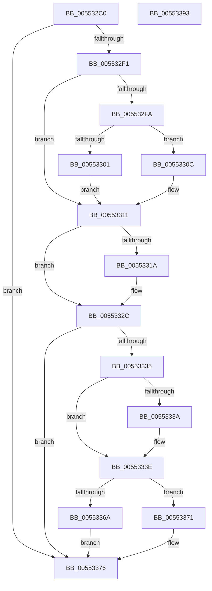

# IoFlushAdapterBuffersV3

- RVA: `0x005532C0`–`0x00553394` (길이 `212` bytes)
- VA: `0x00000001405532C0`
- 실행 섹션: `.text`
- PDB 이름 있음: `예`; PDB Function 태그: `아니요`
- unwind 정보 RVA: `0x00060130`
- 디코드: `55`개 명령, `212/212` bytes 표시
- 미해석 바이트: `0` (있으면 어셈블리에 `.byte`로 보존)

> 이 문서는 커널 이미지의 기계어와 PDB 기호를 분석해 생성했습니다. 4번과 5번은 함수 원형과 자료형을 바이너리 사용 방식에서 추정한 C 해석이며 원본 소스 복구 결과는 아닙니다.

## 1. Dependencies

- 직접 호출 지점: **4**; 고유 호출 대상: **4**
- 직접 호출자로 확인된 함수: **0**
- RIP 상대 이미지 참조: **0**

### Outgoing calls
- `0x00553305` → [HalpDmaFreeLa](../53/HalpDmaFreeLa_function_0053E1B8.md) (function, `0x0053E1B8`)
- `0x00553327` → [HalpDmaControllerFlushChannel](../3D/HalpDmaControllerFlushChannel_function_003DB25C.md) (function, `0x003DB25C`)
- `0x0055336A` → [HalpDmaFlushContiguousTransferV3](../3D/HalpDmaFlushContiguousTransferV3_function_003D9E70.md) (function, `0x003D9E70`)
- `0x00553371` → [HalpDmaFlushScatterTransferV3](../3D/HalpDmaFlushScatterTransferV3_function_003DB06C.md) (function, `0x003DB06C`)

### Direct callers
- 이 함수 시작 RVA로 연결되는 직접 call은 확인되지 않았습니다. 간접 호출은 완전히 역산할 수 없습니다.

### Static image references
- 디코드된 RIP-relative 메모리 참조가 없습니다.

## 2. Other-region calls and transfers

- 다른 실행 섹션으로 향하는 call: **0**
- 별도 외부 분기/꼬리 이동을 확인하지 못했습니다.

## 3. Assembly (complete function range)

```asm
005532C0  48 8B C4                        mov rax, rsp
005532C3  48 89 58 08                     mov qword ptr [rax + 8], rbx
005532C7  48 89 68 10                     mov qword ptr [rax + 0x10], rbp
005532CB  48 89 70 18                     mov qword ptr [rax + 0x18], rsi
005532CF  48 89 78 20                     mov qword ptr [rax + 0x20], rdi
005532D3  41 56                           push r14
005532D5  48 83 EC 40                     sub rsp, 0x40
005532D9  8B 74 24 70                     mov esi, dword ptr [rsp + 0x70]
005532DD  49 8B E9                        mov rbp, r9
005532E0  49 8B F8                        mov rdi, r8
005532E3  4C 8B F2                        mov r14, rdx
005532E6  48 8B D9                        mov rbx, rcx
005532E9  85 F6                           test esi, esi
005532EB  0F 84 85 00 00 00               je 0x140553376
005532F1  83 B9 08 02 00 00 03            cmp dword ptr [rcx + 0x208], 3
005532F8  75 17                           jne 0x140553311
005532FA  41 80 78 40 00                  cmp byte ptr [r8 + 0x40], 0
005532FF  75 0B                           jne 0x14055330c
00553301  49 8D 50 18                     lea rdx, [r8 + 0x18]
00553305  E8 AE AE FE FF                  call 0x14053e1b8
0055330A  EB 05                           jmp 0x140553311
0055330C  41 83 60 10 00                  and dword ptr [r8 + 0x10], 0
00553311  80 BB B9 01 00 00 00            cmp byte ptr [rbx + 0x1b9], 0
00553318  75 12                           jne 0x14055332c
0055331A  8B 93 7C 01 00 00               mov edx, dword ptr [rbx + 0x17c]
00553320  48 8B 8B 70 01 00 00            mov rcx, qword ptr [rbx + 0x170]
00553327  E8 30 7F E8 FF                  call 0x1403db25c
0055332C  80 BB B8 01 00 00 00            cmp byte ptr [rbx + 0x1b8], 0
00553333  74 41                           je 0x140553376
00553335  48 85 FF                        test rdi, rdi
00553338  74 04                           je 0x14055333e
0055333A  48 89 7F 38                     mov qword ptr [rdi + 0x38], rdi
0055333E  48 83 64 24 38 00               and qword ptr [rsp + 0x38], 0
00553344  4C 8B CD                        mov r9, rbp
00553347  80 BB BA 01 00 00 00            cmp byte ptr [rbx + 0x1ba], 0
0055334E  4C 8B C7                        mov r8, rdi
00553351  8A 44 24 78                     mov al, byte ptr [rsp + 0x78]
00553355  49 8B D6                        mov rdx, r14
00553358  C6 44 24 30 00                  mov byte ptr [rsp + 0x30], 0
0055335D  48 8B CB                        mov rcx, rbx
00553360  88 44 24 28                     mov byte ptr [rsp + 0x28], al
00553364  89 74 24 20                     mov dword ptr [rsp + 0x20], esi
00553368  75 07                           jne 0x140553371
0055336A  E8 01 6B E8 FF                  call 0x1403d9e70
0055336F  EB 05                           jmp 0x140553376
00553371  E8 F6 7C E8 FF                  call 0x1403db06c
00553376  48 8B 5C 24 50                  mov rbx, qword ptr [rsp + 0x50]
0055337B  B0 01                           mov al, 1
0055337D  48 8B 6C 24 58                  mov rbp, qword ptr [rsp + 0x58]
00553382  48 8B 74 24 60                  mov rsi, qword ptr [rsp + 0x60]
00553387  48 8B 7C 24 68                  mov rdi, qword ptr [rsp + 0x68]
0055338C  48 83 C4 40                     add rsp, 0x40
00553390  41 5E                           pop r14
00553392  C3                              ret
00553393  CC                              int3
```

## 4. C-style interpretation (structured pseudocode)

```c
__int64 __fastcall IoFlushAdapterBuffersV3(__int64 a1, __int64 a2, __int64 a3, __int64 a4, unsigned int a5, unsigned __int8 a6)
{
    __int64 result;
    __int64 v_rsp;
    unsigned __int64 v_stack_m10;
    unsigned __int8 v_stack_m18;
    unsigned __int8 v_stack_m20;
    unsigned int v_stack_m28;
    unsigned __int64 v_stack_p10;
    unsigned __int64 v_stack_p18;
    unsigned __int64 v_stack_p20;
    unsigned __int64 v_stack_p8;

    *(unsigned __int64 *)(v_rsp + 8) = v_rbx;
    *(unsigned __int64 *)(v_rsp + 16) = v_rbp;
    *(unsigned __int64 *)(v_rsp + 24) = v_rsi;
    *(unsigned __int64 *)(v_rsp + 32) = v_rdi;
    v_rsp = (v_rsp) - (64);
    if ((unsigned int)((unsigned int)(a5)) == 0) goto loc_00553376;
    if ((*(unsigned int *)(a1 + 520)) != 3) goto loc_00553311;
    if ((*(unsigned __int8 *)(a3 + 64)) != 0) goto loc_0055330C;
    result = HalpDmaFreeLa(a1, a3 + 24, a3, a4);
    goto loc_00553311;
loc_0055330C:
loc_00553311:
    if ((*(unsigned __int8 *)(a1 + 441)) == 0) {
        a2 = *(unsigned int *)(a1 + 380);
        a1 = *(unsigned __int64 *)(a1 + 368);
        result = HalpDmaControllerFlushChannel(a1, a2, a3, a4);
    }
    if ((*(unsigned __int8 *)(a1 + 440)) == 0) goto loc_00553376;
    if (a3 != 0) {
        *(unsigned __int64 *)(a3 + 56) = a3;
    }
    v_stack_m18 = 0;
    v_stack_m20 = a6;
    v_stack_m28 = (unsigned int)((unsigned int)(a5));
    if ((*(unsigned __int8 *)(a1 + 442)) != 0) goto loc_00553371;
    result = HalpDmaFlushContiguousTransferV3(a1, a2, a3, a4);
    goto loc_00553376;
loc_00553371:
    result = HalpDmaFlushScatterTransferV3(a1, a2, a3, a4);
loc_00553376:
    v_rsp = (v_rsp) + (64);
    return 1;
}
```

## 5. (Beta) C Style

```c
int64_t IoFlushAdapterBuffersV3(void *Arg1, int64_t Arg2, void *Arg3, int64_t Arg4, uint32_t Arg5, uint8_t Arg6)
{
    uint8_t *arg1 = (uint8_t *)Arg1;
    uint8_t *arg3 = (uint8_t *)Arg3;

    int64_t result;
    int64_t local_rsp;
    uint64_t v_stack_m10;
    uint8_t v_stack_m18;
    uint8_t v_stack_m20;
    uint32_t v_stack_m28;
    uint64_t v_stack_p10;
    uint64_t v_stack_p18;
    uint64_t v_stack_p20;
    uint64_t v_stack_p8;

    *(uint64_t *)(local_rsp + 0x8) = local_rbx;
    *(uint64_t *)(local_rsp + 0x10) = local_rbp;
    *(uint64_t *)(local_rsp + 0x18) = local_rsi;
    *(uint64_t *)(local_rsp + 0x20) = local_rdi;
    local_rsp = (local_rsp) - (64);
    if ((uint32_t)((uint32_t)(Arg5)) == 0) goto loc_00553376;
    if ((*(uint32_t *)(arg1 + 0x208)) != 3) goto loc_00553311;
    if ((*(uint8_t *)(arg3 + 0x40)) != 0) goto loc_0055330C;
    result = HalpDmaFreeLa(Arg1, Arg3 + 24, Arg3, Arg4);
    goto loc_00553311;
loc_0055330C:
loc_00553311:
    if ((*(uint8_t *)(arg1 + 0x1B9)) == 0) {
        Arg2 = *(uint32_t *)(arg1 + 0x17C);
        Arg1 = *(uint64_t *)(arg1 + 0x170);
        result = HalpDmaControllerFlushChannel(Arg1, Arg2, Arg3, Arg4);
    }
    if ((*(uint8_t *)(arg1 + 0x1B8)) == 0) goto loc_00553376;
    if (Arg3 != NULL) {
        *(void **)(arg3 + 0x38) = Arg3;
    }
    v_stack_m18 = 0;
    v_stack_m20 = Arg6;
    v_stack_m28 = (uint32_t)((uint32_t)(Arg5));
    if ((*(uint8_t *)(arg1 + 0x1BA)) != 0) goto loc_00553371;
    result = HalpDmaFlushContiguousTransferV3(Arg1, Arg2, Arg3, Arg4);
    goto loc_00553376;
loc_00553371:
    result = HalpDmaFlushScatterTransferV3(Arg1, Arg2, Arg3, Arg4);
loc_00553376:
    local_rsp = (local_rsp) + (64);
    return 1;
}
```

### 관측된 메모리 오프셋

구조체 형식이 확인되지 않은 접근은 인자 기준의 오프셋으로만 기록했습니다.

| 기준 인자 | 오프셋 표현 | 폭 (bit) | 접근 |
|---|---:|---:|---|
| `Arg1` | `+ 0x170` | `64` | `R` |
| `Arg1` | `+ 0x17C` | `32` | `R` |
| `Arg1` | `+ 0x1B8` | `8` | `R` |
| `Arg1` | `+ 0x1B9` | `8` | `R` |
| `Arg1` | `+ 0x1BA` | `8` | `R` |
| `Arg1` | `+ 0x208` | `32` | `R` |
| `Arg3` | `+ 0x10` | `32` | `R/W` |
| `Arg3` | `+ 0x18` | `64` | `R` |
| `Arg3` | `+ 0x40` | `8` | `R` |

## 6. Execution-region graph

[열기: 2D/3D 그래프와 함수 탐색 컨트롤 패널](../../../control-panel.html?section=text&rva=0x005532C0&view=graph)

- 2D 그래프는 위에서 아래로 흐르고, 3D 그래프는 빈 공간을 드래그해 회전합니다. Shift+드래그는 이동, 휠은 확대·축소, 함수 노드 선택은 대상 보고서 이동입니다.

### Static fallback


