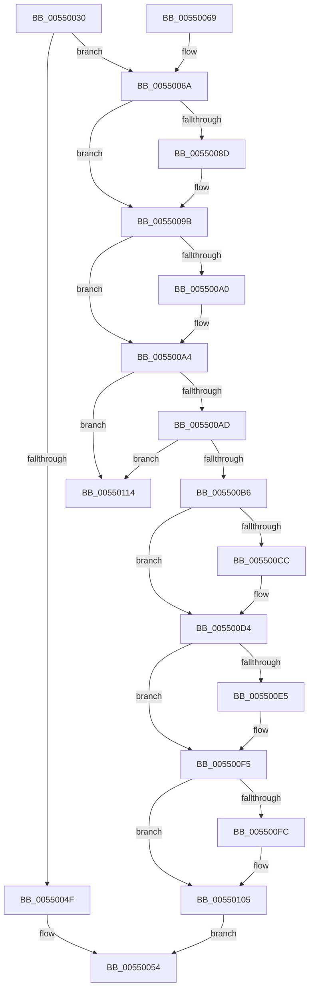

# IommupPasidDeviceDelete

- RVA: `0x00550030`–`0x0055011B` (길이 `235` bytes)
- VA: `0x0000000140550030`
- 실행 섹션: `.text`
- PDB 이름 있음: `예`; PDB Function 태그: `아니요`
- unwind 정보 RVA: `0x000C4160`
- 디코드: `68`개 명령, `235/235` bytes 표시
- 미해석 바이트: `0` (있으면 어셈블리에 `.byte`로 보존)

> 이 문서는 커널 이미지의 기계어와 PDB 기호를 분석해 생성했습니다. 4번과 5번은 함수 원형과 자료형을 바이너리 사용 방식에서 추정한 C 해석이며 원본 소스 복구 결과는 아닙니다.

## 1. Dependencies

- 직접 호출 지점: **7**; 고유 호출 대상: **7**
- 직접 호출자로 확인된 함수: **3**
- RIP 상대 이미지 참조: **1**

### Outgoing calls
- `0x0055007D` → [KeAbPreAcquire](../21/KeAbPreAcquire_function_00210230.md) (function, `0x00210230`)
- `0x00550096` → [ExfAcquirePushLockExclusiveEx](../20/ExfAcquirePushLockExclusiveEx_function_0020FC90.md) (function, `0x0020FC90`)
- `0x005500CF` → [ExfTryToWakePushLock](../26/ExfTryToWakePushLock_function_00265DD0.md) (function, `0x00265DD0`)
- `0x005500D7` → [KeAbPostRelease](../2E/KeAbPostRelease_function_002E1600.md) (function, `0x002E1600`)
- `0x005500E9` → [IommuFreeLibraryContext](../56/IommuFreeLibraryContext_function_005657B4.md) (function, `0x005657B4`)
- `0x00550100` → [ExpFreeAsid](../65/ExpFreeAsid_function_0065B1E8.md) (function, `0x0065B1E8`)
- `0x00550108` → [HalpMmAllocCtxFree](../3E/HalpMmAllocCtxFree_function_003E1904.md) (function, `0x003E1904`)

### Direct callers
- [IommupDeviceDisableSvm](../../page/70/IommupDeviceDisableSvm_function_00708A28.md) at `0x00708AC3`
- [IommupDeviceEnableSvm](../../page/70/IommupDeviceEnableSvm_function_00708CC4.md) at `0x00708E9F`
- [IommuPasidDeviceDelete](../../page/70/IommuPasidDeviceDelete_function_0070D500.md) at `0x0070D511`

### Static image references
- `0x005500DC` → RVA `0x00FC1710` (`.data`; read)

## 2. Other-region calls and transfers

- 다른 실행 섹션으로 향하는 call: **0**
- 별도 외부 분기/꼬리 이동을 확인하지 못했습니다.

## 3. Assembly (complete function range)

```asm
00550030  48 89 5C 24 08                  mov qword ptr [rsp + 8], rbx
00550035  48 89 6C 24 10                  mov qword ptr [rsp + 0x10], rbp
0055003A  48 89 74 24 18                  mov qword ptr [rsp + 0x18], rsi
0055003F  57                              push rdi
00550040  48 83 EC 20                     sub rsp, 0x20
00550044  33 ED                           xor ebp, ebp
00550046  48 8B D9                        mov rbx, rcx
00550049  48 39 69 18                     cmp qword ptr [rcx + 0x18], rbp
0055004D  74 1B                           je 0x14055006a
0055004F  B8 08 07 00 C0                  mov eax, 0xc0000708
00550054  48 8B 5C 24 30                  mov rbx, qword ptr [rsp + 0x30]
00550059  48 8B 6C 24 38                  mov rbp, qword ptr [rsp + 0x38]
0055005E  48 8B 74 24 40                  mov rsi, qword ptr [rsp + 0x40]
00550063  48 83 C4 20                     add rsp, 0x20
00550067  5F                              pop rdi
00550068  C3                              ret
00550069  CC                              int3
0055006A  48 8B 79 10                     mov rdi, qword ptr [rcx + 0x10]
0055006E  45 33 C0                        xor r8d, r8d
00550071  48 81 C7 78 01 00 00            add rdi, 0x178
00550078  33 D2                           xor edx, edx
0055007A  48 8B CF                        mov rcx, rdi
0055007D  E8 AE 01 CC FF                  call 0x140210230
00550082  F0 48 0F BA 2F 00               lock bts qword ptr [rdi], 0
00550088  48 8B F0                        mov rsi, rax
0055008B  73 0E                           jae 0x14055009b
0055008D  4C 8B C7                        mov r8, rdi
00550090  48 8B D0                        mov rdx, rax
00550093  48 8B CF                        mov rcx, rdi
00550096  E8 F5 FB CB FF                  call 0x14020fc90
0055009B  48 85 F6                        test rsi, rsi
0055009E  74 04                           je 0x1405500a4
005500A0  C6 46 0A 01                     mov byte ptr [rsi + 0xa], 1
005500A4  48 8B 0B                        mov rcx, qword ptr [rbx]
005500A7  48 39 59 08                     cmp qword ptr [rcx + 8], rbx
005500AB  75 67                           jne 0x140550114
005500AD  48 8B 43 08                     mov rax, qword ptr [rbx + 8]
005500B1  48 39 18                        cmp qword ptr [rax], rbx
005500B4  75 5E                           jne 0x140550114
005500B6  48 89 08                        mov qword ptr [rax], rcx
005500B9  48 89 41 08                     mov qword ptr [rcx + 8], rax
005500BD  48 83 C8 FF                     or rax, 0xffffffffffffffff
005500C1  F0 48 0F C1 07                  lock xadd qword ptr [rdi], rax
005500C6  24 06                           and al, 6
005500C8  3C 02                           cmp al, 2
005500CA  75 08                           jne 0x1405500d4
005500CC  48 8B CF                        mov rcx, rdi
005500CF  E8 FC 5C D1 FF                  call 0x140265dd0
005500D4  48 8B CF                        mov rcx, rdi
005500D7  E8 24 15 D9 FF                  call 0x1402e1600
005500DC  40 38 2D 2D 16 A7 00            cmp byte ptr [rip + 0xa7162d], bpl
005500E3  75 10                           jne 0x1405500f5
005500E5  48 8B 4B 38                     mov rcx, qword ptr [rbx + 0x38]
005500E9  E8 C6 56 01 00                  call 0x1405657b4
005500EE  48 83 63 38 00                  and qword ptr [rbx + 0x38], 0
005500F3  8B E8                           mov ebp, eax
005500F5  8B 4B 30                        mov ecx, dword ptr [rbx + 0x30]
005500F8  85 C9                           test ecx, ecx
005500FA  74 09                           je 0x140550105
005500FC  FF C9                           dec ecx
005500FE  33 D2                           xor edx, edx
00550100  E8 E3 B0 10 00                  call 0x14065b1e8
00550105  48 8B D3                        mov rdx, rbx
00550108  E8 F7 17 E9 FF                  call 0x1403e1904
0055010D  8B C5                           mov eax, ebp
0055010F  E9 40 FF FF FF                  jmp 0x140550054
00550114  B9 03 00 00 00                  mov ecx, 3
00550119  CD 29                           int 0x29
```

## 4. C-style interpretation (structured pseudocode)

```c
__int64 __fastcall IommupPasidDeviceDelete(__int64 a1, int a2, int a3)
{
    __int64 result;
    __int64 v_rbp;
    __int64 v_rdi;
    __int64 v_rsp;
    unsigned __int64 v_stack_p10;
    unsigned __int64 v_stack_p18;
    unsigned __int64 v_stack_p8;

    v_stack_p8 = v_rbx;
    v_stack_p10 = v_rbp;
    v_stack_p18 = v_rsi;
    v_rsp = (v_rsp) - (32);
    v_rbp = 0;
    if ((*(unsigned __int64 *)(a1 + 24)) == 0) goto loc_0055006A;
loc_00550054:
    v_rsp = (v_rsp) + (32);
    return (unsigned int)(0xC0000708ULL);
loc_0055006A:
    a3 = 0;
    v_rdi = (*(unsigned __int64 *)(a1 + 16)) + (376);
    a2 = 0;
    result = KeAbPreAcquire(v_rdi, a2, a3, a4);
    if (!(condition_is_above_or_equal)) {
        a3 = v_rdi;
        a2 = result;
        a1 = v_rdi;
        result = ExfAcquirePushLockExclusiveEx(a1, a2, a3, a4);
    }
    if (result != 0) {
        *(unsigned __int8 *)(result + 10) = 1;
    }
    if ((*(unsigned __int64 *)(*(unsigned __int64 *)(v_stack_p8) + 8)) != v_stack_p8) goto loc_00550114;
    if ((*(unsigned __int64 *)(*(unsigned __int64 *)(v_stack_p8 + 8))) != v_stack_p8) goto loc_00550114;
    *(unsigned __int64 *)(*(unsigned __int64 *)(v_stack_p8 + 8)) = *(unsigned __int64 *)(v_stack_p8);
    *(unsigned __int64 *)(*(unsigned __int64 *)(v_stack_p8) + 8) = *(unsigned __int64 *)(v_stack_p8 + 8);
    result = (*(unsigned __int64 *)(v_stack_p8 + 8)) | (-1);
    result = (unsigned __int8)((result) & (6));
    if (((unsigned __int8)(result)) == 2) {
        a1 = v_rdi;
        result = ExfTryToWakePushLock(a1, a2, a3, a4);
    }
    result = KeAbPostRelease(v_rdi, a2, a3, a4);
    v_rbp = v_stack_p10;
    if ((*(unsigned __int8 *)(v_rip + 10950189)) == ((unsigned __int8)(v_stack_p10))) {
        a1 = *(unsigned __int64 *)(v_stack_p8 + 56);
        result = IommuFreeLibraryContext(a1, a2, a3, a4);
        v_rbp = (unsigned int)(result);
    }
    if ((unsigned int)((unsigned int)(*(unsigned int *)(v_stack_p8 + 48))) != 0) {
        a1 = (unsigned int)(((unsigned int)(*(unsigned int *)(v_stack_p8 + 48))) - 1);
        a2 = 0;
        result = ExpFreeAsid(a1, a2, a3, a4);
    }
    result = HalpMmAllocCtxFree(a1, v_stack_p8, a3, a4);
    goto loc_00550054;
loc_00550114:
    return (unsigned int)((unsigned int)(v_rbp));
}
```

## 5. (Beta) C Style

```c
int64_t IommupPasidDeviceDelete(void *Arg1, int32_t Arg2, int32_t Arg3)
{
    uint8_t *arg1 = (uint8_t *)Arg1;

    int64_t result;
    int64_t local_rbp;
    int64_t local_rdi;
    int64_t local_rsp;
    uint64_t v_stack_p10;
    uint64_t v_stack_p18;
    uint64_t v_stack_p8;

    v_stack_p8 = local_rbx;
    v_stack_p10 = local_rbp;
    v_stack_p18 = local_rsi;
    local_rsp = (local_rsp) - (32);
    local_rbp = 0;
    if ((*(uint64_t *)(arg1 + 0x18)) == 0) goto loc_0055006A;
loc_00550054:
    local_rsp = (local_rsp) + (32);
    return (uint32_t)(0xC0000708ULL);
loc_0055006A:
    Arg3 = 0;
    local_rdi = (*(uint64_t *)(arg1 + 0x10)) + (376);
    Arg2 = 0;
    result = KeAbPreAcquire(local_rdi, Arg2, Arg3, a4);
    if (!(condition_is_above_or_equal)) {
        Arg3 = local_rdi;
        Arg2 = result;
        Arg1 = local_rdi;
        result = ExfAcquirePushLockExclusiveEx(Arg1, Arg2, Arg3, a4);
    }
    if (result != 0) {
        *(uint8_t *)(result + 0xA) = 1;
    }
    if ((*(uint64_t *)(*(uint64_t *)(v_stack_p8) + 0x8)) != v_stack_p8) goto loc_00550114;
    if ((*(uint64_t *)(*(uint64_t *)(v_stack_p8 + 0x8))) != v_stack_p8) goto loc_00550114;
    *(uint64_t *)(*(uint64_t *)(v_stack_p8 + 0x8)) = *(uint64_t *)(v_stack_p8);
    *(uint64_t *)(*(uint64_t *)(v_stack_p8) + 0x8) = *(uint64_t *)(v_stack_p8 + 0x8);
    result = (*(uint64_t *)(v_stack_p8 + 0x8)) | (-1);
    result = (uint8_t)((result) & (6));
    if (((uint8_t)(result)) == 2) {
        Arg1 = local_rdi;
        result = ExfTryToWakePushLock(Arg1, Arg2, Arg3, a4);
    }
    result = KeAbPostRelease(local_rdi, Arg2, Arg3, a4);
    local_rbp = v_stack_p10;
    if ((*(uint8_t *)(v_rip + 0xA7162D)) == ((uint8_t)(v_stack_p10))) {
        Arg1 = *(uint64_t *)(v_stack_p8 + 0x38);
        result = IommuFreeLibraryContext(Arg1, Arg2, Arg3, a4);
        local_rbp = (uint32_t)(result);
    }
    if ((uint32_t)((uint32_t)(*(uint32_t *)(v_stack_p8 + 0x30))) != 0) {
        Arg1 = (uint32_t)(((uint32_t)(*(uint32_t *)(v_stack_p8 + 0x30))) - 1);
        Arg2 = 0;
        result = ExpFreeAsid(Arg1, Arg2, Arg3, a4);
    }
    result = HalpMmAllocCtxFree(Arg1, v_stack_p8, Arg3, a4);
    goto loc_00550054;
loc_00550114:
    return (uint32_t)((uint32_t)(local_rbp));
}
```

### 관측된 메모리 오프셋

구조체 형식이 확인되지 않은 접근은 인자 기준의 오프셋으로만 기록했습니다.

| 기준 인자 | 오프셋 표현 | 폭 (bit) | 접근 |
|---|---:|---:|---|
| `Arg1` | `+ 0x0` | `64` | `R` |
| `Arg1` | `+ 0x8` | `64` | `R` |
| `Arg1` | `+ 0x10` | `64` | `R` |
| `Arg1` | `+ 0x18` | `64` | `R` |
| `Arg1` | `+ 0x30` | `32` | `R` |
| `Arg1` | `+ 0x38` | `64` | `R` |
| `Arg1` | `+ 0x38` | `64` | `R/W` |

## 6. Execution-region graph

[열기: 2D/3D 그래프와 함수 탐색 컨트롤 패널](../../../control-panel.html?section=text&rva=0x00550030&view=graph)

- 2D 그래프는 위에서 아래로 흐르고, 3D 그래프는 빈 공간을 드래그해 회전합니다. Shift+드래그는 이동, 휠은 확대·축소, 함수 노드 선택은 대상 보고서 이동입니다.

### Static fallback


