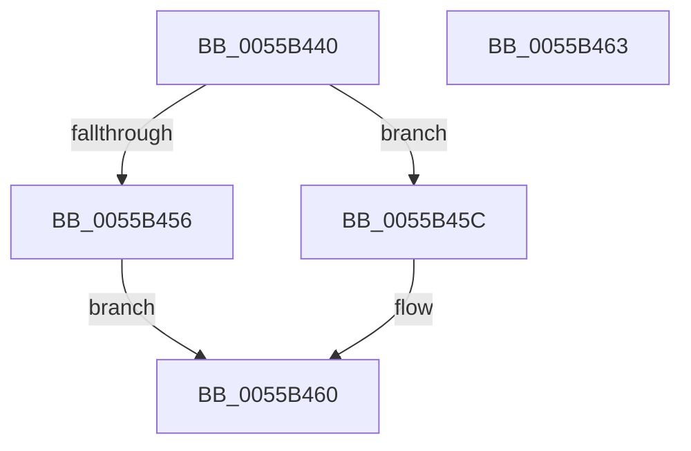

# PcFlushChannel

- RVA: `0x0055B440`–`0x0055B464` (길이 `36` bytes)
- VA: `0x000000014055B440`
- 실행 섹션: `.text`
- PDB 이름 있음: `예`; PDB Function 태그: `아니요`
- unwind 정보 RVA: `0x000DB714`
- 디코드: `15`개 명령, `36/36` bytes 표시
- 미해석 바이트: `0` (있으면 어셈블리에 `.byte`로 보존)

> 이 문서는 커널 이미지의 기계어와 PDB 기호를 분석해 생성했습니다. 4번과 5번은 함수 원형과 자료형을 바이너리 사용 방식에서 추정한 C 해석이며 원본 소스 복구 결과는 아닙니다.

## 1. Dependencies

- 직접 호출 지점: **0**; 고유 호출 대상: **0**
- 직접 호출자로 확인된 함수: **0**
- RIP 상대 이미지 참조: **0**

### Outgoing calls
- 직접 디코드된 call 명령이 없습니다.

### Direct callers
- 이 함수 시작 RVA로 연결되는 직접 call은 확인되지 않았습니다. 간접 호출은 완전히 역산할 수 없습니다.

### Static image references
- 디코드된 RIP-relative 메모리 참조가 없습니다.

## 2. Other-region calls and transfers

- 다른 실행 섹션으로 향하는 call: **0**
- 별도 외부 분기/꼬리 이동을 확인하지 못했습니다.

## 3. Assembly (complete function range)

```asm
0055B440  44 8A 41 10                     mov r8b, byte ptr [rcx + 0x10]
0055B444  48 8B 11                        mov rdx, qword ptr [rcx]
0055B447  41 8A C0                        mov al, r8b
0055B44A  0C 04                           or al, 4
0055B44C  88 41 13                        mov byte ptr [rcx + 0x13], al
0055B44F  90                              nop
0055B450  41 80 F8 04                     cmp r8b, 4
0055B454  73 06                           jae 0x14055b45c
0055B456  66 83 C2 0A                     add dx, 0xa
0055B45A  EB 04                           jmp 0x14055b460
0055B45C  66 83 C2 14                     add dx, 0x14
0055B460  EE                              out dx, al
0055B461  90                              nop
0055B462  C3                              ret
0055B463  CC                              int3
```

## 4. C-style interpretation (structured pseudocode)

```c
__int64 __fastcall PcFlushChannel(__int64 a1)
{
    __int64 result;

    result = (unsigned __int8)(((unsigned __int8)(*(unsigned __int8 *)(a1 + 16))) | (4));
    *(unsigned __int8 *)(a1 + 19) = (unsigned __int8)(result);
    if (((unsigned __int8)(*(unsigned __int8 *)(a1 + 16))) >= 4) goto loc_0055B45C;
    a2 = (unsigned __int16)((*(unsigned __int64 *)(a1)) + (10));
    goto loc_0055B460;
loc_0055B45C:
    a2 = (unsigned __int16)((a2) + (20));
loc_0055B460:
    return result;
}
```

## 5. (Beta) C Style

```c
int64_t PcFlushChannel(void *Arg1)
{
    uint8_t *arg1 = (uint8_t *)Arg1;

    int64_t result;

    result = (uint8_t)(((uint8_t)(*(uint8_t *)(arg1 + 0x10))) | (4));
    *(uint8_t *)(arg1 + 0x13) = (uint8_t)(result);
    if (((uint8_t)(*(uint8_t *)(arg1 + 0x10))) >= 4) goto loc_0055B45C;
    a2 = (uint16_t)((*(uint64_t *)(arg1)) + (10));
    goto loc_0055B460;
loc_0055B45C:
    a2 = (uint16_t)((a2) + (20));
loc_0055B460:
    return result;
}
```

### 관측된 메모리 오프셋

구조체 형식이 확인되지 않은 접근은 인자 기준의 오프셋으로만 기록했습니다.

| 기준 인자 | 오프셋 표현 | 폭 (bit) | 접근 |
|---|---:|---:|---|
| `Arg1` | `+ 0x0` | `64` | `R` |
| `Arg1` | `+ 0x10` | `8` | `R` |
| `Arg1` | `+ 0x13` | `8` | `W` |

## 6. Execution-region graph

[열기: 2D/3D 그래프와 함수 탐색 컨트롤 패널](../../../control-panel.html?section=text&rva=0x0055B440&view=graph)

- 2D 그래프는 위에서 아래로 흐르고, 3D 그래프는 빈 공간을 드래그해 회전합니다. Shift+드래그는 이동, 휠은 확대·축소, 함수 노드 선택은 대상 보고서 이동입니다.

### Static fallback


