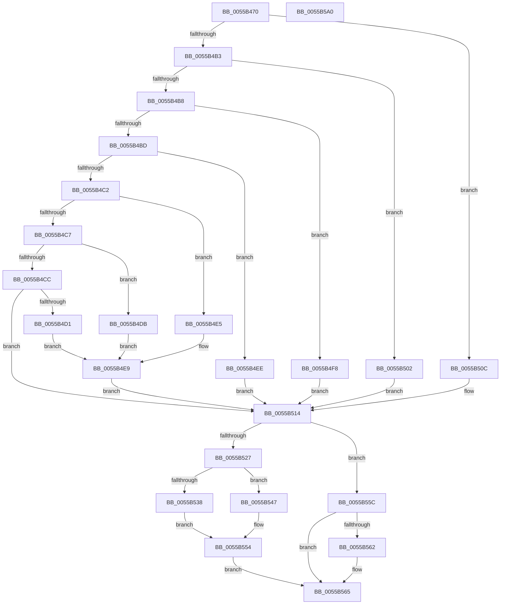

# PcGetChannelAdapter

- RVA: `0x0055B470`–`0x0055B5A1` (길이 `305` bytes)
- VA: `0x000000014055B470`
- 실행 섹션: `.text`
- PDB 이름 있음: `예`; PDB Function 태그: `아니요`
- unwind 정보 RVA: `0x00071750`
- 디코드: `92`개 명령, `305/305` bytes 표시
- 미해석 바이트: `0` (있으면 어셈블리에 `.byte`로 보존)

> 이 문서는 커널 이미지의 기계어와 PDB 기호를 분석해 생성했습니다. 4번과 5번은 함수 원형과 자료형을 바이너리 사용 방식에서 추정한 C 해석이며 원본 소스 복구 결과는 아닙니다.

## 1. Dependencies

- 직접 호출 지점: **0**; 고유 호출 대상: **0**
- 직접 호출자로 확인된 함수: **0**
- RIP 상대 이미지 참조: **1**

### Outgoing calls
- 직접 디코드된 call 명령이 없습니다.

### Direct callers
- 이 함수 시작 RVA로 연결되는 직접 call은 확인되지 않았습니다. 간접 호출은 완전히 역산할 수 없습니다.

### Static image references
- `0x0055B488` → RVA `0x00E10470` (`.data`; read)

## 2. Other-region calls and transfers

- 다른 실행 섹션으로 향하는 call: **0**
- 별도 외부 분기/꼬리 이동을 확인하지 못했습니다.

## 3. Assembly (complete function range)

```asm
0055B470  48 89 5C 24 08                  mov qword ptr [rsp + 8], rbx
0055B475  8B 41 10                        mov eax, dword ptr [rcx + 0x10]
0055B478  0F 57 C0                        xorps xmm0, xmm0
0055B47B  48 8B D9                        mov rbx, rcx
0055B47E  41 B9 0B 00 00 00               mov r9d, 0xb
0055B484  48 8D 14 40                     lea rdx, [rax + rax*2]
0055B488  48 8D 05 E1 4F 8B 00            lea rax, [rip + 0x8b4fe1]
0055B48F  4C 8D 14 D0                     lea r10, [rax + rdx*8]
0055B493  33 C0                           xor eax, eax
0055B495  41 0F 11 02                     movups xmmword ptr [r10], xmm0
0055B499  49 89 42 10                     mov qword ptr [r10 + 0x10], rax
0055B49D  B8 C0 00 00 00                  mov eax, 0xc0
0055B4A2  44 0F B6 41 10                  movzx r8d, byte ptr [rcx + 0x10]
0055B4A7  45 88 42 10                     mov byte ptr [r10 + 0x10], r8b
0055B4AB  41 8B D0                        mov edx, r8d
0055B4AE  45 84 C0                        test r8b, r8b
0055B4B1  74 59                           je 0x14055b50c
0055B4B3  83 EA 01                        sub edx, 1
0055B4B6  74 4A                           je 0x14055b502
0055B4B8  83 EA 01                        sub edx, 1
0055B4BB  74 3B                           je 0x14055b4f8
0055B4BD  83 EA 01                        sub edx, 1
0055B4C0  74 2C                           je 0x14055b4ee
0055B4C2  83 EA 02                        sub edx, 2
0055B4C5  74 1E                           je 0x14055b4e5
0055B4C7  83 EA 01                        sub edx, 1
0055B4CA  74 0F                           je 0x14055b4db
0055B4CC  83 FA 01                        cmp edx, 1
0055B4CF  75 43                           jne 0x14055b514
0055B4D1  49 C7 42 08 0A 00 00 00         mov qword ptr [r10 + 8], 0xa
0055B4D9  EB 0E                           jmp 0x14055b4e9
0055B4DB  49 C7 42 08 09 00 00 00         mov qword ptr [r10 + 8], 9
0055B4E3  EB 04                           jmp 0x14055b4e9
0055B4E5  4D 89 4A 08                     mov qword ptr [r10 + 8], r9
0055B4E9  49 89 02                        mov qword ptr [r10], rax
0055B4EC  EB 26                           jmp 0x14055b514
0055B4EE  49 C7 42 08 02 00 00 00         mov qword ptr [r10 + 8], 2
0055B4F6  EB 1C                           jmp 0x14055b514
0055B4F8  49 C7 42 08 01 00 00 00         mov qword ptr [r10 + 8], 1
0055B500  EB 12                           jmp 0x14055b514
0055B502  49 C7 42 08 03 00 00 00         mov qword ptr [r10 + 8], 3
0055B50A  EB 08                           jmp 0x14055b514
0055B50C  49 C7 42 08 07 00 00 00         mov qword ptr [r10 + 8], 7
0055B514  41 8A C8                        mov cl, r8b
0055B517  45 8A D8                        mov r11b, r8b
0055B51A  80 E1 03                        and cl, 3
0055B51D  41 80 CB 04                     or r11b, 4
0055B521  80 7B 04 00                     cmp byte ptr [rbx + 4], 0
0055B525  74 35                           je 0x14055b55c
0055B527  49 8B 12                        mov rdx, qword ptr [r10]
0055B52A  0A C8                           or cl, al
0055B52C  45 8A D8                        mov r11b, r8b
0055B52F  90                              nop
0055B530  8A C1                           mov al, cl
0055B532  41 80 F8 04                     cmp r8b, 4
0055B536  73 0F                           jae 0x14055b547
0055B538  66 41 03 D1                     add dx, r9w
0055B53C  EE                              out dx, al
0055B53D  90                              nop
0055B53E  49 8B 12                        mov rdx, qword ptr [r10]
0055B541  48 83 C2 0A                     add rdx, 0xa
0055B545  EB 0D                           jmp 0x14055b554
0055B547  66 83 C2 16                     add dx, 0x16
0055B54B  EE                              out dx, al
0055B54C  90                              nop
0055B54D  49 8B 12                        mov rdx, qword ptr [r10]
0055B550  48 83 C2 14                     add rdx, 0x14
0055B554  90                              nop
0055B555  41 8A C0                        mov al, r8b
0055B558  EE                              out dx, al
0055B559  90                              nop
0055B55A  EB 09                           jmp 0x14055b565
0055B55C  80 7B 06 00                     cmp byte ptr [rbx + 6], 0
0055B560  75 03                           jne 0x14055b565
0055B562  80 C9 40                        or cl, 0x40
0055B565  44 0F B6 C9                     movzx r9d, cl
0055B569  49 8B C2                        mov rax, r10
0055B56C  41 8A C9                        mov cl, r9b
0055B56F  80 C9 10                        or cl, 0x10
0055B572  80 7B 07 00                     cmp byte ptr [rbx + 7], 0
0055B576  0F B6 D1                        movzx edx, cl
0055B579  41 0F 44 D1                     cmove edx, r9d
0055B57D  41 C6 42 12 00                  mov byte ptr [r10 + 0x12], 0
0055B582  41 88 52 11                     mov byte ptr [r10 + 0x11], dl
0055B586  45 88 5A 13                     mov byte ptr [r10 + 0x13], r11b
0055B58A  41 C6 42 14 01                  mov byte ptr [r10 + 0x14], 1
0055B58F  83 7B 18 01                     cmp dword ptr [rbx + 0x18], 1
0055B593  48 8B 5C 24 08                  mov rbx, qword ptr [rsp + 8]
0055B598  0F 94 C1                        sete cl
0055B59B  41 88 4A 15                     mov byte ptr [r10 + 0x15], cl
0055B59F  C3                              ret
0055B5A0  CC                              int3
```

## 4. C-style interpretation (structured pseudocode)

```c
__int64 __fastcall PcGetChannelAdapter(__int64 a1)
{
    __int64 result;
    __int64 v_r11;
    unsigned __int64 v_stack_p8;

    v_stack_p8 = v_rbx;
    result = 0;
    *(unsigned __int64 *)(v_rip + 9129953 + (unsigned int)(*(unsigned int *)(a1 + 16)) + (unsigned int)(*(unsigned int *)(a1 + 16)) * 2 * 8) = v_xmm0;
    *(unsigned __int64 *)(v_rip + 9129953 + (unsigned int)(*(unsigned int *)(a1 + 16)) + (unsigned int)(*(unsigned int *)(a1 + 16)) * 2 * 8 + 16) = 0;
    *(unsigned __int8 *)(v_rip + 9129953 + (unsigned int)(*(unsigned int *)(a1 + 16)) + (unsigned int)(*(unsigned int *)(a1 + 16)) * 2 * 8 + 16) = (unsigned __int8)(*(unsigned __int8 *)(a1 + 16));
    if ((unsigned __int8)(*(unsigned __int8 *)(a1 + 16)) == 0) goto loc_0055B50C;
    a2 = (unsigned int)(((unsigned int)((unsigned int)(*(unsigned __int8 *)(a1 + 16)))) - (1));
    if (condition_is_equal) goto loc_0055B502;
    a2 = (unsigned int)((a2) - (1));
    if (condition_is_equal) goto loc_0055B4F8;
    a2 = (unsigned int)((a2) - (1));
    if (condition_is_equal) goto loc_0055B4EE;
    a2 = (unsigned int)((a2) - (2));
    if (condition_is_equal) goto loc_0055B4E5;
    a2 = (unsigned int)((a2) - (1));
    if (condition_is_equal) goto loc_0055B4DB;
    if (((unsigned int)(a2)) != 1) goto loc_0055B514;
    *(unsigned __int64 *)(v_rip + 9129953 + (unsigned int)(*(unsigned int *)(a1 + 16)) + (unsigned int)(*(unsigned int *)(a1 + 16)) * 2 * 8 + 8) = 10;
    goto loc_0055B4E9;
loc_0055B4DB:
    *(unsigned __int64 *)(v_rip + 9129953 + (unsigned int)(*(unsigned int *)(a1 + 16)) + (unsigned int)(*(unsigned int *)(a1 + 16)) * 2 * 8 + 8) = 9;
    goto loc_0055B4E9;
loc_0055B4E5:
    *(unsigned __int64 *)(v_rip + 9129953 + (unsigned int)(*(unsigned int *)(a1 + 16)) + (unsigned int)(*(unsigned int *)(a1 + 16)) * 2 * 8 + 8) = 11;
loc_0055B4E9:
    *(unsigned __int64 *)(v_rip + 9129953 + (unsigned int)(*(unsigned int *)(a1 + 16)) + (unsigned int)(*(unsigned int *)(a1 + 16)) * 2 * 8) = 192;
    goto loc_0055B514;
loc_0055B4EE:
    *(unsigned __int64 *)(v_rip + 9129953 + (unsigned int)(*(unsigned int *)(a1 + 16)) + (unsigned int)(*(unsigned int *)(a1 + 16)) * 2 * 8 + 8) = 2;
    goto loc_0055B514;
loc_0055B4F8:
    *(unsigned __int64 *)(v_rip + 9129953 + (unsigned int)(*(unsigned int *)(a1 + 16)) + (unsigned int)(*(unsigned int *)(a1 + 16)) * 2 * 8 + 8) = 1;
    goto loc_0055B514;
loc_0055B502:
    *(unsigned __int64 *)(v_rip + 9129953 + (unsigned int)(*(unsigned int *)(a1 + 16)) + (unsigned int)(*(unsigned int *)(a1 + 16)) * 2 * 8 + 8) = 3;
    goto loc_0055B514;
loc_0055B50C:
    *(unsigned __int64 *)(v_rip + 9129953 + (unsigned int)(*(unsigned int *)(a1 + 16)) + (unsigned int)(*(unsigned int *)(a1 + 16)) * 2 * 8 + 8) = 7;
loc_0055B514:
    a1 = (unsigned __int8)(((unsigned __int8)(*(unsigned __int8 *)(a1 + 16))) & (3));
    v_r11 = (unsigned __int8)(((unsigned __int8)(*(unsigned __int8 *)(a1 + 16))) | (4));
    if ((*(unsigned __int8 *)(a1 + 4)) == 0) goto loc_0055B55C;
    a1 = (unsigned __int8)((a1) | (192));
    if (((unsigned __int8)(*(unsigned __int8 *)(a1 + 16))) >= 4) goto loc_0055B547;
    a2 = (unsigned __int16)((*(unsigned __int64 *)(v_rip + 9129953 + (unsigned int)(*(unsigned int *)(a1 + 16)) + (unsigned int)(*(unsigned int *)(a1 + 16)) * 2 * 8)) + (11));
    a2 = (*(unsigned __int64 *)(v_rip + 9129953 + (unsigned int)(*(unsigned int *)(a1 + 16)) + (unsigned int)(*(unsigned int *)(a1 + 16)) * 2 * 8)) + (10);
    goto loc_0055B554;
loc_0055B547:
    a2 = (unsigned __int16)((a2) + (22));
    a2 = (*(unsigned __int64 *)(v_rip + 9129953 + (unsigned int)(*(unsigned int *)(a1 + 16)) + (unsigned int)(*(unsigned int *)(a1 + 16)) * 2 * 8)) + (20);
loc_0055B554:
    goto loc_0055B565;
loc_0055B55C:
    if ((*(unsigned __int8 *)(a1 + 6)) == 0) {
        a1 = (unsigned __int8)((a1) | (64));
    }
    a1 = (unsigned __int8)(((unsigned __int8)((unsigned __int8)(a1))) | (16));
    a2 = (unsigned __int8)(a1);
    if ((*(unsigned __int8 *)(a1 + 7)) == 0) { a2 = (unsigned int)((unsigned __int8)(a1)); }
    *(unsigned __int8 *)(v_rip + 9129953 + (unsigned int)(*(unsigned int *)(a1 + 16)) + (unsigned int)(*(unsigned int *)(a1 + 16)) * 2 * 8 + 18) = 0;
    *(unsigned __int8 *)(v_rip + 9129953 + (unsigned int)(*(unsigned int *)(a1 + 16)) + (unsigned int)(*(unsigned int *)(a1 + 16)) * 2 * 8 + 17) = (unsigned __int8)(a2);
    *(unsigned __int8 *)(v_rip + 9129953 + (unsigned int)(*(unsigned int *)(a1 + 16)) + (unsigned int)(*(unsigned int *)(a1 + 16)) * 2 * 8 + 19) = (unsigned __int8)((unsigned __int8)(*(unsigned __int8 *)(a1 + 16)));
    *(unsigned __int8 *)(v_rip + 9129953 + (unsigned int)(*(unsigned int *)(a1 + 16)) + (unsigned int)(*(unsigned int *)(a1 + 16)) * 2 * 8 + 20) = 1;
    a1 = ((*(unsigned int *)(a1 + 24)) == 1) ? 1 : 0;
    *(unsigned __int8 *)(v_rip + 9129953 + (unsigned int)(*(unsigned int *)(a1 + 16)) + (unsigned int)(*(unsigned int *)(a1 + 16)) * 2 * 8 + 21) = (unsigned __int8)(a1);
    return v_rip + 9129953 + (unsigned int)(*(unsigned int *)(a1 + 16)) + (unsigned int)(*(unsigned int *)(a1 + 16)) * 2 * 8;
}
```

## 5. (Beta) C Style

```c
int64_t PcGetChannelAdapter(void *Arg1)
{
    uint8_t *arg1 = (uint8_t *)Arg1;

    int64_t result;
    int64_t local_r11;
    uint64_t v_stack_p8;

    v_stack_p8 = local_rbx;
    result = 0;
    *(uint64_t *)(v_rip + 0x8B4FE1 + (uint32_t)(*(uint32_t *)(arg1 + 0x10)) + (uint32_t)(*(uint32_t *)(arg1 + 0x10)) * 2 * 8) = v_xmm0;
    *(uint64_t *)(v_rip + 0x8B4FE1 + (uint32_t)(*(uint32_t *)(arg1 + 0x10)) + (uint32_t)(*(uint32_t *)(arg1 + 0x10)) * 2 * 8 + 0x10) = 0;
    *(uint8_t *)(v_rip + 0x8B4FE1 + (uint32_t)(*(uint32_t *)(arg1 + 0x10)) + (uint32_t)(*(uint32_t *)(arg1 + 0x10)) * 2 * 8 + 0x10) = (uint8_t)(*(uint8_t *)(arg1 + 0x10));
    if ((uint8_t)(*(uint8_t *)(arg1 + 0x10)) == 0) goto loc_0055B50C;
    a2 = (uint32_t)(((uint32_t)((uint32_t)(*(uint8_t *)(arg1 + 0x10)))) - (1));
    if (condition_is_equal) goto loc_0055B502;
    a2 = (uint32_t)((a2) - (1));
    if (condition_is_equal) goto loc_0055B4F8;
    a2 = (uint32_t)((a2) - (1));
    if (condition_is_equal) goto loc_0055B4EE;
    a2 = (uint32_t)((a2) - (2));
    if (condition_is_equal) goto loc_0055B4E5;
    a2 = (uint32_t)((a2) - (1));
    if (condition_is_equal) goto loc_0055B4DB;
    if (((uint32_t)(a2)) != 1) goto loc_0055B514;
    *(uint64_t *)(v_rip + 0x8B4FE1 + (uint32_t)(*(uint32_t *)(arg1 + 0x10)) + (uint32_t)(*(uint32_t *)(arg1 + 0x10)) * 2 * 8 + 0x8) = 10;
    goto loc_0055B4E9;
loc_0055B4DB:
    *(uint64_t *)(v_rip + 0x8B4FE1 + (uint32_t)(*(uint32_t *)(arg1 + 0x10)) + (uint32_t)(*(uint32_t *)(arg1 + 0x10)) * 2 * 8 + 0x8) = 9;
    goto loc_0055B4E9;
loc_0055B4E5:
    *(uint64_t *)(v_rip + 0x8B4FE1 + (uint32_t)(*(uint32_t *)(arg1 + 0x10)) + (uint32_t)(*(uint32_t *)(arg1 + 0x10)) * 2 * 8 + 0x8) = 11;
loc_0055B4E9:
    *(uint64_t *)(v_rip + 0x8B4FE1 + (uint32_t)(*(uint32_t *)(arg1 + 0x10)) + (uint32_t)(*(uint32_t *)(arg1 + 0x10)) * 2 * 8) = 192;
    goto loc_0055B514;
loc_0055B4EE:
    *(uint64_t *)(v_rip + 0x8B4FE1 + (uint32_t)(*(uint32_t *)(arg1 + 0x10)) + (uint32_t)(*(uint32_t *)(arg1 + 0x10)) * 2 * 8 + 0x8) = 2;
    goto loc_0055B514;
loc_0055B4F8:
    *(uint64_t *)(v_rip + 0x8B4FE1 + (uint32_t)(*(uint32_t *)(arg1 + 0x10)) + (uint32_t)(*(uint32_t *)(arg1 + 0x10)) * 2 * 8 + 0x8) = 1;
    goto loc_0055B514;
loc_0055B502:
    *(uint64_t *)(v_rip + 0x8B4FE1 + (uint32_t)(*(uint32_t *)(arg1 + 0x10)) + (uint32_t)(*(uint32_t *)(arg1 + 0x10)) * 2 * 8 + 0x8) = 3;
    goto loc_0055B514;
loc_0055B50C:
    *(uint64_t *)(v_rip + 0x8B4FE1 + (uint32_t)(*(uint32_t *)(arg1 + 0x10)) + (uint32_t)(*(uint32_t *)(arg1 + 0x10)) * 2 * 8 + 0x8) = 7;
loc_0055B514:
    Arg1 = (uint8_t)(((uint8_t)(*(uint8_t *)(arg1 + 0x10))) & (3));
    local_r11 = (uint8_t)(((uint8_t)(*(uint8_t *)(arg1 + 0x10))) | (4));
    if ((*(uint8_t *)(arg1 + 0x4)) == 0) goto loc_0055B55C;
    Arg1 = (uint8_t)((Arg1) | (192));
    if (((uint8_t)(*(uint8_t *)(arg1 + 0x10))) >= 4) goto loc_0055B547;
    a2 = (uint16_t)((*(uint64_t *)(v_rip + 0x8B4FE1 + (uint32_t)(*(uint32_t *)(arg1 + 0x10)) + (uint32_t)(*(uint32_t *)(arg1 + 0x10)) * 2 * 8)) + (11));
    a2 = (*(uint64_t *)(v_rip + 0x8B4FE1 + (uint32_t)(*(uint32_t *)(arg1 + 0x10)) + (uint32_t)(*(uint32_t *)(arg1 + 0x10)) * 2 * 8)) + (10);
    goto loc_0055B554;
loc_0055B547:
    a2 = (uint16_t)((a2) + (22));
    a2 = (*(uint64_t *)(v_rip + 0x8B4FE1 + (uint32_t)(*(uint32_t *)(arg1 + 0x10)) + (uint32_t)(*(uint32_t *)(arg1 + 0x10)) * 2 * 8)) + (20);
loc_0055B554:
    goto loc_0055B565;
loc_0055B55C:
    if ((*(uint8_t *)(arg1 + 0x6)) == 0) {
        Arg1 = (uint8_t)((Arg1) | (64));
    }
    Arg1 = (uint8_t)(((uint8_t)((uint8_t)(Arg1))) | (16));
    a2 = (uint8_t)(Arg1);
    if ((*(uint8_t *)(arg1 + 0x7)) == 0) { a2 = (uint32_t)((uint8_t)(Arg1)); }
    *(uint8_t *)(v_rip + 0x8B4FE1 + (uint32_t)(*(uint32_t *)(arg1 + 0x10)) + (uint32_t)(*(uint32_t *)(arg1 + 0x10)) * 2 * 8 + 0x12) = 0;
    *(uint8_t *)(v_rip + 0x8B4FE1 + (uint32_t)(*(uint32_t *)(arg1 + 0x10)) + (uint32_t)(*(uint32_t *)(arg1 + 0x10)) * 2 * 8 + 0x11) = (uint8_t)(a2);
    *(uint8_t *)(v_rip + 0x8B4FE1 + (uint32_t)(*(uint32_t *)(arg1 + 0x10)) + (uint32_t)(*(uint32_t *)(arg1 + 0x10)) * 2 * 8 + 0x13) = (uint8_t)((uint8_t)(*(uint8_t *)(arg1 + 0x10)));
    *(uint8_t *)(v_rip + 0x8B4FE1 + (uint32_t)(*(uint32_t *)(arg1 + 0x10)) + (uint32_t)(*(uint32_t *)(arg1 + 0x10)) * 2 * 8 + 0x14) = 1;
    Arg1 = ((*(uint32_t *)(arg1 + 0x18)) == 1) ? 1 : 0;
    *(uint8_t *)(v_rip + 0x8B4FE1 + (uint32_t)(*(uint32_t *)(arg1 + 0x10)) + (uint32_t)(*(uint32_t *)(arg1 + 0x10)) * 2 * 8 + 0x15) = (uint8_t)(Arg1);
    return v_rip + 9129953 + (uint32_t)(*(uint32_t *)(arg1 + 0x10)) + (uint32_t)(*(uint32_t *)(arg1 + 0x10)) * 2 * 8;
}
```

### 관측된 메모리 오프셋

구조체 형식이 확인되지 않은 접근은 인자 기준의 오프셋으로만 기록했습니다.

| 기준 인자 | 오프셋 표현 | 폭 (bit) | 접근 |
|---|---:|---:|---|
| `Arg1` | `+ 0x4` | `8` | `R` |
| `Arg1` | `+ 0x6` | `8` | `R` |
| `Arg1` | `+ 0x7` | `8` | `R` |
| `Arg1` | `+ 0x10` | `8` | `R` |
| `Arg1` | `+ 0x10` | `32` | `R` |
| `Arg1` | `+ 0x18` | `32` | `R` |

## 6. Execution-region graph

[열기: 2D/3D 그래프와 함수 탐색 컨트롤 패널](../../../control-panel.html?section=text&rva=0x0055B470&view=graph)

- 2D 그래프는 위에서 아래로 흐르고, 3D 그래프는 빈 공간을 드래그해 회전합니다. Shift+드래그는 이동, 휠은 확대·축소, 함수 노드 선택은 대상 보고서 이동입니다.

### Static fallback


