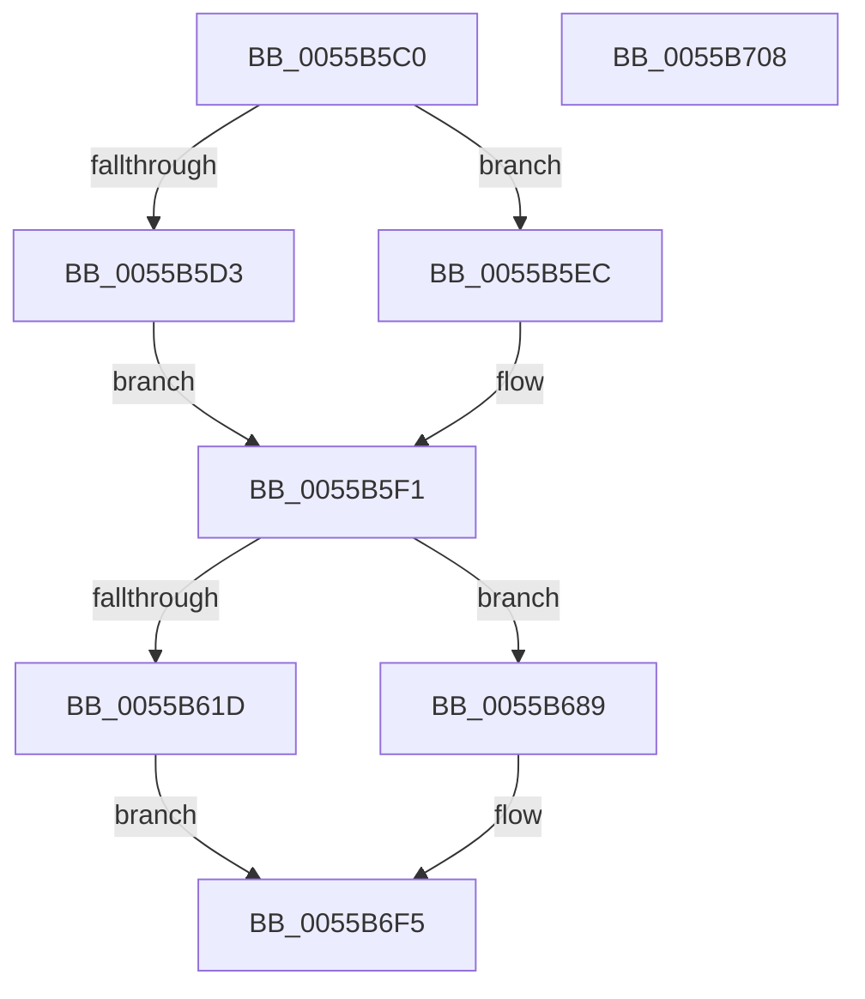

# PcMapTransfer

- RVA: `0x0055B5C0`–`0x0055B709` (길이 `329` bytes)
- VA: `0x000000014055B5C0`
- 실행 섹션: `.text`
- PDB 이름 있음: `예`; PDB Function 태그: `아니요`
- unwind 정보 RVA: `0x00071750`
- 디코드: `129`개 명령, `329/329` bytes 표시
- 미해석 바이트: `0` (있으면 어셈블리에 `.byte`로 보존)

> 이 문서는 커널 이미지의 기계어와 PDB 기호를 분석해 생성했습니다. 4번과 5번은 함수 원형과 자료형을 바이너리 사용 방식에서 추정한 C 해석이며 원본 소스 복구 결과는 아닙니다.

## 1. Dependencies

- 직접 호출 지점: **0**; 고유 호출 대상: **0**
- 직접 호출자로 확인된 함수: **0**
- RIP 상대 이미지 참조: **0**

### Outgoing calls
- 직접 디코드된 call 명령이 없습니다.

### Direct callers
- 이 함수 시작 RVA로 연결되는 직접 call은 확인되지 않았습니다. 간접 호출은 완전히 역산할 수 없습니다.

### Static image references
- 디코드된 RIP-relative 메모리 참조가 없습니다.

## 2. Other-region calls and transfers

- 다른 실행 섹션으로 향하는 call: **0**
- 별도 외부 분기/꼬리 이동을 확인하지 못했습니다.

## 3. Assembly (complete function range)

```asm
0055B5C0  48 89 5C 24 08                  mov qword ptr [rsp + 8], rbx
0055B5C5  80 79 15 00                     cmp byte ptr [rcx + 0x15], 0
0055B5C9  4C 8B C9                        mov r9, rcx
0055B5CC  44 8B 54 24 30                  mov r10d, dword ptr [rsp + 0x30]
0055B5D1  74 19                           je 0x14055b5ec
0055B5D3  48 8B 44 24 28                  mov rax, qword ptr [rsp + 0x28]
0055B5D8  4C 8B D8                        mov r11, rax
0055B5DB  41 D1 EA                        shr r10d, 1
0055B5DE  49 C1 EB 10                     shr r11, 0x10
0055B5E2  48 D1 F8                        sar rax, 1
0055B5E5  48 89 44 24 28                  mov qword ptr [rsp + 0x28], rax
0055B5EA  EB 05                           jmp 0x14055b5f1
0055B5EC  44 8A 5C 24 2A                  mov r11b, byte ptr [rsp + 0x2a]
0055B5F1  8A 49 11                        mov cl, byte ptr [rcx + 0x11]
0055B5F4  49 8B 11                        mov rdx, qword ptr [r9]
0055B5F7  80 E1 F3                        and cl, 0xf3
0055B5FA  41 F6 D8                        neg r8b
0055B5FD  41 B0 04                        mov r8b, 4
0055B600  1A C0                           sbb al, al
0055B602  41 22 C0                        and al, r8b
0055B605  41 02 C0                        add al, r8b
0055B608  0A C8                           or cl, al
0055B60A  41 8A 41 10                     mov al, byte ptr [r9 + 0x10]
0055B60E  8A D8                           mov bl, al
0055B610  90                              nop
0055B611  80 E3 03                        and bl, 3
0055B614  41 3A C0                        cmp al, r8b
0055B617  44 0F B6 C3                     movzx r8d, bl
0055B61B  73 6C                           jae 0x14055b689
0055B61D  66 83 C2 0C                     add dx, 0xc
0055B621  33 C0                           xor eax, eax
0055B623  EE                              out dx, al
0055B624  90                              nop
0055B625  8A C1                           mov al, cl
0055B627  49 8B 11                        mov rdx, qword ptr [r9]
0055B62A  90                              nop
0055B62B  48 83 C2 0B                     add rdx, 0xb
0055B62F  EE                              out dx, al
0055B630  90                              nop
0055B631  49 8B 01                        mov rax, qword ptr [r9]
0055B634  90                              nop
0055B635  4A 8D 14 40                     lea rdx, [rax + r8*2]
0055B639  8A 44 24 28                     mov al, byte ptr [rsp + 0x28]
0055B63D  EE                              out dx, al
0055B63E  8A 44 24 29                     mov al, byte ptr [rsp + 0x29]
0055B642  90                              nop
0055B643  49 8B 09                        mov rcx, qword ptr [r9]
0055B646  90                              nop
0055B647  4A 8D 14 41                     lea rdx, [rcx + r8*2]
0055B64B  EE                              out dx, al
0055B64C  90                              nop
0055B64D  41 8A C3                        mov al, r11b
0055B650  49 8B 51 08                     mov rdx, qword ptr [r9 + 8]
0055B654  90                              nop
0055B655  48 83 EA 80                     sub rdx, -0x80
0055B659  EE                              out dx, al
0055B65A  90                              nop
0055B65B  41 8D 42 FF                     lea eax, [r10 - 1]
0055B65F  49 8B 11                        mov rdx, qword ptr [r9]
0055B662  90                              nop
0055B663  48 FF C2                        inc rdx
0055B666  4A 8D 14 42                     lea rdx, [rdx + r8*2]
0055B66A  EE                              out dx, al
0055B66B  90                              nop
0055B66C  41 8D 42 FF                     lea eax, [r10 - 1]
0055B670  49 8B 11                        mov rdx, qword ptr [r9]
0055B673  90                              nop
0055B674  48 FF C2                        inc rdx
0055B677  C1 E8 08                        shr eax, 8
0055B67A  4A 8D 14 42                     lea rdx, [rdx + r8*2]
0055B67E  EE                              out dx, al
0055B67F  90                              nop
0055B680  49 8B 11                        mov rdx, qword ptr [r9]
0055B683  48 83 C2 0A                     add rdx, 0xa
0055B687  EB 6C                           jmp 0x14055b6f5
0055B689  66 83 C2 18                     add dx, 0x18
0055B68D  33 C0                           xor eax, eax
0055B68F  EE                              out dx, al
0055B690  90                              nop
0055B691  8A C1                           mov al, cl
0055B693  49 8B 11                        mov rdx, qword ptr [r9]
0055B696  90                              nop
0055B697  48 83 C2 16                     add rdx, 0x16
0055B69B  EE                              out dx, al
0055B69C  90                              nop
0055B69D  49 8B 01                        mov rax, qword ptr [r9]
0055B6A0  90                              nop
0055B6A1  4A 8D 14 80                     lea rdx, [rax + r8*4]
0055B6A5  8A 44 24 28                     mov al, byte ptr [rsp + 0x28]
0055B6A9  EE                              out dx, al
0055B6AA  90                              nop
0055B6AB  49 8B 01                        mov rax, qword ptr [r9]
0055B6AE  90                              nop
0055B6AF  4A 8D 14 80                     lea rdx, [rax + r8*4]
0055B6B3  8A 44 24 29                     mov al, byte ptr [rsp + 0x29]
0055B6B7  EE                              out dx, al
0055B6B8  90                              nop
0055B6B9  41 8A C3                        mov al, r11b
0055B6BC  49 8B 51 08                     mov rdx, qword ptr [r9 + 8]
0055B6C0  90                              nop
0055B6C1  48 83 EA 80                     sub rdx, -0x80
0055B6C5  EE                              out dx, al
0055B6C6  90                              nop
0055B6C7  41 8D 42 FF                     lea eax, [r10 - 1]
0055B6CB  49 8B 11                        mov rdx, qword ptr [r9]
0055B6CE  90                              nop
0055B6CF  48 83 C2 02                     add rdx, 2
0055B6D3  4A 8D 14 82                     lea rdx, [rdx + r8*4]
0055B6D7  EE                              out dx, al
0055B6D8  90                              nop
0055B6D9  41 8D 42 FF                     lea eax, [r10 - 1]
0055B6DD  49 8B 11                        mov rdx, qword ptr [r9]
0055B6E0  90                              nop
0055B6E1  48 83 C2 02                     add rdx, 2
0055B6E5  C1 E8 08                        shr eax, 8
0055B6E8  4A 8D 14 82                     lea rdx, [rdx + r8*4]
0055B6EC  EE                              out dx, al
0055B6ED  90                              nop
0055B6EE  49 8B 11                        mov rdx, qword ptr [r9]
0055B6F1  48 83 C2 14                     add rdx, 0x14
0055B6F5  90                              nop
0055B6F6  8A C3                           mov al, bl
0055B6F8  48 8B 5C 24 08                  mov rbx, qword ptr [rsp + 8]
0055B6FD  EE                              out dx, al
0055B6FE  90                              nop
0055B6FF  41 8A 41 10                     mov al, byte ptr [r9 + 0x10]
0055B703  41 88 41 13                     mov byte ptr [r9 + 0x13], al
0055B707  C3                              ret
0055B708  CC                              int3
```

## 4. C-style interpretation (structured pseudocode)

```c
__int64 __fastcall PcMapTransfer(__int64 a1, __int64 a2, unsigned __int8 a3, __int64 a4, unsigned __int8 a5, unsigned int a6)
{
    __int64 result;
    __int64 v_r10;
    __int64 v_r11;
    __int64 v_rbx;
    unsigned __int64 v_stack_p28;
    unsigned __int8 v_stack_p29;
    unsigned __int8 v_stack_p2A;
    unsigned __int64 v_stack_p8;

    v_stack_p8 = v_rbx;
    if ((*(unsigned __int8 *)(a1 + 21)) == 0) goto loc_0055B5EC;
    v_r10 = (unsigned int)(((unsigned int)(a6)) >> (1));
    v_r11 = (a5) >> (16);
    result = (a5) >> (1);
    v_stack_p28 = result;
    goto loc_0055B5F1;
loc_0055B5EC:
loc_0055B5F1:
    a1 = (unsigned __int8)((*(unsigned __int8 *)(a1 + 17)) & (243));
    a3 = (unsigned __int8)(-(a3));
    result = (unsigned __int8)((result) & (4));
    result = (unsigned __int8)((result) + (4));
    a1 = (unsigned __int8)((a1) | ((unsigned __int8)(result)));
    v_rbx = (unsigned __int8)(((unsigned __int8)(*(unsigned __int8 *)(a1 + 16))) & (3));
    if (((unsigned __int8)(*(unsigned __int8 *)(a1 + 16))) >= 4) goto loc_0055B689;
    a2 = (unsigned __int16)((*(unsigned __int64 *)(a1)) + (12));
    result = 0;
    a2 = (*(unsigned __int64 *)(a1)) + (11);
    a2 = (*(unsigned __int64 *)(a1 + 8)) - (-128);
    a2 = (*(unsigned __int64 *)(a1)) + 1;
    a2 = (*(unsigned __int64 *)(a1)) + 1;
    result = (unsigned int)((v_r10 - 1) >> (8));
    a2 = (*(unsigned __int64 *)(a1)) + (10);
    goto loc_0055B6F5;
loc_0055B689:
    a2 = (unsigned __int16)((a2) + (24));
    result = 0;
    a2 = (*(unsigned __int64 *)(a1)) + (22);
    a2 = (*(unsigned __int64 *)(a1 + 8)) - (-128);
    a2 = (*(unsigned __int64 *)(a1)) + (2);
    a2 = (*(unsigned __int64 *)(a1)) + (2);
    result = (unsigned int)((v_r10 - 1) >> (8));
    a2 = (*(unsigned __int64 *)(a1)) + (20);
loc_0055B6F5:
    *(unsigned __int8 *)(a1 + 19) = (unsigned __int8)(*(unsigned __int8 *)(a1 + 16));
    return *(unsigned __int8 *)(a1 + 16);
}
```

## 5. (Beta) C Style

```c
int64_t PcMapTransfer(void *Arg1, int64_t Arg2, uint8_t Arg3, int64_t Arg4, uint8_t Arg5, uint32_t Arg6)
{
    uint8_t *arg1 = (uint8_t *)Arg1;

    int64_t result;
    int64_t local_r10;
    int64_t local_r11;
    int64_t local_rbx;
    uint64_t v_stack_p28;
    uint8_t v_stack_p29;
    uint8_t v_stack_p2A;
    uint64_t v_stack_p8;

    v_stack_p8 = local_rbx;
    if ((*(uint8_t *)(arg1 + 0x15)) == 0) goto loc_0055B5EC;
    local_r10 = (uint32_t)(((uint32_t)(Arg6)) >> (1));
    local_r11 = (Arg5) >> (16);
    result = (Arg5) >> (1);
    v_stack_p28 = result;
    goto loc_0055B5F1;
loc_0055B5EC:
loc_0055B5F1:
    Arg1 = (uint8_t)((*(uint8_t *)(arg1 + 0x11)) & (243));
    Arg3 = (uint8_t)(-(Arg3));
    result = (uint8_t)((result) & (4));
    result = (uint8_t)((result) + (4));
    Arg1 = (uint8_t)((Arg1) | ((uint8_t)(result)));
    local_rbx = (uint8_t)(((uint8_t)(*(uint8_t *)(arg1 + 0x10))) & (3));
    if (((uint8_t)(*(uint8_t *)(arg1 + 0x10))) >= 4) goto loc_0055B689;
    Arg2 = (uint16_t)((*(uint64_t *)(arg1)) + (12));
    result = 0;
    Arg2 = (*(uint64_t *)(arg1)) + (11);
    Arg2 = (*(uint64_t *)(arg1 + 0x8)) - (-128);
    Arg2 = (*(uint64_t *)(arg1)) + 1;
    Arg2 = (*(uint64_t *)(arg1)) + 1;
    result = (uint32_t)((local_r10 - 1) >> (8));
    Arg2 = (*(uint64_t *)(arg1)) + (10);
    goto loc_0055B6F5;
loc_0055B689:
    Arg2 = (uint16_t)((Arg2) + (24));
    result = 0;
    Arg2 = (*(uint64_t *)(arg1)) + (22);
    Arg2 = (*(uint64_t *)(arg1 + 0x8)) - (-128);
    Arg2 = (*(uint64_t *)(arg1)) + (2);
    Arg2 = (*(uint64_t *)(arg1)) + (2);
    result = (uint32_t)((local_r10 - 1) >> (8));
    Arg2 = (*(uint64_t *)(arg1)) + (20);
loc_0055B6F5:
    *(uint8_t *)(arg1 + 0x13) = (uint8_t)(*(uint8_t *)(arg1 + 0x10));
    return *(uint8_t *)(arg1 + 0x10);
}
```

### 관측된 메모리 오프셋

구조체 형식이 확인되지 않은 접근은 인자 기준의 오프셋으로만 기록했습니다.

| 기준 인자 | 오프셋 표현 | 폭 (bit) | 접근 |
|---|---:|---:|---|
| `Arg1` | `+ 0x0` | `64` | `R` |
| `Arg1` | `+ 0x8` | `64` | `R` |
| `Arg1` | `+ 0x10` | `8` | `R` |
| `Arg1` | `+ 0x11` | `8` | `R` |
| `Arg1` | `+ 0x13` | `8` | `W` |
| `Arg1` | `+ 0x15` | `8` | `R` |

## 6. Execution-region graph

[열기: 2D/3D 그래프와 함수 탐색 컨트롤 패널](../../../control-panel.html?section=text&rva=0x0055B5C0&view=graph)

- 2D 그래프는 위에서 아래로 흐르고, 3D 그래프는 빈 공간을 드래그해 회전합니다. Shift+드래그는 이동, 휠은 확대·축소, 함수 노드 선택은 대상 보고서 이동입니다.

### Static fallback


