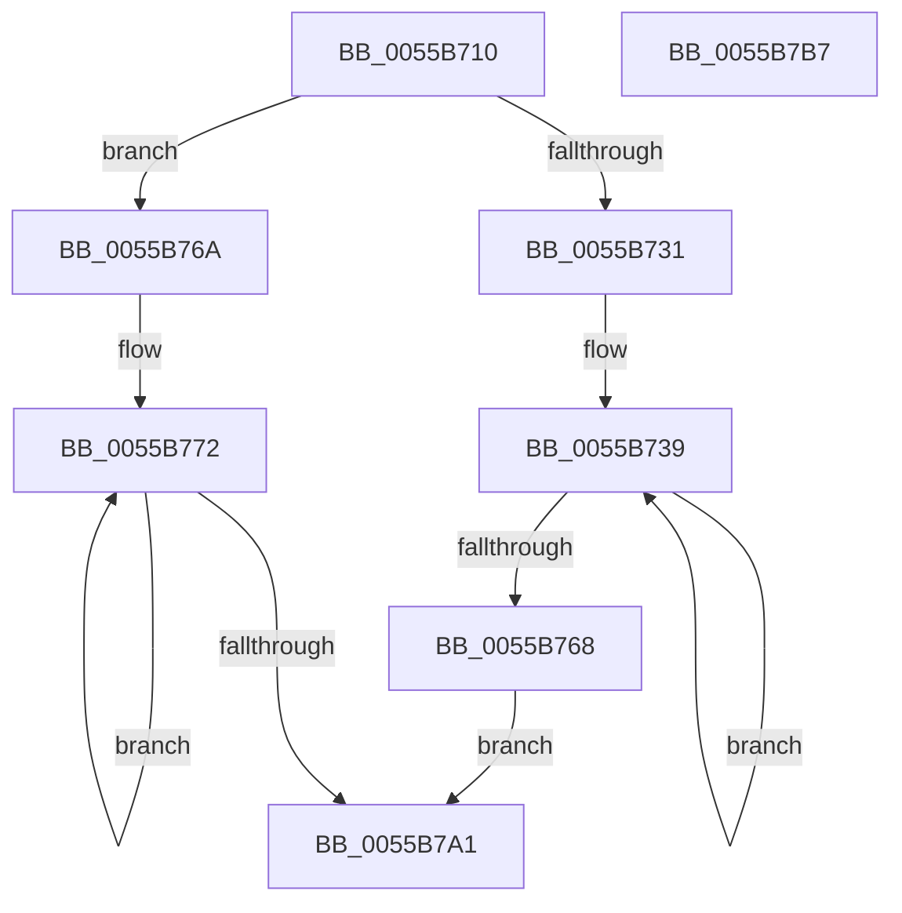

# PcReadCounter

- RVA: `0x0055B710`–`0x0055B7B8` (길이 `168` bytes)
- VA: `0x000000014055B710`
- 실행 섹션: `.text`
- PDB 이름 있음: `예`; PDB Function 태그: `아니요`
- unwind 정보 RVA: `0x00071750`
- 디코드: `67`개 명령, `168/168` bytes 표시
- 미해석 바이트: `0` (있으면 어셈블리에 `.byte`로 보존)

> 이 문서는 커널 이미지의 기계어와 PDB 기호를 분석해 생성했습니다. 4번과 5번은 함수 원형과 자료형을 바이너리 사용 방식에서 추정한 C 해석이며 원본 소스 복구 결과는 아닙니다.

## 1. Dependencies

- 직접 호출 지점: **0**; 고유 호출 대상: **0**
- 직접 호출자로 확인된 함수: **0**
- RIP 상대 이미지 참조: **0**

### Outgoing calls
- 직접 디코드된 call 명령이 없습니다.

### Direct callers
- 이 함수 시작 RVA로 연결되는 직접 call은 확인되지 않았습니다. 간접 호출은 완전히 역산할 수 없습니다.

### Static image references
- 디코드된 RIP-relative 메모리 참조가 없습니다.

## 2. Other-region calls and transfers

- 다른 실행 섹션으로 향하는 call: **0**
- 별도 외부 분기/꼬리 이동을 확인하지 못했습니다.

## 3. Assembly (complete function range)

```asm
0055B710  48 89 5C 24 08                  mov qword ptr [rsp + 8], rbx
0055B715  0F B6 41 10                     movzx eax, byte ptr [rcx + 0x10]
0055B719  41 BB 00 FF FF 00               mov r11d, 0xffff00
0055B71F  8B D0                           mov edx, eax
0055B721  4C 8B D1                        mov r10, rcx
0055B724  48 8B 09                        mov rcx, qword ptr [rcx]
0055B727  83 E2 03                        and edx, 3
0055B72A  3C 04                           cmp al, 4
0055B72C  41 8B C3                        mov eax, r11d
0055B72F  73 39                           jae 0x14055b76a
0055B731  48 8D 59 01                     lea rbx, [rcx + 1]
0055B735  48 8D 1C 53                     lea rbx, [rbx + rdx*2]
0055B739  49 8B 12                        mov rdx, qword ptr [r10]
0055B73C  44 8B C8                        mov r9d, eax
0055B73F  90                              nop
0055B740  33 C0                           xor eax, eax
0055B742  48 83 C2 0C                     add rdx, 0xc
0055B746  45 23 CB                        and r9d, r11d
0055B749  EE                              out dx, al
0055B74A  90                              nop
0055B74B  0F B7 D3                        movzx edx, bx
0055B74E  90                              nop
0055B74F  EC                              in al, dx
0055B750  90                              nop
0055B751  44 0F B6 C0                     movzx r8d, al
0055B755  90                              nop
0055B756  EC                              in al, dx
0055B757  0F B6 C8                        movzx ecx, al
0055B75A  90                              nop
0055B75B  C1 E1 08                        shl ecx, 8
0055B75E  41 8B C0                        mov eax, r8d
0055B761  0B C1                           or eax, ecx
0055B763  41 3B C9                        cmp ecx, r9d
0055B766  75 D1                           jne 0x14055b739
0055B768  EB 37                           jmp 0x14055b7a1
0055B76A  48 8D 59 02                     lea rbx, [rcx + 2]
0055B76E  48 8D 1C 93                     lea rbx, [rbx + rdx*4]
0055B772  49 8B 12                        mov rdx, qword ptr [r10]
0055B775  44 8B C8                        mov r9d, eax
0055B778  90                              nop
0055B779  33 C0                           xor eax, eax
0055B77B  48 83 C2 18                     add rdx, 0x18
0055B77F  45 23 CB                        and r9d, r11d
0055B782  EE                              out dx, al
0055B783  90                              nop
0055B784  0F B7 D3                        movzx edx, bx
0055B787  90                              nop
0055B788  EC                              in al, dx
0055B789  90                              nop
0055B78A  44 0F B6 C0                     movzx r8d, al
0055B78E  90                              nop
0055B78F  EC                              in al, dx
0055B790  0F B6 C8                        movzx ecx, al
0055B793  90                              nop
0055B794  C1 E1 08                        shl ecx, 8
0055B797  41 8B C0                        mov eax, r8d
0055B79A  0B C1                           or eax, ecx
0055B79C  41 3B C9                        cmp ecx, r9d
0055B79F  75 D1                           jne 0x14055b772
0055B7A1  48 8B 5C 24 08                  mov rbx, qword ptr [rsp + 8]
0055B7A6  FF C0                           inc eax
0055B7A8  41 80 7A 15 00                  cmp byte ptr [r10 + 0x15], 0
0055B7AD  0F B7 D0                        movzx edx, ax
0055B7B0  8D 04 12                        lea eax, [rdx + rdx]
0055B7B3  0F 44 C2                        cmove eax, edx
0055B7B6  C3                              ret
0055B7B7  CC                              int3
```

## 4. C-style interpretation (structured pseudocode)

```c
__int64 __fastcall PcReadCounter(__int64 a1)
{
    __int64 result;
    unsigned __int64 v_stack_p8;

    v_stack_p8 = v_rbx;
    a2 = (unsigned int)(((unsigned int)((unsigned int)(*(unsigned __int8 *)(a1 + 16)))) & (3));
    if (((unsigned __int8)(*(unsigned __int8 *)(a1 + 16))) >= 4) goto loc_0055B76A;
loc_0055B739:
    result = 0;
    a2 = (*(unsigned __int64 *)(a1)) + (12);
    a4 = (unsigned int)(((unsigned int)((unsigned int)((unsigned int)((unsigned int)((unsigned int)(0xFFFF00ULL)))))) & ((unsigned int)((unsigned int)(0xFFFF00ULL))));
    a1 = (unsigned int)((0) << (8));
    result = (unsigned int)((0) | ((unsigned int)(a1)));
    if (((unsigned int)(a1)) != ((unsigned int)(a4))) goto loc_0055B739;
    goto loc_0055B7A1;
loc_0055B76A:
loc_0055B772:
    result = 0;
    a2 = (*(unsigned __int64 *)(a1)) + (24);
    a4 = (unsigned int)(((unsigned int)((unsigned int)(result))) & ((unsigned int)((unsigned int)(0xFFFF00ULL))));
    a1 = (unsigned int)((0) << (8));
    result = (unsigned int)((0) | ((unsigned int)(a1)));
    if (((unsigned int)(a1)) != ((unsigned int)(a4))) goto loc_0055B772;
loc_0055B7A1:
    result = (unsigned int)((result) + 1);
    result = (unsigned __int16)(result) + (unsigned __int16)(result) * 1;
    if ((*(unsigned __int8 *)(a1 + 21)) == 0) { result = (unsigned int)((unsigned __int16)(result)); }
    return result;
}
```

## 5. (Beta) C Style

```c
int64_t PcReadCounter(void *Arg1)
{
    uint8_t *arg1 = (uint8_t *)Arg1;

    int64_t result;
    uint64_t v_stack_p8;

    v_stack_p8 = local_rbx;
    a2 = (uint32_t)(((uint32_t)((uint32_t)(*(uint8_t *)(arg1 + 0x10)))) & (3));
    if (((uint8_t)(*(uint8_t *)(arg1 + 0x10))) >= 4) goto loc_0055B76A;
loc_0055B739:
    result = 0;
    a2 = (*(uint64_t *)(arg1)) + (12);
    a4 = (uint32_t)(((uint32_t)((uint32_t)((uint32_t)((uint32_t)((uint32_t)(0xFFFF00ULL)))))) & ((uint32_t)((uint32_t)(0xFFFF00ULL))));
    Arg1 = (uint32_t)((0) << (8));
    result = (uint32_t)((0) | ((uint32_t)(Arg1)));
    if (((uint32_t)(Arg1)) != ((uint32_t)(a4))) goto loc_0055B739;
    goto loc_0055B7A1;
loc_0055B76A:
loc_0055B772:
    result = 0;
    a2 = (*(uint64_t *)(arg1)) + (24);
    a4 = (uint32_t)(((uint32_t)((uint32_t)(result))) & ((uint32_t)((uint32_t)(0xFFFF00ULL))));
    Arg1 = (uint32_t)((0) << (8));
    result = (uint32_t)((0) | ((uint32_t)(Arg1)));
    if (((uint32_t)(Arg1)) != ((uint32_t)(a4))) goto loc_0055B772;
loc_0055B7A1:
    result = (uint32_t)((result) + 1);
    result = (uint16_t)(result) + (uint16_t)(result) * 1;
    if ((*(uint8_t *)(arg1 + 0x15)) == 0) { result = (uint32_t)((uint16_t)(result)); }
    return result;
}
```

### 관측된 메모리 오프셋

구조체 형식이 확인되지 않은 접근은 인자 기준의 오프셋으로만 기록했습니다.

| 기준 인자 | 오프셋 표현 | 폭 (bit) | 접근 |
|---|---:|---:|---|
| `Arg1` | `+ 0x0` | `64` | `R` |
| `Arg1` | `+ 0x10` | `8` | `R` |
| `Arg1` | `+ 0x15` | `8` | `R` |

## 6. Execution-region graph

[열기: 2D/3D 그래프와 함수 탐색 컨트롤 패널](../../../control-panel.html?section=text&rva=0x0055B710&view=graph)

- 2D 그래프는 위에서 아래로 흐르고, 3D 그래프는 빈 공간을 드래그해 회전합니다. Shift+드래그는 이동, 휠은 확대·축소, 함수 노드 선택은 대상 보고서 이동입니다.

### Static fallback


