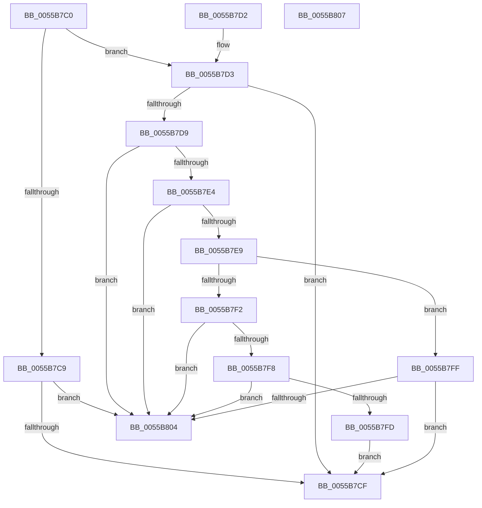

# PcValidateDmaAdapterRequest

- RVA: `0x0055B7C0`–`0x0055B808` (길이 `72` bytes)
- VA: `0x000000014055B7C0`
- 실행 섹션: `.text`
- PDB 이름 있음: `예`; PDB Function 태그: `아니요`
- unwind 정보 RVA: `0x000DB714`
- 디코드: `28`개 명령, `72/72` bytes 표시
- 미해석 바이트: `0` (있으면 어셈블리에 `.byte`로 보존)

> 이 문서는 커널 이미지의 기계어와 PDB 기호를 분석해 생성했습니다. 4번과 5번은 함수 원형과 자료형을 바이너리 사용 방식에서 추정한 C 해석이며 원본 소스 복구 결과는 아닙니다.

## 1. Dependencies

- 직접 호출 지점: **0**; 고유 호출 대상: **0**
- 직접 호출자로 확인된 함수: **0**
- RIP 상대 이미지 참조: **0**

### Outgoing calls
- 직접 디코드된 call 명령이 없습니다.

### Direct callers
- 이 함수 시작 RVA로 연결되는 직접 call은 확인되지 않았습니다. 간접 호출은 완전히 역산할 수 없습니다.

### Static image references
- 디코드된 RIP-relative 메모리 참조가 없습니다.

## 2. Other-region calls and transfers

- 다른 실행 섹션으로 향하는 call: **0**
- 별도 외부 분기/꼬리 이동을 확인하지 못했습니다.

## 3. Assembly (complete function range)

```asm
0055B7C0  45 33 C9                        xor r9d, r9d
0055B7C3  44 38 49 05                     cmp byte ptr [rcx + 5], r9b
0055B7C7  74 0A                           je 0x14055b7d3
0055B7C9  44 38 49 04                     cmp byte ptr [rcx + 4], r9b
0055B7CD  74 35                           je 0x14055b804
0055B7CF  B0 01                           mov al, 1
0055B7D1  C3                              ret
0055B7D2  CC                              int3
0055B7D3  44 38 49 04                     cmp byte ptr [rcx + 4], r9b
0055B7D7  75 F6                           jne 0x14055b7cf
0055B7D9  8B 51 10                        mov edx, dword ptr [rcx + 0x10]
0055B7DC  F7 C2 F8 FF FF FF               test edx, 0xfffffff8
0055B7E2  75 20                           jne 0x14055b804
0055B7E4  83 FA 04                        cmp edx, 4
0055B7E7  74 1B                           je 0x14055b804
0055B7E9  44 8B 41 18                     mov r8d, dword ptr [rcx + 0x18]
0055B7ED  45 85 C0                        test r8d, r8d
0055B7F0  74 0D                           je 0x14055b7ff
0055B7F2  41 83 F8 01                     cmp r8d, 1
0055B7F6  75 0C                           jne 0x14055b804
0055B7F8  83 FA 04                        cmp edx, 4
0055B7FB  72 07                           jb 0x14055b804
0055B7FD  EB D0                           jmp 0x14055b7cf
0055B7FF  83 FA 04                        cmp edx, 4
0055B802  72 CB                           jb 0x14055b7cf
0055B804  32 C0                           xor al, al
0055B806  C3                              ret
0055B807  CC                              int3
```

## 4. C-style interpretation (structured pseudocode)

```c
__int64 __fastcall PcValidateDmaAdapterRequest(__int64 a1, __int64 a2, __int64 a3, int a4)
{
    __int64 result;

    a4 = 0;
    if ((*(unsigned __int8 *)(a1 + 5)) == 0) goto loc_0055B7D3;
    if ((*(unsigned __int8 *)(a1 + 4)) == 0) goto loc_0055B804;
loc_0055B7CF:
    return 1;
loc_0055B7D3:
    if ((*(unsigned __int8 *)(a1 + 4)) != 0) goto loc_0055B7CF;
    if ((((unsigned int)((unsigned int)(*(unsigned int *)(a1 + 16)))) & (0xFFFFFFF8ULL)) != 0) goto loc_0055B804;
    if (((unsigned int)((unsigned int)(*(unsigned int *)(a1 + 16)))) == 4) goto loc_0055B804;
    if ((unsigned int)((unsigned int)(*(unsigned int *)(a1 + 24))) == 0) goto loc_0055B7FF;
    if (((unsigned int)((unsigned int)(*(unsigned int *)(a1 + 24)))) != 1) goto loc_0055B804;
    if (((unsigned int)((unsigned int)(*(unsigned int *)(a1 + 16)))) < 4) goto loc_0055B804;
    goto loc_0055B7CF;
loc_0055B7FF:
    if (((unsigned int)((unsigned int)(*(unsigned int *)(a1 + 16)))) < 4) goto loc_0055B7CF;
loc_0055B804:
    result = 0;
    return result;
}
```

## 5. (Beta) C Style

```c
int64_t PcValidateDmaAdapterRequest(void *Arg1, int64_t Arg2, int64_t Arg3, int32_t Arg4)
{
    uint8_t *arg1 = (uint8_t *)Arg1;

    int64_t result;

    Arg4 = 0;
    if ((*(uint8_t *)(arg1 + 0x5)) == 0) goto loc_0055B7D3;
    if ((*(uint8_t *)(arg1 + 0x4)) == 0) goto loc_0055B804;
loc_0055B7CF:
    return 1;
loc_0055B7D3:
    if ((*(uint8_t *)(arg1 + 0x4)) != 0) goto loc_0055B7CF;
    if ((((uint32_t)((uint32_t)(*(uint32_t *)(arg1 + 0x10)))) & (0xFFFFFFF8ULL)) != 0) goto loc_0055B804;
    if (((uint32_t)((uint32_t)(*(uint32_t *)(arg1 + 0x10)))) == 4) goto loc_0055B804;
    if ((uint32_t)((uint32_t)(*(uint32_t *)(arg1 + 0x18))) == 0) goto loc_0055B7FF;
    if (((uint32_t)((uint32_t)(*(uint32_t *)(arg1 + 0x18)))) != 1) goto loc_0055B804;
    if (((uint32_t)((uint32_t)(*(uint32_t *)(arg1 + 0x10)))) < 4) goto loc_0055B804;
    goto loc_0055B7CF;
loc_0055B7FF:
    if (((uint32_t)((uint32_t)(*(uint32_t *)(arg1 + 0x10)))) < 4) goto loc_0055B7CF;
loc_0055B804:
    result = 0;
    return result;
}
```

### 관측된 메모리 오프셋

구조체 형식이 확인되지 않은 접근은 인자 기준의 오프셋으로만 기록했습니다.

| 기준 인자 | 오프셋 표현 | 폭 (bit) | 접근 |
|---|---:|---:|---|
| `Arg1` | `+ 0x4` | `8` | `R` |
| `Arg1` | `+ 0x5` | `8` | `R` |
| `Arg1` | `+ 0x10` | `32` | `R` |
| `Arg1` | `+ 0x18` | `32` | `R` |

## 6. Execution-region graph

[열기: 2D/3D 그래프와 함수 탐색 컨트롤 패널](../../../control-panel.html?section=text&rva=0x0055B7C0&view=graph)

- 2D 그래프는 위에서 아래로 흐르고, 3D 그래프는 빈 공간을 드래그해 회전합니다. Shift+드래그는 이동, 휠은 확대·축소, 함수 노드 선택은 대상 보고서 이동입니다.

### Static fallback


