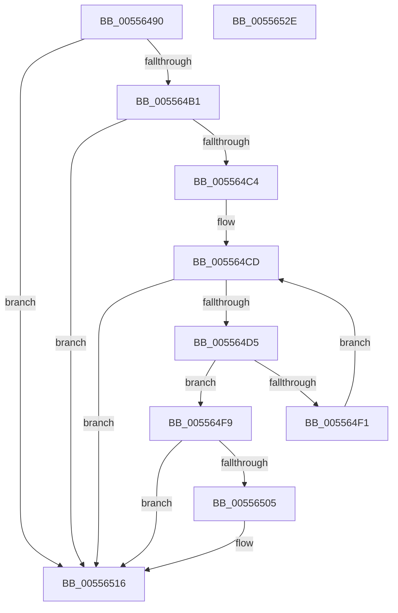

# WheaGetErrPacketFromErrRecord

- RVA: `0x00556490`–`0x0055652F` (길이 `159` bytes)
- VA: `0x0000000140556490`
- 실행 섹션: `.text`
- PDB 이름 있음: `예`; PDB Function 태그: `아니요`
- unwind 정보 RVA: `0x0005C954`
- 디코드: `45`개 명령, `159/159` bytes 표시
- 미해석 바이트: `0` (있으면 어셈블리에 `.byte`로 보존)

> 이 문서는 커널 이미지의 기계어와 PDB 기호를 분석해 생성했습니다. 4번과 5번은 함수 원형과 자료형을 바이너리 사용 방식에서 추정한 C 해석이며 원본 소스 복구 결과는 아닙니다.

## 1. Dependencies

- 직접 호출 지점: **1**; 고유 호출 대상: **1**
- 직접 호출자로 확인된 함수: **3**
- RIP 상대 이미지 참조: **1**

### Outgoing calls
- `0x005564E6` → [RtlCompareMemory](../6B/RtlCompareMemory_function_006BA670.md) (function, `0x006BA670`)

### Direct callers
- [HalpMceRecovery](HalpMceRecovery_function_00555DD0.md) at `0x00555DEE`
- [KiMcheckAlternateReturn](../5C/KiMcheckAlternateReturn_function_005CB180.md) at `0x005CB362`
- [WheapAttemptArchitecturalErrorRecovery](../65/WheapAttemptArchitecturalErrorRecovery_function_0065E240.md) at `0x0065E25E`

### Static image references
- `0x005564DF` → RVA `0x0001A538` (`.rdata`; read)

## 2. Other-region calls and transfers

- 다른 실행 섹션으로 향하는 call: **0**
- 별도 외부 분기/꼬리 이동을 확인하지 못했습니다.

## 3. Assembly (complete function range)

```asm
00556490  48 89 5C 24 08                  mov qword ptr [rsp + 8], rbx
00556495  48 89 6C 24 10                  mov qword ptr [rsp + 0x10], rbp
0055649A  48 89 74 24 18                  mov qword ptr [rsp + 0x18], rsi
0055649F  57                              push rdi
005564A0  48 83 EC 20                     sub rsp, 0x20
005564A4  33 FF                           xor edi, edi
005564A6  48 8B D9                        mov rbx, rcx
005564A9  81 39 43 50 45 52               cmp dword ptr [rcx], 0x52455043
005564AF  75 65                           jne 0x140556516
005564B1  0F B7 41 0A                     movzx eax, word ptr [rcx + 0xa]
005564B5  8D 14 C0                        lea edx, [rax + rax*8]
005564B8  8D 14 D5 80 00 00 00            lea edx, [rdx*8 + 0x80]
005564BF  39 51 14                        cmp dword ptr [rcx + 0x14], edx
005564C2  72 52                           jb 0x140556516
005564C4  48 8D B1 80 00 00 00            lea rsi, [rcx + 0x80]
005564CB  8B EF                           mov ebp, edi
005564CD  0F B7 43 0A                     movzx eax, word ptr [rbx + 0xa]
005564D1  3B E8                           cmp ebp, eax
005564D3  73 41                           jae 0x140556516
005564D5  48 8D 4E 10                     lea rcx, [rsi + 0x10]
005564D9  41 B8 10 00 00 00               mov r8d, 0x10
005564DF  48 8D 15 52 40 AC FF            lea rdx, [rip - 0x53bfae]
005564E6  E8 85 41 16 00                  call 0x1406ba670
005564EB  48 83 F8 10                     cmp rax, 0x10
005564EF  74 08                           je 0x1405564f9
005564F1  48 83 C6 48                     add rsi, 0x48
005564F5  FF C5                           inc ebp
005564F7  EB D4                           jmp 0x1405564cd
005564F9  8B 06                           mov eax, dword ptr [rsi]
005564FB  8B 56 04                        mov edx, dword ptr [rsi + 4]
005564FE  03 D0                           add edx, eax
00556500  39 53 14                        cmp dword ptr [rbx + 0x14], edx
00556503  72 11                           jb 0x140556516
00556505  48 8D 0C 03                     lea rcx, [rbx + rax]
00556509  81 39 57 48 45 41               cmp dword ptr [rcx], 0x41454857
0055650F  48 0F 45 CF                     cmovne rcx, rdi
00556513  48 8B F9                        mov rdi, rcx
00556516  48 8B 5C 24 30                  mov rbx, qword ptr [rsp + 0x30]
0055651B  48 8B C7                        mov rax, rdi
0055651E  48 8B 6C 24 38                  mov rbp, qword ptr [rsp + 0x38]
00556523  48 8B 74 24 40                  mov rsi, qword ptr [rsp + 0x40]
00556528  48 83 C4 20                     add rsp, 0x20
0055652C  5F                              pop rdi
0055652D  C3                              ret
0055652E  CC                              int3
```

## 4. C-style interpretation (structured pseudocode)

```c
__int64 __fastcall WheaGetErrPacketFromErrRecord(__int64 a1)
{
    __int64 result;
    __int64 v_rbp;
    __int64 v_rdi;
    __int64 v_rsi;
    __int64 v_rsp;
    unsigned __int64 v_stack_p10;
    unsigned __int64 v_stack_p18;
    unsigned __int64 v_stack_p8;

    v_stack_p8 = v_rbx;
    v_stack_p10 = v_rbp;
    v_stack_p18 = v_rsi;
    v_rsp = (v_rsp) - (32);
    v_rdi = 0;
    if ((*(unsigned int *)(a1)) != 0x52455043ULL) goto loc_00556516;
    if ((*(unsigned int *)(a1 + 20)) < ((unsigned int)(*(unsigned __int16 *)(a1 + 10) + *(unsigned __int16 *)(a1 + 10) * 8 * 8 + 128))) goto loc_00556516;
loc_005564CD:
    if (0 >= ((unsigned int)(*(unsigned __int16 *)(a1 + 10)))) goto loc_00556516;
    result = RtlCompareMemory(a1 + 128 + 16, v_rip - 5488558, 16, a4);
    if (result == 16) goto loc_005564F9;
    v_rsi = (a1 + 128) + (72);
    v_rbp = (unsigned int)((0) + 1);
    goto loc_005564CD;
loc_005564F9:
    a2 = (unsigned int)(((unsigned int)(*(unsigned int *)(v_rsi + 4))) + ((unsigned int)((unsigned int)(*(unsigned int *)(v_rsi)))));
    if ((*(unsigned int *)(a1 + 20)) >= ((unsigned int)(a2))) {
        a1 = a1 + (unsigned int)(*(unsigned int *)(v_rsi)) * 1;
        if ((*(unsigned int *)(a1)) != 0x41454857ULL) { a1 = 0; }
        v_rdi = a1;
    }
    v_rsp = (v_rsp) + (32);
    return v_rdi;
}
```

## 5. (Beta) C Style

```c
int64_t WheaGetErrPacketFromErrRecord(void *Arg1)
{
    uint8_t *arg1 = (uint8_t *)Arg1;

    int64_t result;
    int64_t local_rbp;
    int64_t local_rdi;
    int64_t local_rsi;
    int64_t local_rsp;
    uint64_t v_stack_p10;
    uint64_t v_stack_p18;
    uint64_t v_stack_p8;

    v_stack_p8 = local_rbx;
    v_stack_p10 = local_rbp;
    v_stack_p18 = local_rsi;
    local_rsp = (local_rsp) - (32);
    local_rdi = 0;
    if ((*(uint32_t *)(arg1)) != 0x52455043ULL) goto loc_00556516;
    if ((*(uint32_t *)(arg1 + 0x14)) < ((uint32_t)(*(uint16_t *)(arg1 + 0xA) + *(uint16_t *)(arg1 + 0xA) * 8 * 8 + 128))) goto loc_00556516;
loc_005564CD:
    if (0 >= ((uint32_t)(*(uint16_t *)(arg1 + 0xA)))) goto loc_00556516;
    result = RtlCompareMemory(Arg1 + 128 + 16, v_rip - 5488558, 16, a4);
    if (result == 16) goto loc_005564F9;
    local_rsi = (Arg1 + 128) + (72);
    local_rbp = (uint32_t)((0) + 1);
    goto loc_005564CD;
loc_005564F9:
    a2 = (uint32_t)(((uint32_t)(*(uint32_t *)(local_rsi + 0x4))) + ((uint32_t)((uint32_t)(*(uint32_t *)(local_rsi)))));
    if ((*(uint32_t *)(arg1 + 0x14)) >= ((uint32_t)(a2))) {
        Arg1 = Arg1 + (uint32_t)(*(uint32_t *)(local_rsi)) * 1;
        if ((*(uint32_t *)(arg1)) != 0x41454857ULL) { Arg1 = 0; }
        local_rdi = Arg1;
    }
    local_rsp = (local_rsp) + (32);
    return local_rdi;
}
```

### 관측된 메모리 오프셋

구조체 형식이 확인되지 않은 접근은 인자 기준의 오프셋으로만 기록했습니다.

| 기준 인자 | 오프셋 표현 | 폭 (bit) | 접근 |
|---|---:|---:|---|
| `Arg1` | `+ 0x0` | `32` | `R` |
| `Arg1` | `+ 0x0 + rax*1` | `64` | `R` |
| `Arg1` | `+ 0x4` | `32` | `R` |
| `Arg1` | `+ 0xA` | `16` | `R` |
| `Arg1` | `+ 0x10` | `64` | `R` |
| `Arg1` | `+ 0x14` | `32` | `R` |
| `Arg1` | `+ 0x80` | `64` | `R` |

## 6. Execution-region graph

[열기: 2D/3D 그래프와 함수 탐색 컨트롤 패널](../../../control-panel.html?section=text&rva=0x00556490&view=graph)

- 2D 그래프는 위에서 아래로 흐르고, 3D 그래프는 빈 공간을 드래그해 회전합니다. Shift+드래그는 이동, 휠은 확대·축소, 함수 노드 선택은 대상 보고서 이동입니다.

### Static fallback


