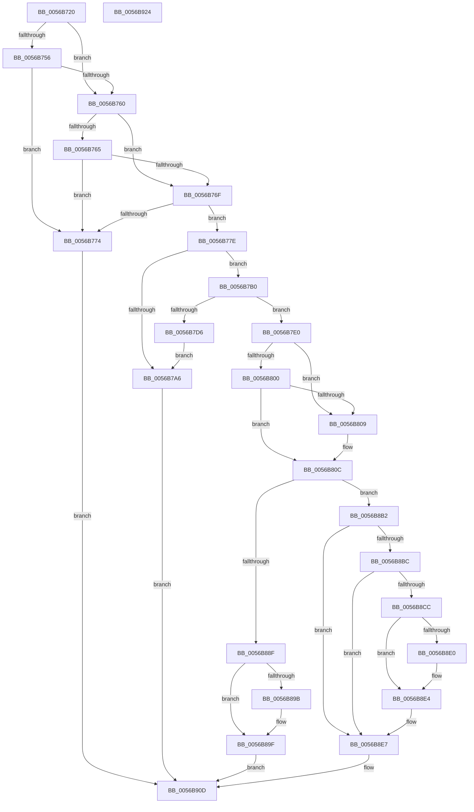

# Amd64AddProfileSource

- RVA: `0x0056B720`–`0x0056B925` (길이 `517` bytes)
- VA: `0x000000014056B720`
- 실행 섹션: `.text`
- PDB 이름 있음: `예`; PDB Function 태그: `아니요`
- unwind 정보 RVA: `0x000BB528`
- 디코드: `139`개 명령, `517/517` bytes 표시
- 미해석 바이트: `0` (있으면 어셈블리에 `.byte`로 보존)

> 이 문서는 커널 이미지의 기계어와 PDB 기호를 분석해 생성했습니다. 4번과 5번은 함수 원형과 자료형을 바이너리 사용 방식에서 추정한 C 해석이며 원본 소스 복구 결과는 아닙니다.

## 1. Dependencies

- 직접 호출 지점: **16**; 고유 호출 대상: **11**
- 직접 호출자로 확인된 함수: **0**
- RIP 상대 이미지 참조: **3**

### Outgoing calls
- `0x0056B78D` → [wcsnlen](../50/wcsnlen_function_00501D60.md) (function, `0x00501D60`)
- `0x0056B799` → [HalpMmAllocCtxAlloc](../3E/HalpMmAllocCtxAlloc_function_003E10B8.md) (function, `0x003E10B8`)
- `0x0056B7BB` → [wcsncpy_s](../50/wcsncpy_s_function_00506650.md) (function, `0x00506650`)
- `0x0056B7C9` → [HalpMmAllocCtxAlloc](../3E/HalpMmAllocCtxAlloc_function_003E10B8.md) (function, `0x003E10B8`)
- `0x0056B7D9` → [HalpMmAllocCtxFree](../3E/HalpMmAllocCtxFree_function_003E1904.md) (function, `0x003E1904`)
- `0x0056B7E8` → [memset](../6C/memset_function_006C6C40.md) (function, `0x006C6C40`)
- `0x0056B813` → [Amd64GetEventSelectDef](Amd64GetEventSelectDef_function_0056C660.md) (function, `0x0056C660`)
- `0x0056B84C` → [memset](../6C/memset_function_006C6C40.md) (function, `0x006C6C40`)
- `0x0056B85D` → [KiCopyAffinityEx](../2C/KiCopyAffinityEx_function_002CE860.md) (function, `0x002CE860`)
- `0x0056B870` → [HalpAcquireHighLevelLock](../2D/HalpAcquireHighLevelLock_function_002D2390.md) (function, `0x002D2390`)
- `0x0056B886` → [HalpInsertProfileSource](../54/HalpInsertProfileSource_function_00547468.md) (function, `0x00547468`)
- `0x0056B8A9` → [HalpReleaseHighLevelLock](../2D/HalpReleaseHighLevelLock_function_002D1C58.md) (function, `0x002D1C58`)
- `0x0056B8D6` → [KeOrAffinityEx2](../2C/KeOrAffinityEx2_function_002CF930.md) (function, `0x002CF930`)
- `0x0056B8F1` → [HalpReleaseHighLevelLock](../2D/HalpReleaseHighLevelLock_function_002D1C58.md) (function, `0x002D1C58`)
- `0x0056B8FD` → [HalpMmAllocCtxFree](../3E/HalpMmAllocCtxFree_function_003E1904.md) (function, `0x003E1904`)
- `0x0056B905` → [HalpMmAllocCtxFree](../3E/HalpMmAllocCtxFree_function_003E1904.md) (function, `0x003E1904`)

### Direct callers
- 이 함수 시작 RVA로 연결되는 직접 call은 확인되지 않았습니다. 간접 호출은 완전히 역산할 수 없습니다.

### Static image references
- `0x0056B756` → RVA `0x00F8F8A0` (`.data`; read)
- `0x0056B862` → RVA `0x00FC2BD0` (`.data`; read)
- `0x0056B88F` → RVA `0x00FC2C20` (`.data`; read/write)

## 2. Other-region calls and transfers

- 다른 실행 섹션으로 향하는 call: **0**
- 별도 외부 분기/꼬리 이동을 확인하지 못했습니다.

## 3. Assembly (complete function range)

```asm
0056B720  48 89 5C 24 10                  mov qword ptr [rsp + 0x10], rbx
0056B725  48 89 6C 24 18                  mov qword ptr [rsp + 0x18], rbp
0056B72A  56                              push rsi
0056B72B  57                              push rdi
0056B72C  41 55                           push r13
0056B72E  41 56                           push r14
0056B730  41 57                           push r15
0056B732  48 83 EC 20                     sub rsp, 0x20
0056B736  48 83 64 24 50 00               and qword ptr [rsp + 0x50], 0
0056B73C  48 8B F2                        mov rsi, rdx
0056B73F  8A 51 07                        mov dl, byte ptr [rcx + 7]
0056B742  41 BD 01 00 00 00               mov r13d, 1
0056B748  48 8B E9                        mov rbp, rcx
0056B74B  41 BE 01 00 00 C0               mov r14d, 0xc0000001
0056B751  41 3A D5                        cmp dl, r13b
0056B754  75 0A                           jne 0x14056b760
0056B756  8B 05 44 41 A2 00               mov eax, dword ptr [rip + 0xa24144]
0056B75C  A8 02                           test al, 2
0056B75E  74 14                           je 0x14056b774
0056B760  80 FA 02                        cmp dl, 2
0056B763  75 0A                           jne 0x14056b76f
0056B765  8B 05 35 41 A2 00               mov eax, dword ptr [rip + 0xa24135]
0056B76B  A8 04                           test al, 4
0056B76D  74 05                           je 0x14056b774
0056B76F  80 FA 03                        cmp dl, 3
0056B772  72 0A                           jb 0x14056b77e
0056B774  B8 BB 00 00 C0                  mov eax, 0xc00000bb
0056B779  E9 8F 01 00 00                  jmp 0x14056b90d
0056B77E  4C 8D B9 18 01 00 00            lea r15, [rcx + 0x118]
0056B785  BA FE 00 00 00                  mov edx, 0xfe
0056B78A  49 8B CF                        mov rcx, r15
0056B78D  E8 CE 65 F9 FF                  call 0x140501d60
0056B792  42 8D 1C 28                     lea ebx, [rax + r13]
0056B796  8D 14 1B                        lea edx, [rbx + rbx]
0056B799  E8 1A 59 E7 FF                  call 0x1403e10b8
0056B79E  48 8B F8                        mov rdi, rax
0056B7A1  48 85 C0                        test rax, rax
0056B7A4  75 0A                           jne 0x14056b7b0
0056B7A6  B8 17 00 00 C0                  mov eax, 0xc0000017
0056B7AB  E9 5D 01 00 00                  jmp 0x14056b90d
0056B7B0  8B D3                           mov edx, ebx
0056B7B2  4D 8B C7                        mov r8, r15
0056B7B5  44 8B CB                        mov r9d, ebx
0056B7B8  48 8B CF                        mov rcx, rdi
0056B7BB  E8 90 AE F9 FF                  call 0x140506650
0056B7C0  41 BF 40 01 00 00               mov r15d, 0x140
0056B7C6  41 8B D7                        mov edx, r15d
0056B7C9  E8 EA 58 E7 FF                  call 0x1403e10b8
0056B7CE  48 8B D8                        mov rbx, rax
0056B7D1  48 85 C0                        test rax, rax
0056B7D4  75 0A                           jne 0x14056b7e0
0056B7D6  48 8B D7                        mov rdx, rdi
0056B7D9  E8 26 61 E7 FF                  call 0x1403e1904
0056B7DE  EB C6                           jmp 0x14056b7a6
0056B7E0  4D 8B C7                        mov r8, r15
0056B7E3  33 D2                           xor edx, edx
0056B7E5  48 8B CB                        mov rcx, rbx
0056B7E8  E8 53 B4 15 00                  call 0x1406c6c40
0056B7ED  B9 FF FF FF 7F                  mov ecx, 0x7fffffff
0056B7F2  44 88 6B 1C                     mov byte ptr [rbx + 0x1c], r13b
0056B7F6  8B 45 08                        mov eax, dword ptr [rbp + 8]
0056B7F9  89 43 18                        mov dword ptr [rbx + 0x18], eax
0056B7FC  3B C1                           cmp eax, ecx
0056B7FE  77 09                           ja 0x14056b809
0056B800  B9 00 10 00 00                  mov ecx, 0x1000
0056B805  3B C1                           cmp eax, ecx
0056B807  73 03                           jae 0x14056b80c
0056B809  89 4B 18                        mov dword ptr [rbx + 0x18], ecx
0056B80C  48 8B CD                        mov rcx, rbp
0056B80F  C6 43 1D 00                     mov byte ptr [rbx + 0x1d], 0
0056B813  E8 48 0E 00 00                  call 0x14056c660
0056B818  48 89 83 30 01 00 00            mov qword ptr [rbx + 0x130], rax
0056B81F  4C 8D 7B 20                     lea r15, [rbx + 0x20]
0056B823  44 89 AB 3C 01 00 00            mov dword ptr [rbx + 0x13c], r13d
0056B82A  49 8D 4F 08                     lea rcx, [r15 + 8]
0056B82E  0F B6 45 07                     movzx eax, byte ptr [rbp + 7]
0056B832  33 D2                           xor edx, edx
0056B834  89 83 38 01 00 00               mov dword ptr [rbx + 0x138], eax
0056B83A  41 B8 00 01 00 00               mov r8d, 0x100
0056B840  41 83 67 04 00                  and dword ptr [r15 + 4], 0
0056B845  41 C7 07 01 00 20 00            mov dword ptr [r15], 0x200001
0056B84C  E8 EF B3 15 00                  call 0x1406c6c40
0056B851  41 0F B7 57 02                  movzx edx, word ptr [r15 + 2]
0056B856  4C 8D 45 10                     lea r8, [rbp + 0x10]
0056B85A  49 8B CF                        mov rcx, r15
0056B85D  E8 FE 2F D6 FF                  call 0x1402ce860
0056B862  48 8D 0D 67 73 A5 00            lea rcx, [rip + 0xa57367]
0056B869  48 89 BB 28 01 00 00            mov qword ptr [rbx + 0x128], rdi
0056B870  E8 1B 6B D6 FF                  call 0x1402d2390
0056B875  4C 8D 4C 24 50                  lea r9, [rsp + 0x50]
0056B87A  41 B8 22 00 00 00               mov r8d, 0x22
0056B880  48 8B CB                        mov rcx, rbx
0056B883  40 8A E8                        mov bpl, al
0056B886  E8 DD BB FD FF                  call 0x140547468
0056B88B  84 C0                           test al, al
0056B88D  74 23                           je 0x14056b8b2
0056B88F  44 01 2D 8A 73 A5 00            add dword ptr [rip + 0xa5738a], r13d
0056B896  48 85 F6                        test rsi, rsi
0056B899  74 04                           je 0x14056b89f
0056B89B  8B 03                           mov eax, dword ptr [rbx]
0056B89D  89 06                           mov dword ptr [rsi], eax
0056B89F  40 8A D5                        mov dl, bpl
0056B8A2  48 8D 0D 27 73 A5 00            lea rcx, [rip + 0xa57327]
0056B8A9  E8 AA 63 D6 FF                  call 0x1402d1c58
0056B8AE  33 C0                           xor eax, eax
0056B8B0  EB 5B                           jmp 0x14056b90d
0056B8B2  48 8B 7C 24 50                  mov rdi, qword ptr [rsp + 0x50]
0056B8B7  48 85 FF                        test rdi, rdi
0056B8BA  74 2B                           je 0x14056b8e7
0056B8BC  48 8B 83 30 01 00 00            mov rax, qword ptr [rbx + 0x130]
0056B8C3  48 39 87 30 01 00 00            cmp qword ptr [rdi + 0x130], rax
0056B8CA  75 1B                           jne 0x14056b8e7
0056B8CC  48 8D 4F 20                     lea rcx, [rdi + 0x20]
0056B8D0  49 8B D7                        mov rdx, r15
0056B8D3  4C 8B C1                        mov r8, rcx
0056B8D6  E8 55 40 D6 FF                  call 0x1402cf930
0056B8DB  48 85 F6                        test rsi, rsi
0056B8DE  74 04                           je 0x14056b8e4
0056B8E0  8B 07                           mov eax, dword ptr [rdi]
0056B8E2  89 06                           mov dword ptr [rsi], eax
0056B8E4  45 33 F6                        xor r14d, r14d
0056B8E7  40 8A D5                        mov dl, bpl
0056B8EA  48 8D 0D DF 72 A5 00            lea rcx, [rip + 0xa572df]
0056B8F1  E8 62 63 D6 FF                  call 0x1402d1c58
0056B8F6  48 8B 93 28 01 00 00            mov rdx, qword ptr [rbx + 0x128]
0056B8FD  E8 02 60 E7 FF                  call 0x1403e1904
0056B902  48 8B D3                        mov rdx, rbx
0056B905  E8 FA 5F E7 FF                  call 0x1403e1904
0056B90A  41 8B C6                        mov eax, r14d
0056B90D  48 8B 5C 24 58                  mov rbx, qword ptr [rsp + 0x58]
0056B912  48 8B 6C 24 60                  mov rbp, qword ptr [rsp + 0x60]
0056B917  48 83 C4 20                     add rsp, 0x20
0056B91B  41 5F                           pop r15
0056B91D  41 5E                           pop r14
0056B91F  41 5D                           pop r13
0056B921  5F                              pop rdi
0056B922  5E                              pop rsi
0056B923  C3                              ret
0056B924  CC                              int3
```

## 4. C-style interpretation (structured pseudocode)

```c
__int64 __fastcall Amd64AddProfileSource(__int64 a1, __int64 a2)
{
    __int64 result;
    __int64 v_r14;
    __int64 v_rsp;
    unsigned __int64 v_stack_p10;
    unsigned __int64 v_stack_p18;
    unsigned __int64 v_stack_p8;

    v_stack_p10 = v_rbx;
    v_stack_p18 = v_rbp;
    v_rsp = (v_rsp) - (32);
    if (((unsigned __int8)(*(unsigned __int8 *)(a1 + 7))) != 1) goto loc_0056B760;
    if ((((unsigned __int8)((unsigned int)(*(unsigned int *)(v_rip + 10633540)))) & (2)) == 0) goto loc_0056B774;
loc_0056B760:
    if (((unsigned __int8)(*(unsigned __int8 *)(a1 + 7))) != 2) goto loc_0056B76F;
    if ((((unsigned __int8)((unsigned int)(*(unsigned int *)(v_rip + 10633525)))) & (4)) == 0) goto loc_0056B774;
loc_0056B76F:
    if (((unsigned __int8)(*(unsigned __int8 *)(a1 + 7))) < 3) goto loc_0056B77E;
loc_0056B774:
    goto loc_0056B90D;
loc_0056B77E:
    result = wcsnlen(a1 + 280, 254, a3, a4);
    result = HalpMmAllocCtxAlloc(a1 + 280, result + 1 * 1 + result + 1 * 1 * 1, a3, a4);
    if (result != 0) goto loc_0056B7B0;
loc_0056B7A6:
    goto loc_0056B90D;
loc_0056B7B0:
    result = wcsncpy_s(result, (unsigned int)((unsigned int)(result + 1 * 1)), a1 + 280, (unsigned int)((unsigned int)(result + 1 * 1)));
    result = HalpMmAllocCtxAlloc(result, 320, a1 + 280, (unsigned int)((unsigned int)(result + 1 * 1)));
    if (result != 0) goto loc_0056B7E0;
    result = HalpMmAllocCtxFree(result, result, a1 + 280, (unsigned int)((unsigned int)(result + 1 * 1)));
    goto loc_0056B7A6;
loc_0056B7E0:
    a2 = 0;
    result = memset(result, a2, 320, (unsigned int)((unsigned int)(result + 1 * 1)));
    *(unsigned __int8 *)(result + 28) = 1;
    *(unsigned int *)(result + 24) = (unsigned int)((unsigned int)(*(unsigned int *)(a1 + 8)));
    if (((unsigned int)((unsigned int)(*(unsigned int *)(a1 + 8)))) > ((unsigned int)((unsigned int)(0x7FFFFFFFULL)))) goto loc_0056B809;
    if (((unsigned int)((unsigned int)(*(unsigned int *)(a1 + 8)))) < ((unsigned int)((unsigned int)(0x1000ULL)))) {
        *(unsigned int *)(result + 24) = (unsigned int)((unsigned int)(0x1000ULL));
    }
    *(unsigned __int8 *)(result + 29) = 0;
    result = Amd64GetEventSelectDef(a1, a2, 320, (unsigned int)((unsigned int)(result + 1 * 1)));
    *(unsigned __int64 *)(result + 304) = result;
    *(unsigned int *)(result + 316) = 1;
    a2 = 0;
    *(unsigned int *)(result + 312) = (unsigned int)(*(unsigned __int8 *)(a1 + 7));
    *(unsigned int *)(result + 32) = 0x200001ULL;
    result = memset(result + 32 + 8, a2, 256, (unsigned int)((unsigned int)(result + 1 * 1)));
    result = KiCopyAffinityEx(result + 32, *(unsigned __int16 *)(result + 32 + 2), a1 + 16, (unsigned int)((unsigned int)(result + 1 * 1)));
    *(unsigned __int64 *)(result + 296) = result;
    result = HalpAcquireHighLevelLock(v_rip + 10842983, *(unsigned __int16 *)(result + 32 + 2), a1 + 16, (unsigned int)((unsigned int)(result + 1 * 1)));
    result = HalpInsertProfileSource(result, *(unsigned __int16 *)(result + 32 + 2), 34, v_stack_p8);
    if ((unsigned __int8)(result) == 0) goto loc_0056B8B2;
    if (0 != 0) {
        result = *(unsigned int *)(result);
        *(unsigned int *)(a2) = (unsigned int)(result);
    }
    result = HalpReleaseHighLevelLock(v_rip + 10842919, (unsigned __int8)((unsigned __int8)(result)), 34, v_stack_p8);
    result = 0;
    goto loc_0056B90D;
loc_0056B8B2:
    if (v_stack_p8 == 0) goto loc_0056B8E7;
    if ((*(unsigned __int64 *)(v_stack_p8 + 304)) != (*(unsigned __int64 *)(result + 304))) goto loc_0056B8E7;
    result = KeOrAffinityEx2(v_stack_p8 + 32, result + 32, v_stack_p8 + 32, v_stack_p8);
    if (0 != 0) {
        result = *(unsigned int *)(v_stack_p8);
        *(unsigned int *)(a2) = (unsigned int)(result);
    }
    v_r14 = 0;
loc_0056B8E7:
    result = HalpReleaseHighLevelLock(v_rip + 10842847, (unsigned __int8)((unsigned __int8)(result)), v_stack_p8 + 32, v_stack_p8);
    result = HalpMmAllocCtxFree(v_rip + 10842847, *(unsigned __int64 *)(result + 296), v_stack_p8 + 32, v_stack_p8);
    result = HalpMmAllocCtxFree(v_rip + 10842847, result, v_stack_p8 + 32, v_stack_p8);
loc_0056B90D:
    v_rsp = (v_rsp) + (32);
    return 0;
}
```

## 5. (Beta) C Style

```c
int64_t Amd64AddProfileSource(void *Arg1, int64_t Arg2)
{
    uint8_t *arg1 = (uint8_t *)Arg1;

    int64_t result;
    int64_t local_r14;
    int64_t local_rsp;
    uint64_t v_stack_p10;
    uint64_t v_stack_p18;
    uint64_t v_stack_p8;

    v_stack_p10 = local_rbx;
    v_stack_p18 = local_rbp;
    local_rsp = (local_rsp) - (32);
    if (((uint8_t)(*(uint8_t *)(arg1 + 0x7))) != 1) goto loc_0056B760;
    if ((((uint8_t)((uint32_t)(*(uint32_t *)(v_rip + 0xA24144)))) & (2)) == 0) goto loc_0056B774;
loc_0056B760:
    if (((uint8_t)(*(uint8_t *)(arg1 + 0x7))) != 2) goto loc_0056B76F;
    if ((((uint8_t)((uint32_t)(*(uint32_t *)(v_rip + 0xA24135)))) & (4)) == 0) goto loc_0056B774;
loc_0056B76F:
    if (((uint8_t)(*(uint8_t *)(arg1 + 0x7))) < 3) goto loc_0056B77E;
loc_0056B774:
    goto loc_0056B90D;
loc_0056B77E:
    result = wcsnlen(Arg1 + 280, 254, a3, a4);
    result = HalpMmAllocCtxAlloc(Arg1 + 280, result + 1 * 1 + result + 1 * 1 * 1, a3, a4);
    if (result != 0) goto loc_0056B7B0;
loc_0056B7A6:
    goto loc_0056B90D;
loc_0056B7B0:
    result = wcsncpy_s(result, (uint32_t)((uint32_t)(result + 1 * 1)), Arg1 + 280, (uint32_t)((uint32_t)(result + 1 * 1)));
    result = HalpMmAllocCtxAlloc(result, 320, Arg1 + 280, (uint32_t)((uint32_t)(result + 1 * 1)));
    if (result != 0) goto loc_0056B7E0;
    result = HalpMmAllocCtxFree(result, result, Arg1 + 280, (uint32_t)((uint32_t)(result + 1 * 1)));
    goto loc_0056B7A6;
loc_0056B7E0:
    Arg2 = 0;
    result = memset(result, Arg2, 320, (uint32_t)((uint32_t)(result + 1 * 1)));
    *(uint8_t *)(result + 0x1C) = 1;
    *(uint32_t *)(result + 0x18) = (uint32_t)((uint32_t)(*(uint32_t *)(arg1 + 0x8)));
    if (((uint32_t)((uint32_t)(*(uint32_t *)(arg1 + 0x8)))) > ((uint32_t)((uint32_t)(0x7FFFFFFFULL)))) goto loc_0056B809;
    if (((uint32_t)((uint32_t)(*(uint32_t *)(arg1 + 0x8)))) < ((uint32_t)((uint32_t)(0x1000ULL)))) {
        *(uint32_t *)(result + 0x18) = (uint32_t)((uint32_t)(0x1000ULL));
    }
    *(uint8_t *)(result + 0x1D) = 0;
    result = Amd64GetEventSelectDef(Arg1, Arg2, 320, (uint32_t)((uint32_t)(result + 1 * 1)));
    *(uint64_t *)(result + 0x130) = result;
    *(uint32_t *)(result + 0x13C) = 1;
    Arg2 = 0;
    *(uint32_t *)(result + 0x138) = (uint32_t)(*(uint8_t *)(arg1 + 0x7));
    *(uint32_t *)(result + 0x20) = 0x200001ULL;
    result = memset(result + 32 + 8, Arg2, 256, (uint32_t)((uint32_t)(result + 1 * 1)));
    result = KiCopyAffinityEx(result + 32, *(uint16_t *)(result + 0x20 + 0x2), Arg1 + 16, (uint32_t)((uint32_t)(result + 1 * 1)));
    *(uint64_t *)(result + 0x128) = result;
    result = HalpAcquireHighLevelLock(v_rip + 10842983, *(uint16_t *)(result + 0x20 + 0x2), Arg1 + 16, (uint32_t)((uint32_t)(result + 1 * 1)));
    result = HalpInsertProfileSource(result, *(uint16_t *)(result + 0x20 + 0x2), 34, v_stack_p8);
    if ((uint8_t)(result) == 0) goto loc_0056B8B2;
    if (0 != 0) {
        result = *(uint32_t *)(result);
        *(uint32_t *)(Arg2) = (uint32_t)(result);
    }
    result = HalpReleaseHighLevelLock(v_rip + 10842919, (uint8_t)((uint8_t)(result)), 34, v_stack_p8);
    result = 0;
    goto loc_0056B90D;
loc_0056B8B2:
    if (v_stack_p8 == 0) goto loc_0056B8E7;
    if ((*(uint64_t *)(v_stack_p8 + 0x130)) != (*(uint64_t *)(result + 0x130))) goto loc_0056B8E7;
    result = KeOrAffinityEx2(v_stack_p8 + 32, result + 32, v_stack_p8 + 32, v_stack_p8);
    if (0 != 0) {
        result = *(uint32_t *)(v_stack_p8);
        *(uint32_t *)(Arg2) = (uint32_t)(result);
    }
    local_r14 = 0;
loc_0056B8E7:
    result = HalpReleaseHighLevelLock(v_rip + 10842847, (uint8_t)((uint8_t)(result)), v_stack_p8 + 32, v_stack_p8);
    result = HalpMmAllocCtxFree(v_rip + 10842847, *(uint64_t *)(result + 0x128), v_stack_p8 + 32, v_stack_p8);
    result = HalpMmAllocCtxFree(v_rip + 10842847, result, v_stack_p8 + 32, v_stack_p8);
loc_0056B90D:
    local_rsp = (local_rsp) + (32);
    return 0;
}
```

### 관측된 메모리 오프셋

구조체 형식이 확인되지 않은 접근은 인자 기준의 오프셋으로만 기록했습니다.

| 기준 인자 | 오프셋 표현 | 폭 (bit) | 접근 |
|---|---:|---:|---|
| `Arg1` | `+ 0x7` | `8` | `R` |
| `Arg1` | `+ 0x8` | `32` | `R` |
| `Arg1` | `+ 0x10` | `64` | `R` |
| `Arg1` | `+ 0x118` | `64` | `R` |

## 6. Execution-region graph

[열기: 2D/3D 그래프와 함수 탐색 컨트롤 패널](../../../control-panel.html?section=text&rva=0x0056B720&view=graph)

- 2D 그래프는 위에서 아래로 흐르고, 3D 그래프는 빈 공간을 드래그해 회전합니다. Shift+드래그는 이동, 휠은 확대·축소, 함수 노드 선택은 대상 보고서 이동입니다.

### Static fallback


