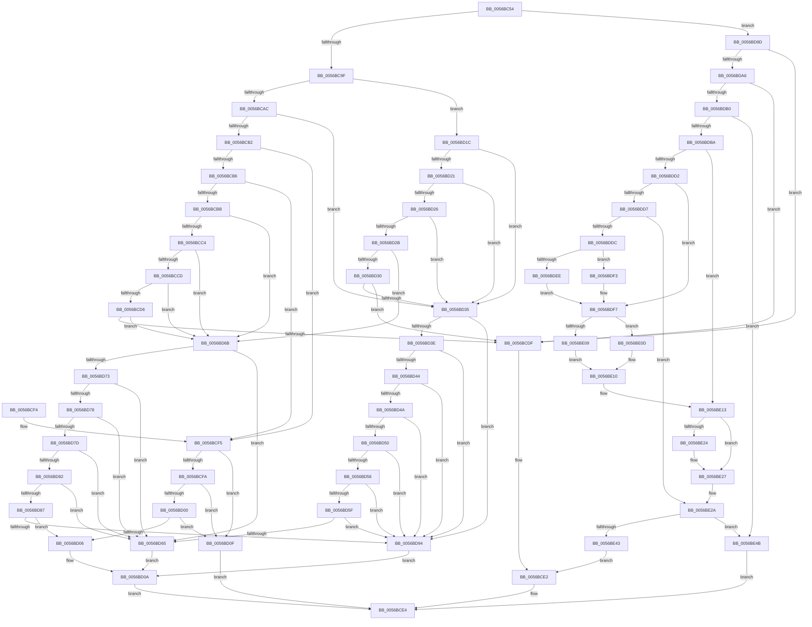

# Amd64CheckCoreEventConstraints

- RVA: `0x0056BC54`–`0x0056BE52` (길이 `510` bytes)
- VA: `0x000000014056BC54`
- 실행 섹션: `.text`
- PDB 이름 있음: `예`; PDB Function 태그: `아니요`
- unwind 정보 RVA: `0x000C50F0`
- 디코드: `143`개 명령, `510/510` bytes 표시
- 미해석 바이트: `0` (있으면 어셈블리에 `.byte`로 보존)

> 이 문서는 커널 이미지의 기계어와 PDB 기호를 분석해 생성했습니다. 4번과 5번은 함수 원형과 자료형을 바이너리 사용 방식에서 추정한 C 해석이며 원본 소스 복구 결과는 아닙니다.

## 1. Dependencies

- 직접 호출 지점: **0**; 고유 호출 대상: **0**
- 직접 호출자로 확인된 함수: **1**
- RIP 상대 이미지 참조: **1**

### Outgoing calls
- 직접 디코드된 call 명령이 없습니다.

### Direct callers
- [Amd64AllocateCounter](Amd64AllocateCounter_function_0056B92C.md) at `0x0056BB19`

### Static image references
- `0x0056BDC6` → RVA `0x00000000` (`image boundary/outside`; read)

## 2. Other-region calls and transfers

- 다른 실행 섹션으로 향하는 call: **0**
- 별도 외부 분기/꼬리 이동을 확인하지 못했습니다.

## 3. Assembly (complete function range)

```asm
0056BC54  48 89 5C 24 08                  mov qword ptr [rsp + 8], rbx
0056BC59  48 89 74 24 10                  mov qword ptr [rsp + 0x10], rsi
0056BC5E  48 89 7C 24 18                  mov qword ptr [rsp + 0x18], rdi
0056BC63  41 0F B6 C0                     movzx eax, r8b
0056BC67  4D 8B D0                        mov r10, r8
0056BC6A  49 C1 EA 18                     shr r10, 0x18
0056BC6E  41 BB 01 00 00 00               mov r11d, 1
0056BC74  41 81 E2 00 0F 00 00            and r10d, 0xf00
0056BC7B  41 D3 E3                        shl r11d, cl
0056BC7E  44 0B D0                        or r10d, eax
0056BC81  8B DA                           mov ebx, edx
0056BC83  65 48 8B 04 25 20 00 00 00      mov rax, qword ptr gs:[0x20]
0056BC8C  8B F1                           mov esi, ecx
0056BC8E  33 D2                           xor edx, edx
0056BC90  49 8B F9                        mov rdi, r9
0056BC93  8A 48 40                        mov cl, byte ptr [rax + 0x40]
0056BC96  80 F9 15                        cmp cl, 0x15
0056BC99  0F 85 FE 00 00 00               jne 0x14056bd9d
0056BC9F  41 8B C2                        mov eax, r10d
0056BCA2  25 F0 00 00 00                  and eax, 0xf0
0056BCA7  83 F8 60                        cmp eax, 0x60
0056BCAA  77 70                           ja 0x14056bd1c
0056BCAC  0F 84 83 00 00 00               je 0x14056bd35
0056BCB2  85 C0                           test eax, eax
0056BCB4  74 3F                           je 0x14056bcf5
0056BCB6  83 F8 10                        cmp eax, 0x10
0056BCB9  74 3A                           je 0x14056bcf5
0056BCBB  83 F8 20                        cmp eax, 0x20
0056BCBE  0F 84 A7 00 00 00               je 0x14056bd6b
0056BCC4  83 F8 30                        cmp eax, 0x30
0056BCC7  0F 84 9E 00 00 00               je 0x14056bd6b
0056BCCD  83 F8 40                        cmp eax, 0x40
0056BCD0  0F 84 95 00 00 00               je 0x14056bd6b
0056BCD6  83 F8 50                        cmp eax, 0x50
0056BCD9  0F 84 8C 00 00 00               je 0x14056bd6b
0056BCDF  41 88 11                        mov byte ptr [r9], dl
0056BCE2  B0 01                           mov al, 1
0056BCE4  48 8B 5C 24 08                  mov rbx, qword ptr [rsp + 8]
0056BCE9  48 8B 74 24 10                  mov rsi, qword ptr [rsp + 0x10]
0056BCEE  48 8B 7C 24 18                  mov rdi, qword ptr [rsp + 0x18]
0056BCF3  C3                              ret
0056BCF4  CC                              int3
0056BCF5  45 85 D2                        test r10d, r10d
0056BCF8  74 15                           je 0x14056bd0f
0056BCFA  41 83 EA 03                     sub r10d, 3
0056BCFE  74 0F                           je 0x14056bd0f
0056BD00  41 83 FA 01                     cmp r10d, 1
0056BD04  74 09                           je 0x14056bd0f
0056BD06  41 F6 C3 38                     test r11b, 0x38
0056BD0A  0F 95 C0                        setne al
0056BD0D  EB D5                           jmp 0x14056bce4
0056BD0F  41 C1 EB 03                     shr r11d, 3
0056BD13  41 80 E3 01                     and r11b, 1
0056BD17  41 8A C3                        mov al, r11b
0056BD1A  EB C8                           jmp 0x14056bce4
0056BD1C  83 E8 70                        sub eax, 0x70
0056BD1F  74 14                           je 0x14056bd35
0056BD21  83 E8 10                        sub eax, 0x10
0056BD24  74 0F                           je 0x14056bd35
0056BD26  83 E8 10                        sub eax, 0x10
0056BD29  74 0A                           je 0x14056bd35
0056BD2B  83 E8 30                        sub eax, 0x30
0056BD2E  74 3B                           je 0x14056bd6b
0056BD30  83 F8 10                        cmp eax, 0x10
0056BD33  75 AA                           jne 0x14056bcdf
0056BD35  41 81 EA DB 00 00 00            sub r10d, 0xdb
0056BD3C  74 56                           je 0x14056bd94
0056BD3E  41 83 EA 01                     sub r10d, 1
0056BD42  74 50                           je 0x14056bd94
0056BD44  41 83 EA 01                     sub r10d, 1
0056BD48  74 4A                           je 0x14056bd94
0056BD4A  41 83 EA 01                     sub r10d, 1
0056BD4E  74 44                           je 0x14056bd94
0056BD50  41 83 EA 01                     sub r10d, 1
0056BD54  74 3E                           je 0x14056bd94
0056BD56  41 81 EA F1 00 00 00            sub r10d, 0xf1
0056BD5D  74 35                           je 0x14056bd94
0056BD5F  41 83 FA 08                     cmp r10d, 8
0056BD63  74 2F                           je 0x14056bd94
0056BD65  41 F6 C3 07                     test r11b, 7
0056BD69  EB 9F                           jmp 0x14056bd0a
0056BD6B  41 8B C2                        mov eax, r10d
0056BD6E  83 E8 23                        sub eax, 0x23
0056BD71  74 F2                           je 0x14056bd65
0056BD73  83 E8 20                        sub eax, 0x20
0056BD76  74 ED                           je 0x14056bd65
0056BD78  83 E8 02                        sub eax, 2
0056BD7B  74 E8                           je 0x14056bd65
0056BD7D  83 E8 01                        sub eax, 1
0056BD80  74 E3                           je 0x14056bd65
0056BD82  83 F8 0E                        cmp eax, 0xe
0056BD85  74 DE                           je 0x14056bd65
0056BD87  41 81 FA C0 01 00 00            cmp r10d, 0x1c0
0056BD8E  0F 84 72 FF FF FF               je 0x14056bd06
0056BD94  41 F6 C3 3F                     test r11b, 0x3f
0056BD98  E9 6D FF FF FF                  jmp 0x14056bd0a
0056BD9D  80 F9 17                        cmp cl, 0x17
0056BDA0  0F 82 39 FF FF FF               jb 0x14056bcdf
0056BDA6  41 83 FA 03                     cmp r10d, 3
0056BDAA  0F 85 2F FF FF FF               jne 0x14056bcdf
0056BDB0  41 F6 C3 15                     test r11b, 0x15
0056BDB4  0F 84 91 00 00 00               je 0x14056be4b
0056BDBA  65 44 8B 0C 25 A4 01 00 00      mov r9d, dword ptr gs:[0x1a4]
0056BDC3  44 8B C2                        mov r8d, edx
0056BDC6  4C 8D 15 33 42 A9 FF            lea r10, [rip - 0x56bdcd]
0056BDCD  83 EB 01                        sub ebx, 1
0056BDD0  74 41                           je 0x14056be13
0056BDD2  83 EB 63                        sub ebx, 0x63
0056BDD5  74 20                           je 0x14056bdf7
0056BDD7  83 FB 01                        cmp ebx, 1
0056BDDA  75 4E                           jne 0x14056be2a
0056BDDC  4B 8B 84 CA 40 8C FC 00         mov rax, qword ptr [r10 + r9*8 + 0xfc8c40]
0056BDE4  4C 8B 40 58                     mov r8, qword ptr [rax + 0x58]
0056BDE8  49 83 C0 30                     add r8, 0x30
0056BDEC  75 05                           jne 0x14056bdf3
0056BDEE  44 8B C2                        mov r8d, edx
0056BDF1  EB 04                           jmp 0x14056bdf7
0056BDF3  45 8B 40 04                     mov r8d, dword ptr [r8 + 4]
0056BDF7  4B 8B 84 CA 40 8C FC 00         mov rax, qword ptr [r10 + r9*8 + 0xfc8c40]
0056BDFF  48 8B 40 58                     mov rax, qword ptr [rax + 0x58]
0056BE03  48 83 C0 18                     add rax, 0x18
0056BE07  75 04                           jne 0x14056be0d
0056BE09  8B C2                           mov eax, edx
0056BE0B  EB 03                           jmp 0x14056be10
0056BE0D  8B 40 04                        mov eax, dword ptr [rax + 4]
0056BE10  44 03 C0                        add r8d, eax
0056BE13  4B 8B 84 CA 40 8C FC 00         mov rax, qword ptr [r10 + r9*8 + 0xfc8c40]
0056BE1B  48 8B 48 58                     mov rcx, qword ptr [rax + 0x58]
0056BE1F  48 85 C9                        test rcx, rcx
0056BE22  74 03                           je 0x14056be27
0056BE24  8B 51 04                        mov edx, dword ptr [rcx + 4]
0056BE27  44 03 C2                        add r8d, edx
0056BE2A  8D 4E 01                        lea ecx, [rsi + 1]
0056BE2D  41 03 C8                        add ecx, r8d
0056BE30  41 8B 8C 8A 40 F9 F8 00         mov ecx, dword ptr [r10 + rcx*4 + 0xf8f940]
0056BE38  0F 32                           rdmsr
0056BE3A  48 C1 E2 20                     shl rdx, 0x20
0056BE3E  48 0B C2                        or rax, rdx
0056BE41  75 08                           jne 0x14056be4b
0056BE43  C6 07 01                        mov byte ptr [rdi], 1
0056BE46  E9 97 FE FF FF                  jmp 0x14056bce2
0056BE4B  32 C0                           xor al, al
0056BE4D  E9 92 FE FF FF                  jmp 0x14056bce4
```

## 4. C-style interpretation (structured pseudocode)

```c
__int64 __fastcall Amd64CheckCoreEventConstraints(int a1, int a2, __int64 a3, __int64 a4)
{
    __int64 result;
    __int64 v_r10;
    __int64 v_r11;
    __int64 v_rbx;
    unsigned __int64 v_stack_p10;
    unsigned __int64 v_stack_p18;
    unsigned __int64 v_stack_p8;

    v_stack_p8 = v_rbx;
    v_stack_p10 = v_rsi;
    v_stack_p18 = v_rdi;
    v_r10 = (a3) >> (24);
    v_r10 = (unsigned int)((v_r10) & (0xF00ULL));
    v_r11 = (unsigned int)((1) << ((unsigned __int8)(a1)));
    v_r10 = (unsigned int)((v_r10) | ((unsigned int)((unsigned __int8)(a3))));
    a2 = 0;
    if (((unsigned __int8)(*(unsigned __int8 *)(*(unsigned __int64 *)(gs_base + (0 + 32)) + 64))) != 21) goto loc_0056BD9D;
    result = (unsigned int)(((unsigned int)((unsigned int)(v_r10))) & (240));
    if (((unsigned int)(result)) > 96) goto loc_0056BD1C;
    if (((unsigned int)(result)) == 96) goto loc_0056BD35;
    if ((unsigned int)(result) == 0) goto loc_0056BCF5;
    if (((unsigned int)(result)) == 16) goto loc_0056BCF5;
    if (((unsigned int)(result)) == 32) goto loc_0056BD6B;
    if (((unsigned int)(result)) == 48) goto loc_0056BD6B;
    if (((unsigned int)(result)) == 64) goto loc_0056BD6B;
    if (((unsigned int)(result)) == 80) goto loc_0056BD6B;
loc_0056BCDF:
    *(unsigned __int8 *)(a4) = 0;
loc_0056BCE2:
loc_0056BCE4:
    return 1;
loc_0056BCF5:
    if ((unsigned int)(v_r10) == 0) goto loc_0056BD0F;
    v_r10 = (unsigned int)((v_r10) - (3));
    if (condition_is_equal) goto loc_0056BD0F;
    if (((unsigned int)(v_r10)) == 1) goto loc_0056BD0F;
loc_0056BD06:
loc_0056BD0A:
    result = ((((unsigned __int8)(v_r11)) & (56)) != 0) ? 1 : 0;
    goto loc_0056BCE4;
loc_0056BD0F:
    v_r11 = (unsigned int)((v_r11) >> (3));
    v_r11 = (unsigned __int8)((v_r11) & (1));
    goto loc_0056BCE4;
loc_0056BD1C:
    result = (unsigned int)(((unsigned __int8)(v_r11)) - (112));
    if (condition_is_equal) goto loc_0056BD35;
    result = (unsigned int)((result) - (16));
    if (condition_is_equal) goto loc_0056BD35;
    result = (unsigned int)((result) - (16));
    if (condition_is_equal) goto loc_0056BD35;
    result = (unsigned int)((result) - (48));
    if (condition_is_equal) goto loc_0056BD6B;
    if (((unsigned int)(result)) != 16) goto loc_0056BCDF;
loc_0056BD35:
    v_r10 = (unsigned int)((v_r10) - (219));
    if (condition_is_equal) goto loc_0056BD94;
    v_r10 = (unsigned int)((v_r10) - (1));
    if (condition_is_equal) goto loc_0056BD94;
    v_r10 = (unsigned int)((v_r10) - (1));
    if (condition_is_equal) goto loc_0056BD94;
    v_r10 = (unsigned int)((v_r10) - (1));
    if (condition_is_equal) goto loc_0056BD94;
    v_r10 = (unsigned int)((v_r10) - (1));
    if (condition_is_equal) goto loc_0056BD94;
    v_r10 = (unsigned int)((v_r10) - (241));
    if (condition_is_equal) goto loc_0056BD94;
    if (((unsigned int)(v_r10)) == 8) goto loc_0056BD94;
loc_0056BD65:
    goto loc_0056BD0A;
loc_0056BD6B:
    result = (unsigned int)(((unsigned int)((unsigned int)(v_r10))) - (35));
    if (condition_is_equal) goto loc_0056BD65;
    result = (unsigned int)((result) - (32));
    if (condition_is_equal) goto loc_0056BD65;
    result = (unsigned int)((result) - (2));
    if (condition_is_equal) goto loc_0056BD65;
    result = (unsigned int)((result) - (1));
    if (condition_is_equal) goto loc_0056BD65;
    if (((unsigned int)(result)) == 14) goto loc_0056BD65;
    if (((unsigned int)(v_r10)) == 448) goto loc_0056BD06;
loc_0056BD94:
    goto loc_0056BD0A;
loc_0056BD9D:
    if (((unsigned __int8)(*(unsigned __int8 *)(*(unsigned __int64 *)(gs_base + (0 + 32)) + 64))) < 23) goto loc_0056BCDF;
    if (((unsigned int)(v_r10)) != 3) goto loc_0056BCDF;
    if ((((unsigned __int8)(v_r11)) & (21)) == 0) goto loc_0056BE4B;
    v_rbx = (unsigned int)((v_stack_p8) - (1));
    if (condition_is_equal) goto loc_0056BE13;
    v_rbx = (unsigned int)((v_rbx) - (99));
    if (condition_is_equal) goto loc_0056BDF7;
    if (((unsigned int)(v_rbx)) != 1) goto loc_0056BE2A;
    a3 = (*(unsigned __int64 *)(*(unsigned __int64 *)(v_rip - 5684685 + (unsigned int)(*(unsigned int *)(gs_base + (0 + 420))) * 8 + 16550976) + 88)) + (48);
    if (condition_is_not_equal) goto loc_0056BDF3;
    goto loc_0056BDF7;
loc_0056BDF3:
loc_0056BDF7:
    result = (*(unsigned __int64 *)(*(unsigned __int64 *)(v_rip - 5684685 + (unsigned int)(*(unsigned int *)(gs_base + (0 + 420))) * 8 + 16550976) + 88)) + (24);
    if (condition_is_not_equal) goto loc_0056BE0D;
    goto loc_0056BE10;
loc_0056BE0D:
loc_0056BE10:
    a3 = (unsigned int)(((unsigned int)(*(unsigned int *)(0 + 4))) + ((unsigned int)((unsigned int)(*(unsigned int *)(0 + 4)))));
loc_0056BE13:
    if (*(unsigned __int64 *)(*(unsigned __int64 *)(v_rip - 5684685 + (unsigned int)(*(unsigned int *)(gs_base + (0 + 420))) * 8 + 16550976) + 88) != 0) {
        a2 = *(unsigned int *)(*(unsigned __int64 *)(*(unsigned __int64 *)(v_rip - 5684685 + (unsigned int)(*(unsigned int *)(gs_base + (0 + 420))) * 8 + 16550976) + 88) + 4);
    }
    a3 = (unsigned int)((a3) + (a2));
loc_0056BE2A:
    a1 = (unsigned int)((v_stack_p10 + 1) + ((unsigned int)(a3)));
    a2 = (a2) << (32);
    result = (*(unsigned __int64 *)(v_rip - 5684685 + (unsigned int)(*(unsigned int *)(gs_base + (0 + 420))) * 8 + 16550976)) | (a2);
    if (condition_is_not_equal) goto loc_0056BE4B;
    *(unsigned __int8 *)(v_stack_p18) = 1;
    goto loc_0056BCE2;
loc_0056BE4B:
    result = 0;
    goto loc_0056BCE4;
}
```

## 5. (Beta) C Style

```c
int64_t Amd64CheckCoreEventConstraints(void *Arg1, int32_t Arg2, int64_t Arg3, void *Arg4)
{
    uint8_t *arg1 = (uint8_t *)Arg1;
    uint8_t *arg4 = (uint8_t *)Arg4;

    int64_t result;
    int64_t local_r10;
    int64_t local_r11;
    int64_t local_rbx;
    uint64_t v_stack_p10;
    uint64_t v_stack_p18;
    uint64_t v_stack_p8;

    v_stack_p8 = local_rbx;
    v_stack_p10 = local_rsi;
    v_stack_p18 = local_rdi;
    local_r10 = (Arg3) >> (24);
    local_r10 = (uint32_t)((local_r10) & (0xF00ULL));
    local_r11 = (uint32_t)((1) << ((uint8_t)(Arg1)));
    local_r10 = (uint32_t)((local_r10) | ((uint32_t)((uint8_t)(Arg3))));
    Arg2 = 0;
    if (((uint8_t)(*(uint8_t *)(*(uint64_t *)(gs_base + (0 + 0x20)) + 0x40))) != 21) goto loc_0056BD9D;
    result = (uint32_t)(((uint32_t)((uint32_t)(local_r10))) & (240));
    if (((uint32_t)(result)) > 96) goto loc_0056BD1C;
    if (((uint32_t)(result)) == 96) goto loc_0056BD35;
    if ((uint32_t)(result) == 0) goto loc_0056BCF5;
    if (((uint32_t)(result)) == 16) goto loc_0056BCF5;
    if (((uint32_t)(result)) == 32) goto loc_0056BD6B;
    if (((uint32_t)(result)) == 48) goto loc_0056BD6B;
    if (((uint32_t)(result)) == 64) goto loc_0056BD6B;
    if (((uint32_t)(result)) == 80) goto loc_0056BD6B;
loc_0056BCDF:
    *(uint8_t *)(arg4) = 0;
loc_0056BCE2:
loc_0056BCE4:
    return 1;
loc_0056BCF5:
    if ((uint32_t)(local_r10) == 0) goto loc_0056BD0F;
    local_r10 = (uint32_t)((local_r10) - (3));
    if (condition_is_equal) goto loc_0056BD0F;
    if (((uint32_t)(local_r10)) == 1) goto loc_0056BD0F;
loc_0056BD06:
loc_0056BD0A:
    result = ((((uint8_t)(local_r11)) & (56)) != 0) ? 1 : 0;
    goto loc_0056BCE4;
loc_0056BD0F:
    local_r11 = (uint32_t)((local_r11) >> (3));
    local_r11 = (uint8_t)((local_r11) & (1));
    goto loc_0056BCE4;
loc_0056BD1C:
    result = (uint32_t)(((uint8_t)(local_r11)) - (112));
    if (condition_is_equal) goto loc_0056BD35;
    result = (uint32_t)((result) - (16));
    if (condition_is_equal) goto loc_0056BD35;
    result = (uint32_t)((result) - (16));
    if (condition_is_equal) goto loc_0056BD35;
    result = (uint32_t)((result) - (48));
    if (condition_is_equal) goto loc_0056BD6B;
    if (((uint32_t)(result)) != 16) goto loc_0056BCDF;
loc_0056BD35:
    local_r10 = (uint32_t)((local_r10) - (219));
    if (condition_is_equal) goto loc_0056BD94;
    local_r10 = (uint32_t)((local_r10) - (1));
    if (condition_is_equal) goto loc_0056BD94;
    local_r10 = (uint32_t)((local_r10) - (1));
    if (condition_is_equal) goto loc_0056BD94;
    local_r10 = (uint32_t)((local_r10) - (1));
    if (condition_is_equal) goto loc_0056BD94;
    local_r10 = (uint32_t)((local_r10) - (1));
    if (condition_is_equal) goto loc_0056BD94;
    local_r10 = (uint32_t)((local_r10) - (241));
    if (condition_is_equal) goto loc_0056BD94;
    if (((uint32_t)(local_r10)) == 8) goto loc_0056BD94;
loc_0056BD65:
    goto loc_0056BD0A;
loc_0056BD6B:
    result = (uint32_t)(((uint32_t)((uint32_t)(local_r10))) - (35));
    if (condition_is_equal) goto loc_0056BD65;
    result = (uint32_t)((result) - (32));
    if (condition_is_equal) goto loc_0056BD65;
    result = (uint32_t)((result) - (2));
    if (condition_is_equal) goto loc_0056BD65;
    result = (uint32_t)((result) - (1));
    if (condition_is_equal) goto loc_0056BD65;
    if (((uint32_t)(result)) == 14) goto loc_0056BD65;
    if (((uint32_t)(local_r10)) == 448) goto loc_0056BD06;
loc_0056BD94:
    goto loc_0056BD0A;
loc_0056BD9D:
    if (((uint8_t)(*(uint8_t *)(*(uint64_t *)(gs_base + (0 + 0x20)) + 0x40))) < 23) goto loc_0056BCDF;
    if (((uint32_t)(local_r10)) != 3) goto loc_0056BCDF;
    if ((((uint8_t)(local_r11)) & (21)) == 0) goto loc_0056BE4B;
    local_rbx = (uint32_t)((v_stack_p8) - (1));
    if (condition_is_equal) goto loc_0056BE13;
    local_rbx = (uint32_t)((local_rbx) - (99));
    if (condition_is_equal) goto loc_0056BDF7;
    if (((uint32_t)(local_rbx)) != 1) goto loc_0056BE2A;
    Arg3 = (*(uint64_t *)(*(uint64_t *)(v_rip - 0x56BDCD + (uint32_t)(*(uint32_t *)(gs_base + (0 + 0x1A4))) * 8 + 0xFC8C40) + 0x58)) + (48);
    if (condition_is_not_equal) goto loc_0056BDF3;
    goto loc_0056BDF7;
loc_0056BDF3:
loc_0056BDF7:
    result = (*(uint64_t *)(*(uint64_t *)(v_rip - 0x56BDCD + (uint32_t)(*(uint32_t *)(gs_base + (0 + 0x1A4))) * 8 + 0xFC8C40) + 0x58)) + (24);
    if (condition_is_not_equal) goto loc_0056BE0D;
    goto loc_0056BE10;
loc_0056BE0D:
loc_0056BE10:
    Arg3 = (uint32_t)(((uint32_t)(*(uint32_t *)(0 + 0x4))) + ((uint32_t)((uint32_t)(*(uint32_t *)(0 + 0x4)))));
loc_0056BE13:
    if (*(uint64_t *)(*(uint64_t *)(v_rip - 0x56BDCD + (uint32_t)(*(uint32_t *)(gs_base + (0 + 0x1A4))) * 8 + 0xFC8C40) + 0x58) != 0) {
        Arg2 = *(uint32_t *)(*(uint64_t *)(*(uint64_t *)(v_rip - 0x56BDCD + (uint32_t)(*(uint32_t *)(gs_base + (0 + 0x1A4))) * 8 + 0xFC8C40) + 0x58) + 0x4);
    }
    Arg3 = (uint32_t)((Arg3) + (Arg2));
loc_0056BE2A:
    Arg1 = (uint32_t)((v_stack_p10 + 1) + ((uint32_t)(Arg3)));
    Arg2 = (Arg2) << (32);
    result = (*(uint64_t *)(v_rip - 0x56BDCD + (uint32_t)(*(uint32_t *)(gs_base + (0 + 0x1A4))) * 8 + 0xFC8C40)) | (Arg2);
    if (condition_is_not_equal) goto loc_0056BE4B;
    *(uint8_t *)(v_stack_p18) = 1;
    goto loc_0056BCE2;
loc_0056BE4B:
    result = 0;
    goto loc_0056BCE4;
}
```

### 관측된 메모리 오프셋

구조체 형식이 확인되지 않은 접근은 인자 기준의 오프셋으로만 기록했습니다.

| 기준 인자 | 오프셋 표현 | 폭 (bit) | 접근 |
|---|---:|---:|---|
| `Arg1` | `+ 0x1` | `32` | `R` |
| `Arg4` | `+ 0x0` | `8` | `W` |

## 6. Execution-region graph

[열기: 2D/3D 그래프와 함수 탐색 컨트롤 패널](../../../control-panel.html?section=text&rva=0x0056BC54&view=graph)

- 2D 그래프는 위에서 아래로 흐르고, 3D 그래프는 빈 공간을 드래그해 회전합니다. Shift+드래그는 이동, 휠은 확대·축소, 함수 노드 선택은 대상 보고서 이동입니다.

### Static fallback


