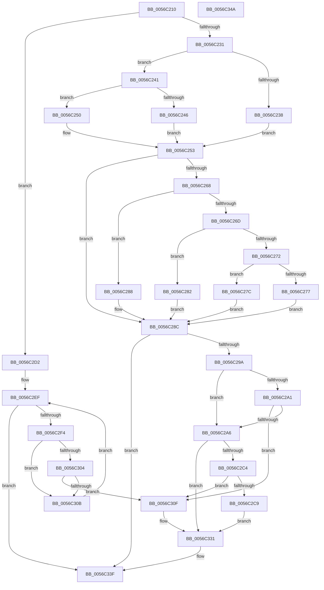

# Amd64DisableMonitoring

- RVA: `0x0056C210`–`0x0056C34B` (길이 `315` bytes)
- VA: `0x000000014056C210`
- 실행 섹션: `.text`
- PDB 이름 있음: `예`; PDB Function 태그: `아니요`
- unwind 정보 RVA: `0x0006E5F8`
- 디코드: `95`개 명령, `315/315` bytes 표시
- 미해석 바이트: `0` (있으면 어셈블리에 `.byte`로 보존)

> 이 문서는 커널 이미지의 기계어와 PDB 기호를 분석해 생성했습니다. 4번과 5번은 함수 원형과 자료형을 바이너리 사용 방식에서 추정한 C 해석이며 원본 소스 복구 결과는 아닙니다.

## 1. Dependencies

- 직접 호출 지점: **2**; 고유 호출 대상: **2**
- 직접 호출자로 확인된 함수: **0**
- RIP 상대 이미지 참조: **1**

### Outgoing calls
- `0x0056C323` → [Amd64ConfigureCounter](Amd64ConfigureCounter_function_0056BE58.md) (function, `0x0056BE58`)
- `0x0056C32C` → [Amd64FreeCounter](Amd64FreeCounter_function_0056C524.md) (function, `0x0056C524`)

### Direct callers
- 이 함수 시작 RVA로 연결되는 직접 call은 확인되지 않았습니다. 간접 호출은 완전히 역산할 수 없습니다.

### Static image references
- `0x0056C253` → RVA `0x00FC8C40` (`ALMOSTRO`; read)

## 2. Other-region calls and transfers

- 다른 실행 섹션으로 향하는 call: **0**
- 별도 외부 분기/꼬리 이동을 확인하지 못했습니다.

## 3. Assembly (complete function range)

```asm
0056C210  48 89 5C 24 08                  mov qword ptr [rsp + 8], rbx
0056C215  57                              push rdi
0056C216  48 83 EC 30                     sub rsp, 0x30
0056C21A  65 8B 04 25 A4 01 00 00         mov eax, dword ptr gs:[0x1a4]
0056C222  45 33 D2                        xor r10d, r10d
0056C225  44 8B C9                        mov r9d, ecx
0056C228  48 85 D2                        test rdx, rdx
0056C22B  0F 84 A1 00 00 00               je 0x14056c2d2
0056C231  8B 1A                           mov ebx, dword ptr [rdx]
0056C233  83 FB 0A                        cmp ebx, 0xa
0056C236  72 09                           jb 0x14056c241
0056C238  83 C3 F6                        add ebx, -0xa
0056C23B  41 8D 7A 65                     lea edi, [r10 + 0x65]
0056C23F  EB 12                           jmp 0x14056c253
0056C241  83 FB 06                        cmp ebx, 6
0056C244  72 0A                           jb 0x14056c250
0056C246  83 C3 FA                        add ebx, -6
0056C249  BF 64 00 00 00                  mov edi, 0x64
0056C24E  EB 03                           jmp 0x14056c253
0056C250  41 8B FA                        mov edi, r10d
0056C253  48 8D 0D E6 C9 A5 00            lea rcx, [rip + 0xa5c9e6]
0056C25A  8B D7                           mov edx, edi
0056C25C  48 8B 04 C1                     mov rax, qword ptr [rcx + rax*8]
0056C260  48 8B 48 58                     mov rcx, qword ptr [rax + 0x58]
0056C264  85 FF                           test edi, edi
0056C266  74 24                           je 0x14056c28c
0056C268  83 EA 01                        sub edx, 1
0056C26B  74 1B                           je 0x14056c288
0056C26D  83 EA 63                        sub edx, 0x63
0056C270  74 10                           je 0x14056c282
0056C272  83 FA 01                        cmp edx, 1
0056C275  74 05                           je 0x14056c27c
0056C277  49 8B CA                        mov rcx, r10
0056C27A  EB 10                           jmp 0x14056c28c
0056C27C  48 83 C1 48                     add rcx, 0x48
0056C280  EB 0A                           jmp 0x14056c28c
0056C282  48 83 C1 30                     add rcx, 0x30
0056C286  EB 04                           jmp 0x14056c28c
0056C288  48 83 C1 18                     add rcx, 0x18
0056C28C  48 8B 51 10                     mov rdx, qword ptr [rcx + 0x10]
0056C290  41 83 F9 20                     cmp r9d, 0x20
0056C294  0F 84 A5 00 00 00               je 0x14056c33f
0056C29A  8B 01                           mov eax, dword ptr [rcx]
0056C29C  83 F8 64                        cmp eax, 0x64
0056C29F  74 05                           je 0x14056c2a6
0056C2A1  83 F8 65                        cmp eax, 0x65
0056C2A4  75 69                           jne 0x14056c30f
0056C2A6  8B C3                           mov eax, ebx
0056C2A8  48 8D 0C 40                     lea rcx, [rax + rax*2]
0056C2AC  48 03 C9                        add rcx, rcx
0056C2AF  48 8B 44 CA 10                  mov rax, qword ptr [rdx + rcx*8 + 0x10]
0056C2B4  48 83 C9 FF                     or rcx, 0xffffffffffffffff
0056C2B8  F0 48 0F C1 48 10               lock xadd qword ptr [rax + 0x10], rcx
0056C2BE  48 83 E9 01                     sub rcx, 1
0056C2C2  7F 6D                           jg 0x14056c331
0056C2C4  48 85 C9                        test rcx, rcx
0056C2C7  74 46                           je 0x14056c30f
0056C2C9  B9 0E 00 00 00                  mov ecx, 0xe
0056C2CE  CD 29                           int 0x29
0056C2D0  EB 5F                           jmp 0x14056c331
0056C2D2  48 8D 0D 67 C9 A5 00            lea rcx, [rip + 0xa5c967]
0056C2D9  41 8B FA                        mov edi, r10d
0056C2DC  48 8B 04 C1                     mov rax, qword ptr [rcx + rax*8]
0056C2E0  41 8B DA                        mov ebx, r10d
0056C2E3  48 8B 48 58                     mov rcx, qword ptr [rax + 0x58]
0056C2E7  48 8B 51 10                     mov rdx, qword ptr [rcx + 0x10]
0056C2EB  44 8B 41 04                     mov r8d, dword ptr [rcx + 4]
0056C2EF  41 3B D8                        cmp ebx, r8d
0056C2F2  73 4B                           jae 0x14056c33f
0056C2F4  8B C3                           mov eax, ebx
0056C2F6  48 8D 0C 40                     lea rcx, [rax + rax*2]
0056C2FA  48 03 C9                        add rcx, rcx
0056C2FD  44 39 54 CA 18                  cmp dword ptr [rdx + rcx*8 + 0x18], r10d
0056C302  75 07                           jne 0x14056c30b
0056C304  44 39 4C CA 24                  cmp dword ptr [rdx + rcx*8 + 0x24], r9d
0056C309  74 04                           je 0x14056c30f
0056C30B  FF C3                           inc ebx
0056C30D  EB E0                           jmp 0x14056c2ef
0056C30F  44 88 54 24 28                  mov byte ptr [rsp + 0x28], r10b
0056C314  45 33 C9                        xor r9d, r9d
0056C317  45 33 C0                        xor r8d, r8d
0056C31A  4C 89 54 24 20                  mov qword ptr [rsp + 0x20], r10
0056C31F  8B D7                           mov edx, edi
0056C321  8B CB                           mov ecx, ebx
0056C323  E8 30 FB FF FF                  call 0x14056be58
0056C328  8B D7                           mov edx, edi
0056C32A  8B CB                           mov ecx, ebx
0056C32C  E8 F3 01 00 00                  call 0x14056c524
0056C331  65 48 8B 04 25 20 00 00 00      mov rax, qword ptr gs:[0x20]
0056C33A  F0 83 40 60 FE                  lock add dword ptr [rax + 0x60], -2
0056C33F  48 8B 5C 24 40                  mov rbx, qword ptr [rsp + 0x40]
0056C344  48 83 C4 30                     add rsp, 0x30
0056C348  5F                              pop rdi
0056C349  C3                              ret
0056C34A  CC                              int3
```

## 4. C-style interpretation (structured pseudocode)

```c
__int64 __fastcall Amd64DisableMonitoring(int a1, __int64 a2)
{
    __int64 result;
    __int64 v_r10;
    __int64 v_rbx;
    __int64 v_rsp;
    unsigned __int8 v_stack_m10;
    unsigned __int64 v_stack_m18;
    unsigned __int64 v_stack_p8;

    v_stack_p8 = v_rbx;
    v_rsp = (v_rsp) - (48);
    v_r10 = 0;
    if (a2 == 0) goto loc_0056C2D2;
    if (((unsigned int)((unsigned int)(*(unsigned int *)(a2)))) < 10) goto loc_0056C241;
    v_rbx = (unsigned int)(((unsigned int)(*(unsigned int *)(a2))) + (-10));
    goto loc_0056C253;
loc_0056C241:
    if (((unsigned int)(v_rbx)) < 6) goto loc_0056C250;
    v_rbx = (unsigned int)((v_rbx) + (-6));
    goto loc_0056C253;
loc_0056C250:
loc_0056C253:
    if (0 == 0) goto loc_0056C28C;
    a2 = (unsigned int)((0) - (1));
    if (condition_is_equal) goto loc_0056C288;
    a2 = (unsigned int)((a2) - (99));
    if (condition_is_equal) goto loc_0056C282;
    if (((unsigned int)(a2)) == 1) goto loc_0056C27C;
    goto loc_0056C28C;
loc_0056C27C:
    a1 = (0) + (72);
    goto loc_0056C28C;
loc_0056C282:
    a1 = (a1) + (48);
    goto loc_0056C28C;
loc_0056C288:
    a1 = (a1) + (24);
loc_0056C28C:
    if (((unsigned int)((unsigned int)(a1))) == 32) goto loc_0056C33F;
    if (((unsigned int)((unsigned int)(*(unsigned int *)(a1)))) == 100) goto loc_0056C2A6;
    if (((unsigned int)((unsigned int)(*(unsigned int *)(a1)))) != 101) goto loc_0056C30F;
loc_0056C2A6:
    a1 = ((unsigned int)((unsigned int)(v_rbx)) + (unsigned int)((unsigned int)(v_rbx)) * 2) + ((unsigned int)((unsigned int)(v_rbx)) + (unsigned int)((unsigned int)(v_rbx)) * 2);
    a1 = (a1) | (-1);
    a1 = (a1) - (1);
    if (condition_is_greater) goto loc_0056C331;
    if (a1 == 0) goto loc_0056C30F;
    goto loc_0056C331;
loc_0056C2D2:
loc_0056C2EF:
    if (0 >= ((unsigned int)((unsigned int)(*(unsigned int *)(*(unsigned __int64 *)(*(unsigned __int64 *)(v_rip + 10864999 + *(unsigned __int64 *)(*(unsigned __int64 *)(a1 + 16) + a1 * 8 + 16) * 8) + 88) + 4))))) goto loc_0056C33F;
    a1 = (0 + 0 * 2) + (0 + 0 * 2);
    if ((*(unsigned int *)(*(unsigned __int64 *)(*(unsigned __int64 *)(*(unsigned __int64 *)(v_rip + 10864999 + *(unsigned __int64 *)(*(unsigned __int64 *)(a1 + 16) + a1 * 8 + 16) * 8) + 88) + 16) + a1 * 8 + 24)) != 0) goto loc_0056C30B;
    if ((*(unsigned int *)(*(unsigned __int64 *)(*(unsigned __int64 *)(*(unsigned __int64 *)(v_rip + 10864999 + *(unsigned __int64 *)(*(unsigned __int64 *)(a1 + 16) + a1 * 8 + 16) * 8) + 88) + 16) + a1 * 8 + 36)) == ((unsigned int)((unsigned int)(a1)))) goto loc_0056C30F;
loc_0056C30B:
    v_rbx = (unsigned int)((0) + 1);
    goto loc_0056C2EF;
loc_0056C30F:
    v_stack_m10 = 0;
    a4 = 0;
    a3 = 0;
    v_stack_m18 = 0;
    result = Amd64ConfigureCounter((unsigned int)((unsigned int)(v_rbx)), 0, a3, a4);
    result = Amd64FreeCounter((unsigned int)((unsigned int)(v_rbx)), 0, a3, a4);
loc_0056C331:
loc_0056C33F:
    v_rsp = (v_rsp) + (48);
    return *(unsigned __int64 *)(gs_base + (0 + 32));
}
```

## 5. (Beta) C Style

```c
int64_t Amd64DisableMonitoring(int32_t Arg1, int64_t Arg2)
{
    int64_t result;
    int64_t local_r10;
    int64_t local_rbx;
    int64_t local_rsp;
    uint8_t v_stack_m10;
    uint64_t v_stack_m18;
    uint64_t v_stack_p8;

    v_stack_p8 = local_rbx;
    local_rsp = (local_rsp) - (48);
    local_r10 = 0;
    if (Arg2 == 0) goto loc_0056C2D2;
    if (((uint32_t)((uint32_t)(*(uint32_t *)(Arg2)))) < 10) goto loc_0056C241;
    local_rbx = (uint32_t)(((uint32_t)(*(uint32_t *)(Arg2))) + (-10));
    goto loc_0056C253;
loc_0056C241:
    if (((uint32_t)(local_rbx)) < 6) goto loc_0056C250;
    local_rbx = (uint32_t)((local_rbx) + (-6));
    goto loc_0056C253;
loc_0056C250:
loc_0056C253:
    if (0 == 0) goto loc_0056C28C;
    Arg2 = (uint32_t)((0) - (1));
    if (condition_is_equal) goto loc_0056C288;
    Arg2 = (uint32_t)((Arg2) - (99));
    if (condition_is_equal) goto loc_0056C282;
    if (((uint32_t)(Arg2)) == 1) goto loc_0056C27C;
    goto loc_0056C28C;
loc_0056C27C:
    Arg1 = (0) + (72);
    goto loc_0056C28C;
loc_0056C282:
    Arg1 = (Arg1) + (48);
    goto loc_0056C28C;
loc_0056C288:
    Arg1 = (Arg1) + (24);
loc_0056C28C:
    if (((uint32_t)((uint32_t)(Arg1))) == 32) goto loc_0056C33F;
    if (((uint32_t)((uint32_t)(*(uint32_t *)(Arg1)))) == 100) goto loc_0056C2A6;
    if (((uint32_t)((uint32_t)(*(uint32_t *)(Arg1)))) != 101) goto loc_0056C30F;
loc_0056C2A6:
    Arg1 = ((uint32_t)((uint32_t)(local_rbx)) + (uint32_t)((uint32_t)(local_rbx)) * 2) + ((uint32_t)((uint32_t)(local_rbx)) + (uint32_t)((uint32_t)(local_rbx)) * 2);
    Arg1 = (Arg1) | (-1);
    Arg1 = (Arg1) - (1);
    if (condition_is_greater) goto loc_0056C331;
    if (Arg1 == 0) goto loc_0056C30F;
    goto loc_0056C331;
loc_0056C2D2:
loc_0056C2EF:
    if (0 >= ((uint32_t)((uint32_t)(*(uint32_t *)(*(uint64_t *)(*(uint64_t *)(v_rip + 0xA5C967 + *(uint64_t *)(*(uint64_t *)(Arg1 + 0x10) + Arg1 * 8 + 0x10) * 8) + 0x58) + 0x4))))) goto loc_0056C33F;
    Arg1 = (0 + 0 * 2) + (0 + 0 * 2);
    if ((*(uint32_t *)(*(uint64_t *)(*(uint64_t *)(*(uint64_t *)(v_rip + 0xA5C967 + *(uint64_t *)(*(uint64_t *)(Arg1 + 0x10) + Arg1 * 8 + 0x10) * 8) + 0x58) + 0x10) + Arg1 * 8 + 0x18)) != 0) goto loc_0056C30B;
    if ((*(uint32_t *)(*(uint64_t *)(*(uint64_t *)(*(uint64_t *)(v_rip + 0xA5C967 + *(uint64_t *)(*(uint64_t *)(Arg1 + 0x10) + Arg1 * 8 + 0x10) * 8) + 0x58) + 0x10) + Arg1 * 8 + 0x24)) == ((uint32_t)((uint32_t)(Arg1)))) goto loc_0056C30F;
loc_0056C30B:
    local_rbx = (uint32_t)((0) + 1);
    goto loc_0056C2EF;
loc_0056C30F:
    v_stack_m10 = 0;
    a4 = 0;
    a3 = 0;
    v_stack_m18 = 0;
    result = Amd64ConfigureCounter((uint32_t)((uint32_t)(local_rbx)), 0, a3, a4);
    result = Amd64FreeCounter((uint32_t)((uint32_t)(local_rbx)), 0, a3, a4);
loc_0056C331:
loc_0056C33F:
    local_rsp = (local_rsp) + (48);
    return *(uint64_t *)(gs_base + (0 + 0x20));
}
```

## 6. Execution-region graph

[열기: 2D/3D 그래프와 함수 탐색 컨트롤 패널](../../../control-panel.html?section=text&rva=0x0056C210&view=graph)

- 2D 그래프는 위에서 아래로 흐르고, 3D 그래프는 빈 공간을 드래그해 회전합니다. Shift+드래그는 이동, 휠은 확대·축소, 함수 노드 선택은 대상 보고서 이동입니다.

### Static fallback


