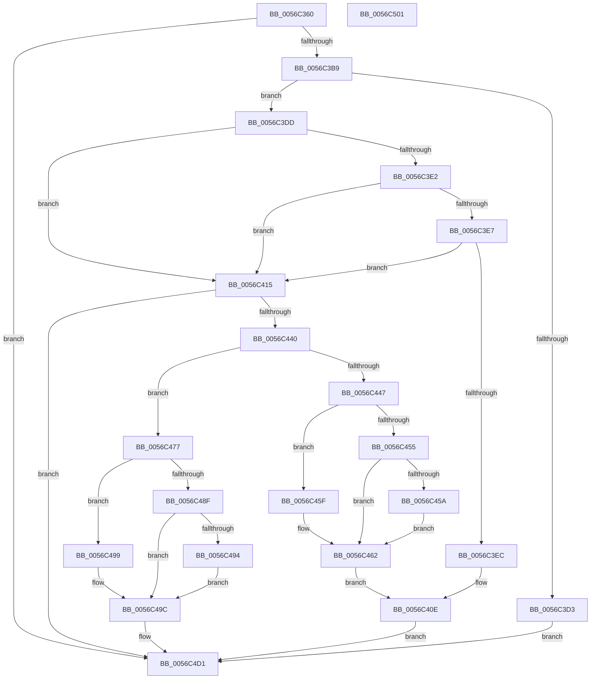

# Amd64EnableMonitoring

- RVA: `0x0056C360`–`0x0056C502` (길이 `418` bytes)
- VA: `0x000000014056C360`
- 실행 섹션: `.text`
- PDB 이름 있음: `예`; PDB Function 태그: `아니요`
- unwind 정보 RVA: `0x0008A668`
- 디코드: `114`개 명령, `418/418` bytes 표시
- 미해석 바이트: `0` (있으면 어셈블리에 `.byte`로 보존)

> 이 문서는 커널 이미지의 기계어와 PDB 기호를 분석해 생성했습니다. 4번과 5번은 함수 원형과 자료형을 바이너리 사용 방식에서 추정한 C 해석이며 원본 소스 복구 결과는 아닙니다.

## 1. Dependencies

- 직접 호출 지점: **6**; 고유 호출 대상: **6**
- 직접 호출자로 확인된 함수: **0**
- RIP 상대 이미지 참조: **1**

### Outgoing calls
- `0x0056C39B` → [HalpAcquireHighLevelLock](../2D/HalpAcquireHighLevelLock_function_002D2390.md) (function, `0x002D2390`)
- `0x0056C3AA` → [HalpGetProfileDescriptor](../4B/HalpGetProfileDescriptor_function_004BB170.md) (function, `0x004BB170`)
- `0x0056C3CA` → [KeCheckProcessorAffinityEx](../30/KeCheckProcessorAffinityEx_function_00305150.md) (function, `0x00305150`)
- `0x0056C431` → [Amd64AllocateCounter](Amd64AllocateCounter_function_0056B92C.md) (function, `0x0056B92C`)
- `0x0056C4CC` → [Amd64ConfigureCounter](Amd64ConfigureCounter_function_0056BE58.md) (function, `0x0056BE58`)
- `0x0056C4DB` → [HalpReleaseHighLevelLock](../2D/HalpReleaseHighLevelLock_function_002D1C58.md) (function, `0x002D1C58`)

### Direct callers
- 이 함수 시작 RVA로 연결되는 직접 call은 확인되지 않았습니다. 간접 호출은 완전히 역산할 수 없습니다.

### Static image references
- `0x0056C388` → RVA `0x00FC2BD0` (`.data`; read)

## 2. Other-region calls and transfers

- 다른 실행 섹션으로 향하는 call: **0**
- 별도 외부 분기/꼬리 이동을 확인하지 못했습니다.

## 3. Assembly (complete function range)

```asm
0056C360  48 8B C4                        mov rax, rsp
0056C363  48 89 58 08                     mov qword ptr [rax + 8], rbx
0056C367  48 89 68 10                     mov qword ptr [rax + 0x10], rbp
0056C36B  48 89 70 18                     mov qword ptr [rax + 0x18], rsi
0056C36F  48 89 78 20                     mov qword ptr [rax + 0x20], rdi
0056C373  41 54                           push r12
0056C375  41 56                           push r14
0056C377  41 57                           push r15
0056C379  48 83 EC 40                     sub rsp, 0x40
0056C37D  83 60 DC 00                     and dword ptr [rax - 0x24], 0
0056C381  8B E9                           mov ebp, ecx
0056C383  48 83 60 E0 00                  and qword ptr [rax - 0x20], 0
0056C388  48 8D 0D 41 68 A5 00            lea rcx, [rip + 0xa56841]
0056C38F  4D 8B F1                        mov r14, r9
0056C392  C6 40 D8 00                     mov byte ptr [rax - 0x28], 0
0056C396  4D 8B F8                        mov r15, r8
0056C399  8B DA                           mov ebx, edx
0056C39B  E8 F0 5F D6 FF                  call 0x1402d2390
0056C3A0  4C 8D 44 24 38                  lea r8, [rsp + 0x38]
0056C3A5  8B CB                           mov ecx, ebx
0056C3A7  44 8A E0                        mov r12b, al
0056C3AA  E8 C1 ED F4 FF                  call 0x1404bb170
0056C3AF  8B D8                           mov ebx, eax
0056C3B1  85 C0                           test eax, eax
0056C3B3  0F 88 18 01 00 00               js 0x14056c4d1
0056C3B9  65 8B 14 25 A4 01 00 00         mov edx, dword ptr gs:[0x1a4]
0056C3C1  48 8B 7C 24 38                  mov rdi, qword ptr [rsp + 0x38]
0056C3C6  48 8D 4F 20                     lea rcx, [rdi + 0x20]
0056C3CA  E8 81 8D D9 FF                  call 0x140305150
0056C3CF  85 C0                           test eax, eax
0056C3D1  75 0A                           jne 0x14056c3dd
0056C3D3  BB BB 00 00 C0                  mov ebx, 0xc00000bb
0056C3D8  E9 F4 00 00 00                  jmp 0x14056c4d1
0056C3DD  48 85 FF                        test rdi, rdi
0056C3E0  74 33                           je 0x14056c415
0056C3E2  83 3F 20                        cmp dword ptr [rdi], 0x20
0056C3E5  75 2E                           jne 0x14056c415
0056C3E7  83 FD 01                        cmp ebp, 1
0056C3EA  75 29                           jne 0x14056c415
0056C3EC  41 83 0E FF                     or dword ptr [r14], 0xffffffff
0056C3F0  8D 4D 01                        lea ecx, [rbp + 1]
0056C3F3  48 8B 84 24 88 00 00 00         mov rax, qword ptr [rsp + 0x88]
0056C3FB  89 08                           mov dword ptr [rax], ecx
0056C3FD  48 8B 84 24 80 00 00 00         mov rax, qword ptr [rsp + 0x80]
0056C405  C7 00 E9 00 00 C0               mov dword ptr [rax], 0xc00000e9
0056C40B  41 89 0F                        mov dword ptr [r15], ecx
0056C40E  33 DB                           xor ebx, ebx
0056C410  E9 BC 00 00 00                  jmp 0x14056c4d1
0056C415  48 8B B4 24 88 00 00 00         mov rsi, qword ptr [rsp + 0x88]
0056C41D  4C 8D 4C 24 30                  lea r9, [rsp + 0x30]
0056C422  4C 8D 44 24 34                  lea r8, [rsp + 0x34]
0056C427  48 89 74 24 20                  mov qword ptr [rsp + 0x20], rsi
0056C42C  48 8B D7                        mov rdx, rdi
0056C42F  8B CD                           mov ecx, ebp
0056C431  E8 F6 F4 FF FF                  call 0x14056b92c
0056C436  8B D8                           mov ebx, eax
0056C438  85 C0                           test eax, eax
0056C43A  0F 88 91 00 00 00               js 0x14056c4d1
0056C440  80 7C 24 30 00                  cmp byte ptr [rsp + 0x30], 0
0056C445  74 30                           je 0x14056c477
0056C447  8B 4C 24 34                     mov ecx, dword ptr [rsp + 0x34]
0056C44B  41 89 0E                        mov dword ptr [r14], ecx
0056C44E  8B 16                           mov edx, dword ptr [rsi]
0056C450  83 EA 64                        sub edx, 0x64
0056C453  74 0A                           je 0x14056c45f
0056C455  83 FA 01                        cmp edx, 1
0056C458  75 08                           jne 0x14056c462
0056C45A  83 C1 0A                        add ecx, 0xa
0056C45D  EB 03                           jmp 0x14056c462
0056C45F  83 C1 06                        add ecx, 6
0056C462  48 8B 84 24 80 00 00 00         mov rax, qword ptr [rsp + 0x80]
0056C46A  89 08                           mov dword ptr [rax], ecx
0056C46C  8B 87 3C 01 00 00               mov eax, dword ptr [rdi + 0x13c]
0056C472  41 89 07                        mov dword ptr [r15], eax
0056C475  EB 97                           jmp 0x14056c40e
0056C477  44 8B 54 24 34                  mov r10d, dword ptr [rsp + 0x34]
0056C47C  85 ED                           test ebp, ebp
0056C47E  45 89 16                        mov dword ptr [r14], r10d
0056C481  41 8B CA                        mov ecx, r10d
0056C484  8B 16                           mov edx, dword ptr [rsi]
0056C486  41 0F 94 C0                     sete r8b
0056C48A  83 EA 64                        sub edx, 0x64
0056C48D  74 0A                           je 0x14056c499
0056C48F  83 FA 01                        cmp edx, 1
0056C492  75 08                           jne 0x14056c49c
0056C494  83 C1 0A                        add ecx, 0xa
0056C497  EB 03                           jmp 0x14056c49c
0056C499  83 C1 06                        add ecx, 6
0056C49C  48 8B 84 24 80 00 00 00         mov rax, qword ptr [rsp + 0x80]
0056C4A4  44 88 44 24 28                  mov byte ptr [rsp + 0x28], r8b
0056C4A9  41 B0 01                        mov r8b, 1
0056C4AC  89 08                           mov dword ptr [rax], ecx
0056C4AE  41 8B CA                        mov ecx, r10d
0056C4B1  8B 87 3C 01 00 00               mov eax, dword ptr [rdi + 0x13c]
0056C4B7  41 89 07                        mov dword ptr [r15], eax
0056C4BA  48 8B 87 30 01 00 00            mov rax, qword ptr [rdi + 0x130]
0056C4C1  44 8B 4F 18                     mov r9d, dword ptr [rdi + 0x18]
0056C4C5  8B 16                           mov edx, dword ptr [rsi]
0056C4C7  48 89 44 24 20                  mov qword ptr [rsp + 0x20], rax
0056C4CC  E8 87 F9 FF FF                  call 0x14056be58
0056C4D1  41 8A D4                        mov dl, r12b
0056C4D4  48 8D 0D F5 66 A5 00            lea rcx, [rip + 0xa566f5]
0056C4DB  E8 78 57 D6 FF                  call 0x1402d1c58
0056C4E0  48 8B 6C 24 68                  mov rbp, qword ptr [rsp + 0x68]
0056C4E5  8B C3                           mov eax, ebx
0056C4E7  48 8B 5C 24 60                  mov rbx, qword ptr [rsp + 0x60]
0056C4EC  48 8B 74 24 70                  mov rsi, qword ptr [rsp + 0x70]
0056C4F1  48 8B 7C 24 78                  mov rdi, qword ptr [rsp + 0x78]
0056C4F6  48 83 C4 40                     add rsp, 0x40
0056C4FA  41 5F                           pop r15
0056C4FC  41 5E                           pop r14
0056C4FE  41 5C                           pop r12
0056C500  C3                              ret
0056C501  CC                              int3
```

## 4. C-style interpretation (structured pseudocode)

```c
__int64 __fastcall Amd64EnableMonitoring(int a1, int a2, __int64 a3, __int64 a4, __int64 a5, __int64 a6)
{
    __int64 result;
    __int64 v_rbx;
    __int64 v_rsp;
    unsigned __int64 v_stack_m20;
    unsigned __int64 v_stack_m24;
    unsigned __int64 v_stack_m28;
    unsigned __int8 v_stack_m30;
    unsigned __int64 v_stack_m38;
    unsigned __int64 v_stack_p10;
    unsigned __int64 v_stack_p18;
    unsigned __int64 v_stack_p20;
    unsigned __int64 v_stack_p8;

    *(unsigned __int64 *)(v_rsp + 8) = v_rbx;
    *(unsigned __int64 *)(v_rsp + 16) = v_rbp;
    *(unsigned __int64 *)(v_rsp + 24) = v_rsi;
    *(unsigned __int64 *)(v_rsp + 32) = v_rdi;
    v_rsp = (v_rsp) - (64);
    *(unsigned __int8 *)(v_rsp - 40) = 0;
    result = HalpAcquireHighLevelLock(v_rip + 10840129, a2, a3, a4);
    result = HalpGetProfileDescriptor((unsigned int)((unsigned int)((unsigned int)(a2))), a2, v_stack_m20, a4);
    if (sign_flag) goto loc_0056C4D1;
    result = KeCheckProcessorAffinityEx(v_stack_m20 + 32, (unsigned int)(*(unsigned int *)(gs_base + (0 + 420))), v_stack_m20, a4);
    if ((unsigned int)(result) != 0) goto loc_0056C3DD;
    goto loc_0056C4D1;
loc_0056C3DD:
    if (v_stack_m20 == 0) goto loc_0056C415;
    if ((*(unsigned int *)(v_stack_m20)) != 32) goto loc_0056C415;
    if (((unsigned int)((unsigned int)(a1))) != 1) goto loc_0056C415;
    *(unsigned int *)(a6) = (unsigned int)((unsigned int)(a1) + 1);
    *(unsigned int *)(a5) = 0xC00000E9ULL;
    *(unsigned int *)(a3) = (unsigned int)((unsigned int)(a1) + 1);
loc_0056C40E:
    v_rbx = 0;
    goto loc_0056C4D1;
loc_0056C415:
    v_stack_m38 = a6;
    result = Amd64AllocateCounter((unsigned int)((unsigned int)((unsigned int)(a1))), v_stack_m20, v_stack_m24, v_stack_m28);
    if (sign_flag) goto loc_0056C4D1;
    if (v_stack_m28 == 0) goto loc_0056C477;
    *(unsigned int *)(a4) = (unsigned int)((unsigned int)(v_stack_m24));
    a2 = (unsigned int)(((unsigned int)(*(unsigned int *)(a6))) - (100));
    if (condition_is_equal) goto loc_0056C45F;
    if (a2 != 1) goto loc_0056C462;
    a1 = (unsigned int)(((unsigned int)(v_stack_m24)) + (10));
    goto loc_0056C462;
loc_0056C45F:
    a1 = (unsigned int)((a1) + (6));
loc_0056C462:
    *(unsigned int *)(a5) = a1;
    *(unsigned int *)(a3) = (unsigned int)((unsigned int)(*(unsigned int *)(v_stack_m20 + 316)));
    goto loc_0056C40E;
loc_0056C477:
    *(unsigned int *)(a4) = (unsigned int)((unsigned int)(v_stack_m24));
    a3 = ((unsigned int)((unsigned int)(a1)) == 0) ? 1 : 0;
    a2 = (unsigned int)(((unsigned int)(*(unsigned int *)(a6))) - (100));
    if (condition_is_equal) goto loc_0056C499;
    if (a2 != 1) goto loc_0056C49C;
    a1 = (unsigned int)(((unsigned int)((unsigned int)((unsigned int)(v_stack_m24)))) + (10));
    goto loc_0056C49C;
loc_0056C499:
    a1 = (unsigned int)((a1) + (6));
loc_0056C49C:
    v_stack_m30 = (unsigned __int8)(a3);
    *(unsigned int *)(a5) = a1;
    *(unsigned int *)(a3) = (unsigned int)((unsigned int)(*(unsigned int *)(v_stack_m20 + 316)));
    v_stack_m38 = *(unsigned __int64 *)(v_stack_m20 + 304);
    result = Amd64ConfigureCounter((unsigned int)((unsigned int)((unsigned int)(v_stack_m24))), (unsigned int)(*(unsigned int *)(a6)), 1, (unsigned int)(*(unsigned int *)(v_stack_m20 + 24)));
loc_0056C4D1:
    result = HalpReleaseHighLevelLock(v_rip + 10839797, (unsigned __int8)((unsigned __int8)(result)), 1, (unsigned int)(*(unsigned int *)(v_stack_m20 + 24)));
    v_rsp = (v_rsp) + (64);
    return (unsigned int)((unsigned int)((unsigned int)((unsigned int)(result))));
}
```

## 5. (Beta) C Style

```c
int64_t Amd64EnableMonitoring(int32_t Arg1, int32_t Arg2, void *Arg3, void *Arg4, void *Arg5, void *Arg6)
{
    uint8_t *arg3 = (uint8_t *)Arg3;
    uint8_t *arg4 = (uint8_t *)Arg4;
    uint8_t *arg5 = (uint8_t *)Arg5;
    uint8_t *arg6 = (uint8_t *)Arg6;

    int64_t result;
    int64_t local_rbx;
    int64_t local_rsp;
    uint64_t v_stack_m20;
    uint64_t v_stack_m24;
    uint64_t v_stack_m28;
    uint8_t v_stack_m30;
    uint64_t v_stack_m38;
    uint64_t v_stack_p10;
    uint64_t v_stack_p18;
    uint64_t v_stack_p20;
    uint64_t v_stack_p8;

    *(uint64_t *)(local_rsp + 0x8) = local_rbx;
    *(uint64_t *)(local_rsp + 0x10) = local_rbp;
    *(uint64_t *)(local_rsp + 0x18) = local_rsi;
    *(uint64_t *)(local_rsp + 0x20) = local_rdi;
    local_rsp = (local_rsp) - (64);
    *(uint8_t *)(local_rsp - 0x28) = 0;
    result = HalpAcquireHighLevelLock(v_rip + 10840129, Arg2, Arg3, Arg4);
    result = HalpGetProfileDescriptor((uint32_t)((uint32_t)((uint32_t)(Arg2))), Arg2, v_stack_m20, Arg4);
    if (sign_flag) goto loc_0056C4D1;
    result = KeCheckProcessorAffinityEx(v_stack_m20 + 32, (uint32_t)(*(uint32_t *)(gs_base + (0 + 0x1A4))), v_stack_m20, Arg4);
    if ((uint32_t)(result) != 0) goto loc_0056C3DD;
    goto loc_0056C4D1;
loc_0056C3DD:
    if (v_stack_m20 == 0) goto loc_0056C415;
    if ((*(uint32_t *)(v_stack_m20)) != 32) goto loc_0056C415;
    if (((uint32_t)((uint32_t)(Arg1))) != 1) goto loc_0056C415;
    *(uint32_t *)(arg6) = (uint32_t)((uint32_t)(Arg1) + 1);
    *(uint32_t *)(arg5) = 0xC00000E9ULL;
    *(uint32_t *)(arg3) = (uint32_t)((uint32_t)(Arg1) + 1);
loc_0056C40E:
    local_rbx = 0;
    goto loc_0056C4D1;
loc_0056C415:
    v_stack_m38 = Arg6;
    result = Amd64AllocateCounter((uint32_t)((uint32_t)((uint32_t)(Arg1))), v_stack_m20, v_stack_m24, v_stack_m28);
    if (sign_flag) goto loc_0056C4D1;
    if (v_stack_m28 == 0) goto loc_0056C477;
    *(uint32_t *)(arg4) = (uint32_t)((uint32_t)(v_stack_m24));
    Arg2 = (uint32_t)(((uint32_t)(*(uint32_t *)(arg6))) - (100));
    if (condition_is_equal) goto loc_0056C45F;
    if (Arg2 != 1) goto loc_0056C462;
    Arg1 = (uint32_t)(((uint32_t)(v_stack_m24)) + (10));
    goto loc_0056C462;
loc_0056C45F:
    Arg1 = (uint32_t)((Arg1) + (6));
loc_0056C462:
    *(uint32_t *)(arg5) = Arg1;
    *(uint32_t *)(arg3) = (uint32_t)((uint32_t)(*(uint32_t *)(v_stack_m20 + 0x13C)));
    goto loc_0056C40E;
loc_0056C477:
    *(uint32_t *)(arg4) = (uint32_t)((uint32_t)(v_stack_m24));
    Arg3 = ((uint32_t)((uint32_t)(Arg1)) == 0) ? 1 : 0;
    Arg2 = (uint32_t)(((uint32_t)(*(uint32_t *)(arg6))) - (100));
    if (condition_is_equal) goto loc_0056C499;
    if (Arg2 != 1) goto loc_0056C49C;
    Arg1 = (uint32_t)(((uint32_t)((uint32_t)((uint32_t)(v_stack_m24)))) + (10));
    goto loc_0056C49C;
loc_0056C499:
    Arg1 = (uint32_t)((Arg1) + (6));
loc_0056C49C:
    v_stack_m30 = (uint8_t)(Arg3);
    *(uint32_t *)(arg5) = Arg1;
    *(uint32_t *)(arg3) = (uint32_t)((uint32_t)(*(uint32_t *)(v_stack_m20 + 0x13C)));
    v_stack_m38 = *(uint64_t *)(v_stack_m20 + 0x130);
    result = Amd64ConfigureCounter((uint32_t)((uint32_t)((uint32_t)(v_stack_m24))), (uint32_t)(*(uint32_t *)(arg6)), 1, (uint32_t)(*(uint32_t *)(v_stack_m20 + 0x18)));
loc_0056C4D1:
    result = HalpReleaseHighLevelLock(v_rip + 10839797, (uint8_t)((uint8_t)(result)), 1, (uint32_t)(*(uint32_t *)(v_stack_m20 + 0x18)));
    local_rsp = (local_rsp) + (64);
    return (uint32_t)((uint32_t)((uint32_t)((uint32_t)(result))));
}
```

### 관측된 메모리 오프셋

구조체 형식이 확인되지 않은 접근은 인자 기준의 오프셋으로만 기록했습니다.

| 기준 인자 | 오프셋 표현 | 폭 (bit) | 접근 |
|---|---:|---:|---|
| `Arg3` | `+ 0x0` | `32` | `W` |
| `Arg4` | `+ 0x0` | `32` | `R/W` |
| `Arg4` | `+ 0x0` | `32` | `W` |
| `Arg5` | `+ 0x0` | `32` | `W` |
| `Arg6` | `+ 0x0` | `32` | `R` |
| `Arg6` | `+ 0x0` | `32` | `W` |

## 6. Execution-region graph

[열기: 2D/3D 그래프와 함수 탐색 컨트롤 패널](../../../control-panel.html?section=text&rva=0x0056C360&view=graph)

- 2D 그래프는 위에서 아래로 흐르고, 3D 그래프는 빈 공간을 드래그해 회전합니다. Shift+드래그는 이동, 휠은 확대·축소, 함수 노드 선택은 대상 보고서 이동입니다.

### Static fallback


