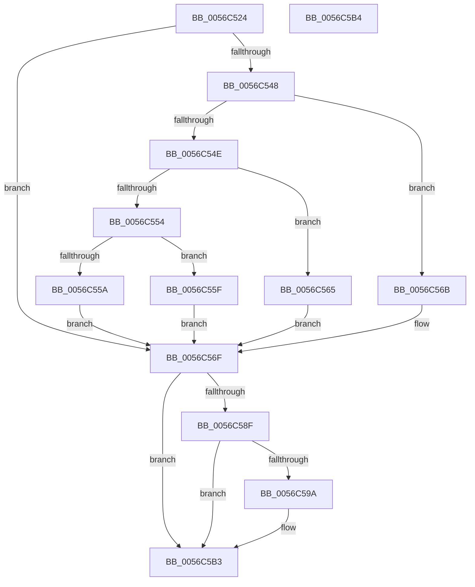

# Amd64FreeCounter

- RVA: `0x0056C524`–`0x0056C5B5` (길이 `145` bytes)
- VA: `0x000000014056C524`
- 실행 섹션: `.text`
- PDB 이름 있음: `예`; PDB Function 태그: `아니요`
- unwind 정보 RVA: `0x000DB714`
- 디코드: `41`개 명령, `145/145` bytes 표시
- 미해석 바이트: `0` (있으면 어셈블리에 `.byte`로 보존)

> 이 문서는 커널 이미지의 기계어와 PDB 기호를 분석해 생성했습니다. 4번과 5번은 함수 원형과 자료형을 바이너리 사용 방식에서 추정한 C 해석이며 원본 소스 복구 결과는 아닙니다.

## 1. Dependencies

- 직접 호출 지점: **0**; 고유 호출 대상: **0**
- 직접 호출자로 확인된 함수: **7**
- RIP 상대 이미지 참조: **1**

### Outgoing calls
- 직접 디코드된 call 명령이 없습니다.

### Direct callers
- [Amd64DisableMonitoring](Amd64DisableMonitoring_function_0056C210.md) at `0x0056C32C`
- [Amd64InitializeCacheStatusEnhanced](Amd64InitializeCacheStatusEnhanced_function_0056C804.md) at `0x0056C9D2`
- [Amd64InitializeCacheStatusOriginal](Amd64InitializeCacheStatusOriginal_function_0056CA40.md) at `0x0056CBF9`
- [Amd64InitializeDataFabricStatusEnhanced](Amd64InitializeDataFabricStatusEnhanced_function_0056CC3C.md) at `0x0056CD86`
- [Amd64InitializeDataFabricStatusOriginal](Amd64InitializeDataFabricStatusOriginal_function_0056CDCC.md) at `0x0056CEEA`
- [Amd64InitializeProfilingEnhanced](../../pagelk/B6/Amd64InitializeProfilingEnhanced_function_00B61318.md) at `0x00B6188D`
- [Amd64InitializeProfilingOriginal](../../pagelk/B6/Amd64InitializeProfilingOriginal_function_00B618D8.md) at `0x00B61D7D`

### Static image references
- `0x0056C532` → RVA `0x00FC8C40` (`ALMOSTRO`; read)

## 2. Other-region calls and transfers

- 다른 실행 섹션으로 향하는 call: **0**
- 별도 외부 분기/꼬리 이동을 확인하지 못했습니다.

## 3. Assembly (complete function range)

```asm
0056C524  65 8B 04 25 A4 01 00 00         mov eax, dword ptr gs:[0x1a4]
0056C52C  44 8B D2                        mov r10d, edx
0056C52F  44 8B D9                        mov r11d, ecx
0056C532  48 8D 0D 07 C7 A5 00            lea rcx, [rip + 0xa5c707]
0056C539  44 8B CA                        mov r9d, edx
0056C53C  48 8B 04 C1                     mov rax, qword ptr [rcx + rax*8]
0056C540  4C 8B 40 58                     mov r8, qword ptr [rax + 0x58]
0056C544  85 D2                           test edx, edx
0056C546  74 27                           je 0x14056c56f
0056C548  41 83 E9 01                     sub r9d, 1
0056C54C  74 1D                           je 0x14056c56b
0056C54E  41 83 E9 63                     sub r9d, 0x63
0056C552  74 11                           je 0x14056c565
0056C554  41 83 F9 01                     cmp r9d, 1
0056C558  74 05                           je 0x14056c55f
0056C55A  45 33 C0                        xor r8d, r8d
0056C55D  EB 10                           jmp 0x14056c56f
0056C55F  49 83 C0 48                     add r8, 0x48
0056C563  EB 0A                           jmp 0x14056c56f
0056C565  49 83 C0 30                     add r8, 0x30
0056C569  EB 04                           jmp 0x14056c56f
0056C56B  49 83 C0 18                     add r8, 0x18
0056C56F  49 8B 50 10                     mov rdx, qword ptr [r8 + 0x10]
0056C573  4B 8D 0C 5B                     lea rcx, [r11 + r11*2]
0056C577  48 03 C9                        add rcx, rcx
0056C57A  41 B8 03 00 00 00               mov r8d, 3
0056C580  83 64 CA 24 00                  and dword ptr [rdx + rcx*8 + 0x24], 0
0056C585  44 89 44 CA 18                  mov dword ptr [rdx + rcx*8 + 0x18], r8d
0056C58A  45 85 D2                        test r10d, r10d
0056C58D  75 24                           jne 0x14056c5b3
0056C58F  48 8B 44 CA 10                  mov rax, qword ptr [rdx + rcx*8 + 0x10]
0056C594  44 38 50 08                     cmp byte ptr [rax + 8], r10b
0056C598  74 19                           je 0x14056c5b3
0056C59A  44 88 50 08                     mov byte ptr [rax + 8], r10b
0056C59E  41 8D 43 01                     lea eax, [r11 + 1]
0056C5A2  48 8D 04 40                     lea rax, [rax + rax*2]
0056C5A6  48 03 C0                        add rax, rax
0056C5A9  44 21 54 C2 24                  and dword ptr [rdx + rax*8 + 0x24], r10d
0056C5AE  44 89 44 C2 18                  mov dword ptr [rdx + rax*8 + 0x18], r8d
0056C5B3  C3                              ret
0056C5B4  CC                              int3
```

## 4. C-style interpretation (structured pseudocode)

```c
__int64 __fastcall Amd64FreeCounter(int a1, int a2)
{
    __int64 result;

    if (a2 == 0) goto loc_0056C56F;
    a4 = (unsigned int)(((unsigned int)(a2)) - (1));
    if (condition_is_equal) goto loc_0056C56B;
    a4 = (unsigned int)((a4) - (99));
    if (condition_is_equal) goto loc_0056C565;
    if (((unsigned int)(a4)) == 1) goto loc_0056C55F;
    a3 = 0;
    goto loc_0056C56F;
loc_0056C55F:
    a3 = (a3) + (72);
    goto loc_0056C56F;
loc_0056C565:
    a3 = (a3) + (48);
    goto loc_0056C56F;
loc_0056C56B:
    a3 = (a3) + (24);
loc_0056C56F:
    a1 = ((unsigned int)(a1) + (unsigned int)(a1) * 2) + ((unsigned int)(a1) + (unsigned int)(a1) * 2);
    *(unsigned int *)(*(unsigned __int64 *)(a3 + 16) + a1 * 8 + 24) = 3;
    if ((unsigned int)((unsigned int)(a2)) != 0) goto loc_0056C5B3;
    result = *(unsigned __int64 *)(*(unsigned __int64 *)(a3 + 16) + a1 * 8 + 16);
    if ((*(unsigned __int8 *)(*(unsigned __int64 *)(*(unsigned __int64 *)(a3 + 16) + a1 * 8 + 16) + 8)) != ((unsigned __int8)((unsigned int)(a2)))) {
        *(unsigned __int8 *)(*(unsigned __int64 *)(*(unsigned __int64 *)(a3 + 16) + a1 * 8 + 16) + 8) = (unsigned __int8)((unsigned int)(a2));
        result = (unsigned int)(a1) + 1;
        result = result + result * 2;
        result = (result) + (result);
        *(unsigned int *)(*(unsigned __int64 *)(a3 + 16) + result * 8 + 24) = 3;
    }
    return result;
}
```

## 5. (Beta) C Style

```c
int64_t Amd64FreeCounter(void *Arg1, int32_t Arg2)
{
    uint8_t *arg1 = (uint8_t *)Arg1;

    int64_t result;

    if (Arg2 == 0) goto loc_0056C56F;
    a4 = (uint32_t)(((uint32_t)(Arg2)) - (1));
    if (condition_is_equal) goto loc_0056C56B;
    a4 = (uint32_t)((a4) - (99));
    if (condition_is_equal) goto loc_0056C565;
    if (((uint32_t)(a4)) == 1) goto loc_0056C55F;
    a3 = 0;
    goto loc_0056C56F;
loc_0056C55F:
    a3 = (a3) + (72);
    goto loc_0056C56F;
loc_0056C565:
    a3 = (a3) + (48);
    goto loc_0056C56F;
loc_0056C56B:
    a3 = (a3) + (24);
loc_0056C56F:
    Arg1 = ((uint32_t)(Arg1) + (uint32_t)(Arg1) * 2) + ((uint32_t)(Arg1) + (uint32_t)(Arg1) * 2);
    *(uint32_t *)(*(uint64_t *)(a3 + 0x10) + arg1 * 8 + 0x18) = 3;
    if ((uint32_t)((uint32_t)(Arg2)) != 0) goto loc_0056C5B3;
    result = *(uint64_t *)(*(uint64_t *)(a3 + 0x10) + arg1 * 8 + 0x10);
    if ((*(uint8_t *)(*(uint64_t *)(*(uint64_t *)(a3 + 0x10) + arg1 * 8 + 0x10) + 0x8)) != ((uint8_t)((uint32_t)(Arg2)))) {
        *(uint8_t *)(*(uint64_t *)(*(uint64_t *)(a3 + 0x10) + arg1 * 8 + 0x10) + 0x8) = (uint8_t)((uint32_t)(Arg2));
        result = (uint32_t)(Arg1) + 1;
        result = result + result * 2;
        result = (result) + (result);
        *(uint32_t *)(*(uint64_t *)(a3 + 0x10) + result * 8 + 0x18) = 3;
    }
    return result;
}
```

### 관측된 메모리 오프셋

구조체 형식이 확인되지 않은 접근은 인자 기준의 오프셋으로만 기록했습니다.

| 기준 인자 | 오프셋 표현 | 폭 (bit) | 접근 |
|---|---:|---:|---|
| `Arg1` | `+ 0x0 + r11*2` | `64` | `R` |
| `Arg1` | `+ 0x0 + rax*2` | `64` | `R` |
| `Arg1` | `+ 0x1` | `32` | `R` |

## 6. Execution-region graph

[열기: 2D/3D 그래프와 함수 탐색 컨트롤 패널](../../../control-panel.html?section=text&rva=0x0056C524&view=graph)

- 2D 그래프는 위에서 아래로 흐르고, 3D 그래프는 빈 공간을 드래그해 회전합니다. Shift+드래그는 이동, 휠은 확대·축소, 함수 노드 선택은 대상 보고서 이동입니다.

### Static fallback


