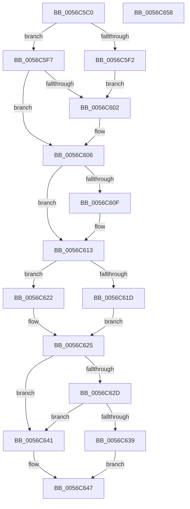

# Amd64GetCounterResolution

- RVA: `0x0056C5C0`–`0x0056C659` (길이 `153` bytes)
- VA: `0x000000014056C5C0`
- 실행 섹션: `.text`
- PDB 이름 있음: `예`; PDB Function 태그: `아니요`
- unwind 정보 RVA: `0x000950EC`
- 디코드: `45`개 명령, `153/153` bytes 표시
- 미해석 바이트: `0` (있으면 어셈블리에 `.byte`로 보존)

> 이 문서는 커널 이미지의 기계어와 PDB 기호를 분석해 생성했습니다. 4번과 5번은 함수 원형과 자료형을 바이너리 사용 방식에서 추정한 C 해석이며 원본 소스 복구 결과는 아닙니다.

## 1. Dependencies

- 직접 호출 지점: **0**; 고유 호출 대상: **0**
- 직접 호출자로 확인된 함수: **0**
- RIP 상대 이미지 참조: **1**

### Outgoing calls
- 직접 디코드된 call 명령이 없습니다.

### Direct callers
- 이 함수 시작 RVA로 연결되는 직접 call은 확인되지 않았습니다. 간접 호출은 완전히 역산할 수 없습니다.

### Static image references
- `0x0056C5D2` → RVA `0x00FC8C40` (`ALMOSTRO`; read)

## 2. Other-region calls and transfers

- 다른 실행 섹션으로 향하는 call: **0**
- 별도 외부 분기/꼬리 이동을 확인하지 못했습니다.

## 3. Assembly (complete function range)

```asm
0056C5C0  48 89 5C 24 08                  mov qword ptr [rsp + 8], rbx
0056C5C5  48 89 7C 24 10                  mov qword ptr [rsp + 0x10], rdi
0056C5CA  65 8B 04 25 A4 01 00 00         mov eax, dword ptr gs:[0x1a4]
0056C5D2  48 8D 3D 67 C6 A5 00            lea rdi, [rip + 0xa5c667]
0056C5D9  45 33 C9                        xor r9d, r9d
0056C5DC  8B D9                           mov ebx, ecx
0056C5DE  45 8B D9                        mov r11d, r9d
0056C5E1  48 8B 3C C7                     mov rdi, qword ptr [rdi + rax*8]
0056C5E5  48 8B 47 58                     mov rax, qword ptr [rdi + 0x58]
0056C5E9  4C 8D 40 18                     lea r8, [rax + 0x18]
0056C5ED  48 85 C0                        test rax, rax
0056C5F0  75 05                           jne 0x14056c5f7
0056C5F2  41 8B C9                        mov ecx, r9d
0056C5F5  EB 0B                           jmp 0x14056c602
0056C5F7  8B 48 04                        mov ecx, dword ptr [rax + 4]
0056C5FA  45 8B D1                        mov r10d, r9d
0056C5FD  4D 85 C0                        test r8, r8
0056C600  74 04                           je 0x14056c606
0056C602  45 8B 50 04                     mov r10d, dword ptr [r8 + 4]
0056C606  45 8B C1                        mov r8d, r9d
0056C609  48 83 C0 30                     add rax, 0x30
0056C60D  74 04                           je 0x14056c613
0056C60F  44 8B 40 04                     mov r8d, dword ptr [rax + 4]
0056C613  48 8B 47 58                     mov rax, qword ptr [rdi + 0x58]
0056C617  48 83 C0 48                     add rax, 0x48
0056C61B  75 05                           jne 0x14056c622
0056C61D  41 8B C1                        mov eax, r9d
0056C620  EB 03                           jmp 0x14056c625
0056C622  8B 40 04                        mov eax, dword ptr [rax + 4]
0056C625  81 FB E9 00 00 C0               cmp ebx, 0xc00000e9
0056C62B  74 14                           je 0x14056c641
0056C62D  41 03 C0                        add eax, r8d
0056C630  41 03 C2                        add eax, r10d
0056C633  03 C1                           add eax, ecx
0056C635  3B D8                           cmp ebx, eax
0056C637  72 08                           jb 0x14056c641
0056C639  41 BB 0D 00 00 C0               mov r11d, 0xc000000d
0056C63F  EB 06                           jmp 0x14056c647
0056C641  41 B9 30 00 00 00               mov r9d, 0x30
0056C647  44 89 0A                        mov dword ptr [rdx], r9d
0056C64A  41 8B C3                        mov eax, r11d
0056C64D  48 8B 5C 24 08                  mov rbx, qword ptr [rsp + 8]
0056C652  48 8B 7C 24 10                  mov rdi, qword ptr [rsp + 0x10]
0056C657  C3                              ret
0056C658  CC                              int3
```

## 4. C-style interpretation (structured pseudocode)

```c
__int64 __fastcall Amd64GetCounterResolution(int a1, __int64 a2, __int64 a3, int a4)
{
    __int64 result;
    __int64 v_r10;
    unsigned __int64 v_stack_p10;
    unsigned __int64 v_stack_p8;

    v_stack_p8 = v_rbx;
    v_stack_p10 = v_rdi;
    a4 = 0;
    if (*(unsigned __int64 *)(*(unsigned __int64 *)(v_rip + 10864231 + (unsigned int)(*(unsigned int *)(gs_base + (0 + 420))) * 8) + 88) != 0) goto loc_0056C5F7;
    goto loc_0056C602;
loc_0056C5F7:
    v_r10 = 0;
    if (*(unsigned __int64 *)(*(unsigned __int64 *)(v_rip + 10864231 + (unsigned int)(*(unsigned int *)(gs_base + (0 + 420))) * 8) + 88) + 24 != 0) {
        v_r10 = *(unsigned int *)(*(unsigned __int64 *)(*(unsigned __int64 *)(v_rip + 10864231 + (unsigned int)(*(unsigned int *)(gs_base + (0 + 420))) * 8) + 88) + 24 + 4);
    }
    result = (*(unsigned __int64 *)(*(unsigned __int64 *)(v_rip + 10864231 + (unsigned int)(*(unsigned int *)(gs_base + (0 + 420))) * 8) + 88)) + (48);
    if (!(condition_is_equal)) {
        a3 = *(unsigned int *)(result + 4);
    }
    result = (*(unsigned __int64 *)(*(unsigned __int64 *)(v_rip + 10864231 + (unsigned int)(*(unsigned int *)(gs_base + (0 + 420))) * 8) + 88)) + (72);
    if (condition_is_not_equal) goto loc_0056C622;
    goto loc_0056C625;
loc_0056C622:
loc_0056C625:
    if (((unsigned int)((unsigned int)(a1))) == 0xC00000E9ULL) goto loc_0056C641;
    result = (unsigned int)(((unsigned int)(*(unsigned int *)(0 + 4))) + ((unsigned int)(a3)));
    result = (unsigned int)((result) + ((unsigned int)(v_r10)));
    result = (unsigned int)((result) + ((unsigned int)((unsigned int)(*(unsigned int *)(*(unsigned __int64 *)(*(unsigned __int64 *)(v_rip + 10864231 + (unsigned int)(*(unsigned int *)(gs_base + (0 + 420))) * 8) + 88) + 4)))));
    if (((unsigned int)((unsigned int)(a1))) < ((unsigned int)(result))) goto loc_0056C641;
    goto loc_0056C647;
loc_0056C641:
loc_0056C647:
    *(unsigned int *)(a2) = 48;
    return (unsigned int)((unsigned int)((unsigned int)(0xC000000DULL)));
}
```

## 5. (Beta) C Style

```c
int64_t Amd64GetCounterResolution(int32_t Arg1, void *Arg2, int64_t Arg3, int32_t Arg4)
{
    uint8_t *arg2 = (uint8_t *)Arg2;

    int64_t result;
    int64_t local_r10;
    uint64_t v_stack_p10;
    uint64_t v_stack_p8;

    v_stack_p8 = local_rbx;
    v_stack_p10 = local_rdi;
    Arg4 = 0;
    if (*(uint64_t *)(*(uint64_t *)(v_rip + 0xA5C667 + (uint32_t)(*(uint32_t *)(gs_base + (0 + 0x1A4))) * 8) + 0x58) != 0) goto loc_0056C5F7;
    goto loc_0056C602;
loc_0056C5F7:
    local_r10 = 0;
    if (*(uint64_t *)(*(uint64_t *)(v_rip + 0xA5C667 + (uint32_t)(*(uint32_t *)(gs_base + (0 + 0x1A4))) * 8) + 0x58) + 24 != 0) {
        local_r10 = *(uint32_t *)(*(uint64_t *)(*(uint64_t *)(v_rip + 0xA5C667 + (uint32_t)(*(uint32_t *)(gs_base + (0 + 0x1A4))) * 8) + 0x58) + 0x18 + 0x4);
    }
    result = (*(uint64_t *)(*(uint64_t *)(v_rip + 0xA5C667 + (uint32_t)(*(uint32_t *)(gs_base + (0 + 0x1A4))) * 8) + 0x58)) + (48);
    if (!(condition_is_equal)) {
        Arg3 = *(uint32_t *)(result + 0x4);
    }
    result = (*(uint64_t *)(*(uint64_t *)(v_rip + 0xA5C667 + (uint32_t)(*(uint32_t *)(gs_base + (0 + 0x1A4))) * 8) + 0x58)) + (72);
    if (condition_is_not_equal) goto loc_0056C622;
    goto loc_0056C625;
loc_0056C622:
loc_0056C625:
    if (((uint32_t)((uint32_t)(Arg1))) == 0xC00000E9ULL) goto loc_0056C641;
    result = (uint32_t)(((uint32_t)(*(uint32_t *)(0 + 0x4))) + ((uint32_t)(Arg3)));
    result = (uint32_t)((result) + ((uint32_t)(local_r10)));
    result = (uint32_t)((result) + ((uint32_t)((uint32_t)(*(uint32_t *)(*(uint64_t *)(*(uint64_t *)(v_rip + 0xA5C667 + (uint32_t)(*(uint32_t *)(gs_base + (0 + 0x1A4))) * 8) + 0x58) + 0x4)))));
    if (((uint32_t)((uint32_t)(Arg1))) < ((uint32_t)(result))) goto loc_0056C641;
    goto loc_0056C647;
loc_0056C641:
loc_0056C647:
    *(uint32_t *)(arg2) = 48;
    return (uint32_t)((uint32_t)((uint32_t)(0xC000000DULL)));
}
```

### 관측된 메모리 오프셋

구조체 형식이 확인되지 않은 접근은 인자 기준의 오프셋으로만 기록했습니다.

| 기준 인자 | 오프셋 표현 | 폭 (bit) | 접근 |
|---|---:|---:|---|
| `Arg2` | `+ 0x0` | `32` | `W` |

## 6. Execution-region graph

[열기: 2D/3D 그래프와 함수 탐색 컨트롤 패널](../../../control-panel.html?section=text&rva=0x0056C5C0&view=graph)

- 2D 그래프는 위에서 아래로 흐르고, 3D 그래프는 빈 공간을 드래그해 회전합니다. Shift+드래그는 이동, 휠은 확대·축소, 함수 노드 선택은 대상 보고서 이동입니다.

### Static fallback


