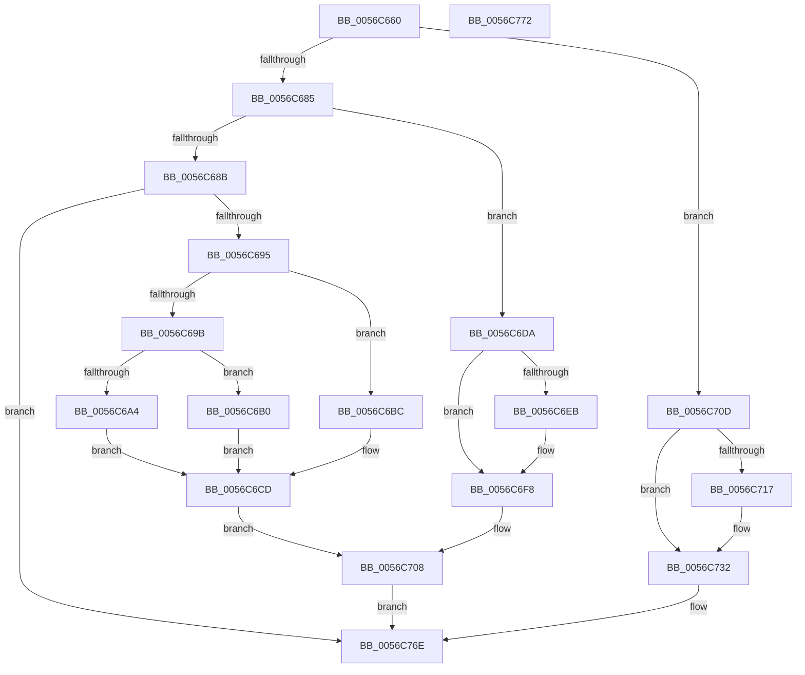

# Amd64GetEventSelectDef

- RVA: `0x0056C660`–`0x0056C773` (길이 `275` bytes)
- VA: `0x000000014056C660`
- 실행 섹션: `.text`
- PDB 이름 있음: `예`; PDB Function 태그: `아니요`
- unwind 정보 RVA: `0x000DB714`
- 디코드: `72`개 명령, `275/275` bytes 표시
- 미해석 바이트: `0` (있으면 어셈블리에 `.byte`로 보존)

> 이 문서는 커널 이미지의 기계어와 PDB 기호를 분석해 생성했습니다. 4번과 5번은 함수 원형과 자료형을 바이너리 사용 방식에서 추정한 C 해석이며 원본 소스 복구 결과는 아닙니다.

## 1. Dependencies

- 직접 호출 지점: **0**; 고유 호출 대상: **0**
- 직접 호출자로 확인된 함수: **1**
- RIP 상대 이미지 참조: **0**

### Outgoing calls
- 직접 디코드된 call 명령이 없습니다.

### Direct callers
- [Amd64AddProfileSource](Amd64AddProfileSource_function_0056B720.md) at `0x0056B813`

### Static image references
- 디코드된 RIP-relative 메모리 참조가 없습니다.

## 2. Other-region calls and transfers

- 다른 실행 섹션으로 향하는 call: **0**
- 별도 외부 분기/꼬리 이동을 확인하지 못했습니다.

## 3. Assembly (complete function range)

```asm
0056C660  65 48 8B 04 25 20 00 00 00      mov rax, qword ptr gs:[0x20]
0056C669  45 33 C0                        xor r8d, r8d
0056C66C  44 0F B6 51 07                  movzx r10d, byte ptr [rcx + 7]
0056C671  4C 8B D9                        mov r11, rcx
0056C674  0F B7 11                        movzx edx, word ptr [rcx]
0056C677  44 0F B6 48 40                  movzx r9d, byte ptr [rax + 0x40]
0056C67C  45 85 D2                        test r10d, r10d
0056C67F  0F 84 88 00 00 00               je 0x14056c70d
0056C685  41 83 EA 01                     sub r10d, 1
0056C689  74 4F                           je 0x14056c6da
0056C68B  41 83 FA 01                     cmp r10d, 1
0056C68F  0F 85 D9 00 00 00               jne 0x14056c76e
0056C695  41 83 E9 16                     sub r9d, 0x16
0056C699  74 21                           je 0x14056c6bc
0056C69B  44 0F B6 C2                     movzx r8d, dl
0056C69F  45 3B CA                        cmp r9d, r10d
0056C6A2  74 0C                           je 0x14056c6b0
0056C6A4  48 B8 00 00 00 00 00 C0 00 03   movabs rax, 0x300c00000000000
0056C6AE  EB 1D                           jmp 0x14056c6cd
0056C6B0  48 B8 00 00 00 00 00 00 0F FF   movabs rax, 0xff0f000000000000
0056C6BA  EB 11                           jmp 0x14056c6cd
0056C6BC  4C 8B C2                        mov r8, rdx
0056C6BF  0F B6 C2                        movzx eax, dl
0056C6C2  41 81 E0 00 0F 00 00            and r8d, 0xf00
0056C6C9  49 C1 E0 18                     shl r8, 0x18
0056C6CD  4C 0B C0                        or r8, rax
0056C6D0  0F B6 41 02                     movzx eax, byte ptr [rcx + 2]
0056C6D4  48 C1 E0 08                     shl rax, 8
0056C6D8  EB 2E                           jmp 0x14056c708
0056C6DA  48 8B C2                        mov rax, rdx
0056C6DD  0F B6 CA                        movzx ecx, dl
0056C6E0  25 00 0F 00 00                  and eax, 0xf00
0056C6E5  41 83 F9 16                     cmp r9d, 0x16
0056C6E9  76 0D                           jbe 0x14056c6f8
0056C6EB  81 E2 00 30 00 00               and edx, 0x3000
0056C6F1  48 C1 E2 17                     shl rdx, 0x17
0056C6F5  48 0B C2                        or rax, rdx
0056C6F8  45 0F B6 43 02                  movzx r8d, byte ptr [r11 + 2]
0056C6FD  49 C1 E0 08                     shl r8, 8
0056C701  48 C1 E0 18                     shl rax, 0x18
0056C705  4C 0B C1                        or r8, rcx
0056C708  4C 0B C0                        or r8, rax
0056C70B  EB 61                           jmp 0x14056c76e
0056C70D  44 0F B6 C2                     movzx r8d, dl
0056C711  41 83 F9 0F                     cmp r9d, 0xf
0056C715  74 1B                           je 0x14056c732
0056C717  0F B6 41 06                     movzx eax, byte ptr [rcx + 6]
0056C71B  81 E2 00 0F 00 00               and edx, 0xf00
0056C721  83 E0 03                        and eax, 3
0056C724  48 C1 E0 10                     shl rax, 0x10
0056C728  48 0B C2                        or rax, rdx
0056C72B  48 C1 E0 18                     shl rax, 0x18
0056C72F  4C 0B C0                        or r8, rax
0056C732  0F B6 51 03                     movzx edx, byte ptr [rcx + 3]
0056C736  0F B6 41 04                     movzx eax, byte ptr [rcx + 4]
0056C73A  83 E2 0F                        and edx, 0xf
0056C73D  0F B6 49 05                     movzx ecx, byte ptr [rcx + 5]
0056C741  48 03 D2                        add rdx, rdx
0056C744  83 E1 01                        and ecx, 1
0056C747  83 E0 01                        and eax, 1
0056C74A  48 0B D0                        or rdx, rax
0056C74D  48 C1 E2 05                     shl rdx, 5
0056C751  48 0B D1                        or rdx, rcx
0056C754  41 0F B6 4B 02                  movzx ecx, byte ptr [r11 + 2]
0056C759  48 C1 E2 0A                     shl rdx, 0xa
0056C75D  48 0B D1                        or rdx, rcx
0056C760  48 81 CA 00 03 00 00            or rdx, 0x300
0056C767  48 C1 E2 08                     shl rdx, 8
0056C76B  4C 0B C2                        or r8, rdx
0056C76E  49 8B C0                        mov rax, r8
0056C771  C3                              ret
0056C772  CC                              int3
```

## 4. C-style interpretation (structured pseudocode)

```c
__int64 __fastcall Amd64GetEventSelectDef(__int64 a1, __int64 a2, int a3)
{
    __int64 result;
    __int64 v_r10;

    a3 = 0;
    if ((unsigned int)(*(unsigned __int8 *)(a1 + 7)) == 0) goto loc_0056C70D;
    v_r10 = (unsigned int)((*(unsigned __int8 *)(a1 + 7)) - (1));
    if (condition_is_equal) goto loc_0056C6DA;
    if (((unsigned int)(v_r10)) != 1) goto loc_0056C76E;
    a4 = (unsigned int)((*(unsigned __int8 *)(*(unsigned __int64 *)(gs_base + (0 + 32)) + 64)) - (22));
    if (condition_is_equal) goto loc_0056C6BC;
    if (((unsigned int)(a4)) == ((unsigned int)(v_r10))) goto loc_0056C6B0;
    goto loc_0056C6CD;
loc_0056C6B0:
    goto loc_0056C6CD;
loc_0056C6BC:
    a3 = (unsigned int)((*(unsigned __int16 *)(a1)) & (0xF00ULL));
    a3 = (a3) << (24);
loc_0056C6CD:
    a3 = (a3) | ((unsigned __int8)(*(unsigned __int16 *)(a1)));
    result = (*(unsigned __int8 *)(a1 + 2)) << (8);
    goto loc_0056C708;
loc_0056C6DA:
    result = (unsigned int)((*(unsigned __int16 *)(a1)) & (0xF00ULL));
    if (((unsigned int)(a4)) >= = 22) {
        a2 = (unsigned int)((*(unsigned __int16 *)(a1)) & (0x3000ULL));
        a2 = (a2) << (23);
        result = (result) | (a2);
    }
    a3 = (*(unsigned __int8 *)(a1 + 2)) << (8);
    result = (result) << (24);
    a3 = (a3) | ((unsigned __int8)(*(unsigned __int16 *)(a1)));
loc_0056C708:
    a3 = (a3) | (result);
    goto loc_0056C76E;
loc_0056C70D:
    if (((unsigned int)(a4)) != 15) {
        result = *(unsigned __int8 *)((unsigned __int8)(*(unsigned __int16 *)(a1)) + 6);
        a2 = (unsigned int)((a2) & (0xF00ULL));
        result = (unsigned int)((result) & (3));
        result = (result) << (16);
        result = (result) | (a2);
        result = (result) << (24);
        a3 = ((unsigned __int8)(a2)) | (result);
    }
    a2 = (unsigned int)((*(unsigned __int8 *)((unsigned __int8)(*(unsigned __int16 *)(a1)) + 3)) & (15));
    a2 = (a2) + (a2);
    a1 = (unsigned int)((*(unsigned __int8 *)((unsigned __int8)(*(unsigned __int16 *)(a1)) + 5)) & (1));
    result = (unsigned int)((*(unsigned __int8 *)((unsigned __int8)(*(unsigned __int16 *)(a1)) + 4)) & (1));
    a2 = (a2) | (result);
    a2 = (a2) << (5);
    a2 = (a2) | (a1);
    a2 = (a2) << (10);
    a2 = (a2) | (*(unsigned __int8 *)(a1 + 2));
    a2 = (a2) | (768);
    a2 = (a2) << (8);
    a3 = (a3) | (a2);
loc_0056C76E:
    return a3;
}
```

## 5. (Beta) C Style

```c
int64_t Amd64GetEventSelectDef(void *Arg1, int64_t Arg2, int32_t Arg3)
{
    uint8_t *arg1 = (uint8_t *)Arg1;

    int64_t result;
    int64_t local_r10;

    Arg3 = 0;
    if ((uint32_t)(*(uint8_t *)(arg1 + 0x7)) == 0) goto loc_0056C70D;
    local_r10 = (uint32_t)((*(uint8_t *)(arg1 + 0x7)) - (1));
    if (condition_is_equal) goto loc_0056C6DA;
    if (((uint32_t)(local_r10)) != 1) goto loc_0056C76E;
    a4 = (uint32_t)((*(uint8_t *)(*(uint64_t *)(gs_base + (0 + 0x20)) + 0x40)) - (22));
    if (condition_is_equal) goto loc_0056C6BC;
    if (((uint32_t)(a4)) == ((uint32_t)(local_r10))) goto loc_0056C6B0;
    goto loc_0056C6CD;
loc_0056C6B0:
    goto loc_0056C6CD;
loc_0056C6BC:
    Arg3 = (uint32_t)((*(uint16_t *)(arg1)) & (0xF00ULL));
    Arg3 = (Arg3) << (24);
loc_0056C6CD:
    Arg3 = (Arg3) | ((uint8_t)(*(uint16_t *)(arg1)));
    result = (*(uint8_t *)(arg1 + 0x2)) << (8);
    goto loc_0056C708;
loc_0056C6DA:
    result = (uint32_t)((*(uint16_t *)(arg1)) & (0xF00ULL));
    if (((uint32_t)(a4)) >= = 22) {
        Arg2 = (uint32_t)((*(uint16_t *)(arg1)) & (0x3000ULL));
        Arg2 = (Arg2) << (23);
        result = (result) | (Arg2);
    }
    Arg3 = (*(uint8_t *)(arg1 + 0x2)) << (8);
    result = (result) << (24);
    Arg3 = (Arg3) | ((uint8_t)(*(uint16_t *)(arg1)));
loc_0056C708:
    Arg3 = (Arg3) | (result);
    goto loc_0056C76E;
loc_0056C70D:
    if (((uint32_t)(a4)) != 15) {
        result = *(uint8_t *)((uint8_t)(*(uint16_t *)(arg1)) + 0x6);
        Arg2 = (uint32_t)((Arg2) & (0xF00ULL));
        result = (uint32_t)((result) & (3));
        result = (result) << (16);
        result = (result) | (Arg2);
        result = (result) << (24);
        Arg3 = ((uint8_t)(Arg2)) | (result);
    }
    Arg2 = (uint32_t)((*(uint8_t *)((uint8_t)(*(uint16_t *)(arg1)) + 0x3)) & (15));
    Arg2 = (Arg2) + (Arg2);
    Arg1 = (uint32_t)((*(uint8_t *)((uint8_t)(*(uint16_t *)(arg1)) + 0x5)) & (1));
    result = (uint32_t)((*(uint8_t *)((uint8_t)(*(uint16_t *)(arg1)) + 0x4)) & (1));
    Arg2 = (Arg2) | (result);
    Arg2 = (Arg2) << (5);
    Arg2 = (Arg2) | (Arg1);
    Arg2 = (Arg2) << (10);
    Arg2 = (Arg2) | (*(uint8_t *)(arg1 + 0x2));
    Arg2 = (Arg2) | (768);
    Arg2 = (Arg2) << (8);
    Arg3 = (Arg3) | (Arg2);
loc_0056C76E:
    return Arg3;
}
```

### 관측된 메모리 오프셋

구조체 형식이 확인되지 않은 접근은 인자 기준의 오프셋으로만 기록했습니다.

| 기준 인자 | 오프셋 표현 | 폭 (bit) | 접근 |
|---|---:|---:|---|
| `Arg1` | `+ 0x0` | `16` | `R` |
| `Arg1` | `+ 0x2` | `8` | `R` |
| `Arg1` | `+ 0x3` | `8` | `R` |
| `Arg1` | `+ 0x4` | `8` | `R` |
| `Arg1` | `+ 0x5` | `8` | `R` |
| `Arg1` | `+ 0x6` | `8` | `R` |
| `Arg1` | `+ 0x7` | `8` | `R` |

## 6. Execution-region graph

[열기: 2D/3D 그래프와 함수 탐색 컨트롤 패널](../../../control-panel.html?section=text&rva=0x0056C660&view=graph)

- 2D 그래프는 위에서 아래로 흐르고, 3D 그래프는 빈 공간을 드래그해 회전합니다. Shift+드래그는 이동, 휠은 확대·축소, 함수 노드 선택은 대상 보고서 이동입니다.

### Static fallback


