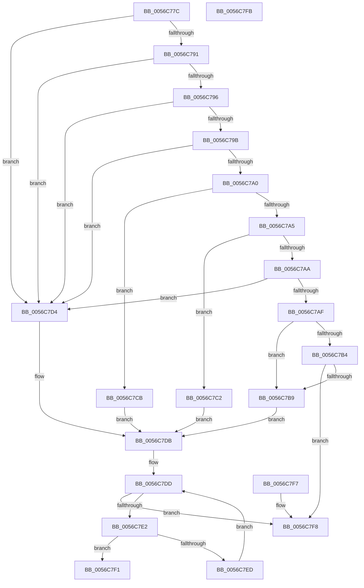

# Amd64GetGenericPerfEvent

- RVA: `0x0056C77C`–`0x0056C7FC` (길이 `128` bytes)
- VA: `0x000000014056C77C`
- 실행 섹션: `.text`
- PDB 이름 있음: `예`; PDB Function 태그: `아니요`
- unwind 정보 RVA: `0x000DB714`
- 디코드: `43`개 명령, `128/128` bytes 표시
- 미해석 바이트: `0` (있으면 어셈블리에 `.byte`로 보존)

> 이 문서는 커널 이미지의 기계어와 PDB 기호를 분석해 생성했습니다. 4번과 5번은 함수 원형과 자료형을 바이너리 사용 방식에서 추정한 C 해석이며 원본 소스 복구 결과는 아닙니다.

## 1. Dependencies

- 직접 호출 지점: **0**; 고유 호출 대상: **0**
- 직접 호출자로 확인된 함수: **2**
- RIP 상대 이미지 참조: **4**

### Outgoing calls
- 직접 디코드된 call 명령이 없습니다.

### Direct callers
- [Amd64InitializeProfilingEnhanced](../../pagelk/B6/Amd64InitializeProfilingEnhanced_function_00B61318.md) at `0x00B617C3`
- [Amd64InitializeProfilingOriginal](../../pagelk/B6/Amd64InitializeProfilingOriginal_function_00B618D8.md) at `0x00B61CA7`

### Static image references
- `0x0056C7B9` → RVA `0x00026108` (`.rdata`; read)
- `0x0056C7C2` → RVA `0x000260E8` (`.rdata`; read)
- `0x0056C7CB` → RVA `0x00026128` (`.rdata`; read)
- `0x0056C7D4` → RVA `0x000260B8` (`.rdata`; read)

## 2. Other-region calls and transfers

- 다른 실행 섹션으로 향하는 call: **0**
- 별도 외부 분기/꼬리 이동을 확인하지 못했습니다.

## 3. Assembly (complete function range)

```asm
0056C77C  65 48 8B 04 25 20 00 00 00      mov rax, qword ptr gs:[0x20]
0056C785  44 8B C1                        mov r8d, ecx
0056C788  0F B6 50 40                     movzx edx, byte ptr [rax + 0x40]
0056C78C  83 EA 0F                        sub edx, 0xf
0056C78F  74 43                           je 0x14056c7d4
0056C791  83 EA 01                        sub edx, 1
0056C794  74 3E                           je 0x14056c7d4
0056C796  83 EA 01                        sub edx, 1
0056C799  74 39                           je 0x14056c7d4
0056C79B  83 EA 01                        sub edx, 1
0056C79E  74 34                           je 0x14056c7d4
0056C7A0  83 EA 02                        sub edx, 2
0056C7A3  74 26                           je 0x14056c7cb
0056C7A5  83 EA 01                        sub edx, 1
0056C7A8  74 18                           je 0x14056c7c2
0056C7AA  83 EA 01                        sub edx, 1
0056C7AD  74 25                           je 0x14056c7d4
0056C7AF  83 EA 01                        sub edx, 1
0056C7B2  74 05                           je 0x14056c7b9
0056C7B4  83 FA 02                        cmp edx, 2
0056C7B7  75 3F                           jne 0x14056c7f8
0056C7B9  48 8D 05 48 99 AB FF            lea rax, [rip - 0x5466b8]
0056C7C0  EB 19                           jmp 0x14056c7db
0056C7C2  48 8D 05 1F 99 AB FF            lea rax, [rip - 0x5466e1]
0056C7C9  EB 10                           jmp 0x14056c7db
0056C7CB  48 8D 05 56 99 AB FF            lea rax, [rip - 0x5466aa]
0056C7D2  EB 07                           jmp 0x14056c7db
0056C7D4  48 8D 05 DD 98 AB FF            lea rax, [rip - 0x546723]
0056C7DB  33 C9                           xor ecx, ecx
0056C7DD  83 F9 02                        cmp ecx, 2
0056C7E0  73 16                           jae 0x14056c7f8
0056C7E2  8B D1                           mov edx, ecx
0056C7E4  48 03 D2                        add rdx, rdx
0056C7E7  44 39 04 D0                     cmp dword ptr [rax + rdx*8], r8d
0056C7EB  74 04                           je 0x14056c7f1
0056C7ED  FF C1                           inc ecx
0056C7EF  EB EC                           jmp 0x14056c7dd
0056C7F1  48 8B 44 D0 08                  mov rax, qword ptr [rax + rdx*8 + 8]
0056C7F6  C3                              ret
0056C7F7  CC                              int3
0056C7F8  33 C0                           xor eax, eax
0056C7FA  C3                              ret
0056C7FB  CC                              int3
```

## 4. C-style interpretation (structured pseudocode)

```c
__int64 __fastcall Amd64GetGenericPerfEvent(int a1)
{
    __int64 result;

    a2 = (unsigned int)((*(unsigned __int8 *)(*(unsigned __int64 *)(gs_base + (0 + 32)) + 64)) - (15));
    if (condition_is_equal) goto loc_0056C7D4;
    a2 = (unsigned int)((a2) - (1));
    if (condition_is_equal) goto loc_0056C7D4;
    a2 = (unsigned int)((a2) - (1));
    if (condition_is_equal) goto loc_0056C7D4;
    a2 = (unsigned int)((a2) - (1));
    if (condition_is_equal) goto loc_0056C7D4;
    a2 = (unsigned int)((a2) - (2));
    if (condition_is_equal) goto loc_0056C7CB;
    a2 = (unsigned int)((a2) - (1));
    if (condition_is_equal) goto loc_0056C7C2;
    a2 = (unsigned int)((a2) - (1));
    if (condition_is_equal) goto loc_0056C7D4;
    a2 = (unsigned int)((a2) - (1));
    if (condition_is_equal) goto loc_0056C7B9;
    if (((unsigned int)(a2)) != 2) goto loc_0056C7F8;
loc_0056C7B9:
    goto loc_0056C7DB;
loc_0056C7C2:
    goto loc_0056C7DB;
loc_0056C7CB:
    goto loc_0056C7DB;
loc_0056C7D4:
loc_0056C7DB:
    a1 = 0;
loc_0056C7DD:
    if (0 >= 2) goto loc_0056C7F8;
    a2 = (0) + (0);
    if ((*(unsigned int *)(v_rip - 5531427 + a2 * 8)) == ((unsigned int)((unsigned int)(a1)))) goto loc_0056C7F1;
    a1 = (unsigned int)((a1) + 1);
    goto loc_0056C7DD;
loc_0056C7F1:
    return *(unsigned __int64 *)(v_rip - 5531427 + a2 * 8 + 8);
loc_0056C7F8:
    result = 0;
    return result;
}
```

## 5. (Beta) C Style

```c
int64_t Amd64GetGenericPerfEvent(int32_t Arg1)
{
    int64_t result;

    a2 = (uint32_t)((*(uint8_t *)(*(uint64_t *)(gs_base + (0 + 0x20)) + 0x40)) - (15));
    if (condition_is_equal) goto loc_0056C7D4;
    a2 = (uint32_t)((a2) - (1));
    if (condition_is_equal) goto loc_0056C7D4;
    a2 = (uint32_t)((a2) - (1));
    if (condition_is_equal) goto loc_0056C7D4;
    a2 = (uint32_t)((a2) - (1));
    if (condition_is_equal) goto loc_0056C7D4;
    a2 = (uint32_t)((a2) - (2));
    if (condition_is_equal) goto loc_0056C7CB;
    a2 = (uint32_t)((a2) - (1));
    if (condition_is_equal) goto loc_0056C7C2;
    a2 = (uint32_t)((a2) - (1));
    if (condition_is_equal) goto loc_0056C7D4;
    a2 = (uint32_t)((a2) - (1));
    if (condition_is_equal) goto loc_0056C7B9;
    if (((uint32_t)(a2)) != 2) goto loc_0056C7F8;
loc_0056C7B9:
    goto loc_0056C7DB;
loc_0056C7C2:
    goto loc_0056C7DB;
loc_0056C7CB:
    goto loc_0056C7DB;
loc_0056C7D4:
loc_0056C7DB:
    Arg1 = 0;
loc_0056C7DD:
    if (0 >= 2) goto loc_0056C7F8;
    a2 = (0) + (0);
    if ((*(uint32_t *)(v_rip - 0x546723 + a2 * 8)) == ((uint32_t)((uint32_t)(Arg1)))) goto loc_0056C7F1;
    Arg1 = (uint32_t)((Arg1) + 1);
    goto loc_0056C7DD;
loc_0056C7F1:
    return *(uint64_t *)(v_rip - 0x546723 + a2 * 8 + 0x8);
loc_0056C7F8:
    result = 0;
    return result;
}
```

## 6. Execution-region graph

[열기: 2D/3D 그래프와 함수 탐색 컨트롤 패널](../../../control-panel.html?section=text&rva=0x0056C77C&view=graph)

- 2D 그래프는 위에서 아래로 흐르고, 3D 그래프는 빈 공간을 드래그해 회전합니다. Shift+드래그는 이동, 휠은 확대·축소, 함수 노드 선택은 대상 보고서 이동입니다.

### Static fallback


