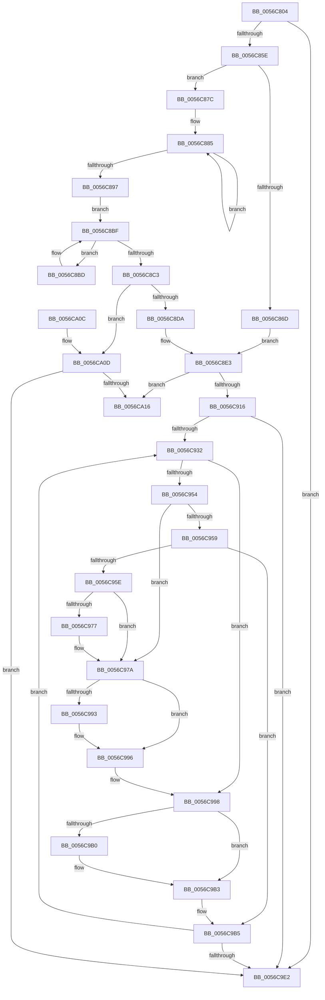

# Amd64InitializeCacheStatusEnhanced

- RVA: `0x0056C804`–`0x0056CA39` (길이 `565` bytes)
- VA: `0x000000014056C804`
- 실행 섹션: `.text`
- PDB 이름 있음: `예`; PDB Function 태그: `아니요`
- unwind 정보 RVA: `0x000C50A0`
- 디코드: `153`개 명령, `565/565` bytes 표시
- 미해석 바이트: `0` (있으면 어셈블리에 `.byte`로 보존)

> 이 문서는 커널 이미지의 기계어와 PDB 기호를 분석해 생성했습니다. 4번과 5번은 함수 원형과 자료형을 바이너리 사용 방식에서 추정한 C 해석이며 원본 소스 복구 결과는 아닙니다.

## 1. Dependencies

- 직접 호출 지점: **7**; 고유 호출 대상: **7**
- 직접 호출자로 확인된 함수: **1**
- RIP 상대 이미지 참조: **4**

### Outgoing calls
- `0x0056C8CD` → [HalpInterruptGetIdentifiers](../4C/HalpInterruptGetIdentifiers_function_004C5DC0.md) (function, `0x004C5DC0`)
- `0x0056C8EF` → [Amd64InitializeUncoreStatusEnhanced](Amd64InitializeUncoreStatusEnhanced_function_0056D178.md) (function, `0x0056D178`)
- `0x0056C905` → [HalpMmAllocCtxAlloc](../3E/HalpMmAllocCtxAlloc_function_003E10B8.md) (function, `0x003E10B8`)
- `0x0056C91E` → [memset](../6C/memset_function_006C6C40.md) (function, `0x006C6C40`)
- `0x0056C9D2` → [Amd64FreeCounter](Amd64FreeCounter_function_0056C524.md) (function, `0x0056C524`)
- `0x0056C9E9` → [_security_check_cookie](../6A/_security_check_cookie_function_006AC640.md) (function, `0x006AC640`)
- `0x0056CA33` → [KeBugCheckEx](../4F/KeBugCheckEx_function_004FD660.md) (function, `0x004FD660`)

### Direct callers
- [Amd64InitializeUncoreProfilingEnhanced](Amd64InitializeUncoreProfilingEnhanced_function_0056CF58.md) at `0x0056D022`

### Static image references
- `0x0056C823` → RVA `0x00E0A740` (`.data`; read)
- `0x0056C83A` → RVA `0x00000000` (`image boundary/outside`; read)
- `0x0056C8E3` → RVA `0x00F8F900` (`.data`; read)
- `0x0056CA19` → RVA `0x00026288` (`.rdata`; read)

## 2. Other-region calls and transfers

- 다른 실행 섹션으로 향하는 call: **0**
- 별도 외부 분기/꼬리 이동을 확인하지 못했습니다.

## 3. Assembly (complete function range)

```asm
0056C804  48 8B C4                        mov rax, rsp
0056C807  48 89 58 08                     mov qword ptr [rax + 8], rbx
0056C80B  48 89 70 10                     mov qword ptr [rax + 0x10], rsi
0056C80F  48 89 78 18                     mov qword ptr [rax + 0x18], rdi
0056C813  4C 89 60 20                     mov qword ptr [rax + 0x20], r12
0056C817  55                              push rbp
0056C818  41 56                           push r14
0056C81A  41 57                           push r15
0056C81C  48 8B EC                        mov rbp, rsp
0056C81F  48 83 EC 50                     sub rsp, 0x50
0056C823  48 8B 05 16 DF 89 00            mov rax, qword ptr [rip + 0x89df16]
0056C82A  48 33 C4                        xor rax, rsp
0056C82D  48 89 45 F8                     mov qword ptr [rbp - 8], rax
0056C831  65 44 8B 0C 25 A4 01 00 00      mov r9d, dword ptr gs:[0x1a4]
0056C83A  48 8D 05 BF 37 A9 FF            lea rax, [rip - 0x56c841]
0056C841  83 65 E0 00                     and dword ptr [rbp - 0x20], 0
0056C845  41 8B F1                        mov esi, r9d
0056C848  4A 8B 84 C8 40 8C FC 00         mov rax, qword ptr [rax + r9*8 + 0xfc8c40]
0056C850  48 8B 78 58                     mov rdi, qword ptr [rax + 0x58]
0056C854  83 7F 4C 00                     cmp dword ptr [rdi + 0x4c], 0
0056C858  0F 84 84 01 00 00               je 0x14056c9e2
0056C85E  65 48 8B 04 25 20 00 00 00      mov rax, qword ptr gs:[0x20]
0056C867  80 78 40 16                     cmp byte ptr [rax + 0x40], 0x16
0056C86B  75 0F                           jne 0x14056c87c
0056C86D  B8 1E 00 00 80                  mov eax, 0x8000001e
0056C872  33 C9                           xor ecx, ecx
0056C874  0F A2                           cpuid
0056C876  44 0F B6 C1                     movzx r8d, cl
0056C87A  EB 67                           jmp 0x14056c8e3
0056C87C  45 33 C0                        xor r8d, r8d
0056C87F  41 BB 1D 00 00 80               mov r11d, 0x8000001d
0056C885  45 8B D0                        mov r10d, r8d
0056C888  41 8B C3                        mov eax, r11d
0056C88B  41 FF C0                        inc r8d
0056C88E  41 8B C8                        mov ecx, r8d
0056C891  0F A2                           cpuid
0056C893  A8 0F                           test al, 0xf
0056C895  75 EE                           jne 0x14056c885
0056C897  41 8B C3                        mov eax, r11d
0056C89A  41 8B CA                        mov ecx, r10d
0056C89D  0F A2                           cpuid
0056C89F  C1 E8 0E                        shr eax, 0xe
0056C8A2  33 DB                           xor ebx, ebx
0056C8A4  25 FF 0F 00 00                  and eax, 0xfff
0056C8A9  8D 04 45 01 00 00 00            lea eax, [rax*2 + 1]
0056C8B0  0F BD C8                        bsr ecx, eax
0056C8B3  8D 43 01                        lea eax, [rbx + 1]
0056C8B6  D2 E0                           shl al, cl
0056C8B8  0F B6 D0                        movzx edx, al
0056C8BB  EB 02                           jmp 0x14056c8bf
0056C8BD  FF C3                           inc ebx
0056C8BF  D1 EA                           shr edx, 1
0056C8C1  75 FA                           jne 0x14056c8bd
0056C8C3  45 33 C0                        xor r8d, r8d
0056C8C6  48 8D 55 E0                     lea rdx, [rbp - 0x20]
0056C8CA  41 8B C9                        mov ecx, r9d
0056C8CD  E8 EE 94 F5 FF                  call 0x1404c5dc0
0056C8D2  85 C0                           test eax, eax
0056C8D4  0F 88 33 01 00 00               js 0x14056ca0d
0056C8DA  44 8B 45 E0                     mov r8d, dword ptr [rbp - 0x20]
0056C8DE  8B CB                           mov ecx, ebx
0056C8E0  41 D3 E8                        shr r8d, cl
0056C8E3  48 8D 15 16 30 A2 00            lea rdx, [rip + 0xa23016]
0056C8EA  B9 02 00 00 00                  mov ecx, 2
0056C8EF  E8 84 08 00 00                  call 0x14056d178
0056C8F4  8B 4F 4C                        mov ecx, dword ptr [rdi + 0x4c]
0056C8F7  4C 8B E0                        mov r12, rax
0056C8FA  8D 1C 49                        lea ebx, [rcx + rcx*2]
0056C8FD  C1 E3 03                        shl ebx, 3
0056C900  8B D3                           mov edx, ebx
0056C902  44 8B F3                        mov r14d, ebx
0056C905  E8 AE 47 E7 FF                  call 0x1403e10b8
0056C90A  4C 8B F8                        mov r15, rax
0056C90D  48 85 C0                        test rax, rax
0056C910  0F 84 00 01 00 00               je 0x14056ca16
0056C916  45 8B C6                        mov r8d, r14d
0056C919  33 D2                           xor edx, edx
0056C91B  48 8B C8                        mov rcx, rax
0056C91E  E8 1D A3 15 00                  call 0x1406c6c40
0056C923  4C 8B 77 58                     mov r14, qword ptr [rdi + 0x58]
0056C927  33 DB                           xor ebx, ebx
0056C929  39 5F 4C                        cmp dword ptr [rdi + 0x4c], ebx
0056C92C  0F 86 B0 00 00 00               jbe 0x14056c9e2
0056C932  48 8D 04 5B                     lea rax, [rbx + rbx*2]
0056C936  49 8D 14 C7                     lea rdx, [r15 + rax*8]
0056C93A  4C 89 62 08                     mov qword ptr [rdx + 8], r12
0056C93E  48 8D 04 5B                     lea rax, [rbx + rbx*2]
0056C942  48 03 C0                        add rax, rax
0056C945  49 89 54 C6 10                  mov qword ptr [r14 + rax*8 + 0x10], rdx
0056C94A  33 D2                           xor edx, edx
0056C94C  8B 4F 48                        mov ecx, dword ptr [rdi + 0x48]
0056C94F  83 E9 01                        sub ecx, 1
0056C952  74 44                           je 0x14056c998
0056C954  83 E9 63                        sub ecx, 0x63
0056C957  74 21                           je 0x14056c97a
0056C959  83 F9 01                        cmp ecx, 1
0056C95C  75 57                           jne 0x14056c9b5
0056C95E  48 8D 05 9B 36 A9 FF            lea rax, [rip - 0x56c965]
0056C965  48 8B 84 F0 40 8C FC 00         mov rax, qword ptr [rax + rsi*8 + 0xfc8c40]
0056C96D  48 8B 50 58                     mov rdx, qword ptr [rax + 0x58]
0056C971  48 83 C2 30                     add rdx, 0x30
0056C975  74 03                           je 0x14056c97a
0056C977  8B 52 04                        mov edx, dword ptr [rdx + 4]
0056C97A  48 8D 05 7F 36 A9 FF            lea rax, [rip - 0x56c981]
0056C981  48 8B 84 F0 40 8C FC 00         mov rax, qword ptr [rax + rsi*8 + 0xfc8c40]
0056C989  48 8B 40 58                     mov rax, qword ptr [rax + 0x58]
0056C98D  48 83 C0 18                     add rax, 0x18
0056C991  74 03                           je 0x14056c996
0056C993  8B 40 04                        mov eax, dword ptr [rax + 4]
0056C996  03 D0                           add edx, eax
0056C998  48 8D 05 61 36 A9 FF            lea rax, [rip - 0x56c99f]
0056C99F  48 8B 84 F0 40 8C FC 00         mov rax, qword ptr [rax + rsi*8 + 0xfc8c40]
0056C9A7  48 8B 40 58                     mov rax, qword ptr [rax + 0x58]
0056C9AB  48 85 C0                        test rax, rax
0056C9AE  74 03                           je 0x14056c9b3
0056C9B0  8B 40 04                        mov eax, dword ptr [rax + 4]
0056C9B3  03 D0                           add edx, eax
0056C9B5  8D 0C 1A                        lea ecx, [rdx + rbx]
0056C9B8  33 C0                           xor eax, eax
0056C9BA  4C 8D 05 3F 36 A9 FF            lea r8, [rip - 0x56c9c1]
0056C9C1  33 D2                           xor edx, edx
0056C9C3  41 8B 8C 88 40 F9 F8 00         mov ecx, dword ptr [r8 + rcx*4 + 0xf8f940]
0056C9CB  0F 30                           wrmsr
0056C9CD  8B 57 48                        mov edx, dword ptr [rdi + 0x48]
0056C9D0  8B CB                           mov ecx, ebx
0056C9D2  E8 4D FB FF FF                  call 0x14056c524
0056C9D7  FF C3                           inc ebx
0056C9D9  3B 5F 4C                        cmp ebx, dword ptr [rdi + 0x4c]
0056C9DC  0F 82 50 FF FF FF               jb 0x14056c932
0056C9E2  48 8B 4D F8                     mov rcx, qword ptr [rbp - 8]
0056C9E6  48 33 CC                        xor rcx, rsp
0056C9E9  E8 52 FC 13 00                  call 0x1406ac640
0056C9EE  4C 8D 5C 24 50                  lea r11, [rsp + 0x50]
0056C9F3  49 8B 5B 20                     mov rbx, qword ptr [r11 + 0x20]
0056C9F7  49 8B 73 28                     mov rsi, qword ptr [r11 + 0x28]
0056C9FB  49 8B 7B 30                     mov rdi, qword ptr [r11 + 0x30]
0056C9FF  4D 8B 63 38                     mov r12, qword ptr [r11 + 0x38]
0056CA03  49 8B E3                        mov rsp, r11
0056CA06  41 5F                           pop r15
0056CA08  41 5E                           pop r14
0056CA0A  5D                              pop rbp
0056CA0B  C3                              ret
0056CA0C  CC                              int3
0056CA0D  33 DB                           xor ebx, ebx
0056CA0F  3D 17 00 00 C0                  cmp eax, 0xc0000017
0056CA14  75 CC                           jne 0x14056c9e2
0056CA16  44 8B C3                        mov r8d, ebx
0056CA19  4C 8D 0D 68 98 AB FF            lea r9, [rip - 0x546798]
0056CA20  BA 03 90 00 00                  mov edx, 0x9003
0056CA25  48 C7 44 24 20 28 08 00 00      mov qword ptr [rsp + 0x20], 0x828
0056CA2E  B9 5C 00 00 00                  mov ecx, 0x5c
0056CA33  E8 28 0C F9 FF                  call 0x1404fd660
0056CA38  CC                              int3
```

## 4. C-style interpretation (structured pseudocode)

```c
__int64 __fastcall Amd64InitializeCacheStatusEnhanced(int a1)
{
    __int64 result;
    __int64 v_rbx;
    __int64 v_rsp;
    unsigned __int64 v_stack_m18;
    unsigned __int64 v_stack_m20;
    unsigned __int64 v_stack_m30;
    unsigned int v_stack_m38;

    *(unsigned __int64 *)(v_rsp + 8) = v_rbx;
    *(unsigned __int64 *)(v_rsp + 16) = v_rsi;
    *(unsigned __int64 *)(v_rsp + 24) = v_rdi;
    *(unsigned __int64 *)(v_rsp + 32) = v_r12;
    v_rsp = (v_rsp) - (80);
    result = (*(unsigned __int64 *)(v_rip + 9035542)) ^ (v_rsp);
    v_stack_m20 = result;
    if ((*(unsigned int *)(*(unsigned __int64 *)(*(unsigned __int64 *)(v_rip - 5687361 + (unsigned int)(*(unsigned int *)(gs_base + (0 + 420))) * 8 + 16550976) + 88) + 76)) == 0) goto loc_0056C9E2;
    if ((*(unsigned __int8 *)(*(unsigned __int64 *)(gs_base + (0 + 32)) + 64)) != 22) goto loc_0056C87C;
    a1 = 0;
    goto loc_0056C8E3;
loc_0056C87C:
    a3 = 0;
loc_0056C885:
    a3 = (unsigned int)((a3) + 1);
    if ((((unsigned __int8)((unsigned int)((unsigned int)((unsigned int)(0x8000001DULL))))) & (15)) != 0) goto loc_0056C885;
    result = (unsigned int)(((unsigned int)((unsigned int)((unsigned int)(0x8000001DULL)))) >> (14));
    v_rbx = 0;
    result = (unsigned int)((result) & (0xFFFULL));
    result = (unsigned __int8)((v_rbx + 1) << (0));
    goto loc_0056C8BF;
loc_0056C8BD:
    v_rbx = (unsigned int)((v_rbx) + 1);
loc_0056C8BF:
    a2 = (unsigned int)(((unsigned __int8)(result)) >> (1));
    if (condition_is_not_equal) goto loc_0056C8BD;
    a3 = 0;
    result = HalpInterruptGetIdentifiers((unsigned int)((unsigned int)((unsigned int)(*(unsigned int *)(gs_base + (0 + 420))))), v_stack_m38, a3, (unsigned int)(*(unsigned int *)(gs_base + (0 + 420))));
    if (sign_flag) goto loc_0056CA0D;
    a3 = (unsigned int)(((unsigned int)(v_stack_m38)) >> ((unsigned __int8)((unsigned int)((unsigned int)(v_rbx)))));
loc_0056C8E3:
    result = Amd64InitializeUncoreStatusEnhanced(2, v_rip + 10629142, a3, (unsigned int)(*(unsigned int *)(gs_base + (0 + 420))));
    v_rbx = (unsigned int)(((unsigned int)(*(unsigned int *)(*(unsigned __int64 *)(*(unsigned __int64 *)(v_rip - 5687361 + (unsigned int)(*(unsigned int *)(gs_base + (0 + 420))) * 8 + 16550976) + 88) + 76)) + (unsigned int)(*(unsigned int *)(*(unsigned __int64 *)(*(unsigned __int64 *)(v_rip - 5687361 + (unsigned int)(*(unsigned int *)(gs_base + (0 + 420))) * 8 + 16550976) + 88) + 76)) * 2) << (3));
    result = HalpMmAllocCtxAlloc((unsigned int)(*(unsigned int *)(*(unsigned __int64 *)(*(unsigned __int64 *)(v_rip - 5687361 + (unsigned int)(*(unsigned int *)(gs_base + (0 + 420))) * 8 + 16550976) + 88) + 76)), (unsigned int)((unsigned int)(v_rbx)), a3, (unsigned int)(*(unsigned int *)(gs_base + (0 + 420))));
    if (result == 0) goto loc_0056CA16;
    a2 = 0;
    result = memset(result, a2, (unsigned int)((unsigned int)((unsigned int)((unsigned int)(v_rbx)))), (unsigned int)(*(unsigned int *)(gs_base + (0 + 420))));
    v_rbx = 0;
    if ((*(unsigned int *)(*(unsigned __int64 *)(*(unsigned __int64 *)(v_rip - 5687361 + (unsigned int)(*(unsigned int *)(gs_base + (0 + 420))) * 8 + 16550976) + 88) + 76)) <= 0) goto loc_0056C9E2;
loc_0056C932:
    *(unsigned __int64 *)(result + v_rbx + v_rbx * 2 * 8 + 8) = result;
    result = (v_rbx + v_rbx * 2) + (v_rbx + v_rbx * 2);
    *(unsigned __int64 *)(*(unsigned __int64 *)(*(unsigned __int64 *)(*(unsigned __int64 *)(v_rip - 5687361 + (unsigned int)(*(unsigned int *)(gs_base + (0 + 420))) * 8 + 16550976) + 88) + 88) + result * 8 + 16) = result + v_rbx + v_rbx * 2 * 8;
    a2 = 0;
    a1 = (unsigned int)(((unsigned int)(*(unsigned int *)(*(unsigned __int64 *)(*(unsigned __int64 *)(v_rip - 5687361 + (unsigned int)(*(unsigned int *)(gs_base + (0 + 420))) * 8 + 16550976) + 88) + 72))) - (1));
    if (condition_is_equal) goto loc_0056C998;
    a1 = (unsigned int)((a1) - (99));
    if (condition_is_equal) goto loc_0056C97A;
    if (a1 != 1) goto loc_0056C9B5;
    a2 = (*(unsigned __int64 *)(*(unsigned __int64 *)(v_rip - 5687653 + (unsigned int)((unsigned int)((unsigned int)(*(unsigned int *)(gs_base + (0 + 420))))) * 8 + 16550976) + 88)) + (48);
    if (!(condition_is_equal)) {
        a2 = *(unsigned int *)(a2 + 4);
    }
    result = (*(unsigned __int64 *)(*(unsigned __int64 *)(v_rip - 5687681 + (unsigned int)((unsigned int)((unsigned int)(*(unsigned int *)(gs_base + (0 + 420))))) * 8 + 16550976) + 88)) + (24);
    if (!(condition_is_equal)) {
        result = *(unsigned int *)(result + 4);
    }
    a2 = (unsigned int)((a2) + ((unsigned int)(result)));
loc_0056C998:
    result = *(unsigned __int64 *)(*(unsigned __int64 *)(v_rip - 5687711 + (unsigned int)((unsigned int)((unsigned int)(*(unsigned int *)(gs_base + (0 + 420))))) * 8 + 16550976) + 88);
    if (*(unsigned __int64 *)(*(unsigned __int64 *)(v_rip - 5687711 + (unsigned int)((unsigned int)((unsigned int)(*(unsigned int *)(gs_base + (0 + 420))))) * 8 + 16550976) + 88) != 0) {
        result = *(unsigned int *)(*(unsigned __int64 *)(*(unsigned __int64 *)(v_rip - 5687711 + (unsigned int)((unsigned int)((unsigned int)(*(unsigned int *)(gs_base + (0 + 420))))) * 8 + 16550976) + 88) + 4);
    }
    a2 = (unsigned int)((a2) + ((unsigned int)(result)));
loc_0056C9B5:
    result = 0;
    a2 = 0;
    result = Amd64FreeCounter(0, (unsigned int)(*(unsigned int *)(*(unsigned __int64 *)(*(unsigned __int64 *)(v_rip - 5687361 + (unsigned int)(*(unsigned int *)(gs_base + (0 + 420))) * 8 + 16550976) + 88) + 72)), v_rip - 5687745, (unsigned int)(*(unsigned int *)(gs_base + (0 + 420))));
    v_rbx = (unsigned int)((v_rbx) + 1);
    if (((unsigned int)(v_rbx)) < (*(unsigned int *)(*(unsigned __int64 *)(*(unsigned __int64 *)(v_rip - 5687361 + (unsigned int)(*(unsigned int *)(gs_base + (0 + 420))) * 8 + 16550976) + 88) + 76))) goto loc_0056C932;
loc_0056C9E2:
    a1 = (v_stack_m20) ^ (v_rsp);
    result = _security_check_cookie(a1, (unsigned int)(*(unsigned int *)(*(unsigned __int64 *)(*(unsigned __int64 *)(v_rip - 5687361 + (unsigned int)(*(unsigned int *)(gs_base + (0 + 420))) * 8 + 16550976) + 88) + 72)), v_rip - 5687745, (unsigned int)(*(unsigned int *)(gs_base + (0 + 420))));
    return result;
loc_0056CA0D:
    v_rbx = 0;
    if (((unsigned int)(result)) != 0xC0000017ULL) goto loc_0056C9E2;
loc_0056CA16:
    v_stack_m30 = 0x828ULL;
    result = KeBugCheckEx(92, (unsigned int)(0x9003ULL), 0, v_rip - 5531544);
    return result;
}
```

## 5. (Beta) C Style

```c
int64_t Amd64InitializeCacheStatusEnhanced(int32_t Arg1)
{
    int64_t result;
    int64_t local_rbx;
    int64_t local_rsp;
    uint64_t v_stack_m18;
    uint64_t v_stack_m20;
    uint64_t v_stack_m30;
    uint32_t v_stack_m38;

    *(uint64_t *)(local_rsp + 0x8) = local_rbx;
    *(uint64_t *)(local_rsp + 0x10) = local_rsi;
    *(uint64_t *)(local_rsp + 0x18) = local_rdi;
    *(uint64_t *)(local_rsp + 0x20) = local_r12;
    local_rsp = (local_rsp) - (80);
    result = (*(uint64_t *)(v_rip + 0x89DF16)) ^ (local_rsp);
    v_stack_m20 = result;
    if ((*(uint32_t *)(*(uint64_t *)(*(uint64_t *)(v_rip - 0x56C841 + (uint32_t)(*(uint32_t *)(gs_base + (0 + 0x1A4))) * 8 + 0xFC8C40) + 0x58) + 0x4C)) == 0) goto loc_0056C9E2;
    if ((*(uint8_t *)(*(uint64_t *)(gs_base + (0 + 0x20)) + 0x40)) != 22) goto loc_0056C87C;
    Arg1 = 0;
    goto loc_0056C8E3;
loc_0056C87C:
    a3 = 0;
loc_0056C885:
    a3 = (uint32_t)((a3) + 1);
    if ((((uint8_t)((uint32_t)((uint32_t)((uint32_t)(0x8000001DULL))))) & (15)) != 0) goto loc_0056C885;
    result = (uint32_t)(((uint32_t)((uint32_t)((uint32_t)(0x8000001DULL)))) >> (14));
    local_rbx = 0;
    result = (uint32_t)((result) & (0xFFFULL));
    result = (uint8_t)((local_rbx + 1) << (0));
    goto loc_0056C8BF;
loc_0056C8BD:
    local_rbx = (uint32_t)((local_rbx) + 1);
loc_0056C8BF:
    a2 = (uint32_t)(((uint8_t)(result)) >> (1));
    if (condition_is_not_equal) goto loc_0056C8BD;
    a3 = 0;
    result = HalpInterruptGetIdentifiers((uint32_t)((uint32_t)((uint32_t)(*(uint32_t *)(gs_base + (0 + 0x1A4))))), v_stack_m38, a3, (uint32_t)(*(uint32_t *)(gs_base + (0 + 0x1A4))));
    if (sign_flag) goto loc_0056CA0D;
    a3 = (uint32_t)(((uint32_t)(v_stack_m38)) >> ((uint8_t)((uint32_t)((uint32_t)(local_rbx)))));
loc_0056C8E3:
    result = Amd64InitializeUncoreStatusEnhanced(2, v_rip + 10629142, a3, (uint32_t)(*(uint32_t *)(gs_base + (0 + 0x1A4))));
    local_rbx = (uint32_t)(((uint32_t)(*(uint32_t *)(*(uint64_t *)(*(uint64_t *)(v_rip - 0x56C841 + (uint32_t)(*(uint32_t *)(gs_base + (0 + 0x1A4))) * 8 + 0xFC8C40) + 0x58) + 0x4C)) + (uint32_t)(*(uint32_t *)(*(uint64_t *)(*(uint64_t *)(v_rip - 0x56C841 + (uint32_t)(*(uint32_t *)(gs_base + (0 + 0x1A4))) * 8 + 0xFC8C40) + 0x58) + 0x4C)) * 2) << (3));
    result = HalpMmAllocCtxAlloc((uint32_t)(*(uint32_t *)(*(uint64_t *)(*(uint64_t *)(v_rip - 0x56C841 + (uint32_t)(*(uint32_t *)(gs_base + (0 + 0x1A4))) * 8 + 0xFC8C40) + 0x58) + 0x4C)), (uint32_t)((uint32_t)(local_rbx)), a3, (uint32_t)(*(uint32_t *)(gs_base + (0 + 0x1A4))));
    if (result == 0) goto loc_0056CA16;
    a2 = 0;
    result = memset(result, a2, (uint32_t)((uint32_t)((uint32_t)((uint32_t)(local_rbx)))), (uint32_t)(*(uint32_t *)(gs_base + (0 + 0x1A4))));
    local_rbx = 0;
    if ((*(uint32_t *)(*(uint64_t *)(*(uint64_t *)(v_rip - 0x56C841 + (uint32_t)(*(uint32_t *)(gs_base + (0 + 0x1A4))) * 8 + 0xFC8C40) + 0x58) + 0x4C)) <= 0) goto loc_0056C9E2;
loc_0056C932:
    *(uint64_t *)(result + local_rbx + local_rbx * 2 * 8 + 0x8) = result;
    result = (local_rbx + local_rbx * 2) + (local_rbx + local_rbx * 2);
    *(uint64_t *)(*(uint64_t *)(*(uint64_t *)(*(uint64_t *)(v_rip - 0x56C841 + (uint32_t)(*(uint32_t *)(gs_base + (0 + 0x1A4))) * 8 + 0xFC8C40) + 0x58) + 0x58) + result * 8 + 0x10) = result + local_rbx + local_rbx * 2 * 8;
    a2 = 0;
    Arg1 = (uint32_t)(((uint32_t)(*(uint32_t *)(*(uint64_t *)(*(uint64_t *)(v_rip - 0x56C841 + (uint32_t)(*(uint32_t *)(gs_base + (0 + 0x1A4))) * 8 + 0xFC8C40) + 0x58) + 0x48))) - (1));
    if (condition_is_equal) goto loc_0056C998;
    Arg1 = (uint32_t)((Arg1) - (99));
    if (condition_is_equal) goto loc_0056C97A;
    if (Arg1 != 1) goto loc_0056C9B5;
    a2 = (*(uint64_t *)(*(uint64_t *)(v_rip - 0x56C965 + (uint32_t)((uint32_t)((uint32_t)(*(uint32_t *)(gs_base + (0 + 0x1A4))))) * 8 + 0xFC8C40) + 0x58)) + (48);
    if (!(condition_is_equal)) {
        a2 = *(uint32_t *)(a2 + 0x4);
    }
    result = (*(uint64_t *)(*(uint64_t *)(v_rip - 0x56C981 + (uint32_t)((uint32_t)((uint32_t)(*(uint32_t *)(gs_base + (0 + 0x1A4))))) * 8 + 0xFC8C40) + 0x58)) + (24);
    if (!(condition_is_equal)) {
        result = *(uint32_t *)(result + 0x4);
    }
    a2 = (uint32_t)((a2) + ((uint32_t)(result)));
loc_0056C998:
    result = *(uint64_t *)(*(uint64_t *)(v_rip - 0x56C99F + (uint32_t)((uint32_t)((uint32_t)(*(uint32_t *)(gs_base + (0 + 0x1A4))))) * 8 + 0xFC8C40) + 0x58);
    if (*(uint64_t *)(*(uint64_t *)(v_rip - 0x56C99F + (uint32_t)((uint32_t)((uint32_t)(*(uint32_t *)(gs_base + (0 + 0x1A4))))) * 8 + 0xFC8C40) + 0x58) != 0) {
        result = *(uint32_t *)(*(uint64_t *)(*(uint64_t *)(v_rip - 0x56C99F + (uint32_t)((uint32_t)((uint32_t)(*(uint32_t *)(gs_base + (0 + 0x1A4))))) * 8 + 0xFC8C40) + 0x58) + 0x4);
    }
    a2 = (uint32_t)((a2) + ((uint32_t)(result)));
loc_0056C9B5:
    result = 0;
    a2 = 0;
    result = Amd64FreeCounter(0, (uint32_t)(*(uint32_t *)(*(uint64_t *)(*(uint64_t *)(v_rip - 0x56C841 + (uint32_t)(*(uint32_t *)(gs_base + (0 + 0x1A4))) * 8 + 0xFC8C40) + 0x58) + 0x48)), v_rip - 5687745, (uint32_t)(*(uint32_t *)(gs_base + (0 + 0x1A4))));
    local_rbx = (uint32_t)((local_rbx) + 1);
    if (((uint32_t)(local_rbx)) < (*(uint32_t *)(*(uint64_t *)(*(uint64_t *)(v_rip - 0x56C841 + (uint32_t)(*(uint32_t *)(gs_base + (0 + 0x1A4))) * 8 + 0xFC8C40) + 0x58) + 0x4C))) goto loc_0056C932;
loc_0056C9E2:
    Arg1 = (v_stack_m20) ^ (local_rsp);
    result = _security_check_cookie(Arg1, (uint32_t)(*(uint32_t *)(*(uint64_t *)(*(uint64_t *)(v_rip - 0x56C841 + (uint32_t)(*(uint32_t *)(gs_base + (0 + 0x1A4))) * 8 + 0xFC8C40) + 0x58) + 0x48)), v_rip - 5687745, (uint32_t)(*(uint32_t *)(gs_base + (0 + 0x1A4))));
    return result;
loc_0056CA0D:
    local_rbx = 0;
    if (((uint32_t)(result)) != 0xC0000017ULL) goto loc_0056C9E2;
loc_0056CA16:
    v_stack_m30 = 0x828ULL;
    result = KeBugCheckEx(92, (uint32_t)(0x9003ULL), 0, v_rip - 5531544);
    return result;
}
```

## 6. Execution-region graph

[열기: 2D/3D 그래프와 함수 탐색 컨트롤 패널](../../../control-panel.html?section=text&rva=0x0056C804&view=graph)

- 2D 그래프는 위에서 아래로 흐르고, 3D 그래프는 빈 공간을 드래그해 회전합니다. Shift+드래그는 이동, 휠은 확대·축소, 함수 노드 선택은 대상 보고서 이동입니다.

### Static fallback


