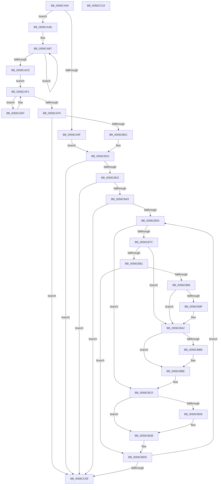

# Amd64InitializeCacheStatusOriginal

- RVA: `0x0056CA40`–`0x0056CC34` (길이 `500` bytes)
- VA: `0x000000014056CA40`
- 실행 섹션: `.text`
- PDB 이름 있음: `예`; PDB Function 태그: `아니요`
- unwind 정보 RVA: `0x000C4980`
- 디코드: `138`개 명령, `500/500` bytes 표시
- 미해석 바이트: `0` (있으면 어셈블리에 `.byte`로 보존)

> 이 문서는 커널 이미지의 기계어와 PDB 기호를 분석해 생성했습니다. 4번과 5번은 함수 원형과 자료형을 바이너리 사용 방식에서 추정한 C 해석이며 원본 소스 복구 결과는 아닙니다.

## 1. Dependencies

- 직접 호출 지점: **5**; 고유 호출 대상: **5**
- 직접 호출자로 확인된 함수: **1**
- RIP 상대 이미지 참조: **3**

### Outgoing calls
- `0x0056CAFF` → [HalpInterruptGetIdentifiers](../4C/HalpInterruptGetIdentifiers_function_004C5DC0.md) (function, `0x004C5DC0`)
- `0x0056CB21` → [Amd64InitializeUncoreStatusOriginal](Amd64InitializeUncoreStatusOriginal_function_0056D214.md) (function, `0x0056D214`)
- `0x0056CB43` → [HalpMmAllocCtxAlloc](../3E/HalpMmAllocCtxAlloc_function_003E10B8.md) (function, `0x003E10B8`)
- `0x0056CBF9` → [Amd64FreeCounter](Amd64FreeCounter_function_0056C524.md) (function, `0x0056C524`)
- `0x0056CC10` → [_security_check_cookie](../6A/_security_check_cookie_function_006AC640.md) (function, `0x006AC640`)

### Direct callers
- [Amd64InitializeUncoreProfilingOriginal](Amd64InitializeUncoreProfilingOriginal_function_0056D068.md) at `0x0056D132`

### Static image references
- `0x0056CA5F` → RVA `0x00E0A740` (`.data`; read)
- `0x0056CA76` → RVA `0x00000000` (`image boundary/outside`; read)
- `0x0056CB15` → RVA `0x00F8F900` (`.data`; read)

## 2. Other-region calls and transfers

- 다른 실행 섹션으로 향하는 call: **0**
- 별도 외부 분기/꼬리 이동을 확인하지 못했습니다.

## 3. Assembly (complete function range)

```asm
0056CA40  48 89 5C 24 08                  mov qword ptr [rsp + 8], rbx
0056CA45  48 89 74 24 10                  mov qword ptr [rsp + 0x10], rsi
0056CA4A  48 89 7C 24 18                  mov qword ptr [rsp + 0x18], rdi
0056CA4F  55                              push rbp
0056CA50  41 54                           push r12
0056CA52  41 55                           push r13
0056CA54  41 56                           push r14
0056CA56  41 57                           push r15
0056CA58  48 8B EC                        mov rbp, rsp
0056CA5B  48 83 EC 40                     sub rsp, 0x40
0056CA5F  48 8B 05 DA DC 89 00            mov rax, qword ptr [rip + 0x89dcda]
0056CA66  48 33 C4                        xor rax, rsp
0056CA69  48 89 45 F8                     mov qword ptr [rbp - 8], rax
0056CA6D  65 44 8B 0C 25 A4 01 00 00      mov r9d, dword ptr gs:[0x1a4]
0056CA76  48 8D 05 83 35 A9 FF            lea rax, [rip - 0x56ca7d]
0056CA7D  83 65 E0 00                     and dword ptr [rbp - 0x20], 0
0056CA81  45 8B F1                        mov r14d, r9d
0056CA84  4A 8B 84 C8 40 8C FC 00         mov rax, qword ptr [rax + r9*8 + 0xfc8c40]
0056CA8C  48 8B 78 58                     mov rdi, qword ptr [rax + 0x58]
0056CA90  65 48 8B 04 25 20 00 00 00      mov rax, qword ptr gs:[0x20]
0056CA99  80 78 40 16                     cmp byte ptr [rax + 0x40], 0x16
0056CA9D  75 0F                           jne 0x14056caae
0056CA9F  B8 1E 00 00 80                  mov eax, 0x8000001e
0056CAA4  33 C9                           xor ecx, ecx
0056CAA6  0F A2                           cpuid
0056CAA8  44 0F B6 C1                     movzx r8d, cl
0056CAAC  EB 67                           jmp 0x14056cb15
0056CAAE  45 33 C0                        xor r8d, r8d
0056CAB1  41 BB 1D 00 00 80               mov r11d, 0x8000001d
0056CAB7  45 8B D0                        mov r10d, r8d
0056CABA  41 8B C3                        mov eax, r11d
0056CABD  41 FF C0                        inc r8d
0056CAC0  41 8B C8                        mov ecx, r8d
0056CAC3  0F A2                           cpuid
0056CAC5  A8 0F                           test al, 0xf
0056CAC7  75 EE                           jne 0x14056cab7
0056CAC9  41 8B C3                        mov eax, r11d
0056CACC  41 8B CA                        mov ecx, r10d
0056CACF  0F A2                           cpuid
0056CAD1  C1 E8 0E                        shr eax, 0xe
0056CAD4  33 DB                           xor ebx, ebx
0056CAD6  25 FF 0F 00 00                  and eax, 0xfff
0056CADB  8D 04 45 01 00 00 00            lea eax, [rax*2 + 1]
0056CAE2  0F BD C8                        bsr ecx, eax
0056CAE5  8D 43 01                        lea eax, [rbx + 1]
0056CAE8  D2 E0                           shl al, cl
0056CAEA  0F B6 D0                        movzx edx, al
0056CAED  EB 02                           jmp 0x14056caf1
0056CAEF  FF C3                           inc ebx
0056CAF1  D1 EA                           shr edx, 1
0056CAF3  75 FA                           jne 0x14056caef
0056CAF5  45 33 C0                        xor r8d, r8d
0056CAF8  48 8D 55 E0                     lea rdx, [rbp - 0x20]
0056CAFC  41 8B C9                        mov ecx, r9d
0056CAFF  E8 BC 92 F5 FF                  call 0x1404c5dc0
0056CB04  85 C0                           test eax, eax
0056CB06  0F 88 FD 00 00 00               js 0x14056cc09
0056CB0C  44 8B 45 E0                     mov r8d, dword ptr [rbp - 0x20]
0056CB10  8B CB                           mov ecx, ebx
0056CB12  41 D3 E8                        shr r8d, cl
0056CB15  48 8D 15 E4 2D A2 00            lea rdx, [rip + 0xa22de4]
0056CB1C  B9 02 00 00 00                  mov ecx, 2
0056CB21  E8 EE 06 00 00                  call 0x14056d214
0056CB26  4C 8B F8                        mov r15, rax
0056CB29  48 85 C0                        test rax, rax
0056CB2C  0F 84 D7 00 00 00               je 0x14056cc09
0056CB32  8B 4F 4C                        mov ecx, dword ptr [rdi + 0x4c]
0056CB35  8D 14 49                        lea edx, [rcx + rcx*2]
0056CB38  C1 E2 03                        shl edx, 3
0056CB3B  85 D2                           test edx, edx
0056CB3D  0F 84 C6 00 00 00               je 0x14056cc09
0056CB43  E8 70 45 E7 FF                  call 0x1403e10b8
0056CB48  4C 8B 6F 58                     mov r13, qword ptr [rdi + 0x58]
0056CB4C  33 F6                           xor esi, esi
0056CB4E  4C 8B E0                        mov r12, rax
0056CB51  39 77 4C                        cmp dword ptr [rdi + 0x4c], esi
0056CB54  0F 86 AF 00 00 00               jbe 0x14056cc09
0056CB5A  48 8D 0C 76                     lea rcx, [rsi + rsi*2]
0056CB5E  33 D2                           xor edx, edx
0056CB60  49 8D 1C CC                     lea rbx, [r12 + rcx*8]
0056CB64  4C 89 7B 08                     mov qword ptr [rbx + 8], r15
0056CB68  48 8D 0C 76                     lea rcx, [rsi + rsi*2]
0056CB6C  48 03 C9                        add rcx, rcx
0056CB6F  49 89 5C CD 10                  mov qword ptr [r13 + rcx*8 + 0x10], rbx
0056CB74  8B 4F 48                        mov ecx, dword ptr [rdi + 0x48]
0056CB77  83 E9 01                        sub ecx, 1
0056CB7A  74 44                           je 0x14056cbc0
0056CB7C  83 E9 63                        sub ecx, 0x63
0056CB7F  74 21                           je 0x14056cba2
0056CB81  83 F9 01                        cmp ecx, 1
0056CB84  75 57                           jne 0x14056cbdd
0056CB86  48 8D 05 73 34 A9 FF            lea rax, [rip - 0x56cb8d]
0056CB8D  4A 8B 84 F0 40 8C FC 00         mov rax, qword ptr [rax + r14*8 + 0xfc8c40]
0056CB95  48 8B 50 58                     mov rdx, qword ptr [rax + 0x58]
0056CB99  48 83 C2 30                     add rdx, 0x30
0056CB9D  74 03                           je 0x14056cba2
0056CB9F  8B 52 04                        mov edx, dword ptr [rdx + 4]
0056CBA2  48 8D 05 57 34 A9 FF            lea rax, [rip - 0x56cba9]
0056CBA9  4A 8B 84 F0 40 8C FC 00         mov rax, qword ptr [rax + r14*8 + 0xfc8c40]
0056CBB1  48 8B 40 58                     mov rax, qword ptr [rax + 0x58]
0056CBB5  48 83 C0 18                     add rax, 0x18
0056CBB9  74 03                           je 0x14056cbbe
0056CBBB  8B 40 04                        mov eax, dword ptr [rax + 4]
0056CBBE  03 D0                           add edx, eax
0056CBC0  48 8D 05 39 34 A9 FF            lea rax, [rip - 0x56cbc7]
0056CBC7  4A 8B 84 F0 40 8C FC 00         mov rax, qword ptr [rax + r14*8 + 0xfc8c40]
0056CBCF  48 8B 40 58                     mov rax, qword ptr [rax + 0x58]
0056CBD3  48 85 C0                        test rax, rax
0056CBD6  74 03                           je 0x14056cbdb
0056CBD8  8B 40 04                        mov eax, dword ptr [rax + 4]
0056CBDB  03 D0                           add edx, eax
0056CBDD  8D 0C 32                        lea ecx, [rdx + rsi]
0056CBE0  33 C0                           xor eax, eax
0056CBE2  48 8D 1D 17 34 A9 FF            lea rbx, [rip - 0x56cbe9]
0056CBE9  33 D2                           xor edx, edx
0056CBEB  8B 8C 8B 40 F9 F8 00            mov ecx, dword ptr [rbx + rcx*4 + 0xf8f940]
0056CBF2  0F 30                           wrmsr
0056CBF4  8B 57 48                        mov edx, dword ptr [rdi + 0x48]
0056CBF7  8B CE                           mov ecx, esi
0056CBF9  E8 26 F9 FF FF                  call 0x14056c524
0056CBFE  FF C6                           inc esi
0056CC00  3B 77 4C                        cmp esi, dword ptr [rdi + 0x4c]
0056CC03  0F 82 51 FF FF FF               jb 0x14056cb5a
0056CC09  48 8B 4D F8                     mov rcx, qword ptr [rbp - 8]
0056CC0D  48 33 CC                        xor rcx, rsp
0056CC10  E8 2B FA 13 00                  call 0x1406ac640
0056CC15  4C 8D 5C 24 40                  lea r11, [rsp + 0x40]
0056CC1A  49 8B 5B 30                     mov rbx, qword ptr [r11 + 0x30]
0056CC1E  49 8B 73 38                     mov rsi, qword ptr [r11 + 0x38]
0056CC22  49 8B 7B 40                     mov rdi, qword ptr [r11 + 0x40]
0056CC26  49 8B E3                        mov rsp, r11
0056CC29  41 5F                           pop r15
0056CC2B  41 5E                           pop r14
0056CC2D  41 5D                           pop r13
0056CC2F  41 5C                           pop r12
0056CC31  5D                              pop rbp
0056CC32  C3                              ret
0056CC33  CC                              int3
```

## 4. C-style interpretation (structured pseudocode)

```c
__int64 __fastcall Amd64InitializeCacheStatusOriginal(int a1)
{
    __int64 result;
    __int64 v_rbx;
    __int64 v_rsi;
    __int64 v_rsp;
    unsigned __int64 v_stack_m28;
    unsigned __int64 v_stack_m30;
    unsigned int v_stack_m48;
    unsigned __int64 v_stack_p10;
    unsigned __int64 v_stack_p18;
    unsigned __int64 v_stack_p8;

    v_stack_p8 = v_rbx;
    v_stack_p10 = v_rsi;
    v_stack_p18 = v_rdi;
    v_rsp = (v_rsp) - (64);
    result = (*(unsigned __int64 *)(v_rip + 9034970)) ^ (v_rsp);
    v_stack_m30 = result;
    if ((*(unsigned __int8 *)(*(unsigned __int64 *)(gs_base + (0 + 32)) + 64)) != 22) goto loc_0056CAAE;
    a1 = 0;
    goto loc_0056CB15;
loc_0056CAAE:
    a3 = 0;
loc_0056CAB7:
    a3 = (unsigned int)((a3) + 1);
    if ((((unsigned __int8)((unsigned int)((unsigned int)((unsigned int)(0x8000001DULL))))) & (15)) != 0) goto loc_0056CAB7;
    result = (unsigned int)(((unsigned int)((unsigned int)((unsigned int)(0x8000001DULL)))) >> (14));
    v_rbx = 0;
    result = (unsigned int)((result) & (0xFFFULL));
    result = (unsigned __int8)((v_rbx + 1) << (0));
    goto loc_0056CAF1;
loc_0056CAEF:
    v_rbx = (unsigned int)((v_rbx) + 1);
loc_0056CAF1:
    a2 = (unsigned int)(((unsigned __int8)(result)) >> (1));
    if (condition_is_not_equal) goto loc_0056CAEF;
    a3 = 0;
    result = HalpInterruptGetIdentifiers((unsigned int)((unsigned int)((unsigned int)(*(unsigned int *)(gs_base + (0 + 420))))), v_stack_m48, a3, (unsigned int)(*(unsigned int *)(gs_base + (0 + 420))));
    if (sign_flag) goto loc_0056CC09;
    a3 = (unsigned int)(((unsigned int)(v_stack_m48)) >> ((unsigned __int8)((unsigned int)((unsigned int)(v_rbx)))));
loc_0056CB15:
    result = Amd64InitializeUncoreStatusOriginal(2, v_rip + 10628580, a3, (unsigned int)(*(unsigned int *)(gs_base + (0 + 420))));
    if (result == 0) goto loc_0056CC09;
    a2 = (unsigned int)(((unsigned int)(*(unsigned int *)(*(unsigned __int64 *)(*(unsigned __int64 *)(v_rip - 5687933 + (unsigned int)(*(unsigned int *)(gs_base + (0 + 420))) * 8 + 16550976) + 88) + 76)) + (unsigned int)(*(unsigned int *)(*(unsigned __int64 *)(*(unsigned __int64 *)(v_rip - 5687933 + (unsigned int)(*(unsigned int *)(gs_base + (0 + 420))) * 8 + 16550976) + 88) + 76)) * 2) << (3));
    if ((unsigned int)(a2) == 0) goto loc_0056CC09;
    result = HalpMmAllocCtxAlloc((unsigned int)(*(unsigned int *)(*(unsigned __int64 *)(*(unsigned __int64 *)(v_rip - 5687933 + (unsigned int)(*(unsigned int *)(gs_base + (0 + 420))) * 8 + 16550976) + 88) + 76)), a2, a3, (unsigned int)(*(unsigned int *)(gs_base + (0 + 420))));
    v_rsi = 0;
    if ((*(unsigned int *)(*(unsigned __int64 *)(*(unsigned __int64 *)(v_rip - 5687933 + (unsigned int)(*(unsigned int *)(gs_base + (0 + 420))) * 8 + 16550976) + 88) + 76)) <= 0) goto loc_0056CC09;
loc_0056CB5A:
    a2 = 0;
    *(unsigned __int64 *)(result + v_rsi + v_rsi * 2 * 8 + 8) = result;
    a1 = (v_rsi + v_rsi * 2) + (v_rsi + v_rsi * 2);
    *(unsigned __int64 *)(*(unsigned __int64 *)(*(unsigned __int64 *)(*(unsigned __int64 *)(v_rip - 5687933 + (unsigned int)(*(unsigned int *)(gs_base + (0 + 420))) * 8 + 16550976) + 88) + 88) + a1 * 8 + 16) = result + v_rsi + v_rsi * 2 * 8;
    a1 = (unsigned int)(((unsigned int)(*(unsigned int *)(*(unsigned __int64 *)(*(unsigned __int64 *)(v_rip - 5687933 + (unsigned int)(*(unsigned int *)(gs_base + (0 + 420))) * 8 + 16550976) + 88) + 72))) - (1));
    if (condition_is_equal) goto loc_0056CBC0;
    a1 = (unsigned int)((a1) - (99));
    if (condition_is_equal) goto loc_0056CBA2;
    if (a1 != 1) goto loc_0056CBDD;
    a2 = (*(unsigned __int64 *)(*(unsigned __int64 *)(v_rip - 5688205 + (unsigned int)((unsigned int)((unsigned int)(*(unsigned int *)(gs_base + (0 + 420))))) * 8 + 16550976) + 88)) + (48);
    if (!(condition_is_equal)) {
        a2 = *(unsigned int *)(a2 + 4);
    }
    result = (*(unsigned __int64 *)(*(unsigned __int64 *)(v_rip - 5688233 + (unsigned int)((unsigned int)((unsigned int)(*(unsigned int *)(gs_base + (0 + 420))))) * 8 + 16550976) + 88)) + (24);
    if (!(condition_is_equal)) {
        result = *(unsigned int *)(result + 4);
    }
    a2 = (unsigned int)((a2) + ((unsigned int)(result)));
loc_0056CBC0:
    result = *(unsigned __int64 *)(*(unsigned __int64 *)(v_rip - 5688263 + (unsigned int)((unsigned int)((unsigned int)(*(unsigned int *)(gs_base + (0 + 420))))) * 8 + 16550976) + 88);
    if (*(unsigned __int64 *)(*(unsigned __int64 *)(v_rip - 5688263 + (unsigned int)((unsigned int)((unsigned int)(*(unsigned int *)(gs_base + (0 + 420))))) * 8 + 16550976) + 88) != 0) {
        result = *(unsigned int *)(*(unsigned __int64 *)(*(unsigned __int64 *)(v_rip - 5688263 + (unsigned int)((unsigned int)((unsigned int)(*(unsigned int *)(gs_base + (0 + 420))))) * 8 + 16550976) + 88) + 4);
    }
    a2 = (unsigned int)((a2) + ((unsigned int)(result)));
loc_0056CBDD:
    result = 0;
    a2 = 0;
    result = Amd64FreeCounter(0, (unsigned int)(*(unsigned int *)(*(unsigned __int64 *)(*(unsigned __int64 *)(v_rip - 5687933 + (unsigned int)(*(unsigned int *)(gs_base + (0 + 420))) * 8 + 16550976) + 88) + 72)), a3, (unsigned int)(*(unsigned int *)(gs_base + (0 + 420))));
    v_rsi = (unsigned int)((v_rsi) + 1);
    if (((unsigned int)(v_rsi)) < (*(unsigned int *)(*(unsigned __int64 *)(*(unsigned __int64 *)(v_rip - 5687933 + (unsigned int)(*(unsigned int *)(gs_base + (0 + 420))) * 8 + 16550976) + 88) + 76))) goto loc_0056CB5A;
loc_0056CC09:
    a1 = (v_stack_m30) ^ (v_rsp);
    result = _security_check_cookie(a1, (unsigned int)(*(unsigned int *)(*(unsigned __int64 *)(*(unsigned __int64 *)(v_rip - 5687933 + (unsigned int)(*(unsigned int *)(gs_base + (0 + 420))) * 8 + 16550976) + 88) + 72)), a3, (unsigned int)(*(unsigned int *)(gs_base + (0 + 420))));
    return result;
}
```

## 5. (Beta) C Style

```c
int64_t Amd64InitializeCacheStatusOriginal(int32_t Arg1)
{
    int64_t result;
    int64_t local_rbx;
    int64_t local_rsi;
    int64_t local_rsp;
    uint64_t v_stack_m28;
    uint64_t v_stack_m30;
    uint32_t v_stack_m48;
    uint64_t v_stack_p10;
    uint64_t v_stack_p18;
    uint64_t v_stack_p8;

    v_stack_p8 = local_rbx;
    v_stack_p10 = local_rsi;
    v_stack_p18 = local_rdi;
    local_rsp = (local_rsp) - (64);
    result = (*(uint64_t *)(v_rip + 0x89DCDA)) ^ (local_rsp);
    v_stack_m30 = result;
    if ((*(uint8_t *)(*(uint64_t *)(gs_base + (0 + 0x20)) + 0x40)) != 22) goto loc_0056CAAE;
    Arg1 = 0;
    goto loc_0056CB15;
loc_0056CAAE:
    a3 = 0;
loc_0056CAB7:
    a3 = (uint32_t)((a3) + 1);
    if ((((uint8_t)((uint32_t)((uint32_t)((uint32_t)(0x8000001DULL))))) & (15)) != 0) goto loc_0056CAB7;
    result = (uint32_t)(((uint32_t)((uint32_t)((uint32_t)(0x8000001DULL)))) >> (14));
    local_rbx = 0;
    result = (uint32_t)((result) & (0xFFFULL));
    result = (uint8_t)((local_rbx + 1) << (0));
    goto loc_0056CAF1;
loc_0056CAEF:
    local_rbx = (uint32_t)((local_rbx) + 1);
loc_0056CAF1:
    a2 = (uint32_t)(((uint8_t)(result)) >> (1));
    if (condition_is_not_equal) goto loc_0056CAEF;
    a3 = 0;
    result = HalpInterruptGetIdentifiers((uint32_t)((uint32_t)((uint32_t)(*(uint32_t *)(gs_base + (0 + 0x1A4))))), v_stack_m48, a3, (uint32_t)(*(uint32_t *)(gs_base + (0 + 0x1A4))));
    if (sign_flag) goto loc_0056CC09;
    a3 = (uint32_t)(((uint32_t)(v_stack_m48)) >> ((uint8_t)((uint32_t)((uint32_t)(local_rbx)))));
loc_0056CB15:
    result = Amd64InitializeUncoreStatusOriginal(2, v_rip + 10628580, a3, (uint32_t)(*(uint32_t *)(gs_base + (0 + 0x1A4))));
    if (result == 0) goto loc_0056CC09;
    a2 = (uint32_t)(((uint32_t)(*(uint32_t *)(*(uint64_t *)(*(uint64_t *)(v_rip - 0x56CA7D + (uint32_t)(*(uint32_t *)(gs_base + (0 + 0x1A4))) * 8 + 0xFC8C40) + 0x58) + 0x4C)) + (uint32_t)(*(uint32_t *)(*(uint64_t *)(*(uint64_t *)(v_rip - 0x56CA7D + (uint32_t)(*(uint32_t *)(gs_base + (0 + 0x1A4))) * 8 + 0xFC8C40) + 0x58) + 0x4C)) * 2) << (3));
    if ((uint32_t)(a2) == 0) goto loc_0056CC09;
    result = HalpMmAllocCtxAlloc((uint32_t)(*(uint32_t *)(*(uint64_t *)(*(uint64_t *)(v_rip - 0x56CA7D + (uint32_t)(*(uint32_t *)(gs_base + (0 + 0x1A4))) * 8 + 0xFC8C40) + 0x58) + 0x4C)), a2, a3, (uint32_t)(*(uint32_t *)(gs_base + (0 + 0x1A4))));
    local_rsi = 0;
    if ((*(uint32_t *)(*(uint64_t *)(*(uint64_t *)(v_rip - 0x56CA7D + (uint32_t)(*(uint32_t *)(gs_base + (0 + 0x1A4))) * 8 + 0xFC8C40) + 0x58) + 0x4C)) <= 0) goto loc_0056CC09;
loc_0056CB5A:
    a2 = 0;
    *(uint64_t *)(result + local_rsi + local_rsi * 2 * 8 + 0x8) = result;
    Arg1 = (local_rsi + local_rsi * 2) + (local_rsi + local_rsi * 2);
    *(uint64_t *)(*(uint64_t *)(*(uint64_t *)(*(uint64_t *)(v_rip - 0x56CA7D + (uint32_t)(*(uint32_t *)(gs_base + (0 + 0x1A4))) * 8 + 0xFC8C40) + 0x58) + 0x58) + Arg1 * 8 + 0x10) = result + local_rsi + local_rsi * 2 * 8;
    Arg1 = (uint32_t)(((uint32_t)(*(uint32_t *)(*(uint64_t *)(*(uint64_t *)(v_rip - 0x56CA7D + (uint32_t)(*(uint32_t *)(gs_base + (0 + 0x1A4))) * 8 + 0xFC8C40) + 0x58) + 0x48))) - (1));
    if (condition_is_equal) goto loc_0056CBC0;
    Arg1 = (uint32_t)((Arg1) - (99));
    if (condition_is_equal) goto loc_0056CBA2;
    if (Arg1 != 1) goto loc_0056CBDD;
    a2 = (*(uint64_t *)(*(uint64_t *)(v_rip - 0x56CB8D + (uint32_t)((uint32_t)((uint32_t)(*(uint32_t *)(gs_base + (0 + 0x1A4))))) * 8 + 0xFC8C40) + 0x58)) + (48);
    if (!(condition_is_equal)) {
        a2 = *(uint32_t *)(a2 + 0x4);
    }
    result = (*(uint64_t *)(*(uint64_t *)(v_rip - 0x56CBA9 + (uint32_t)((uint32_t)((uint32_t)(*(uint32_t *)(gs_base + (0 + 0x1A4))))) * 8 + 0xFC8C40) + 0x58)) + (24);
    if (!(condition_is_equal)) {
        result = *(uint32_t *)(result + 0x4);
    }
    a2 = (uint32_t)((a2) + ((uint32_t)(result)));
loc_0056CBC0:
    result = *(uint64_t *)(*(uint64_t *)(v_rip - 0x56CBC7 + (uint32_t)((uint32_t)((uint32_t)(*(uint32_t *)(gs_base + (0 + 0x1A4))))) * 8 + 0xFC8C40) + 0x58);
    if (*(uint64_t *)(*(uint64_t *)(v_rip - 0x56CBC7 + (uint32_t)((uint32_t)((uint32_t)(*(uint32_t *)(gs_base + (0 + 0x1A4))))) * 8 + 0xFC8C40) + 0x58) != 0) {
        result = *(uint32_t *)(*(uint64_t *)(*(uint64_t *)(v_rip - 0x56CBC7 + (uint32_t)((uint32_t)((uint32_t)(*(uint32_t *)(gs_base + (0 + 0x1A4))))) * 8 + 0xFC8C40) + 0x58) + 0x4);
    }
    a2 = (uint32_t)((a2) + ((uint32_t)(result)));
loc_0056CBDD:
    result = 0;
    a2 = 0;
    result = Amd64FreeCounter(0, (uint32_t)(*(uint32_t *)(*(uint64_t *)(*(uint64_t *)(v_rip - 0x56CA7D + (uint32_t)(*(uint32_t *)(gs_base + (0 + 0x1A4))) * 8 + 0xFC8C40) + 0x58) + 0x48)), a3, (uint32_t)(*(uint32_t *)(gs_base + (0 + 0x1A4))));
    local_rsi = (uint32_t)((local_rsi) + 1);
    if (((uint32_t)(local_rsi)) < (*(uint32_t *)(*(uint64_t *)(*(uint64_t *)(v_rip - 0x56CA7D + (uint32_t)(*(uint32_t *)(gs_base + (0 + 0x1A4))) * 8 + 0xFC8C40) + 0x58) + 0x4C))) goto loc_0056CB5A;
loc_0056CC09:
    Arg1 = (v_stack_m30) ^ (local_rsp);
    result = _security_check_cookie(Arg1, (uint32_t)(*(uint32_t *)(*(uint64_t *)(*(uint64_t *)(v_rip - 0x56CA7D + (uint32_t)(*(uint32_t *)(gs_base + (0 + 0x1A4))) * 8 + 0xFC8C40) + 0x58) + 0x48)), a3, (uint32_t)(*(uint32_t *)(gs_base + (0 + 0x1A4))));
    return result;
}
```

## 6. Execution-region graph

[열기: 2D/3D 그래프와 함수 탐색 컨트롤 패널](../../../control-panel.html?section=text&rva=0x0056CA40&view=graph)

- 2D 그래프는 위에서 아래로 흐르고, 3D 그래프는 빈 공간을 드래그해 회전합니다. Shift+드래그는 이동, 휠은 확대·축소, 함수 노드 선택은 대상 보고서 이동입니다.

### Static fallback


