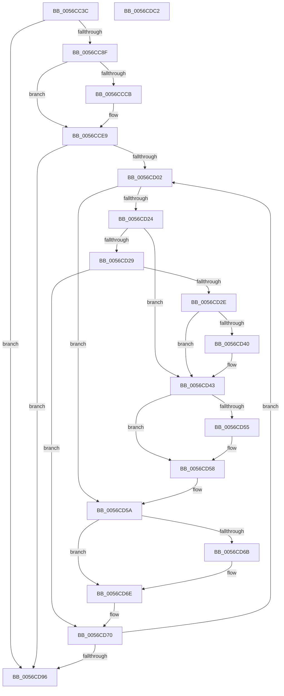

# Amd64InitializeDataFabricStatusEnhanced

- RVA: `0x0056CC3C`–`0x0056CDC3` (길이 `391` bytes)
- VA: `0x000000014056CC3C`
- 실행 섹션: `.text`
- PDB 이름 있음: `예`; PDB Function 태그: `아니요`
- unwind 정보 RVA: `0x000BC32C`
- 디코드: `105`개 명령, `391/391` bytes 표시
- 미해석 바이트: `0` (있으면 어셈블리에 `.byte`로 보존)

> 이 문서는 커널 이미지의 기계어와 PDB 기호를 분석해 생성했습니다. 4번과 5번은 함수 원형과 자료형을 바이너리 사용 방식에서 추정한 C 해석이며 원본 소스 복구 결과는 아닙니다.

## 1. Dependencies

- 직접 호출 지점: **6**; 고유 호출 대상: **6**
- 직접 호출자로 확인된 함수: **1**
- RIP 상대 이미지 참조: **4**

### Outgoing calls
- `0x0056CCA8` → [Amd64InitializeUncoreStatusEnhanced](Amd64InitializeUncoreStatusEnhanced_function_0056D178.md) (function, `0x0056D178`)
- `0x0056CCBB` → [HalpMmAllocCtxAlloc](../3E/HalpMmAllocCtxAlloc_function_003E10B8.md) (function, `0x003E10B8`)
- `0x0056CCE3` → [KeBugCheckEx](../4F/KeBugCheckEx_function_004FD660.md) (function, `0x004FD660`)
- `0x0056CCEE` → [memset](../6C/memset_function_006C6C40.md) (function, `0x006C6C40`)
- `0x0056CD86` → [Amd64FreeCounter](Amd64FreeCounter_function_0056C524.md) (function, `0x0056C524`)
- `0x0056CD9E` → [_security_check_cookie](../6A/_security_check_cookie_function_006AC640.md) (function, `0x006AC640`)

### Direct callers
- [Amd64InitializeUncoreProfilingEnhanced](Amd64InitializeUncoreProfilingEnhanced_function_0056CF58.md) at `0x0056D013`

### Static image references
- `0x0056CC59` → RVA `0x00E0A740` (`.data`; read)
- `0x0056CC70` → RVA `0x00000000` (`image boundary/outside`; read)
- `0x0056CC9C` → RVA `0x00F8F890` (`.data`; read)
- `0x0056CCCB` → RVA `0x00026288` (`.rdata`; read)

## 2. Other-region calls and transfers

- 다른 실행 섹션으로 향하는 call: **0**
- 별도 외부 분기/꼬리 이동을 확인하지 못했습니다.

## 3. Assembly (complete function range)

```asm
0056CC3C  48 8B C4                        mov rax, rsp
0056CC3F  48 89 58 08                     mov qword ptr [rax + 8], rbx
0056CC43  48 89 68 10                     mov qword ptr [rax + 0x10], rbp
0056CC47  48 89 70 18                     mov qword ptr [rax + 0x18], rsi
0056CC4B  48 89 78 20                     mov qword ptr [rax + 0x20], rdi
0056CC4F  41 54                           push r12
0056CC51  41 56                           push r14
0056CC53  41 57                           push r15
0056CC55  48 83 EC 50                     sub rsp, 0x50
0056CC59  48 8B 05 E0 DA 89 00            mov rax, qword ptr [rip + 0x89dae0]
0056CC60  48 33 C4                        xor rax, rsp
0056CC63  48 89 44 24 40                  mov qword ptr [rsp + 0x40], rax
0056CC68  65 8B 04 25 A4 01 00 00         mov eax, dword ptr gs:[0x1a4]
0056CC70  4C 8D 25 89 33 A9 FF            lea r12, [rip - 0x56cc77]
0056CC77  8B F0                           mov esi, eax
0056CC79  49 8B 84 C4 40 8C FC 00         mov rax, qword ptr [r12 + rax*8 + 0xfc8c40]
0056CC81  48 8B 78 58                     mov rdi, qword ptr [rax + 0x58]
0056CC85  83 7F 34 00                     cmp dword ptr [rdi + 0x34], 0
0056CC89  0F 84 07 01 00 00               je 0x14056cd96
0056CC8F  33 C9                           xor ecx, ecx
0056CC91  B8 1E 00 00 80                  mov eax, 0x8000001e
0056CC96  0F A2                           cpuid
0056CC98  44 0F B6 C1                     movzx r8d, cl
0056CC9C  48 8D 15 ED 2B A2 00            lea rdx, [rip + 0xa22bed]
0056CCA3  B9 01 00 00 00                  mov ecx, 1
0056CCA8  E8 CB 04 00 00                  call 0x14056d178
0056CCAD  8B 4F 34                        mov ecx, dword ptr [rdi + 0x34]
0056CCB0  4C 8B F8                        mov r15, rax
0056CCB3  8D 14 49                        lea edx, [rcx + rcx*2]
0056CCB6  C1 E2 03                        shl edx, 3
0056CCB9  8B DA                           mov ebx, edx
0056CCBB  E8 F8 43 E7 FF                  call 0x1403e10b8
0056CCC0  4C 8B F0                        mov r14, rax
0056CCC3  44 8B C3                        mov r8d, ebx
0056CCC6  48 85 C0                        test rax, rax
0056CCC9  75 1E                           jne 0x14056cce9
0056CCCB  4C 8D 0D B6 95 AB FF            lea r9, [rip - 0x546a4a]
0056CCD2  48 C7 44 24 20 04 07 00 00      mov qword ptr [rsp + 0x20], 0x704
0056CCDB  BA 03 90 00 00                  mov edx, 0x9003
0056CCE0  8D 48 5C                        lea ecx, [rax + 0x5c]
0056CCE3  E8 78 09 F9 FF                  call 0x1404fd660
0056CCE8  CC                              int3
0056CCE9  33 D2                           xor edx, edx
0056CCEB  49 8B CE                        mov rcx, r14
0056CCEE  E8 4D 9F 15 00                  call 0x1406c6c40
0056CCF3  48 8B 6F 40                     mov rbp, qword ptr [rdi + 0x40]
0056CCF7  33 DB                           xor ebx, ebx
0056CCF9  39 5F 34                        cmp dword ptr [rdi + 0x34], ebx
0056CCFC  0F 86 94 00 00 00               jbe 0x14056cd96
0056CD02  48 8D 04 5B                     lea rax, [rbx + rbx*2]
0056CD06  49 8D 14 C6                     lea rdx, [r14 + rax*8]
0056CD0A  4C 89 7A 08                     mov qword ptr [rdx + 8], r15
0056CD0E  48 8D 04 5B                     lea rax, [rbx + rbx*2]
0056CD12  48 03 C0                        add rax, rax
0056CD15  48 89 54 C5 10                  mov qword ptr [rbp + rax*8 + 0x10], rdx
0056CD1A  33 D2                           xor edx, edx
0056CD1C  8B 4F 30                        mov ecx, dword ptr [rdi + 0x30]
0056CD1F  83 E9 01                        sub ecx, 1
0056CD22  74 36                           je 0x14056cd5a
0056CD24  83 E9 63                        sub ecx, 0x63
0056CD27  74 1A                           je 0x14056cd43
0056CD29  83 F9 01                        cmp ecx, 1
0056CD2C  75 42                           jne 0x14056cd70
0056CD2E  49 8B 84 F4 40 8C FC 00         mov rax, qword ptr [r12 + rsi*8 + 0xfc8c40]
0056CD36  48 8B 50 58                     mov rdx, qword ptr [rax + 0x58]
0056CD3A  48 83 C2 30                     add rdx, 0x30
0056CD3E  74 03                           je 0x14056cd43
0056CD40  8B 52 04                        mov edx, dword ptr [rdx + 4]
0056CD43  49 8B 84 F4 40 8C FC 00         mov rax, qword ptr [r12 + rsi*8 + 0xfc8c40]
0056CD4B  48 8B 40 58                     mov rax, qword ptr [rax + 0x58]
0056CD4F  48 83 C0 18                     add rax, 0x18
0056CD53  74 03                           je 0x14056cd58
0056CD55  8B 40 04                        mov eax, dword ptr [rax + 4]
0056CD58  03 D0                           add edx, eax
0056CD5A  49 8B 84 F4 40 8C FC 00         mov rax, qword ptr [r12 + rsi*8 + 0xfc8c40]
0056CD62  48 8B 40 58                     mov rax, qword ptr [rax + 0x58]
0056CD66  48 85 C0                        test rax, rax
0056CD69  74 03                           je 0x14056cd6e
0056CD6B  8B 40 04                        mov eax, dword ptr [rax + 4]
0056CD6E  03 D0                           add edx, eax
0056CD70  8D 0C 1A                        lea ecx, [rdx + rbx]
0056CD73  33 C0                           xor eax, eax
0056CD75  41 8B 8C 8C 40 F9 F8 00         mov ecx, dword ptr [r12 + rcx*4 + 0xf8f940]
0056CD7D  33 D2                           xor edx, edx
0056CD7F  0F 30                           wrmsr
0056CD81  8B 57 30                        mov edx, dword ptr [rdi + 0x30]
0056CD84  8B CB                           mov ecx, ebx
0056CD86  E8 99 F7 FF FF                  call 0x14056c524
0056CD8B  FF C3                           inc ebx
0056CD8D  3B 5F 34                        cmp ebx, dword ptr [rdi + 0x34]
0056CD90  0F 82 6C FF FF FF               jb 0x14056cd02
0056CD96  48 8B 4C 24 40                  mov rcx, qword ptr [rsp + 0x40]
0056CD9B  48 33 CC                        xor rcx, rsp
0056CD9E  E8 9D F8 13 00                  call 0x1406ac640
0056CDA3  4C 8D 5C 24 50                  lea r11, [rsp + 0x50]
0056CDA8  49 8B 5B 20                     mov rbx, qword ptr [r11 + 0x20]
0056CDAC  49 8B 6B 28                     mov rbp, qword ptr [r11 + 0x28]
0056CDB0  49 8B 73 30                     mov rsi, qword ptr [r11 + 0x30]
0056CDB4  49 8B 7B 38                     mov rdi, qword ptr [r11 + 0x38]
0056CDB8  49 8B E3                        mov rsp, r11
0056CDBB  41 5F                           pop r15
0056CDBD  41 5E                           pop r14
0056CDBF  41 5C                           pop r12
0056CDC1  C3                              ret
0056CDC2  CC                              int3
```

## 4. C-style interpretation (structured pseudocode)

```c
__int64 __fastcall Amd64InitializeDataFabricStatusEnhanced(int a1)
{
    __int64 result;
    __int64 v_rbx;
    __int64 v_rsp;
    unsigned __int64 v_stack_m18;
    unsigned __int64 v_stack_m28;
    unsigned __int64 v_stack_m48;

    *(unsigned __int64 *)(v_rsp + 8) = v_rbx;
    *(unsigned __int64 *)(v_rsp + 16) = v_rbp;
    *(unsigned __int64 *)(v_rsp + 24) = v_rsi;
    *(unsigned __int64 *)(v_rsp + 32) = v_rdi;
    v_rsp = (v_rsp) - (80);
    result = (*(unsigned __int64 *)(v_rip + 9034464)) ^ (v_rsp);
    v_stack_m28 = result;
    if ((*(unsigned int *)(*(unsigned __int64 *)(*(unsigned __int64 *)(v_rip - 5688439 + (unsigned int)(*(unsigned int *)(gs_base + (0 + 420))) * 8 + 16550976) + 88) + 52)) == 0) goto loc_0056CD96;
    a1 = 0;
    result = Amd64InitializeUncoreStatusEnhanced(1, v_rip + 10628077, 0, a4);
    a2 = (unsigned int)(((unsigned int)(*(unsigned int *)(*(unsigned __int64 *)(*(unsigned __int64 *)(v_rip - 5688439 + (unsigned int)(*(unsigned int *)(gs_base + (0 + 420))) * 8 + 16550976) + 88) + 52)) + (unsigned int)(*(unsigned int *)(*(unsigned __int64 *)(*(unsigned __int64 *)(v_rip - 5688439 + (unsigned int)(*(unsigned int *)(gs_base + (0 + 420))) * 8 + 16550976) + 88) + 52)) * 2) << (3));
    result = HalpMmAllocCtxAlloc((unsigned int)(*(unsigned int *)(*(unsigned __int64 *)(*(unsigned __int64 *)(v_rip - 5688439 + (unsigned int)(*(unsigned int *)(gs_base + (0 + 420))) * 8 + 16550976) + 88) + 52)), a2, 0, a4);
    if (result == 0) {
        a4 = v_rip - 5532234;
        v_stack_m48 = 0x704ULL;
        a2 = 0x9003ULL;
        a1 = result + 92;
        result = KeBugCheckEx(a1, a2, (unsigned int)((unsigned int)((unsigned int)((unsigned int)(a2)))), a4);
    }
    a2 = 0;
    result = memset(result, a2, (unsigned int)((unsigned int)((unsigned int)((unsigned int)(a2)))), a4);
    v_rbx = 0;
    if ((*(unsigned int *)(*(unsigned __int64 *)(*(unsigned __int64 *)(v_rip - 5688439 + (unsigned int)(*(unsigned int *)(gs_base + (0 + 420))) * 8 + 16550976) + 88) + 52)) <= 0) goto loc_0056CD96;
loc_0056CD02:
    *(unsigned __int64 *)(result + v_rbx + v_rbx * 2 * 8 + 8) = result;
    result = (v_rbx + v_rbx * 2) + (v_rbx + v_rbx * 2);
    *(unsigned __int64 *)(*(unsigned __int64 *)(*(unsigned __int64 *)(*(unsigned __int64 *)(v_rip - 5688439 + (unsigned int)(*(unsigned int *)(gs_base + (0 + 420))) * 8 + 16550976) + 88) + 64) + result * 8 + 16) = result + v_rbx + v_rbx * 2 * 8;
    a2 = 0;
    a1 = (unsigned int)(((unsigned int)(*(unsigned int *)(*(unsigned __int64 *)(*(unsigned __int64 *)(v_rip - 5688439 + (unsigned int)(*(unsigned int *)(gs_base + (0 + 420))) * 8 + 16550976) + 88) + 48))) - (1));
    if (condition_is_equal) goto loc_0056CD5A;
    a1 = (unsigned int)((a1) - (99));
    if (condition_is_equal) goto loc_0056CD43;
    if (a1 != 1) goto loc_0056CD70;
    a2 = (*(unsigned __int64 *)(*(unsigned __int64 *)(v_rip - 5688439 + (unsigned int)((unsigned int)((unsigned int)(*(unsigned int *)(gs_base + (0 + 420))))) * 8 + 16550976) + 88)) + (48);
    if (!(condition_is_equal)) {
        a2 = *(unsigned int *)(a2 + 4);
    }
    result = (*(unsigned __int64 *)(*(unsigned __int64 *)(v_rip - 5688439 + (unsigned int)((unsigned int)((unsigned int)(*(unsigned int *)(gs_base + (0 + 420))))) * 8 + 16550976) + 88)) + (24);
    if (!(condition_is_equal)) {
        result = *(unsigned int *)(result + 4);
    }
    a2 = (unsigned int)((a2) + ((unsigned int)(result)));
loc_0056CD5A:
    result = *(unsigned __int64 *)(*(unsigned __int64 *)(v_rip - 5688439 + (unsigned int)((unsigned int)((unsigned int)(*(unsigned int *)(gs_base + (0 + 420))))) * 8 + 16550976) + 88);
    if (*(unsigned __int64 *)(*(unsigned __int64 *)(v_rip - 5688439 + (unsigned int)((unsigned int)((unsigned int)(*(unsigned int *)(gs_base + (0 + 420))))) * 8 + 16550976) + 88) != 0) {
        result = *(unsigned int *)(*(unsigned __int64 *)(*(unsigned __int64 *)(v_rip - 5688439 + (unsigned int)((unsigned int)((unsigned int)(*(unsigned int *)(gs_base + (0 + 420))))) * 8 + 16550976) + 88) + 4);
    }
    a2 = (unsigned int)((a2) + ((unsigned int)(result)));
loc_0056CD70:
    result = 0;
    a2 = 0;
    result = Amd64FreeCounter(0, (unsigned int)(*(unsigned int *)(*(unsigned __int64 *)(*(unsigned __int64 *)(v_rip - 5688439 + (unsigned int)(*(unsigned int *)(gs_base + (0 + 420))) * 8 + 16550976) + 88) + 48)), (unsigned int)((unsigned int)((unsigned int)((unsigned int)(a2)))), a4);
    v_rbx = (unsigned int)((v_rbx) + 1);
    if (((unsigned int)(v_rbx)) < (*(unsigned int *)(*(unsigned __int64 *)(*(unsigned __int64 *)(v_rip - 5688439 + (unsigned int)(*(unsigned int *)(gs_base + (0 + 420))) * 8 + 16550976) + 88) + 52))) goto loc_0056CD02;
loc_0056CD96:
    a1 = (v_stack_m28) ^ (v_rsp);
    result = _security_check_cookie(a1, (unsigned int)(*(unsigned int *)(*(unsigned __int64 *)(*(unsigned __int64 *)(v_rip - 5688439 + (unsigned int)(*(unsigned int *)(gs_base + (0 + 420))) * 8 + 16550976) + 88) + 48)), (unsigned int)((unsigned int)((unsigned int)((unsigned int)(a2)))), a4);
    return result;
}
```

## 5. (Beta) C Style

```c
int64_t Amd64InitializeDataFabricStatusEnhanced(int32_t Arg1)
{
    int64_t result;
    int64_t local_rbx;
    int64_t local_rsp;
    uint64_t v_stack_m18;
    uint64_t v_stack_m28;
    uint64_t v_stack_m48;

    *(uint64_t *)(local_rsp + 0x8) = local_rbx;
    *(uint64_t *)(local_rsp + 0x10) = local_rbp;
    *(uint64_t *)(local_rsp + 0x18) = local_rsi;
    *(uint64_t *)(local_rsp + 0x20) = local_rdi;
    local_rsp = (local_rsp) - (80);
    result = (*(uint64_t *)(v_rip + 0x89DAE0)) ^ (local_rsp);
    v_stack_m28 = result;
    if ((*(uint32_t *)(*(uint64_t *)(*(uint64_t *)(v_rip - 0x56CC77 + (uint32_t)(*(uint32_t *)(gs_base + (0 + 0x1A4))) * 8 + 0xFC8C40) + 0x58) + 0x34)) == 0) goto loc_0056CD96;
    Arg1 = 0;
    result = Amd64InitializeUncoreStatusEnhanced(1, v_rip + 10628077, 0, a4);
    a2 = (uint32_t)(((uint32_t)(*(uint32_t *)(*(uint64_t *)(*(uint64_t *)(v_rip - 0x56CC77 + (uint32_t)(*(uint32_t *)(gs_base + (0 + 0x1A4))) * 8 + 0xFC8C40) + 0x58) + 0x34)) + (uint32_t)(*(uint32_t *)(*(uint64_t *)(*(uint64_t *)(v_rip - 0x56CC77 + (uint32_t)(*(uint32_t *)(gs_base + (0 + 0x1A4))) * 8 + 0xFC8C40) + 0x58) + 0x34)) * 2) << (3));
    result = HalpMmAllocCtxAlloc((uint32_t)(*(uint32_t *)(*(uint64_t *)(*(uint64_t *)(v_rip - 0x56CC77 + (uint32_t)(*(uint32_t *)(gs_base + (0 + 0x1A4))) * 8 + 0xFC8C40) + 0x58) + 0x34)), a2, 0, a4);
    if (result == 0) {
        a4 = v_rip - 5532234;
        v_stack_m48 = 0x704ULL;
        a2 = 0x9003ULL;
        Arg1 = result + 92;
        result = KeBugCheckEx(Arg1, a2, (uint32_t)((uint32_t)((uint32_t)((uint32_t)(a2)))), a4);
    }
    a2 = 0;
    result = memset(result, a2, (uint32_t)((uint32_t)((uint32_t)((uint32_t)(a2)))), a4);
    local_rbx = 0;
    if ((*(uint32_t *)(*(uint64_t *)(*(uint64_t *)(v_rip - 0x56CC77 + (uint32_t)(*(uint32_t *)(gs_base + (0 + 0x1A4))) * 8 + 0xFC8C40) + 0x58) + 0x34)) <= 0) goto loc_0056CD96;
loc_0056CD02:
    *(uint64_t *)(result + local_rbx + local_rbx * 2 * 8 + 0x8) = result;
    result = (local_rbx + local_rbx * 2) + (local_rbx + local_rbx * 2);
    *(uint64_t *)(*(uint64_t *)(*(uint64_t *)(*(uint64_t *)(v_rip - 0x56CC77 + (uint32_t)(*(uint32_t *)(gs_base + (0 + 0x1A4))) * 8 + 0xFC8C40) + 0x58) + 0x40) + result * 8 + 0x10) = result + local_rbx + local_rbx * 2 * 8;
    a2 = 0;
    Arg1 = (uint32_t)(((uint32_t)(*(uint32_t *)(*(uint64_t *)(*(uint64_t *)(v_rip - 0x56CC77 + (uint32_t)(*(uint32_t *)(gs_base + (0 + 0x1A4))) * 8 + 0xFC8C40) + 0x58) + 0x30))) - (1));
    if (condition_is_equal) goto loc_0056CD5A;
    Arg1 = (uint32_t)((Arg1) - (99));
    if (condition_is_equal) goto loc_0056CD43;
    if (Arg1 != 1) goto loc_0056CD70;
    a2 = (*(uint64_t *)(*(uint64_t *)(v_rip - 0x56CC77 + (uint32_t)((uint32_t)((uint32_t)(*(uint32_t *)(gs_base + (0 + 0x1A4))))) * 8 + 0xFC8C40) + 0x58)) + (48);
    if (!(condition_is_equal)) {
        a2 = *(uint32_t *)(a2 + 0x4);
    }
    result = (*(uint64_t *)(*(uint64_t *)(v_rip - 0x56CC77 + (uint32_t)((uint32_t)((uint32_t)(*(uint32_t *)(gs_base + (0 + 0x1A4))))) * 8 + 0xFC8C40) + 0x58)) + (24);
    if (!(condition_is_equal)) {
        result = *(uint32_t *)(result + 0x4);
    }
    a2 = (uint32_t)((a2) + ((uint32_t)(result)));
loc_0056CD5A:
    result = *(uint64_t *)(*(uint64_t *)(v_rip - 0x56CC77 + (uint32_t)((uint32_t)((uint32_t)(*(uint32_t *)(gs_base + (0 + 0x1A4))))) * 8 + 0xFC8C40) + 0x58);
    if (*(uint64_t *)(*(uint64_t *)(v_rip - 0x56CC77 + (uint32_t)((uint32_t)((uint32_t)(*(uint32_t *)(gs_base + (0 + 0x1A4))))) * 8 + 0xFC8C40) + 0x58) != 0) {
        result = *(uint32_t *)(*(uint64_t *)(*(uint64_t *)(v_rip - 0x56CC77 + (uint32_t)((uint32_t)((uint32_t)(*(uint32_t *)(gs_base + (0 + 0x1A4))))) * 8 + 0xFC8C40) + 0x58) + 0x4);
    }
    a2 = (uint32_t)((a2) + ((uint32_t)(result)));
loc_0056CD70:
    result = 0;
    a2 = 0;
    result = Amd64FreeCounter(0, (uint32_t)(*(uint32_t *)(*(uint64_t *)(*(uint64_t *)(v_rip - 0x56CC77 + (uint32_t)(*(uint32_t *)(gs_base + (0 + 0x1A4))) * 8 + 0xFC8C40) + 0x58) + 0x30)), (uint32_t)((uint32_t)((uint32_t)((uint32_t)(a2)))), a4);
    local_rbx = (uint32_t)((local_rbx) + 1);
    if (((uint32_t)(local_rbx)) < (*(uint32_t *)(*(uint64_t *)(*(uint64_t *)(v_rip - 0x56CC77 + (uint32_t)(*(uint32_t *)(gs_base + (0 + 0x1A4))) * 8 + 0xFC8C40) + 0x58) + 0x34))) goto loc_0056CD02;
loc_0056CD96:
    Arg1 = (v_stack_m28) ^ (local_rsp);
    result = _security_check_cookie(Arg1, (uint32_t)(*(uint32_t *)(*(uint64_t *)(*(uint64_t *)(v_rip - 0x56CC77 + (uint32_t)(*(uint32_t *)(gs_base + (0 + 0x1A4))) * 8 + 0xFC8C40) + 0x58) + 0x30)), (uint32_t)((uint32_t)((uint32_t)((uint32_t)(a2)))), a4);
    return result;
}
```

## 6. Execution-region graph

[열기: 2D/3D 그래프와 함수 탐색 컨트롤 패널](../../../control-panel.html?section=text&rva=0x0056CC3C&view=graph)

- 2D 그래프는 위에서 아래로 흐르고, 3D 그래프는 빈 공간을 드래그해 회전합니다. Shift+드래그는 이동, 휠은 확대·축소, 함수 노드 선택은 대상 보고서 이동입니다.

### Static fallback


