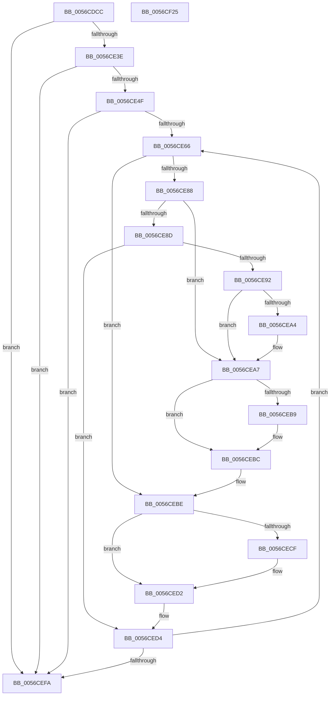

# Amd64InitializeDataFabricStatusOriginal

- RVA: `0x0056CDCC`–`0x0056CF26` (길이 `346` bytes)
- VA: `0x000000014056CDCC`
- 실행 섹션: `.text`
- PDB 이름 있음: `예`; PDB Function 태그: `아니요`
- unwind 정보 RVA: `0x000C50C8`
- 디코드: `95`개 명령, `346/346` bytes 표시
- 미해석 바이트: `0` (있으면 어셈블리에 `.byte`로 보존)

> 이 문서는 커널 이미지의 기계어와 PDB 기호를 분석해 생성했습니다. 4번과 5번은 함수 원형과 자료형을 바이너리 사용 방식에서 추정한 C 해석이며 원본 소스 복구 결과는 아닙니다.

## 1. Dependencies

- 직접 호출 지점: **4**; 고유 호출 대상: **4**
- 직접 호출자로 확인된 함수: **1**
- RIP 상대 이미지 참조: **3**

### Outgoing calls
- `0x0056CE2D` → [Amd64InitializeUncoreStatusOriginal](Amd64InitializeUncoreStatusOriginal_function_0056D214.md) (function, `0x0056D214`)
- `0x0056CE4F` → [HalpMmAllocCtxAlloc](../3E/HalpMmAllocCtxAlloc_function_003E10B8.md) (function, `0x003E10B8`)
- `0x0056CEEA` → [Amd64FreeCounter](Amd64FreeCounter_function_0056C524.md) (function, `0x0056C524`)
- `0x0056CF02` → [_security_check_cookie](../6A/_security_check_cookie_function_006AC640.md) (function, `0x006AC640`)

### Direct callers
- [Amd64InitializeUncoreProfilingOriginal](Amd64InitializeUncoreProfilingOriginal_function_0056D068.md) at `0x0056D123`

### Static image references
- `0x0056CDE8` → RVA `0x00E0A740` (`.data`; read)
- `0x0056CDFF` → RVA `0x00000000` (`image boundary/outside`; read)
- `0x0056CE21` → RVA `0x00F8F890` (`.data`; read)

## 2. Other-region calls and transfers

- 다른 실행 섹션으로 향하는 call: **0**
- 별도 외부 분기/꼬리 이동을 확인하지 못했습니다.

## 3. Assembly (complete function range)

```asm
0056CDCC  48 89 5C 24 08                  mov qword ptr [rsp + 8], rbx
0056CDD1  48 89 6C 24 10                  mov qword ptr [rsp + 0x10], rbp
0056CDD6  48 89 74 24 18                  mov qword ptr [rsp + 0x18], rsi
0056CDDB  57                              push rdi
0056CDDC  41 54                           push r12
0056CDDE  41 55                           push r13
0056CDE0  41 56                           push r14
0056CDE2  41 57                           push r15
0056CDE4  48 83 EC 40                     sub rsp, 0x40
0056CDE8  48 8B 05 51 D9 89 00            mov rax, qword ptr [rip + 0x89d951]
0056CDEF  48 33 C4                        xor rax, rsp
0056CDF2  48 89 44 24 30                  mov qword ptr [rsp + 0x30], rax
0056CDF7  65 8B 04 25 A4 01 00 00         mov eax, dword ptr gs:[0x1a4]
0056CDFF  4C 8D 2D FA 31 A9 FF            lea r13, [rip - 0x56ce06]
0056CE06  8B E8                           mov ebp, eax
0056CE08  33 C9                           xor ecx, ecx
0056CE0A  49 8B 84 C5 40 8C FC 00         mov rax, qword ptr [r13 + rax*8 + 0xfc8c40]
0056CE12  48 8B 78 58                     mov rdi, qword ptr [rax + 0x58]
0056CE16  B8 1E 00 00 80                  mov eax, 0x8000001e
0056CE1B  0F A2                           cpuid
0056CE1D  44 0F B6 C1                     movzx r8d, cl
0056CE21  48 8D 15 68 2A A2 00            lea rdx, [rip + 0xa22a68]
0056CE28  B9 01 00 00 00                  mov ecx, 1
0056CE2D  E8 E2 03 00 00                  call 0x14056d214
0056CE32  4C 8B E0                        mov r12, rax
0056CE35  48 85 C0                        test rax, rax
0056CE38  0F 84 BC 00 00 00               je 0x14056cefa
0056CE3E  8B 4F 34                        mov ecx, dword ptr [rdi + 0x34]
0056CE41  8D 14 49                        lea edx, [rcx + rcx*2]
0056CE44  C1 E2 03                        shl edx, 3
0056CE47  85 D2                           test edx, edx
0056CE49  0F 84 AB 00 00 00               je 0x14056cefa
0056CE4F  E8 64 42 E7 FF                  call 0x1403e10b8
0056CE54  4C 8B 7F 40                     mov r15, qword ptr [rdi + 0x40]
0056CE58  33 F6                           xor esi, esi
0056CE5A  4C 8B F0                        mov r14, rax
0056CE5D  39 77 34                        cmp dword ptr [rdi + 0x34], esi
0056CE60  0F 86 94 00 00 00               jbe 0x14056cefa
0056CE66  48 8D 0C 76                     lea rcx, [rsi + rsi*2]
0056CE6A  33 D2                           xor edx, edx
0056CE6C  49 8D 1C CE                     lea rbx, [r14 + rcx*8]
0056CE70  4C 89 63 08                     mov qword ptr [rbx + 8], r12
0056CE74  48 8D 0C 76                     lea rcx, [rsi + rsi*2]
0056CE78  48 03 C9                        add rcx, rcx
0056CE7B  49 89 5C CF 10                  mov qword ptr [r15 + rcx*8 + 0x10], rbx
0056CE80  8B 4F 30                        mov ecx, dword ptr [rdi + 0x30]
0056CE83  83 E9 01                        sub ecx, 1
0056CE86  74 36                           je 0x14056cebe
0056CE88  83 E9 63                        sub ecx, 0x63
0056CE8B  74 1A                           je 0x14056cea7
0056CE8D  83 F9 01                        cmp ecx, 1
0056CE90  75 42                           jne 0x14056ced4
0056CE92  49 8B 84 ED 40 8C FC 00         mov rax, qword ptr [r13 + rbp*8 + 0xfc8c40]
0056CE9A  48 8B 50 58                     mov rdx, qword ptr [rax + 0x58]
0056CE9E  48 83 C2 30                     add rdx, 0x30
0056CEA2  74 03                           je 0x14056cea7
0056CEA4  8B 52 04                        mov edx, dword ptr [rdx + 4]
0056CEA7  49 8B 84 ED 40 8C FC 00         mov rax, qword ptr [r13 + rbp*8 + 0xfc8c40]
0056CEAF  48 8B 40 58                     mov rax, qword ptr [rax + 0x58]
0056CEB3  48 83 C0 18                     add rax, 0x18
0056CEB7  74 03                           je 0x14056cebc
0056CEB9  8B 40 04                        mov eax, dword ptr [rax + 4]
0056CEBC  03 D0                           add edx, eax
0056CEBE  49 8B 84 ED 40 8C FC 00         mov rax, qword ptr [r13 + rbp*8 + 0xfc8c40]
0056CEC6  48 8B 40 58                     mov rax, qword ptr [rax + 0x58]
0056CECA  48 85 C0                        test rax, rax
0056CECD  74 03                           je 0x14056ced2
0056CECF  8B 40 04                        mov eax, dword ptr [rax + 4]
0056CED2  03 D0                           add edx, eax
0056CED4  8D 0C 32                        lea ecx, [rdx + rsi]
0056CED7  33 C0                           xor eax, eax
0056CED9  41 8B 8C 8D 40 F9 F8 00         mov ecx, dword ptr [r13 + rcx*4 + 0xf8f940]
0056CEE1  33 D2                           xor edx, edx
0056CEE3  0F 30                           wrmsr
0056CEE5  8B 57 30                        mov edx, dword ptr [rdi + 0x30]
0056CEE8  8B CE                           mov ecx, esi
0056CEEA  E8 35 F6 FF FF                  call 0x14056c524
0056CEEF  FF C6                           inc esi
0056CEF1  3B 77 34                        cmp esi, dword ptr [rdi + 0x34]
0056CEF4  0F 82 6C FF FF FF               jb 0x14056ce66
0056CEFA  48 8B 4C 24 30                  mov rcx, qword ptr [rsp + 0x30]
0056CEFF  48 33 CC                        xor rcx, rsp
0056CF02  E8 39 F7 13 00                  call 0x1406ac640
0056CF07  4C 8D 5C 24 40                  lea r11, [rsp + 0x40]
0056CF0C  49 8B 5B 30                     mov rbx, qword ptr [r11 + 0x30]
0056CF10  49 8B 6B 38                     mov rbp, qword ptr [r11 + 0x38]
0056CF14  49 8B 73 40                     mov rsi, qword ptr [r11 + 0x40]
0056CF18  49 8B E3                        mov rsp, r11
0056CF1B  41 5F                           pop r15
0056CF1D  41 5E                           pop r14
0056CF1F  41 5D                           pop r13
0056CF21  41 5C                           pop r12
0056CF23  5F                              pop rdi
0056CF24  C3                              ret
0056CF25  CC                              int3
```

## 4. C-style interpretation (structured pseudocode)

```c
__int64 __fastcall Amd64InitializeDataFabricStatusOriginal(int a1)
{
    __int64 result;
    __int64 v_rsi;
    __int64 v_rsp;
    unsigned __int64 v_stack_m28;
    unsigned __int64 v_stack_m38;
    unsigned __int64 v_stack_p10;
    unsigned __int64 v_stack_p18;
    unsigned __int64 v_stack_p8;

    v_stack_p8 = v_rbx;
    v_stack_p10 = v_rbp;
    v_stack_p18 = v_rsi;
    v_rsp = (v_rsp) - (64);
    result = (*(unsigned __int64 *)(v_rip + 9034065)) ^ (v_rsp);
    v_stack_m38 = result;
    a1 = 0;
    result = Amd64InitializeUncoreStatusOriginal(1, v_rip + 10627688, 0, a4);
    if (result == 0) goto loc_0056CEFA;
    a2 = (unsigned int)(((unsigned int)(*(unsigned int *)(*(unsigned __int64 *)(*(unsigned __int64 *)(v_rip - 5688838 + (unsigned int)(*(unsigned int *)(gs_base + (0 + 420))) * 8 + 16550976) + 88) + 52)) + (unsigned int)(*(unsigned int *)(*(unsigned __int64 *)(*(unsigned __int64 *)(v_rip - 5688838 + (unsigned int)(*(unsigned int *)(gs_base + (0 + 420))) * 8 + 16550976) + 88) + 52)) * 2) << (3));
    if ((unsigned int)(a2) == 0) goto loc_0056CEFA;
    result = HalpMmAllocCtxAlloc((unsigned int)(*(unsigned int *)(*(unsigned __int64 *)(*(unsigned __int64 *)(v_rip - 5688838 + (unsigned int)(*(unsigned int *)(gs_base + (0 + 420))) * 8 + 16550976) + 88) + 52)), a2, 0, a4);
    v_rsi = 0;
    if ((*(unsigned int *)(*(unsigned __int64 *)(*(unsigned __int64 *)(v_rip - 5688838 + (unsigned int)(*(unsigned int *)(gs_base + (0 + 420))) * 8 + 16550976) + 88) + 52)) <= 0) goto loc_0056CEFA;
loc_0056CE66:
    a2 = 0;
    *(unsigned __int64 *)(result + v_rsi + v_rsi * 2 * 8 + 8) = result;
    a1 = (v_rsi + v_rsi * 2) + (v_rsi + v_rsi * 2);
    *(unsigned __int64 *)(*(unsigned __int64 *)(*(unsigned __int64 *)(*(unsigned __int64 *)(v_rip - 5688838 + (unsigned int)(*(unsigned int *)(gs_base + (0 + 420))) * 8 + 16550976) + 88) + 64) + a1 * 8 + 16) = result + v_rsi + v_rsi * 2 * 8;
    a1 = (unsigned int)(((unsigned int)(*(unsigned int *)(*(unsigned __int64 *)(*(unsigned __int64 *)(v_rip - 5688838 + (unsigned int)(*(unsigned int *)(gs_base + (0 + 420))) * 8 + 16550976) + 88) + 48))) - (1));
    if (condition_is_equal) goto loc_0056CEBE;
    a1 = (unsigned int)((a1) - (99));
    if (condition_is_equal) goto loc_0056CEA7;
    if (a1 != 1) goto loc_0056CED4;
    a2 = (*(unsigned __int64 *)(*(unsigned __int64 *)(v_rip - 5688838 + (unsigned int)((unsigned int)((unsigned int)(*(unsigned int *)(gs_base + (0 + 420))))) * 8 + 16550976) + 88)) + (48);
    if (!(condition_is_equal)) {
        a2 = *(unsigned int *)(a2 + 4);
    }
    result = (*(unsigned __int64 *)(*(unsigned __int64 *)(v_rip - 5688838 + (unsigned int)((unsigned int)((unsigned int)(*(unsigned int *)(gs_base + (0 + 420))))) * 8 + 16550976) + 88)) + (24);
    if (!(condition_is_equal)) {
        result = *(unsigned int *)(result + 4);
    }
    a2 = (unsigned int)((a2) + ((unsigned int)(result)));
loc_0056CEBE:
    result = *(unsigned __int64 *)(*(unsigned __int64 *)(v_rip - 5688838 + (unsigned int)((unsigned int)((unsigned int)(*(unsigned int *)(gs_base + (0 + 420))))) * 8 + 16550976) + 88);
    if (*(unsigned __int64 *)(*(unsigned __int64 *)(v_rip - 5688838 + (unsigned int)((unsigned int)((unsigned int)(*(unsigned int *)(gs_base + (0 + 420))))) * 8 + 16550976) + 88) != 0) {
        result = *(unsigned int *)(*(unsigned __int64 *)(*(unsigned __int64 *)(v_rip - 5688838 + (unsigned int)((unsigned int)((unsigned int)(*(unsigned int *)(gs_base + (0 + 420))))) * 8 + 16550976) + 88) + 4);
    }
    a2 = (unsigned int)((a2) + ((unsigned int)(result)));
loc_0056CED4:
    result = 0;
    a2 = 0;
    result = Amd64FreeCounter(0, (unsigned int)(*(unsigned int *)(*(unsigned __int64 *)(*(unsigned __int64 *)(v_rip - 5688838 + (unsigned int)(*(unsigned int *)(gs_base + (0 + 420))) * 8 + 16550976) + 88) + 48)), 0, a4);
    v_rsi = (unsigned int)((v_rsi) + 1);
    if (((unsigned int)(v_rsi)) < (*(unsigned int *)(*(unsigned __int64 *)(*(unsigned __int64 *)(v_rip - 5688838 + (unsigned int)(*(unsigned int *)(gs_base + (0 + 420))) * 8 + 16550976) + 88) + 52))) goto loc_0056CE66;
loc_0056CEFA:
    a1 = (v_stack_m38) ^ (v_rsp);
    result = _security_check_cookie(a1, (unsigned int)(*(unsigned int *)(*(unsigned __int64 *)(*(unsigned __int64 *)(v_rip - 5688838 + (unsigned int)(*(unsigned int *)(gs_base + (0 + 420))) * 8 + 16550976) + 88) + 48)), 0, a4);
    return result;
}
```

## 5. (Beta) C Style

```c
int64_t Amd64InitializeDataFabricStatusOriginal(int32_t Arg1)
{
    int64_t result;
    int64_t local_rsi;
    int64_t local_rsp;
    uint64_t v_stack_m28;
    uint64_t v_stack_m38;
    uint64_t v_stack_p10;
    uint64_t v_stack_p18;
    uint64_t v_stack_p8;

    v_stack_p8 = local_rbx;
    v_stack_p10 = local_rbp;
    v_stack_p18 = local_rsi;
    local_rsp = (local_rsp) - (64);
    result = (*(uint64_t *)(v_rip + 0x89D951)) ^ (local_rsp);
    v_stack_m38 = result;
    Arg1 = 0;
    result = Amd64InitializeUncoreStatusOriginal(1, v_rip + 10627688, 0, a4);
    if (result == 0) goto loc_0056CEFA;
    a2 = (uint32_t)(((uint32_t)(*(uint32_t *)(*(uint64_t *)(*(uint64_t *)(v_rip - 0x56CE06 + (uint32_t)(*(uint32_t *)(gs_base + (0 + 0x1A4))) * 8 + 0xFC8C40) + 0x58) + 0x34)) + (uint32_t)(*(uint32_t *)(*(uint64_t *)(*(uint64_t *)(v_rip - 0x56CE06 + (uint32_t)(*(uint32_t *)(gs_base + (0 + 0x1A4))) * 8 + 0xFC8C40) + 0x58) + 0x34)) * 2) << (3));
    if ((uint32_t)(a2) == 0) goto loc_0056CEFA;
    result = HalpMmAllocCtxAlloc((uint32_t)(*(uint32_t *)(*(uint64_t *)(*(uint64_t *)(v_rip - 0x56CE06 + (uint32_t)(*(uint32_t *)(gs_base + (0 + 0x1A4))) * 8 + 0xFC8C40) + 0x58) + 0x34)), a2, 0, a4);
    local_rsi = 0;
    if ((*(uint32_t *)(*(uint64_t *)(*(uint64_t *)(v_rip - 0x56CE06 + (uint32_t)(*(uint32_t *)(gs_base + (0 + 0x1A4))) * 8 + 0xFC8C40) + 0x58) + 0x34)) <= 0) goto loc_0056CEFA;
loc_0056CE66:
    a2 = 0;
    *(uint64_t *)(result + local_rsi + local_rsi * 2 * 8 + 0x8) = result;
    Arg1 = (local_rsi + local_rsi * 2) + (local_rsi + local_rsi * 2);
    *(uint64_t *)(*(uint64_t *)(*(uint64_t *)(*(uint64_t *)(v_rip - 0x56CE06 + (uint32_t)(*(uint32_t *)(gs_base + (0 + 0x1A4))) * 8 + 0xFC8C40) + 0x58) + 0x40) + Arg1 * 8 + 0x10) = result + local_rsi + local_rsi * 2 * 8;
    Arg1 = (uint32_t)(((uint32_t)(*(uint32_t *)(*(uint64_t *)(*(uint64_t *)(v_rip - 0x56CE06 + (uint32_t)(*(uint32_t *)(gs_base + (0 + 0x1A4))) * 8 + 0xFC8C40) + 0x58) + 0x30))) - (1));
    if (condition_is_equal) goto loc_0056CEBE;
    Arg1 = (uint32_t)((Arg1) - (99));
    if (condition_is_equal) goto loc_0056CEA7;
    if (Arg1 != 1) goto loc_0056CED4;
    a2 = (*(uint64_t *)(*(uint64_t *)(v_rip - 0x56CE06 + (uint32_t)((uint32_t)((uint32_t)(*(uint32_t *)(gs_base + (0 + 0x1A4))))) * 8 + 0xFC8C40) + 0x58)) + (48);
    if (!(condition_is_equal)) {
        a2 = *(uint32_t *)(a2 + 0x4);
    }
    result = (*(uint64_t *)(*(uint64_t *)(v_rip - 0x56CE06 + (uint32_t)((uint32_t)((uint32_t)(*(uint32_t *)(gs_base + (0 + 0x1A4))))) * 8 + 0xFC8C40) + 0x58)) + (24);
    if (!(condition_is_equal)) {
        result = *(uint32_t *)(result + 0x4);
    }
    a2 = (uint32_t)((a2) + ((uint32_t)(result)));
loc_0056CEBE:
    result = *(uint64_t *)(*(uint64_t *)(v_rip - 0x56CE06 + (uint32_t)((uint32_t)((uint32_t)(*(uint32_t *)(gs_base + (0 + 0x1A4))))) * 8 + 0xFC8C40) + 0x58);
    if (*(uint64_t *)(*(uint64_t *)(v_rip - 0x56CE06 + (uint32_t)((uint32_t)((uint32_t)(*(uint32_t *)(gs_base + (0 + 0x1A4))))) * 8 + 0xFC8C40) + 0x58) != 0) {
        result = *(uint32_t *)(*(uint64_t *)(*(uint64_t *)(v_rip - 0x56CE06 + (uint32_t)((uint32_t)((uint32_t)(*(uint32_t *)(gs_base + (0 + 0x1A4))))) * 8 + 0xFC8C40) + 0x58) + 0x4);
    }
    a2 = (uint32_t)((a2) + ((uint32_t)(result)));
loc_0056CED4:
    result = 0;
    a2 = 0;
    result = Amd64FreeCounter(0, (uint32_t)(*(uint32_t *)(*(uint64_t *)(*(uint64_t *)(v_rip - 0x56CE06 + (uint32_t)(*(uint32_t *)(gs_base + (0 + 0x1A4))) * 8 + 0xFC8C40) + 0x58) + 0x30)), 0, a4);
    local_rsi = (uint32_t)((local_rsi) + 1);
    if (((uint32_t)(local_rsi)) < (*(uint32_t *)(*(uint64_t *)(*(uint64_t *)(v_rip - 0x56CE06 + (uint32_t)(*(uint32_t *)(gs_base + (0 + 0x1A4))) * 8 + 0xFC8C40) + 0x58) + 0x34))) goto loc_0056CE66;
loc_0056CEFA:
    Arg1 = (v_stack_m38) ^ (local_rsp);
    result = _security_check_cookie(Arg1, (uint32_t)(*(uint32_t *)(*(uint64_t *)(*(uint64_t *)(v_rip - 0x56CE06 + (uint32_t)(*(uint32_t *)(gs_base + (0 + 0x1A4))) * 8 + 0xFC8C40) + 0x58) + 0x30)), 0, a4);
    return result;
}
```

## 6. Execution-region graph

[열기: 2D/3D 그래프와 함수 탐색 컨트롤 패널](../../../control-panel.html?section=text&rva=0x0056CDCC&view=graph)

- 2D 그래프는 위에서 아래로 흐르고, 3D 그래프는 빈 공간을 드래그해 회전합니다. Shift+드래그는 이동, 휠은 확대·축소, 함수 노드 선택은 대상 보고서 이동입니다.

### Static fallback


