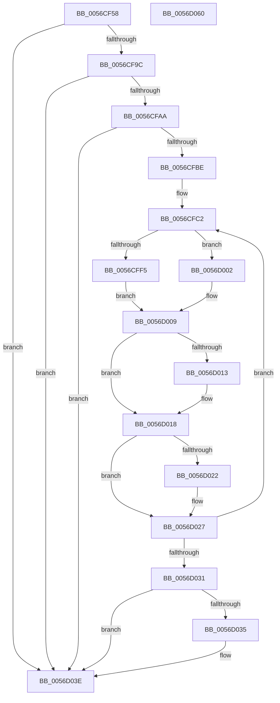

# Amd64InitializeUncoreProfilingEnhanced

- RVA: `0x0056CF58`–`0x0056D061` (길이 `265` bytes)
- VA: `0x000000014056CF58`
- 실행 섹션: `.text`
- PDB 이름 있음: `예`; PDB Function 태그: `아니요`
- unwind 정보 RVA: `0x000C5080`
- 디코드: `74`개 명령, `265/265` bytes 표시
- 미해석 바이트: `0` (있으면 어셈블리에 `.byte`로 보존)

> 이 문서는 커널 이미지의 기계어와 PDB 기호를 분석해 생성했습니다. 4번과 5번은 함수 원형과 자료형을 바이너리 사용 방식에서 추정한 C 해석이며 원본 소스 복구 결과는 아닙니다.

## 1. Dependencies

- 직접 호출 지점: **7**; 고유 호출 대상: **6**
- 직접 호출자로 확인된 함수: **1**
- RIP 상대 이미지 참조: **3**

### Outgoing calls
- `0x0056CFAF` → [KeQueryActiveProcessorCountEx](../24/KeQueryActiveProcessorCountEx_function_00249EF0.md) (function, `0x00249EF0`)
- `0x0056CFF9` → [KeSetSystemGroupAffinityThread](../39/KeSetSystemGroupAffinityThread_function_00399140.md) (function, `0x00399140`)
- `0x0056D004` → [KeSetSystemGroupAffinityThread](../39/KeSetSystemGroupAffinityThread_function_00399140.md) (function, `0x00399140`)
- `0x0056D013` → [Amd64InitializeDataFabricStatusEnhanced](Amd64InitializeDataFabricStatusEnhanced_function_0056CC3C.md) (function, `0x0056CC3C`)
- `0x0056D022` → [Amd64InitializeCacheStatusEnhanced](Amd64InitializeCacheStatusEnhanced_function_0056C804.md) (function, `0x0056C804`)
- `0x0056D039` → [KeRevertToUserGroupAffinityThread](../39/KeRevertToUserGroupAffinityThread_function_00398EC0.md) (function, `0x00398EC0`)
- `0x0056D045` → [_security_check_cookie](../6A/_security_check_cookie_function_006AC640.md) (function, `0x006AC640`)

### Direct callers
- [Amd64InitializeUncoreProfiling](Amd64InitializeUncoreProfiling_function_0056CF30.md) at `0x0056CF3D`

### Static image references
- `0x0056CF6F` → RVA `0x00E0A740` (`.data`; read)
- `0x0056CF9C` → RVA `0x00F8F8A0` (`.data`; read)
- `0x0056CFC2` → RVA `0x00F231B0` (`.data`; read)

## 2. Other-region calls and transfers

- 다른 실행 섹션으로 향하는 call: **0**
- 별도 외부 분기/꼬리 이동을 확인하지 못했습니다.

## 3. Assembly (complete function range)

```asm
0056CF58  48 89 5C 24 08                  mov qword ptr [rsp + 8], rbx
0056CF5D  48 89 74 24 10                  mov qword ptr [rsp + 0x10], rsi
0056CF62  48 89 7C 24 18                  mov qword ptr [rsp + 0x18], rdi
0056CF67  55                              push rbp
0056CF68  48 8B EC                        mov rbp, rsp
0056CF6B  48 83 EC 60                     sub rsp, 0x60
0056CF6F  48 8B 05 CA D7 89 00            mov rax, qword ptr [rip + 0x89d7ca]
0056CF76  48 33 C4                        xor rax, rsp
0056CF79  48 89 45 F0                     mov qword ptr [rbp - 0x10], rax
0056CF7D  33 C9                           xor ecx, ecx
0056CF7F  0F 57 C0                        xorps xmm0, xmm0
0056CF82  B8 00 00 00 80                  mov eax, 0x80000000
0056CF87  0F A2                           cpuid
0056CF89  0F 11 45 C0                     movups xmmword ptr [rbp - 0x40], xmm0
0056CF8D  0F 11 45 E0                     movups xmmword ptr [rbp - 0x20], xmm0
0056CF91  3D 1E 00 00 80                  cmp eax, 0x8000001e
0056CF96  0F 82 A2 00 00 00               jb 0x14056d03e
0056CF9C  8B 05 FE 28 A2 00               mov eax, dword ptr [rip + 0xa228fe]
0056CFA2  A8 06                           test al, 6
0056CFA4  0F 84 94 00 00 00               je 0x14056d03e
0056CFAA  B9 FF FF 00 00                  mov ecx, 0xffff
0056CFAF  E8 3C CF CD FF                  call 0x140249ef0
0056CFB4  32 DB                           xor bl, bl
0056CFB6  85 C0                           test eax, eax
0056CFB8  0F 84 80 00 00 00               je 0x14056d03e
0056CFBE  33 FF                           xor edi, edi
0056CFC0  8B F0                           mov esi, eax
0056CFC2  48 8B 05 E7 61 9B 00            mov rax, qword ptr [rip + 0x9b61e7]
0056CFC9  8B 0C 07                        mov ecx, dword ptr [rdi + rax]
0056CFCC  33 C0                           xor eax, eax
0056CFCE  89 45 CA                        mov dword ptr [rbp - 0x36], eax
0056CFD1  66 89 45 CE                     mov word ptr [rbp - 0x32], ax
0056CFD5  8B C1                           mov eax, ecx
0056CFD7  C1 E8 06                        shr eax, 6
0056CFDA  83 E1 3F                        and ecx, 0x3f
0056CFDD  66 89 45 C8                     mov word ptr [rbp - 0x38], ax
0056CFE1  B8 01 00 00 00                  mov eax, 1
0056CFE6  48 D3 E0                        shl rax, cl
0056CFE9  48 8D 4D C0                     lea rcx, [rbp - 0x40]
0056CFED  48 89 45 C0                     mov qword ptr [rbp - 0x40], rax
0056CFF1  84 DB                           test bl, bl
0056CFF3  75 0D                           jne 0x14056d002
0056CFF5  48 8D 55 E0                     lea rdx, [rbp - 0x20]
0056CFF9  E8 42 C1 E2 FF                  call 0x140399140
0056CFFE  B3 01                           mov bl, 1
0056D000  EB 07                           jmp 0x14056d009
0056D002  33 D2                           xor edx, edx
0056D004  E8 37 C1 E2 FF                  call 0x140399140
0056D009  8B 05 91 28 A2 00               mov eax, dword ptr [rip + 0xa22891]
0056D00F  A8 02                           test al, 2
0056D011  74 05                           je 0x14056d018
0056D013  E8 24 FC FF FF                  call 0x14056cc3c
0056D018  8B 05 82 28 A2 00               mov eax, dword ptr [rip + 0xa22882]
0056D01E  A8 04                           test al, 4
0056D020  74 05                           je 0x14056d027
0056D022  E8 DD F7 FF FF                  call 0x14056c804
0056D027  48 83 C7 04                     add rdi, 4
0056D02B  48 83 EE 01                     sub rsi, 1
0056D02F  75 91                           jne 0x14056cfc2
0056D031  84 DB                           test bl, bl
0056D033  74 09                           je 0x14056d03e
0056D035  48 8D 4D E0                     lea rcx, [rbp - 0x20]
0056D039  E8 82 BE E2 FF                  call 0x140398ec0
0056D03E  48 8B 4D F0                     mov rcx, qword ptr [rbp - 0x10]
0056D042  48 33 CC                        xor rcx, rsp
0056D045  E8 F6 F5 13 00                  call 0x1406ac640
0056D04A  4C 8D 5C 24 60                  lea r11, [rsp + 0x60]
0056D04F  49 8B 5B 10                     mov rbx, qword ptr [r11 + 0x10]
0056D053  49 8B 73 18                     mov rsi, qword ptr [r11 + 0x18]
0056D057  49 8B 7B 20                     mov rdi, qword ptr [r11 + 0x20]
0056D05B  49 8B E3                        mov rsp, r11
0056D05E  5D                              pop rbp
0056D05F  C3                              ret
0056D060  CC                              int3
```

## 4. C-style interpretation (structured pseudocode)

```c
__int64 __fastcall Amd64InitializeUncoreProfilingEnhanced(int a1)
{
    __int64 result;
    __int64 v_rbx;
    __int64 v_rdi;
    __int64 v_rsi;
    __int64 v_rsp;
    unsigned __int64 v_stack_m18;
    unsigned __int64 v_stack_m28;
    unsigned __int16 v_stack_m3A;
    unsigned int v_stack_m3E;
    unsigned __int16 v_stack_m40;
    unsigned __int64 v_stack_m48;
    unsigned __int64 v_stack_m8;
    unsigned __int64 v_stack_p10;
    unsigned __int64 v_stack_p18;
    unsigned __int64 v_stack_p8;

    v_stack_p8 = v_rbx;
    v_stack_p10 = v_rsi;
    v_stack_p18 = v_rdi;
    v_rsp = (v_rsp) - (96);
    result = (*(unsigned __int64 *)(v_rip + 9033674)) ^ (v_rsp);
    v_stack_m18 = result;
    a1 = 0;
    v_stack_m48 = v_xmm0;
    v_stack_m28 = v_xmm0;
    if (((unsigned int)((unsigned int)(0x80000000ULL))) < 0x8000001EULL) goto loc_0056D03E;
    if ((((unsigned __int8)((unsigned int)(*(unsigned int *)(v_rip + 10627326)))) & (6)) == 0) goto loc_0056D03E;
    result = KeQueryActiveProcessorCountEx((unsigned int)(0xFFFFULL), a2, a3, a4);
    v_rbx = 0;
    if ((unsigned int)(result) == 0) goto loc_0056D03E;
    v_rdi = 0;
loc_0056CFC2:
    result = 0;
    v_stack_m3E = 0;
    v_stack_m3A = 0;
    result = (unsigned int)(((unsigned int)((unsigned int)((unsigned int)(*(unsigned int *)(v_rdi + *(unsigned __int64 *)(v_rip + 10183143) * 1))))) >> (6));
    a1 = (unsigned int)(((unsigned int)(*(unsigned int *)(v_rdi + *(unsigned __int64 *)(v_rip + 10183143) * 1))) & (63));
    v_stack_m40 = (unsigned __int16)(result);
    result = (1) << ((unsigned __int8)(a1));
    v_stack_m48 = result;
    if (0 != 0) goto loc_0056D002;
    result = KeSetSystemGroupAffinityThread(v_stack_m48, v_stack_m28, a3, a4);
    goto loc_0056D009;
loc_0056D002:
    a2 = 0;
    result = KeSetSystemGroupAffinityThread(v_stack_m48, a2, a3, a4);
loc_0056D009:
    result = (unsigned int)(*(unsigned int *)(v_rip + 10627217));
    if ((((unsigned __int8)((unsigned int)(*(unsigned int *)(v_rip + 10627217)))) & (2)) != 0) {
        result = Amd64InitializeDataFabricStatusEnhanced(v_stack_m48, a2, a3, a4);
    }
    result = (unsigned int)(*(unsigned int *)(v_rip + 10627202));
    if ((((unsigned __int8)((unsigned int)(*(unsigned int *)(v_rip + 10627202)))) & (4)) != 0) {
        result = Amd64InitializeCacheStatusEnhanced(v_stack_m48, a2, a3, a4);
    }
    v_rdi = (v_rdi) + (4);
    v_rsi = ((unsigned int)((unsigned int)(result))) - (1);
    if (condition_is_not_equal) goto loc_0056CFC2;
    if (1 != 0) {
        a1 = v_stack_m28;
        result = KeRevertToUserGroupAffinityThread(a1, a2, a3, a4);
    }
    a1 = (v_stack_m18) ^ (v_rsp);
    result = _security_check_cookie(a1, a2, a3, a4);
    return result;
}
```

## 5. (Beta) C Style

```c
int64_t Amd64InitializeUncoreProfilingEnhanced(int32_t Arg1)
{
    int64_t result;
    int64_t local_rbx;
    int64_t local_rdi;
    int64_t local_rsi;
    int64_t local_rsp;
    uint64_t v_stack_m18;
    uint64_t v_stack_m28;
    uint16_t v_stack_m3A;
    uint32_t v_stack_m3E;
    uint16_t v_stack_m40;
    uint64_t v_stack_m48;
    uint64_t v_stack_m8;
    uint64_t v_stack_p10;
    uint64_t v_stack_p18;
    uint64_t v_stack_p8;

    v_stack_p8 = local_rbx;
    v_stack_p10 = local_rsi;
    v_stack_p18 = local_rdi;
    local_rsp = (local_rsp) - (96);
    result = (*(uint64_t *)(v_rip + 0x89D7CA)) ^ (local_rsp);
    v_stack_m18 = result;
    Arg1 = 0;
    v_stack_m48 = v_xmm0;
    v_stack_m28 = v_xmm0;
    if (((uint32_t)((uint32_t)(0x80000000ULL))) < 0x8000001EULL) goto loc_0056D03E;
    if ((((uint8_t)((uint32_t)(*(uint32_t *)(v_rip + 0xA228FE)))) & (6)) == 0) goto loc_0056D03E;
    result = KeQueryActiveProcessorCountEx((uint32_t)(0xFFFFULL), a2, a3, a4);
    local_rbx = 0;
    if ((uint32_t)(result) == 0) goto loc_0056D03E;
    local_rdi = 0;
loc_0056CFC2:
    result = 0;
    v_stack_m3E = 0;
    v_stack_m3A = 0;
    result = (uint32_t)(((uint32_t)((uint32_t)((uint32_t)(*(uint32_t *)(local_rdi + *(uint64_t *)(v_rip + 0x9B61E7) * 1))))) >> (6));
    Arg1 = (uint32_t)(((uint32_t)(*(uint32_t *)(local_rdi + *(uint64_t *)(v_rip + 0x9B61E7) * 1))) & (63));
    v_stack_m40 = (uint16_t)(result);
    result = (1) << ((uint8_t)(Arg1));
    v_stack_m48 = result;
    if (0 != 0) goto loc_0056D002;
    result = KeSetSystemGroupAffinityThread(v_stack_m48, v_stack_m28, a3, a4);
    goto loc_0056D009;
loc_0056D002:
    a2 = 0;
    result = KeSetSystemGroupAffinityThread(v_stack_m48, a2, a3, a4);
loc_0056D009:
    result = (uint32_t)(*(uint32_t *)(v_rip + 0xA22891));
    if ((((uint8_t)((uint32_t)(*(uint32_t *)(v_rip + 0xA22891)))) & (2)) != 0) {
        result = Amd64InitializeDataFabricStatusEnhanced(v_stack_m48, a2, a3, a4);
    }
    result = (uint32_t)(*(uint32_t *)(v_rip + 0xA22882));
    if ((((uint8_t)((uint32_t)(*(uint32_t *)(v_rip + 0xA22882)))) & (4)) != 0) {
        result = Amd64InitializeCacheStatusEnhanced(v_stack_m48, a2, a3, a4);
    }
    local_rdi = (local_rdi) + (4);
    local_rsi = ((uint32_t)((uint32_t)(result))) - (1);
    if (condition_is_not_equal) goto loc_0056CFC2;
    if (1 != 0) {
        Arg1 = v_stack_m28;
        result = KeRevertToUserGroupAffinityThread(Arg1, a2, a3, a4);
    }
    Arg1 = (v_stack_m18) ^ (local_rsp);
    result = _security_check_cookie(Arg1, a2, a3, a4);
    return result;
}
```

## 6. Execution-region graph

[열기: 2D/3D 그래프와 함수 탐색 컨트롤 패널](../../../control-panel.html?section=text&rva=0x0056CF58&view=graph)

- 2D 그래프는 위에서 아래로 흐르고, 3D 그래프는 빈 공간을 드래그해 회전합니다. Shift+드래그는 이동, 휠은 확대·축소, 함수 노드 선택은 대상 보고서 이동입니다.

### Static fallback


