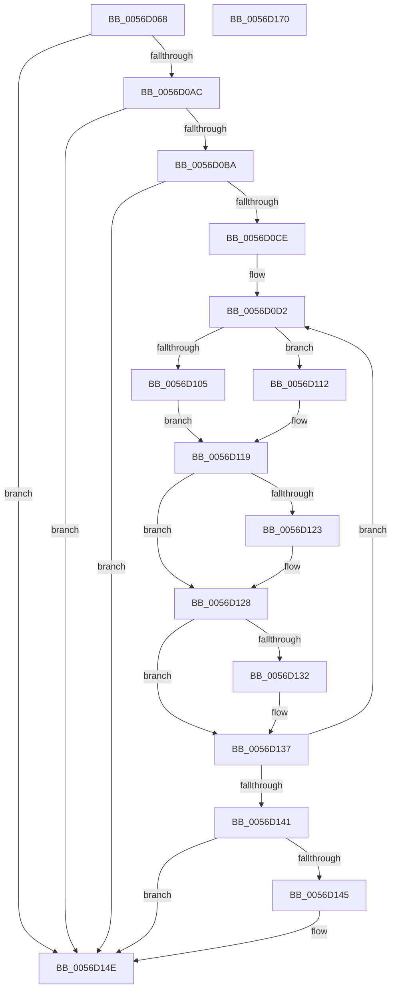

# Amd64InitializeUncoreProfilingOriginal

- RVA: `0x0056D068`–`0x0056D171` (길이 `265` bytes)
- VA: `0x000000014056D068`
- 실행 섹션: `.text`
- PDB 이름 있음: `예`; PDB Function 태그: `아니요`
- unwind 정보 RVA: `0x000C5080`
- 디코드: `74`개 명령, `265/265` bytes 표시
- 미해석 바이트: `0` (있으면 어셈블리에 `.byte`로 보존)

> 이 문서는 커널 이미지의 기계어와 PDB 기호를 분석해 생성했습니다. 4번과 5번은 함수 원형과 자료형을 바이너리 사용 방식에서 추정한 C 해석이며 원본 소스 복구 결과는 아닙니다.

## 1. Dependencies

- 직접 호출 지점: **7**; 고유 호출 대상: **6**
- 직접 호출자로 확인된 함수: **1**
- RIP 상대 이미지 참조: **3**

### Outgoing calls
- `0x0056D0BF` → [KeQueryActiveProcessorCountEx](../24/KeQueryActiveProcessorCountEx_function_00249EF0.md) (function, `0x00249EF0`)
- `0x0056D109` → [KeSetSystemGroupAffinityThread](../39/KeSetSystemGroupAffinityThread_function_00399140.md) (function, `0x00399140`)
- `0x0056D114` → [KeSetSystemGroupAffinityThread](../39/KeSetSystemGroupAffinityThread_function_00399140.md) (function, `0x00399140`)
- `0x0056D123` → [Amd64InitializeDataFabricStatusOriginal](Amd64InitializeDataFabricStatusOriginal_function_0056CDCC.md) (function, `0x0056CDCC`)
- `0x0056D132` → [Amd64InitializeCacheStatusOriginal](Amd64InitializeCacheStatusOriginal_function_0056CA40.md) (function, `0x0056CA40`)
- `0x0056D149` → [KeRevertToUserGroupAffinityThread](../39/KeRevertToUserGroupAffinityThread_function_00398EC0.md) (function, `0x00398EC0`)
- `0x0056D155` → [_security_check_cookie](../6A/_security_check_cookie_function_006AC640.md) (function, `0x006AC640`)

### Direct callers
- [Amd64InitializeUncoreProfiling](Amd64InitializeUncoreProfiling_function_0056CF30.md) at `0x0056CF44`

### Static image references
- `0x0056D07F` → RVA `0x00E0A740` (`.data`; read)
- `0x0056D0AC` → RVA `0x00F8F8A0` (`.data`; read)
- `0x0056D0D2` → RVA `0x00F231B0` (`.data`; read)

## 2. Other-region calls and transfers

- 다른 실행 섹션으로 향하는 call: **0**
- 별도 외부 분기/꼬리 이동을 확인하지 못했습니다.

## 3. Assembly (complete function range)

```asm
0056D068  48 89 5C 24 08                  mov qword ptr [rsp + 8], rbx
0056D06D  48 89 74 24 10                  mov qword ptr [rsp + 0x10], rsi
0056D072  48 89 7C 24 18                  mov qword ptr [rsp + 0x18], rdi
0056D077  55                              push rbp
0056D078  48 8B EC                        mov rbp, rsp
0056D07B  48 83 EC 60                     sub rsp, 0x60
0056D07F  48 8B 05 BA D6 89 00            mov rax, qword ptr [rip + 0x89d6ba]
0056D086  48 33 C4                        xor rax, rsp
0056D089  48 89 45 F0                     mov qword ptr [rbp - 0x10], rax
0056D08D  33 C9                           xor ecx, ecx
0056D08F  0F 57 C0                        xorps xmm0, xmm0
0056D092  B8 00 00 00 80                  mov eax, 0x80000000
0056D097  0F A2                           cpuid
0056D099  0F 11 45 C0                     movups xmmword ptr [rbp - 0x40], xmm0
0056D09D  0F 11 45 E0                     movups xmmword ptr [rbp - 0x20], xmm0
0056D0A1  3D 1E 00 00 80                  cmp eax, 0x8000001e
0056D0A6  0F 82 A2 00 00 00               jb 0x14056d14e
0056D0AC  8B 05 EE 27 A2 00               mov eax, dword ptr [rip + 0xa227ee]
0056D0B2  A8 06                           test al, 6
0056D0B4  0F 84 94 00 00 00               je 0x14056d14e
0056D0BA  B9 FF FF 00 00                  mov ecx, 0xffff
0056D0BF  E8 2C CE CD FF                  call 0x140249ef0
0056D0C4  32 DB                           xor bl, bl
0056D0C6  85 C0                           test eax, eax
0056D0C8  0F 84 80 00 00 00               je 0x14056d14e
0056D0CE  33 FF                           xor edi, edi
0056D0D0  8B F0                           mov esi, eax
0056D0D2  48 8B 05 D7 60 9B 00            mov rax, qword ptr [rip + 0x9b60d7]
0056D0D9  8B 0C 07                        mov ecx, dword ptr [rdi + rax]
0056D0DC  33 C0                           xor eax, eax
0056D0DE  89 45 CA                        mov dword ptr [rbp - 0x36], eax
0056D0E1  66 89 45 CE                     mov word ptr [rbp - 0x32], ax
0056D0E5  8B C1                           mov eax, ecx
0056D0E7  C1 E8 06                        shr eax, 6
0056D0EA  83 E1 3F                        and ecx, 0x3f
0056D0ED  66 89 45 C8                     mov word ptr [rbp - 0x38], ax
0056D0F1  B8 01 00 00 00                  mov eax, 1
0056D0F6  48 D3 E0                        shl rax, cl
0056D0F9  48 8D 4D C0                     lea rcx, [rbp - 0x40]
0056D0FD  48 89 45 C0                     mov qword ptr [rbp - 0x40], rax
0056D101  84 DB                           test bl, bl
0056D103  75 0D                           jne 0x14056d112
0056D105  48 8D 55 E0                     lea rdx, [rbp - 0x20]
0056D109  E8 32 C0 E2 FF                  call 0x140399140
0056D10E  B3 01                           mov bl, 1
0056D110  EB 07                           jmp 0x14056d119
0056D112  33 D2                           xor edx, edx
0056D114  E8 27 C0 E2 FF                  call 0x140399140
0056D119  8B 05 81 27 A2 00               mov eax, dword ptr [rip + 0xa22781]
0056D11F  A8 02                           test al, 2
0056D121  74 05                           je 0x14056d128
0056D123  E8 A4 FC FF FF                  call 0x14056cdcc
0056D128  8B 05 72 27 A2 00               mov eax, dword ptr [rip + 0xa22772]
0056D12E  A8 04                           test al, 4
0056D130  74 05                           je 0x14056d137
0056D132  E8 09 F9 FF FF                  call 0x14056ca40
0056D137  48 83 C7 04                     add rdi, 4
0056D13B  48 83 EE 01                     sub rsi, 1
0056D13F  75 91                           jne 0x14056d0d2
0056D141  84 DB                           test bl, bl
0056D143  74 09                           je 0x14056d14e
0056D145  48 8D 4D E0                     lea rcx, [rbp - 0x20]
0056D149  E8 72 BD E2 FF                  call 0x140398ec0
0056D14E  48 8B 4D F0                     mov rcx, qword ptr [rbp - 0x10]
0056D152  48 33 CC                        xor rcx, rsp
0056D155  E8 E6 F4 13 00                  call 0x1406ac640
0056D15A  4C 8D 5C 24 60                  lea r11, [rsp + 0x60]
0056D15F  49 8B 5B 10                     mov rbx, qword ptr [r11 + 0x10]
0056D163  49 8B 73 18                     mov rsi, qword ptr [r11 + 0x18]
0056D167  49 8B 7B 20                     mov rdi, qword ptr [r11 + 0x20]
0056D16B  49 8B E3                        mov rsp, r11
0056D16E  5D                              pop rbp
0056D16F  C3                              ret
0056D170  CC                              int3
```

## 4. C-style interpretation (structured pseudocode)

```c
__int64 __fastcall Amd64InitializeUncoreProfilingOriginal(int a1)
{
    __int64 result;
    __int64 v_rbx;
    __int64 v_rdi;
    __int64 v_rsi;
    __int64 v_rsp;
    unsigned __int64 v_stack_m18;
    unsigned __int64 v_stack_m28;
    unsigned __int16 v_stack_m3A;
    unsigned int v_stack_m3E;
    unsigned __int16 v_stack_m40;
    unsigned __int64 v_stack_m48;
    unsigned __int64 v_stack_m8;
    unsigned __int64 v_stack_p10;
    unsigned __int64 v_stack_p18;
    unsigned __int64 v_stack_p8;

    v_stack_p8 = v_rbx;
    v_stack_p10 = v_rsi;
    v_stack_p18 = v_rdi;
    v_rsp = (v_rsp) - (96);
    result = (*(unsigned __int64 *)(v_rip + 9033402)) ^ (v_rsp);
    v_stack_m18 = result;
    a1 = 0;
    v_stack_m48 = v_xmm0;
    v_stack_m28 = v_xmm0;
    if (((unsigned int)((unsigned int)(0x80000000ULL))) < 0x8000001EULL) goto loc_0056D14E;
    if ((((unsigned __int8)((unsigned int)(*(unsigned int *)(v_rip + 10627054)))) & (6)) == 0) goto loc_0056D14E;
    result = KeQueryActiveProcessorCountEx((unsigned int)(0xFFFFULL), a2, a3, a4);
    v_rbx = 0;
    if ((unsigned int)(result) == 0) goto loc_0056D14E;
    v_rdi = 0;
loc_0056D0D2:
    result = 0;
    v_stack_m3E = 0;
    v_stack_m3A = 0;
    result = (unsigned int)(((unsigned int)((unsigned int)((unsigned int)(*(unsigned int *)(v_rdi + *(unsigned __int64 *)(v_rip + 10182871) * 1))))) >> (6));
    a1 = (unsigned int)(((unsigned int)(*(unsigned int *)(v_rdi + *(unsigned __int64 *)(v_rip + 10182871) * 1))) & (63));
    v_stack_m40 = (unsigned __int16)(result);
    result = (1) << ((unsigned __int8)(a1));
    v_stack_m48 = result;
    if (0 != 0) goto loc_0056D112;
    result = KeSetSystemGroupAffinityThread(v_stack_m48, v_stack_m28, a3, a4);
    goto loc_0056D119;
loc_0056D112:
    a2 = 0;
    result = KeSetSystemGroupAffinityThread(v_stack_m48, a2, a3, a4);
loc_0056D119:
    result = (unsigned int)(*(unsigned int *)(v_rip + 10626945));
    if ((((unsigned __int8)((unsigned int)(*(unsigned int *)(v_rip + 10626945)))) & (2)) != 0) {
        result = Amd64InitializeDataFabricStatusOriginal(v_stack_m48, a2, a3, a4);
    }
    result = (unsigned int)(*(unsigned int *)(v_rip + 10626930));
    if ((((unsigned __int8)((unsigned int)(*(unsigned int *)(v_rip + 10626930)))) & (4)) != 0) {
        result = Amd64InitializeCacheStatusOriginal(v_stack_m48, a2, a3, a4);
    }
    v_rdi = (v_rdi) + (4);
    v_rsi = ((unsigned int)((unsigned int)(result))) - (1);
    if (condition_is_not_equal) goto loc_0056D0D2;
    if (1 != 0) {
        a1 = v_stack_m28;
        result = KeRevertToUserGroupAffinityThread(a1, a2, a3, a4);
    }
    a1 = (v_stack_m18) ^ (v_rsp);
    result = _security_check_cookie(a1, a2, a3, a4);
    return result;
}
```

## 5. (Beta) C Style

```c
int64_t Amd64InitializeUncoreProfilingOriginal(int32_t Arg1)
{
    int64_t result;
    int64_t local_rbx;
    int64_t local_rdi;
    int64_t local_rsi;
    int64_t local_rsp;
    uint64_t v_stack_m18;
    uint64_t v_stack_m28;
    uint16_t v_stack_m3A;
    uint32_t v_stack_m3E;
    uint16_t v_stack_m40;
    uint64_t v_stack_m48;
    uint64_t v_stack_m8;
    uint64_t v_stack_p10;
    uint64_t v_stack_p18;
    uint64_t v_stack_p8;

    v_stack_p8 = local_rbx;
    v_stack_p10 = local_rsi;
    v_stack_p18 = local_rdi;
    local_rsp = (local_rsp) - (96);
    result = (*(uint64_t *)(v_rip + 0x89D6BA)) ^ (local_rsp);
    v_stack_m18 = result;
    Arg1 = 0;
    v_stack_m48 = v_xmm0;
    v_stack_m28 = v_xmm0;
    if (((uint32_t)((uint32_t)(0x80000000ULL))) < 0x8000001EULL) goto loc_0056D14E;
    if ((((uint8_t)((uint32_t)(*(uint32_t *)(v_rip + 0xA227EE)))) & (6)) == 0) goto loc_0056D14E;
    result = KeQueryActiveProcessorCountEx((uint32_t)(0xFFFFULL), a2, a3, a4);
    local_rbx = 0;
    if ((uint32_t)(result) == 0) goto loc_0056D14E;
    local_rdi = 0;
loc_0056D0D2:
    result = 0;
    v_stack_m3E = 0;
    v_stack_m3A = 0;
    result = (uint32_t)(((uint32_t)((uint32_t)((uint32_t)(*(uint32_t *)(local_rdi + *(uint64_t *)(v_rip + 0x9B60D7) * 1))))) >> (6));
    Arg1 = (uint32_t)(((uint32_t)(*(uint32_t *)(local_rdi + *(uint64_t *)(v_rip + 0x9B60D7) * 1))) & (63));
    v_stack_m40 = (uint16_t)(result);
    result = (1) << ((uint8_t)(Arg1));
    v_stack_m48 = result;
    if (0 != 0) goto loc_0056D112;
    result = KeSetSystemGroupAffinityThread(v_stack_m48, v_stack_m28, a3, a4);
    goto loc_0056D119;
loc_0056D112:
    a2 = 0;
    result = KeSetSystemGroupAffinityThread(v_stack_m48, a2, a3, a4);
loc_0056D119:
    result = (uint32_t)(*(uint32_t *)(v_rip + 0xA22781));
    if ((((uint8_t)((uint32_t)(*(uint32_t *)(v_rip + 0xA22781)))) & (2)) != 0) {
        result = Amd64InitializeDataFabricStatusOriginal(v_stack_m48, a2, a3, a4);
    }
    result = (uint32_t)(*(uint32_t *)(v_rip + 0xA22772));
    if ((((uint8_t)((uint32_t)(*(uint32_t *)(v_rip + 0xA22772)))) & (4)) != 0) {
        result = Amd64InitializeCacheStatusOriginal(v_stack_m48, a2, a3, a4);
    }
    local_rdi = (local_rdi) + (4);
    local_rsi = ((uint32_t)((uint32_t)(result))) - (1);
    if (condition_is_not_equal) goto loc_0056D0D2;
    if (1 != 0) {
        Arg1 = v_stack_m28;
        result = KeRevertToUserGroupAffinityThread(Arg1, a2, a3, a4);
    }
    Arg1 = (v_stack_m18) ^ (local_rsp);
    result = _security_check_cookie(Arg1, a2, a3, a4);
    return result;
}
```

## 6. Execution-region graph

[열기: 2D/3D 그래프와 함수 탐색 컨트롤 패널](../../../control-panel.html?section=text&rva=0x0056D068&view=graph)

- 2D 그래프는 위에서 아래로 흐르고, 3D 그래프는 빈 공간을 드래그해 회전합니다. Shift+드래그는 이동, 휠은 확대·축소, 함수 노드 선택은 대상 보고서 이동입니다.

### Static fallback


