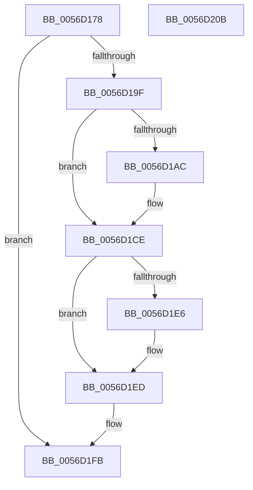

# Amd64InitializeUncoreStatusEnhanced

- RVA: `0x0056D178`–`0x0056D20C` (길이 `148` bytes)
- VA: `0x000000014056D178`
- 실행 섹션: `.text`
- PDB 이름 있음: `예`; PDB Function 태그: `아니요`
- unwind 정보 RVA: `0x000794E0`
- 디코드: `42`개 명령, `148/148` bytes 표시
- 미해석 바이트: `0` (있으면 어셈블리에 `.byte`로 보존)

> 이 문서는 커널 이미지의 기계어와 PDB 기호를 분석해 생성했습니다. 4번과 5번은 함수 원형과 자료형을 바이너리 사용 방식에서 추정한 C 해석이며 원본 소스 복구 결과는 아닙니다.

## 1. Dependencies

- 직접 호출 지점: **3**; 고유 호출 대상: **3**
- 직접 호출자로 확인된 함수: **2**
- RIP 상대 이미지 참조: **1**

### Outgoing calls
- `0x0056D195` → [Amd64FindUncoreById](Amd64FindUncoreById_function_0056C508.md) (function, `0x0056C508`)
- `0x0056D1A2` → [HalpMmAllocCtxAlloc](../3E/HalpMmAllocCtxAlloc_function_003E10B8.md) (function, `0x003E10B8`)
- `0x0056D1C8` → [KeBugCheckEx](../4F/KeBugCheckEx_function_004FD660.md) (function, `0x004FD660`)

### Direct callers
- [Amd64InitializeCacheStatusEnhanced](Amd64InitializeCacheStatusEnhanced_function_0056C804.md) at `0x0056C8EF`
- [Amd64InitializeDataFabricStatusEnhanced](Amd64InitializeDataFabricStatusEnhanced_function_0056CC3C.md) at `0x0056CCA8`

### Static image references
- `0x0056D1AC` → RVA `0x00026288` (`.rdata`; read)

## 2. Other-region calls and transfers

- 다른 실행 섹션으로 향하는 call: **0**
- 별도 외부 분기/꼬리 이동을 확인하지 못했습니다.

## 3. Assembly (complete function range)

```asm
0056D178  48 89 5C 24 08                  mov qword ptr [rsp + 8], rbx
0056D17D  48 89 74 24 10                  mov qword ptr [rsp + 0x10], rsi
0056D182  57                              push rdi
0056D183  48 83 EC 30                     sub rsp, 0x30
0056D187  48 8B DA                        mov rbx, rdx
0056D18A  8B F1                           mov esi, ecx
0056D18C  48 8B CB                        mov rcx, rbx
0056D18F  41 8B D0                        mov edx, r8d
0056D192  41 8B F8                        mov edi, r8d
0056D195  E8 6E F3 FF FF                  call 0x14056c508
0056D19A  48 85 C0                        test rax, rax
0056D19D  75 5C                           jne 0x14056d1fb
0056D19F  8D 50 18                        lea edx, [rax + 0x18]
0056D1A2  E8 11 3F E7 FF                  call 0x1403e10b8
0056D1A7  48 85 C0                        test rax, rax
0056D1AA  75 22                           jne 0x14056d1ce
0056D1AC  4C 8D 0D D5 90 AB FF            lea r9, [rip - 0x546f2b]
0056D1B3  48 C7 44 24 20 63 06 00 00      mov qword ptr [rsp + 0x20], 0x663
0056D1BC  BA 03 90 00 00                  mov edx, 0x9003
0056D1C1  8D 48 5C                        lea ecx, [rax + 0x5c]
0056D1C4  44 8D 40 18                     lea r8d, [rax + 0x18]
0056D1C8  E8 93 04 F9 FF                  call 0x1404fd660
0056D1CD  CC                              int3
0056D1CE  48 83 20 00                     and qword ptr [rax], 0
0056D1D2  48 83 60 08 00                  and qword ptr [rax + 8], 0
0056D1D7  89 78 14                        mov dword ptr [rax + 0x14], edi
0056D1DA  89 70 10                        mov dword ptr [rax + 0x10], esi
0056D1DD  48 8B 4B 08                     mov rcx, qword ptr [rbx + 8]
0056D1E1  48 39 19                        cmp qword ptr [rcx], rbx
0056D1E4  74 07                           je 0x14056d1ed
0056D1E6  B9 03 00 00 00                  mov ecx, 3
0056D1EB  CD 29                           int 0x29
0056D1ED  48 89 18                        mov qword ptr [rax], rbx
0056D1F0  48 89 48 08                     mov qword ptr [rax + 8], rcx
0056D1F4  48 89 01                        mov qword ptr [rcx], rax
0056D1F7  48 89 43 08                     mov qword ptr [rbx + 8], rax
0056D1FB  48 8B 5C 24 40                  mov rbx, qword ptr [rsp + 0x40]
0056D200  48 8B 74 24 48                  mov rsi, qword ptr [rsp + 0x48]
0056D205  48 83 C4 30                     add rsp, 0x30
0056D209  5F                              pop rdi
0056D20A  C3                              ret
0056D20B  CC                              int3
```

## 4. C-style interpretation (structured pseudocode)

```c
__int64 __fastcall Amd64InitializeUncoreStatusEnhanced(int a1, __int64 a2, int a3)
{
    __int64 result;
    __int64 v_rsp;
    unsigned __int64 v_stack_m18;
    unsigned __int64 v_stack_p10;
    unsigned __int64 v_stack_p8;

    v_stack_p8 = v_rbx;
    v_stack_p10 = v_rsi;
    v_rsp = (v_rsp) - (48);
    result = Amd64FindUncoreById(a2, (unsigned int)(a3), a3, a4);
    if (result != 0) goto loc_0056D1FB;
    result = HalpMmAllocCtxAlloc(a2, result + 24, a3, a4);
    if (result == 0) {
        a4 = v_rip - 5533483;
        v_stack_m18 = 0x663ULL;
        a2 = 0x9003ULL;
        a1 = result + 92;
        a3 = result + 24;
        result = KeBugCheckEx(a1, a2, a3, a4);
    }
    *(unsigned int *)(result + 20) = (unsigned int)((unsigned int)(a3));
    *(unsigned int *)(result + 16) = (unsigned int)((unsigned int)(a1));
    if ((*(unsigned __int64 *)(*(unsigned __int64 *)(a2 + 8))) != a2) {
        a1 = 3;
    }
    *(unsigned __int64 *)(result) = a2;
    *(unsigned __int64 *)(result + 8) = a1;
    *(unsigned __int64 *)(a1) = result;
    *(unsigned __int64 *)(a2 + 8) = result;
loc_0056D1FB:
    v_rsp = (v_rsp) + (48);
    return result;
}
```

## 5. (Beta) C Style

```c
int64_t Amd64InitializeUncoreStatusEnhanced(int32_t Arg1, void *Arg2, int32_t Arg3)
{
    uint8_t *arg2 = (uint8_t *)Arg2;

    int64_t result;
    int64_t local_rsp;
    uint64_t v_stack_m18;
    uint64_t v_stack_p10;
    uint64_t v_stack_p8;

    v_stack_p8 = local_rbx;
    v_stack_p10 = local_rsi;
    local_rsp = (local_rsp) - (48);
    result = Amd64FindUncoreById(Arg2, (uint32_t)(Arg3), Arg3, a4);
    if (result != 0) goto loc_0056D1FB;
    result = HalpMmAllocCtxAlloc(Arg2, result + 24, Arg3, a4);
    if (result == 0) {
        a4 = v_rip - 5533483;
        v_stack_m18 = 0x663ULL;
        Arg2 = 0x9003ULL;
        Arg1 = result + 92;
        Arg3 = result + 24;
        result = KeBugCheckEx(Arg1, Arg2, Arg3, a4);
    }
    *(uint32_t *)(result + 0x14) = (uint32_t)((uint32_t)(Arg3));
    *(uint32_t *)(result + 0x10) = (uint32_t)((uint32_t)(Arg1));
    if ((*(uint64_t *)(*(uint64_t *)(arg2 + 0x8))) != Arg2) {
        Arg1 = 3;
    }
    *(void **)(result) = Arg2;
    *(uint64_t *)(result + 0x8) = Arg1;
    *(uint64_t *)(Arg1) = result;
    *(uint64_t *)(arg2 + 0x8) = result;
loc_0056D1FB:
    local_rsp = (local_rsp) + (48);
    return result;
}
```

### 관측된 메모리 오프셋

구조체 형식이 확인되지 않은 접근은 인자 기준의 오프셋으로만 기록했습니다.

| 기준 인자 | 오프셋 표현 | 폭 (bit) | 접근 |
|---|---:|---:|---|
| `Arg2` | `+ 0x8` | `64` | `R` |
| `Arg2` | `+ 0x8` | `64` | `W` |

## 6. Execution-region graph

[열기: 2D/3D 그래프와 함수 탐색 컨트롤 패널](../../../control-panel.html?section=text&rva=0x0056D178&view=graph)

- 2D 그래프는 위에서 아래로 흐르고, 3D 그래프는 빈 공간을 드래그해 회전합니다. Shift+드래그는 이동, 휠은 확대·축소, 함수 노드 선택은 대상 보고서 이동입니다.

### Static fallback


