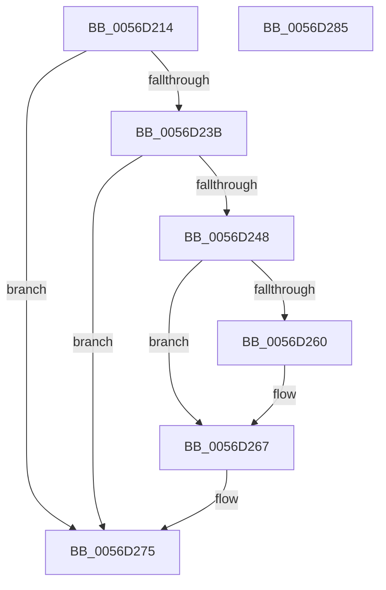

# Amd64InitializeUncoreStatusOriginal

- RVA: `0x0056D214`–`0x0056D286` (길이 `114` bytes)
- VA: `0x000000014056D214`
- 실행 섹션: `.text`
- PDB 이름 있음: `예`; PDB Function 태그: `아니요`
- unwind 정보 RVA: `0x00060BC4`
- 디코드: `35`개 명령, `114/114` bytes 표시
- 미해석 바이트: `0` (있으면 어셈블리에 `.byte`로 보존)

> 이 문서는 커널 이미지의 기계어와 PDB 기호를 분석해 생성했습니다. 4번과 5번은 함수 원형과 자료형을 바이너리 사용 방식에서 추정한 C 해석이며 원본 소스 복구 결과는 아닙니다.

## 1. Dependencies

- 직접 호출 지점: **2**; 고유 호출 대상: **2**
- 직접 호출자로 확인된 함수: **2**
- RIP 상대 이미지 참조: **0**

### Outgoing calls
- `0x0056D231` → [Amd64FindUncoreById](Amd64FindUncoreById_function_0056C508.md) (function, `0x0056C508`)
- `0x0056D23E` → [HalpMmAllocCtxAlloc](../3E/HalpMmAllocCtxAlloc_function_003E10B8.md) (function, `0x003E10B8`)

### Direct callers
- [Amd64InitializeCacheStatusOriginal](Amd64InitializeCacheStatusOriginal_function_0056CA40.md) at `0x0056CB21`
- [Amd64InitializeDataFabricStatusOriginal](Amd64InitializeDataFabricStatusOriginal_function_0056CDCC.md) at `0x0056CE2D`

### Static image references
- 디코드된 RIP-relative 메모리 참조가 없습니다.

## 2. Other-region calls and transfers

- 다른 실행 섹션으로 향하는 call: **0**
- 별도 외부 분기/꼬리 이동을 확인하지 못했습니다.

## 3. Assembly (complete function range)

```asm
0056D214  48 89 5C 24 08                  mov qword ptr [rsp + 8], rbx
0056D219  48 89 74 24 10                  mov qword ptr [rsp + 0x10], rsi
0056D21E  57                              push rdi
0056D21F  48 83 EC 20                     sub rsp, 0x20
0056D223  48 8B DA                        mov rbx, rdx
0056D226  8B F1                           mov esi, ecx
0056D228  48 8B CB                        mov rcx, rbx
0056D22B  41 8B D0                        mov edx, r8d
0056D22E  41 8B F8                        mov edi, r8d
0056D231  E8 D2 F2 FF FF                  call 0x14056c508
0056D236  48 85 C0                        test rax, rax
0056D239  75 3A                           jne 0x14056d275
0056D23B  8D 50 18                        lea edx, [rax + 0x18]
0056D23E  E8 75 3E E7 FF                  call 0x1403e10b8
0056D243  48 85 C0                        test rax, rax
0056D246  74 2D                           je 0x14056d275
0056D248  48 83 20 00                     and qword ptr [rax], 0
0056D24C  48 83 60 08 00                  and qword ptr [rax + 8], 0
0056D251  89 78 14                        mov dword ptr [rax + 0x14], edi
0056D254  89 70 10                        mov dword ptr [rax + 0x10], esi
0056D257  48 8B 4B 08                     mov rcx, qword ptr [rbx + 8]
0056D25B  48 39 19                        cmp qword ptr [rcx], rbx
0056D25E  74 07                           je 0x14056d267
0056D260  B9 03 00 00 00                  mov ecx, 3
0056D265  CD 29                           int 0x29
0056D267  48 89 18                        mov qword ptr [rax], rbx
0056D26A  48 89 48 08                     mov qword ptr [rax + 8], rcx
0056D26E  48 89 01                        mov qword ptr [rcx], rax
0056D271  48 89 43 08                     mov qword ptr [rbx + 8], rax
0056D275  48 8B 5C 24 30                  mov rbx, qword ptr [rsp + 0x30]
0056D27A  48 8B 74 24 38                  mov rsi, qword ptr [rsp + 0x38]
0056D27F  48 83 C4 20                     add rsp, 0x20
0056D283  5F                              pop rdi
0056D284  C3                              ret
0056D285  CC                              int3
```

## 4. C-style interpretation (structured pseudocode)

```c
__int64 __fastcall Amd64InitializeUncoreStatusOriginal(int a1, __int64 a2, int a3)
{
    __int64 result;
    __int64 v_rsp;
    unsigned __int64 v_stack_p10;
    unsigned __int64 v_stack_p8;

    v_stack_p8 = v_rbx;
    v_stack_p10 = v_rsi;
    v_rsp = (v_rsp) - (32);
    result = Amd64FindUncoreById(a2, (unsigned int)(a3), a3, a4);
    if (result != 0) goto loc_0056D275;
    result = HalpMmAllocCtxAlloc(a2, result + 24, a3, a4);
    if (result == 0) goto loc_0056D275;
    *(unsigned int *)(result + 20) = (unsigned int)((unsigned int)(a3));
    *(unsigned int *)(result + 16) = (unsigned int)((unsigned int)(a1));
    if ((*(unsigned __int64 *)(*(unsigned __int64 *)(a2 + 8))) != a2) {
        a1 = 3;
    }
    *(unsigned __int64 *)(result) = a2;
    *(unsigned __int64 *)(result + 8) = a1;
    *(unsigned __int64 *)(a1) = result;
    *(unsigned __int64 *)(a2 + 8) = result;
loc_0056D275:
    v_rsp = (v_rsp) + (32);
    return result;
}
```

## 5. (Beta) C Style

```c
int64_t Amd64InitializeUncoreStatusOriginal(int32_t Arg1, void *Arg2, int32_t Arg3)
{
    uint8_t *arg2 = (uint8_t *)Arg2;

    int64_t result;
    int64_t local_rsp;
    uint64_t v_stack_p10;
    uint64_t v_stack_p8;

    v_stack_p8 = local_rbx;
    v_stack_p10 = local_rsi;
    local_rsp = (local_rsp) - (32);
    result = Amd64FindUncoreById(Arg2, (uint32_t)(Arg3), Arg3, a4);
    if (result != 0) goto loc_0056D275;
    result = HalpMmAllocCtxAlloc(Arg2, result + 24, Arg3, a4);
    if (result == 0) goto loc_0056D275;
    *(uint32_t *)(result + 0x14) = (uint32_t)((uint32_t)(Arg3));
    *(uint32_t *)(result + 0x10) = (uint32_t)((uint32_t)(Arg1));
    if ((*(uint64_t *)(*(uint64_t *)(arg2 + 0x8))) != Arg2) {
        Arg1 = 3;
    }
    *(void **)(result) = Arg2;
    *(uint64_t *)(result + 0x8) = Arg1;
    *(uint64_t *)(Arg1) = result;
    *(uint64_t *)(arg2 + 0x8) = result;
loc_0056D275:
    local_rsp = (local_rsp) + (32);
    return result;
}
```

### 관측된 메모리 오프셋

구조체 형식이 확인되지 않은 접근은 인자 기준의 오프셋으로만 기록했습니다.

| 기준 인자 | 오프셋 표현 | 폭 (bit) | 접근 |
|---|---:|---:|---|
| `Arg2` | `+ 0x8` | `64` | `R` |
| `Arg2` | `+ 0x8` | `64` | `W` |

## 6. Execution-region graph

[열기: 2D/3D 그래프와 함수 탐색 컨트롤 패널](../../../control-panel.html?section=text&rva=0x0056D214&view=graph)

- 2D 그래프는 위에서 아래로 흐르고, 3D 그래프는 빈 공간을 드래그해 회전합니다. Shift+드래그는 이동, 휠은 확대·축소, 함수 노드 선택은 대상 보고서 이동입니다.

### Static fallback


