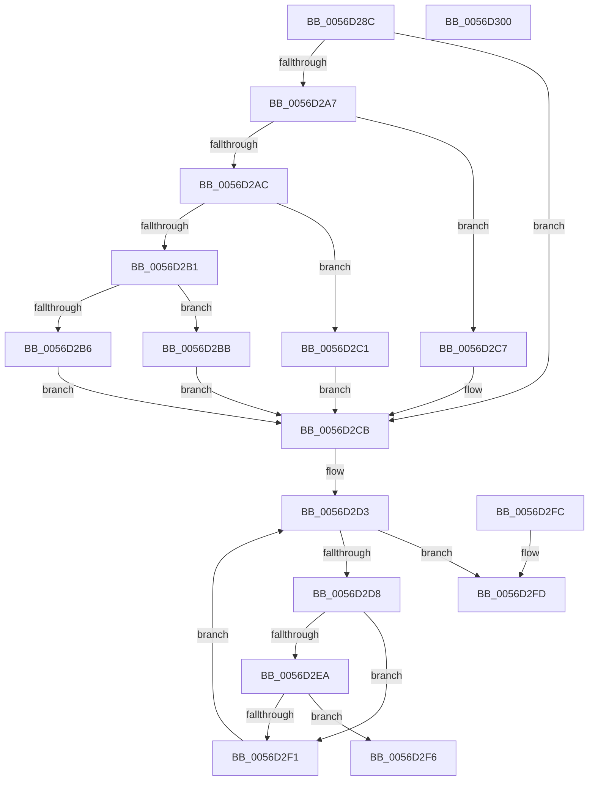

# Amd64IsProfileBeingUsed

- RVA: `0x0056D28C`–`0x0056D301` (길이 `117` bytes)
- VA: `0x000000014056D28C`
- 실행 섹션: `.text`
- PDB 이름 있음: `예`; PDB Function 태그: `아니요`
- unwind 정보 RVA: `0x000DB714`
- 디코드: `40`개 명령, `117/117` bytes 표시
- 미해석 바이트: `0` (있으면 어셈블리에 `.byte`로 보존)

> 이 문서는 커널 이미지의 기계어와 PDB 기호를 분석해 생성했습니다. 4번과 5번은 함수 원형과 자료형을 바이너리 사용 방식에서 추정한 C 해석이며 원본 소스 복구 결과는 아닙니다.

## 1. Dependencies

- 직접 호출 지점: **0**; 고유 호출 대상: **0**
- 직접 호출자로 확인된 함수: **1**
- RIP 상대 이미지 참조: **1**

### Outgoing calls
- 직접 디코드된 call 명령이 없습니다.

### Direct callers
- [Amd64RemoveProfileSource](Amd64RemoveProfileSource_function_0056D900.md) at `0x0056D956`
- [Amd64RemoveProfileSource](Amd64RemoveProfileSource_function_0056D900.md) at `0x0056D96D`
- [Amd64RemoveProfileSource](Amd64RemoveProfileSource_function_0056D900.md) at `0x0056D980`

### Static image references
- `0x0056D291` → RVA `0x00FC8C40` (`ALMOSTRO`; read)

## 2. Other-region calls and transfers

- 다른 실행 섹션으로 향하는 call: **0**
- 별도 외부 분기/꼬리 이동을 확인하지 못했습니다.

## 3. Assembly (complete function range)

```asm
0056D28C  8B C2                           mov eax, edx
0056D28E  45 33 C9                        xor r9d, r9d
0056D291  48 8D 15 A8 B9 A5 00            lea rdx, [rip + 0xa5b9a8]
0056D298  45 8B D8                        mov r11d, r8d
0056D29B  48 8B 04 C2                     mov rax, qword ptr [rdx + rax*8]
0056D29F  48 8B 50 58                     mov rdx, qword ptr [rax + 0x58]
0056D2A3  85 C9                           test ecx, ecx
0056D2A5  74 24                           je 0x14056d2cb
0056D2A7  83 E9 01                        sub ecx, 1
0056D2AA  74 1B                           je 0x14056d2c7
0056D2AC  83 E9 63                        sub ecx, 0x63
0056D2AF  74 10                           je 0x14056d2c1
0056D2B1  83 F9 01                        cmp ecx, 1
0056D2B4  74 05                           je 0x14056d2bb
0056D2B6  41 8B D1                        mov edx, r9d
0056D2B9  EB 10                           jmp 0x14056d2cb
0056D2BB  48 83 C2 48                     add rdx, 0x48
0056D2BF  EB 0A                           jmp 0x14056d2cb
0056D2C1  48 83 C2 30                     add rdx, 0x30
0056D2C5  EB 04                           jmp 0x14056d2cb
0056D2C7  48 83 C2 18                     add rdx, 0x18
0056D2CB  4C 8B 42 10                     mov r8, qword ptr [rdx + 0x10]
0056D2CF  44 8B 52 04                     mov r10d, dword ptr [rdx + 4]
0056D2D3  45 3B CA                        cmp r9d, r10d
0056D2D6  73 25                           jae 0x14056d2fd
0056D2D8  41 8B C1                        mov eax, r9d
0056D2DB  48 8D 0C 40                     lea rcx, [rax + rax*2]
0056D2DF  48 03 C9                        add rcx, rcx
0056D2E2  41 83 7C C8 18 03               cmp dword ptr [r8 + rcx*8 + 0x18], 3
0056D2E8  74 07                           je 0x14056d2f1
0056D2EA  45 39 5C C8 24                  cmp dword ptr [r8 + rcx*8 + 0x24], r11d
0056D2EF  74 05                           je 0x14056d2f6
0056D2F1  41 FF C1                        inc r9d
0056D2F4  EB DD                           jmp 0x14056d2d3
0056D2F6  B8 11 00 00 80                  mov eax, 0x80000011
0056D2FB  C3                              ret
0056D2FC  CC                              int3
0056D2FD  33 C0                           xor eax, eax
0056D2FF  C3                              ret
0056D300  CC                              int3
```

## 4. C-style interpretation (structured pseudocode)

```c
__int64 __fastcall Amd64IsProfileBeingUsed(int a1, int a2, int a3, int a4)
{
    __int64 result;

    a4 = 0;
    if (a1 == 0) goto loc_0056D2CB;
    a1 = (unsigned int)((a1) - (1));
    if (condition_is_equal) goto loc_0056D2C7;
    a1 = (unsigned int)((a1) - (99));
    if (condition_is_equal) goto loc_0056D2C1;
    if (a1 == 1) goto loc_0056D2BB;
    goto loc_0056D2CB;
loc_0056D2BB:
    a2 = (0) + (72);
    goto loc_0056D2CB;
loc_0056D2C1:
    a2 = (a2) + (48);
    goto loc_0056D2CB;
loc_0056D2C7:
    a2 = (a2) + (24);
loc_0056D2CB:
loc_0056D2D3:
    if (0 >= ((unsigned int)((unsigned int)(*(unsigned int *)(a2 + 4))))) goto loc_0056D2FD;
    a1 = (0 + 0 * 2) + (0 + 0 * 2);
    if ((*(unsigned int *)(*(unsigned __int64 *)(a2 + 16) + a1 * 8 + 24)) == 3) goto loc_0056D2F1;
    if ((*(unsigned int *)(*(unsigned __int64 *)(a2 + 16) + a1 * 8 + 36)) == ((unsigned int)((unsigned int)(a3)))) goto loc_0056D2F6;
loc_0056D2F1:
    a4 = (unsigned int)((a4) + 1);
    goto loc_0056D2D3;
loc_0056D2F6:
    return (unsigned int)(0x80000011ULL);
loc_0056D2FD:
    result = 0;
    return result;
}
```

## 5. (Beta) C Style

```c
int64_t Amd64IsProfileBeingUsed(int32_t Arg1, int32_t Arg2, int32_t Arg3, int32_t Arg4)
{
    int64_t result;

    Arg4 = 0;
    if (Arg1 == 0) goto loc_0056D2CB;
    Arg1 = (uint32_t)((Arg1) - (1));
    if (condition_is_equal) goto loc_0056D2C7;
    Arg1 = (uint32_t)((Arg1) - (99));
    if (condition_is_equal) goto loc_0056D2C1;
    if (Arg1 == 1) goto loc_0056D2BB;
    goto loc_0056D2CB;
loc_0056D2BB:
    Arg2 = (0) + (72);
    goto loc_0056D2CB;
loc_0056D2C1:
    Arg2 = (Arg2) + (48);
    goto loc_0056D2CB;
loc_0056D2C7:
    Arg2 = (Arg2) + (24);
loc_0056D2CB:
loc_0056D2D3:
    if (0 >= ((uint32_t)((uint32_t)(*(uint32_t *)(Arg2 + 0x4))))) goto loc_0056D2FD;
    Arg1 = (0 + 0 * 2) + (0 + 0 * 2);
    if ((*(uint32_t *)(*(uint64_t *)(Arg2 + 0x10) + Arg1 * 8 + 0x18)) == 3) goto loc_0056D2F1;
    if ((*(uint32_t *)(*(uint64_t *)(Arg2 + 0x10) + Arg1 * 8 + 0x24)) == ((uint32_t)((uint32_t)(Arg3)))) goto loc_0056D2F6;
loc_0056D2F1:
    Arg4 = (uint32_t)((Arg4) + 1);
    goto loc_0056D2D3;
loc_0056D2F6:
    return (uint32_t)(0x80000011ULL);
loc_0056D2FD:
    result = 0;
    return result;
}
```

## 6. Execution-region graph

[열기: 2D/3D 그래프와 함수 탐색 컨트롤 패널](../../../control-panel.html?section=text&rva=0x0056D28C&view=graph)

- 2D 그래프는 위에서 아래로 흐르고, 3D 그래프는 빈 공간을 드래그해 회전합니다. Shift+드래그는 이동, 휠은 확대·축소, 함수 노드 선택은 대상 보고서 이동입니다.

### Static fallback


