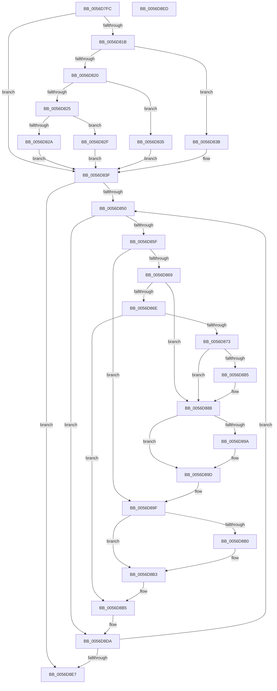

# Amd64PauseProfilingInternal

- RVA: `0x0056D7FC`–`0x0056D8EE` (길이 `242` bytes)
- VA: `0x000000014056D7FC`
- 실행 섹션: `.text`
- PDB 이름 있음: `예`; PDB Function 태그: `아니요`
- unwind 정보 RVA: `0x00071750`
- 디코드: `69`개 명령, `242/242` bytes 표시
- 미해석 바이트: `0` (있으면 어셈블리에 `.byte`로 보존)

> 이 문서는 커널 이미지의 기계어와 PDB 기호를 분석해 생성했습니다. 4번과 5번은 함수 원형과 자료형을 바이너리 사용 방식에서 추정한 C 해석이며 원본 소스 복구 결과는 아닙니다.

## 1. Dependencies

- 직접 호출 지점: **0**; 고유 호출 대상: **0**
- 직접 호출자로 확인된 함수: **1**
- RIP 상대 이미지 참조: **1**

### Outgoing calls
- 직접 디코드된 call 명령이 없습니다.

### Direct callers
- [Amd64PauseProfiling](Amd64PauseProfiling_function_0056D7C0.md) at `0x0056D7D2`
- [Amd64PauseProfiling](Amd64PauseProfiling_function_0056D7C0.md) at `0x0056D7DE`
- [Amd64PauseProfiling](Amd64PauseProfiling_function_0056D7C0.md) at `0x0056D7EA`

### Static image references
- `0x0056D804` → RVA `0x00000000` (`image boundary/outside`; read)

## 2. Other-region calls and transfers

- 다른 실행 섹션으로 향하는 call: **0**
- 별도 외부 분기/꼬리 이동을 확인하지 못했습니다.

## 3. Assembly (complete function range)

```asm
0056D7FC  48 89 5C 24 08                  mov qword ptr [rsp + 8], rbx
0056D801  44 8B D2                        mov r10d, edx
0056D804  48 8D 1D F5 27 A9 FF            lea rbx, [rip - 0x56d80b]
0056D80B  4A 8B 84 D3 40 8C FC 00         mov rax, qword ptr [rbx + r10*8 + 0xfc8c40]
0056D813  4C 8B 40 58                     mov r8, qword ptr [rax + 0x58]
0056D817  85 C9                           test ecx, ecx
0056D819  74 24                           je 0x14056d83f
0056D81B  83 E9 01                        sub ecx, 1
0056D81E  74 1B                           je 0x14056d83b
0056D820  83 E9 63                        sub ecx, 0x63
0056D823  74 10                           je 0x14056d835
0056D825  83 F9 01                        cmp ecx, 1
0056D828  74 05                           je 0x14056d82f
0056D82A  45 33 C0                        xor r8d, r8d
0056D82D  EB 10                           jmp 0x14056d83f
0056D82F  49 83 C0 48                     add r8, 0x48
0056D833  EB 0A                           jmp 0x14056d83f
0056D835  49 83 C0 30                     add r8, 0x30
0056D839  EB 04                           jmp 0x14056d83f
0056D83B  49 83 C0 18                     add r8, 0x18
0056D83F  4D 8B 58 10                     mov r11, qword ptr [r8 + 0x10]
0056D843  45 33 C9                        xor r9d, r9d
0056D846  45 39 48 04                     cmp dword ptr [r8 + 4], r9d
0056D84A  0F 86 97 00 00 00               jbe 0x14056d8e7
0056D850  4B 8D 0C 49                     lea rcx, [r9 + r9*2]
0056D854  48 03 C9                        add rcx, rcx
0056D857  41 83 7C CB 18 02               cmp dword ptr [r11 + rcx*8 + 0x18], 2
0056D85D  7D 7B                           jge 0x14056d8da
0056D85F  41 8B 08                        mov ecx, dword ptr [r8]
0056D862  33 D2                           xor edx, edx
0056D864  83 E9 01                        sub ecx, 1
0056D867  74 36                           je 0x14056d89f
0056D869  83 E9 63                        sub ecx, 0x63
0056D86C  74 1A                           je 0x14056d888
0056D86E  83 F9 01                        cmp ecx, 1
0056D871  75 42                           jne 0x14056d8b5
0056D873  4A 8B 84 D3 40 8C FC 00         mov rax, qword ptr [rbx + r10*8 + 0xfc8c40]
0056D87B  48 8B 50 58                     mov rdx, qword ptr [rax + 0x58]
0056D87F  48 83 C2 30                     add rdx, 0x30
0056D883  74 03                           je 0x14056d888
0056D885  8B 52 04                        mov edx, dword ptr [rdx + 4]
0056D888  4A 8B 84 D3 40 8C FC 00         mov rax, qword ptr [rbx + r10*8 + 0xfc8c40]
0056D890  48 8B 40 58                     mov rax, qword ptr [rax + 0x58]
0056D894  48 83 C0 18                     add rax, 0x18
0056D898  74 03                           je 0x14056d89d
0056D89A  8B 40 04                        mov eax, dword ptr [rax + 4]
0056D89D  03 D0                           add edx, eax
0056D89F  4A 8B 84 D3 40 8C FC 00         mov rax, qword ptr [rbx + r10*8 + 0xfc8c40]
0056D8A7  48 8B 40 58                     mov rax, qword ptr [rax + 0x58]
0056D8AB  48 85 C0                        test rax, rax
0056D8AE  74 03                           je 0x14056d8b3
0056D8B0  8B 40 04                        mov eax, dword ptr [rax + 4]
0056D8B3  03 D0                           add edx, eax
0056D8B5  42 8D 04 0A                     lea eax, [rdx + r9]
0056D8B9  8B 8C 83 40 F9 F8 00            mov ecx, dword ptr [rbx + rax*4 + 0xf8f940]
0056D8C0  0F 32                           rdmsr
0056D8C2  48 C1 E2 20                     shl rdx, 0x20
0056D8C6  48 0B C2                        or rax, rdx
0056D8C9  BA FF FF BF FF                  mov edx, 0xffbfffff
0056D8CE  48 23 C2                        and rax, rdx
0056D8D1  48 8B D0                        mov rdx, rax
0056D8D4  48 C1 EA 20                     shr rdx, 0x20
0056D8D8  0F 30                           wrmsr
0056D8DA  41 FF C1                        inc r9d
0056D8DD  45 3B 48 04                     cmp r9d, dword ptr [r8 + 4]
0056D8E1  0F 82 69 FF FF FF               jb 0x14056d850
0056D8E7  48 8B 5C 24 08                  mov rbx, qword ptr [rsp + 8]
0056D8EC  C3                              ret
0056D8ED  CC                              int3
```

## 4. C-style interpretation (structured pseudocode)

```c
__int64 __fastcall Amd64PauseProfilingInternal(int a1, int a2, __int64 a3, int a4)
{
    __int64 result;
    unsigned __int64 v_stack_p8;

    v_stack_p8 = v_rbx;
    if (a1 == 0) goto loc_0056D83F;
    a1 = (unsigned int)((a1) - (1));
    if (condition_is_equal) goto loc_0056D83B;
    a1 = (unsigned int)((a1) - (99));
    if (condition_is_equal) goto loc_0056D835;
    if (a1 == 1) goto loc_0056D82F;
    a3 = 0;
    goto loc_0056D83F;
loc_0056D82F:
    a3 = (a3) + (72);
    goto loc_0056D83F;
loc_0056D835:
    a3 = (a3) + (48);
    goto loc_0056D83F;
loc_0056D83B:
    a3 = (a3) + (24);
loc_0056D83F:
    a4 = 0;
    if ((*(unsigned int *)(a3 + 4)) <= 0) goto loc_0056D8E7;
loc_0056D850:
    a1 = (a4 + a4 * 2) + (a4 + a4 * 2);
    if ((*(unsigned int *)(*(unsigned __int64 *)(a3 + 16) + a1 * 8 + 24)) >= 2) goto loc_0056D8DA;
    a2 = 0;
    a1 = (unsigned int)(((unsigned int)(*(unsigned int *)(a3))) - (1));
    if (condition_is_equal) goto loc_0056D89F;
    a1 = (unsigned int)((a1) - (99));
    if (condition_is_equal) goto loc_0056D888;
    if (a1 != 1) goto loc_0056D8B5;
    a2 = (*(unsigned __int64 *)(*(unsigned __int64 *)(v_rip - 5691403 + (unsigned int)(a2) * 8 + 16550976) + 88)) + (48);
    if (!(condition_is_equal)) {
        a2 = *(unsigned int *)(a2 + 4);
    }
    result = (*(unsigned __int64 *)(*(unsigned __int64 *)(v_rip - 5691403 + (unsigned int)(a2) * 8 + 16550976) + 88)) + (24);
    if (!(condition_is_equal)) {
        result = *(unsigned int *)(result + 4);
    }
    a2 = (unsigned int)((a2) + ((unsigned int)(result)));
loc_0056D89F:
    result = *(unsigned __int64 *)(*(unsigned __int64 *)(v_rip - 5691403 + (unsigned int)(a2) * 8 + 16550976) + 88);
    if (*(unsigned __int64 *)(*(unsigned __int64 *)(v_rip - 5691403 + (unsigned int)(a2) * 8 + 16550976) + 88) != 0) {
        result = *(unsigned int *)(*(unsigned __int64 *)(*(unsigned __int64 *)(v_rip - 5691403 + (unsigned int)(a2) * 8 + 16550976) + 88) + 4);
    }
    a2 = (unsigned int)((a2) + ((unsigned int)(result)));
loc_0056D8B5:
    a2 = (a2) << (32);
    result = (a2 + a4 * 1) | (a2);
    result = (result) & ((unsigned int)(0xFFBFFFFFULL));
    a2 = (result) >> (32);
loc_0056D8DA:
    a4 = (unsigned int)((a4) + 1);
    if (a4 < (*(unsigned int *)(a3 + 4))) goto loc_0056D850;
loc_0056D8E7:
    return result;
}
```

## 5. (Beta) C Style

```c
int64_t Amd64PauseProfilingInternal(int32_t Arg1, int32_t Arg2, int64_t Arg3, int32_t Arg4)
{
    int64_t result;
    uint64_t v_stack_p8;

    v_stack_p8 = local_rbx;
    if (Arg1 == 0) goto loc_0056D83F;
    Arg1 = (uint32_t)((Arg1) - (1));
    if (condition_is_equal) goto loc_0056D83B;
    Arg1 = (uint32_t)((Arg1) - (99));
    if (condition_is_equal) goto loc_0056D835;
    if (Arg1 == 1) goto loc_0056D82F;
    Arg3 = 0;
    goto loc_0056D83F;
loc_0056D82F:
    Arg3 = (Arg3) + (72);
    goto loc_0056D83F;
loc_0056D835:
    Arg3 = (Arg3) + (48);
    goto loc_0056D83F;
loc_0056D83B:
    Arg3 = (Arg3) + (24);
loc_0056D83F:
    Arg4 = 0;
    if ((*(uint32_t *)(Arg3 + 0x4)) <= 0) goto loc_0056D8E7;
loc_0056D850:
    Arg1 = (Arg4 + Arg4 * 2) + (Arg4 + Arg4 * 2);
    if ((*(uint32_t *)(*(uint64_t *)(Arg3 + 0x10) + Arg1 * 8 + 0x18)) >= 2) goto loc_0056D8DA;
    Arg2 = 0;
    Arg1 = (uint32_t)(((uint32_t)(*(uint32_t *)(Arg3))) - (1));
    if (condition_is_equal) goto loc_0056D89F;
    Arg1 = (uint32_t)((Arg1) - (99));
    if (condition_is_equal) goto loc_0056D888;
    if (Arg1 != 1) goto loc_0056D8B5;
    Arg2 = (*(uint64_t *)(*(uint64_t *)(v_rip - 0x56D80B + (uint32_t)(Arg2) * 8 + 0xFC8C40) + 0x58)) + (48);
    if (!(condition_is_equal)) {
        Arg2 = *(uint32_t *)(Arg2 + 0x4);
    }
    result = (*(uint64_t *)(*(uint64_t *)(v_rip - 0x56D80B + (uint32_t)(Arg2) * 8 + 0xFC8C40) + 0x58)) + (24);
    if (!(condition_is_equal)) {
        result = *(uint32_t *)(result + 0x4);
    }
    Arg2 = (uint32_t)((Arg2) + ((uint32_t)(result)));
loc_0056D89F:
    result = *(uint64_t *)(*(uint64_t *)(v_rip - 0x56D80B + (uint32_t)(Arg2) * 8 + 0xFC8C40) + 0x58);
    if (*(uint64_t *)(*(uint64_t *)(v_rip - 0x56D80B + (uint32_t)(Arg2) * 8 + 0xFC8C40) + 0x58) != 0) {
        result = *(uint32_t *)(*(uint64_t *)(*(uint64_t *)(v_rip - 0x56D80B + (uint32_t)(Arg2) * 8 + 0xFC8C40) + 0x58) + 0x4);
    }
    Arg2 = (uint32_t)((Arg2) + ((uint32_t)(result)));
loc_0056D8B5:
    Arg2 = (Arg2) << (32);
    result = (Arg2 + Arg4 * 1) | (Arg2);
    result = (result) & ((uint32_t)(0xFFBFFFFFULL));
    Arg2 = (result) >> (32);
loc_0056D8DA:
    Arg4 = (uint32_t)((Arg4) + 1);
    if (Arg4 < (*(uint32_t *)(Arg3 + 0x4))) goto loc_0056D850;
loc_0056D8E7:
    return result;
}
```

## 6. Execution-region graph

[열기: 2D/3D 그래프와 함수 탐색 컨트롤 패널](../../../control-panel.html?section=text&rva=0x0056D7FC&view=graph)

- 2D 그래프는 위에서 아래로 흐르고, 3D 그래프는 빈 공간을 드래그해 회전합니다. Shift+드래그는 이동, 휠은 확대·축소, 함수 노드 선택은 대상 보고서 이동입니다.

### Static fallback


